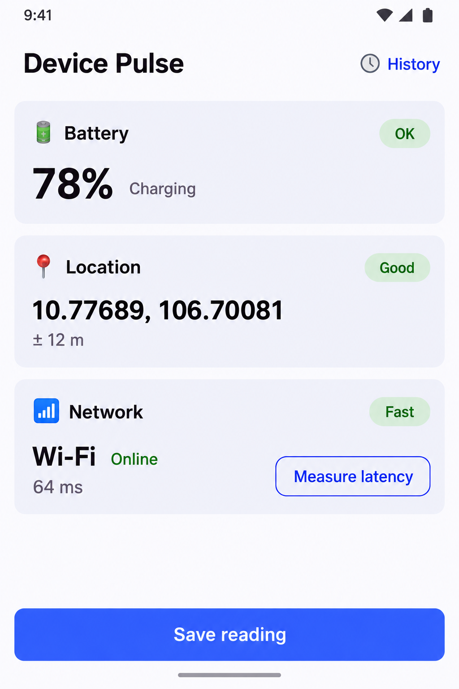
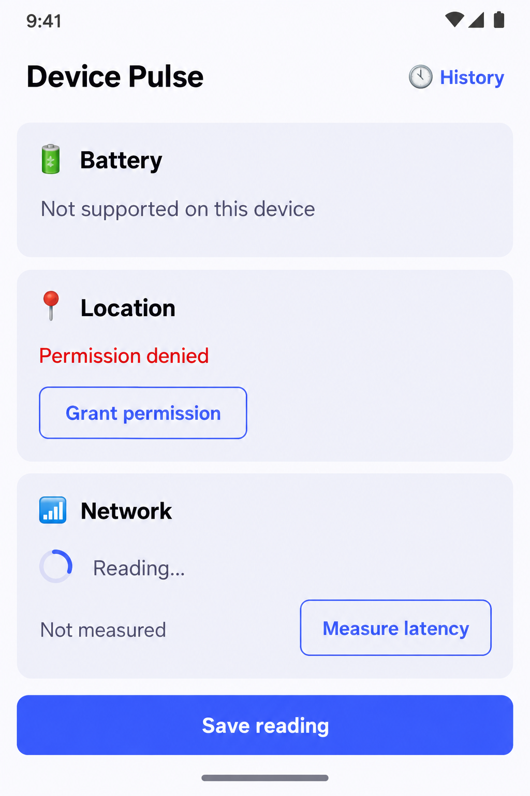
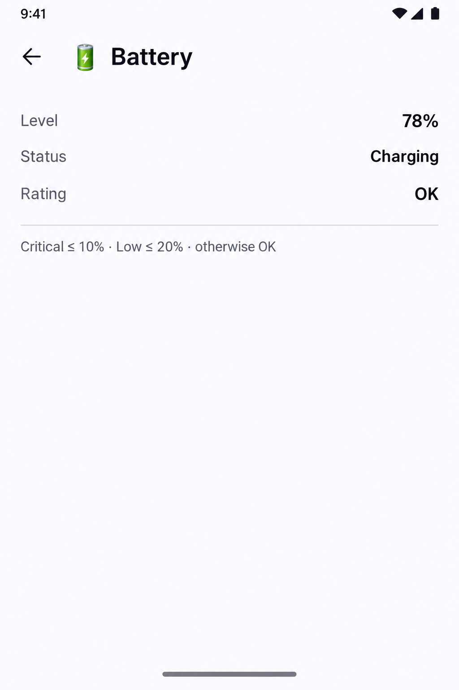
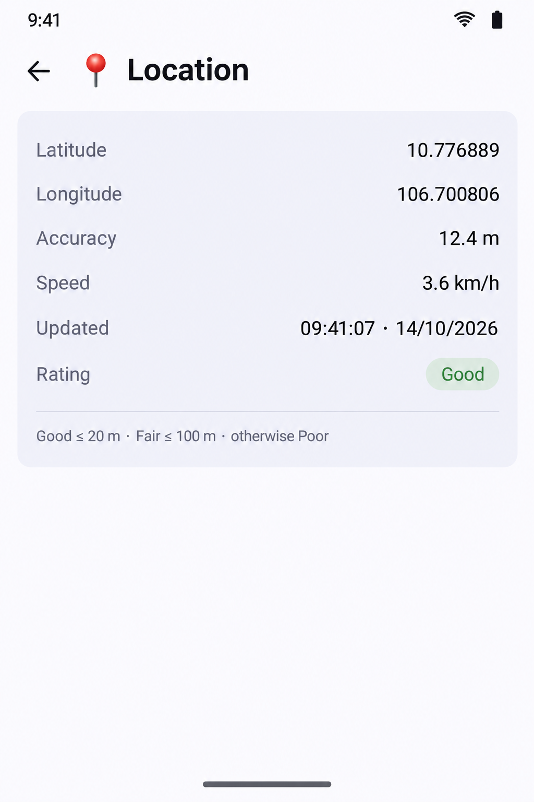
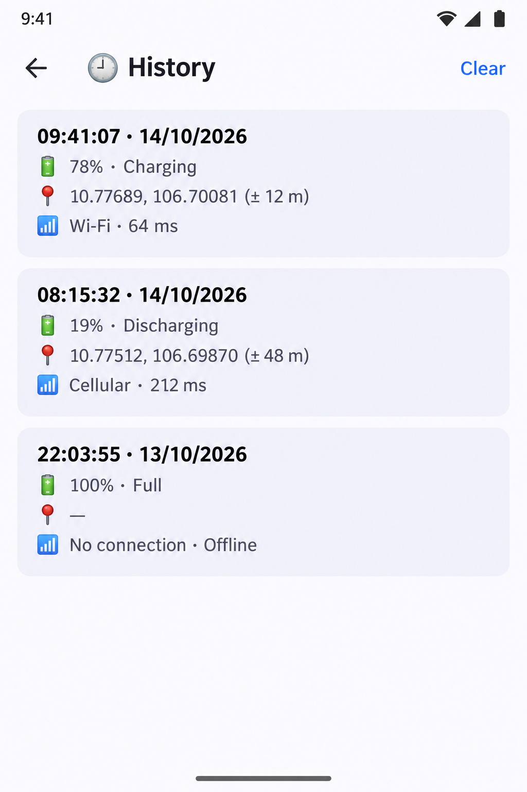

# Device Pulse — UI mockups

Mockup đơn giản cho dev nhìn và đối chiếu khi code UI Compose. Mỗi màn bám đúng code hiện tại trong
`composeApp/src/commonMain/kotlin/dev/devicepulse/ui/` và chuỗi tiếng Anh trong `composeResources/values/strings.xml`.

Ảnh sinh bằng Codex CLI (`codex exec`, tool image_generation), 1024x1536. File máy đọc: [`jobs.json`](jobs.json).

## Theo dõi

| ID | Màn | Code | Trạng thái |
|---|---|---|---|
| [01-dashboard](01-dashboard.png) | Dashboard (all sensors available) | `DashboardScreen.kt` | ✅ có ảnh |
| [02-dashboard-states](02-dashboard-states.png) | Dashboard (non-value states) | `Components.kt` | ✅ có ảnh |
| [03-detail-battery](03-detail-battery.png) | Detail — Battery | `DetailScreen.kt` | ✅ có ảnh |
| [04-detail-location](04-detail-location.png) | Detail — Location | `DetailScreen.kt` | ✅ có ảnh — lệch: các dòng nằm trong card và Rating là chip; code là dòng chữ thường, không card |
| [05-detail-network](05-detail-network.png) | Detail — Network | `DetailScreen.kt` | ✅ có ảnh — lệch: card và chip Rating giống 04; giá trị căn trái thay vì căn phải |
| [06-history](06-history.png) | History (with saved readings) | `HistoryScreen.kt` | ✅ có ảnh |
| [07-history-empty](07-history-empty.png) | History (empty) | `HistoryScreen.kt` | ✅ có ảnh |
| [08-dashboard-dark](08-dashboard-dark.png) | Dashboard (dark theme, warning grades) | `App.kt + DashboardScreen.kt` | ✅ có ảnh — lệch: "Discharging"/"Online" xuống dòng thay vì nằm cạnh giá trị |

Đổi `⬜ chưa có` → `✅ có ảnh` khi ảnh đã nằm ở `design/mockups/<id>.png`. Ảnh lệch code → ghi chú ở cột Trạng thái.

## Ảnh









## Cách sinh ảnh

1. Mở Codex (hoặc ChatGPT), dán từng prompt bên dưới, mỗi prompt một ảnh, khổ dọc 1024x1536.
2. Lưu ảnh vào `design/mockups/raw/`, tên bắt đầu bằng ID (vd `01-dashboard.png`).
3. Soát chữ trong ảnh — generator hay viết sai chữ; sai thì sinh lại.
4. Từ root repo chạy:

```bash
python ~/.claude/plugins/cache/tu-skills/core/0.13.4/skills/asset-prompt/scripts/collect_raw.py DevicePulse/design/mockups/jobs.json          # kiểm tra
python ~/.claude/plugins/cache/tu-skills/core/0.13.4/skills/asset-prompt/scripts/collect_raw.py DevicePulse/design/mockups/jobs.json --apply  # copy vào design/mockups/
```

Hoặc nói với Claude: "đã paste ảnh mockup vào raw".

## Style lock (chung cho cả bộ)

Style: simple, flat developer UI mockup of a single Android phone screen built with Material 3 (Compose Multiplatform). Clean and readable like a spec screenshot, not a marketing render. Flat front view of the screen only, no hand, no device frame, no perspective, no shadows outside the screen. Android status bar at top (time 9:41, Wi-Fi and battery icons), gesture bar at bottom. Palette: background #FBFBFF, cards #F1F2FA with 12 px rounded corners and no heavy shadow, primary/brand #3D5AFE for filled buttons and accents, body text #1B1B1F, secondary text #5F6170, good/green #2E7D32, warn/amber #B26A00, bad/red #BA1A1A. Grade chips are pill-shaped with the tone colour at 14% opacity as fill and the tone colour as text. Font: Roboto-like sans-serif, sizes as in Material 3 (top app bar title 22 sp semibold, card title 16 sp, big value 36 sp bold). 16 dp screen padding, 12 dp gap between cards. Emoji icons are used exactly as written (🔋 📍 📶 🕘).

## Prompts

### 01-dashboard — Dashboard (all sensors available)

```text
Subject: Device Pulse app — Dashboard (all sensors available). Matches ui/DashboardScreen.kt with every Reading Available.
Style: simple, flat developer UI mockup of a single Android phone screen built with Material 3 (Compose Multiplatform). Clean and readable like a spec screenshot, not a marketing render. Flat front view of the screen only, no hand, no device frame, no perspective, no shadows outside the screen. Android status bar at top (time 9:41, Wi-Fi and battery icons), gesture bar at bottom. Palette: background #FBFBFF, cards #F1F2FA with 12 px rounded corners and no heavy shadow, primary/brand #3D5AFE for filled buttons and accents, body text #1B1B1F, secondary text #5F6170, good/green #2E7D32, warn/amber #B26A00, bad/red #BA1A1A. Grade chips are pill-shaped with the tone colour at 14% opacity as fill and the tone colour as text. Font: Roboto-like sans-serif, sizes as in Material 3 (top app bar title 22 sp semibold, card title 16 sp, big value 36 sp bold). 16 dp screen padding, 12 dp gap between cards. Emoji icons are used exactly as written (🔋 📍 📶 🕘).
Composition (top to bottom, render every text exactly as quoted, nothing else):
- Top app bar: title "Device Pulse" left; text button "🕘 History" right in brand blue.
- Card 1: header row "🔋" + "Battery" and a green chip "OK" on the right; below, big bold "78%" and next to it smaller "Charging".
- Card 2: header row "📍" + "Location" and a green chip "Good"; below, "10.77689, 106.70081" (title size) and a grey line "± 12 m".
- Card 3: header row "📶" + "Network" and a green chip "Fast"; below, "Wi-Fi" (title size) with green "Online" next to it; then a row with "64 ms" on the left and an outlined button "Measure latency" on the right.
- Empty space, then a full-width filled brand-blue button "Save reading" pinned at the bottom with 16 dp margin.
Spec: portrait 1024x1536, opaque background, one screen only, all text crisp and legible.
Negative: watermark, logo, signature, extra text not listed, lorem ipsum, misspelled words, device frame, hands, 3D perspective, collage of several screens, gradients, illustrations, photos.
```

### 02-dashboard-states — Dashboard (non-value states)

```text
Subject: Device Pulse app — Dashboard (non-value states). Shows how ReadingContent in ui/Components.kt draws Loading, PermissionDenied and Unsupported.
Style: simple, flat developer UI mockup of a single Android phone screen built with Material 3 (Compose Multiplatform). Clean and readable like a spec screenshot, not a marketing render. Flat front view of the screen only, no hand, no device frame, no perspective, no shadows outside the screen. Android status bar at top (time 9:41, Wi-Fi and battery icons), gesture bar at bottom. Palette: background #FBFBFF, cards #F1F2FA with 12 px rounded corners and no heavy shadow, primary/brand #3D5AFE for filled buttons and accents, body text #1B1B1F, secondary text #5F6170, good/green #2E7D32, warn/amber #B26A00, bad/red #BA1A1A. Grade chips are pill-shaped with the tone colour at 14% opacity as fill and the tone colour as text. Font: Roboto-like sans-serif, sizes as in Material 3 (top app bar title 22 sp semibold, card title 16 sp, big value 36 sp bold). 16 dp screen padding, 12 dp gap between cards. Emoji icons are used exactly as written (🔋 📍 📶 🕘).
Composition (top to bottom, render every text exactly as quoted, nothing else):
- Top app bar: "Device Pulse" left, text button "🕘 History" right.
- Card 1: header "🔋" + "Battery", no chip; body grey text "Not supported on this device".
- Card 2: header "📍" + "Location", no chip; body red text "Permission denied" and under it an outlined button "Grant permission".
- Card 3: header "📶" + "Network", no chip; body a small circular spinner followed by "Reading…"; then a row with "Not measured" left and outlined button "Measure latency" right.
- Full-width filled brand-blue button "Save reading" at the bottom.
Spec: portrait 1024x1536, opaque background, one screen only, all text crisp and legible.
Negative: watermark, logo, signature, extra text not listed, lorem ipsum, misspelled words, device frame, hands, 3D perspective, collage of several screens, gradients, illustrations, photos.
```

### 03-detail-battery — Detail — Battery

```text
Subject: Device Pulse app — Detail — Battery. Matches ui/DetailScreen.kt for SensorKind.Battery.
Style: simple, flat developer UI mockup of a single Android phone screen built with Material 3 (Compose Multiplatform). Clean and readable like a spec screenshot, not a marketing render. Flat front view of the screen only, no hand, no device frame, no perspective, no shadows outside the screen. Android status bar at top (time 9:41, Wi-Fi and battery icons), gesture bar at bottom. Palette: background #FBFBFF, cards #F1F2FA with 12 px rounded corners and no heavy shadow, primary/brand #3D5AFE for filled buttons and accents, body text #1B1B1F, secondary text #5F6170, good/green #2E7D32, warn/amber #B26A00, bad/red #BA1A1A. Grade chips are pill-shaped with the tone colour at 14% opacity as fill and the tone colour as text. Font: Roboto-like sans-serif, sizes as in Material 3 (top app bar title 22 sp semibold, card title 16 sp, big value 36 sp bold). 16 dp screen padding, 12 dp gap between cards. Emoji icons are used exactly as written (🔋 📍 📶 🕘).
Composition (top to bottom, render every text exactly as quoted, nothing else):
- Top app bar: back arrow icon left, title "🔋  Battery".
- A list of label/value rows (label grey on the left, value medium weight right-aligned), no cards:
  "Level" — "78%"; "Status" — "Charging"; "Rating" — "OK".
- A thin horizontal divider, then small grey text "Critical ≤ 10% · Low ≤ 20% · otherwise OK".
- The rest of the screen empty.
Spec: portrait 1024x1536, opaque background, one screen only, all text crisp and legible.
Negative: watermark, logo, signature, extra text not listed, lorem ipsum, misspelled words, device frame, hands, 3D perspective, collage of several screens, gradients, illustrations, photos.
```

### 04-detail-location — Detail — Location

```text
Subject: Device Pulse app — Detail — Location. Matches ui/DetailScreen.kt for SensorKind.Location.
Style: simple, flat developer UI mockup of a single Android phone screen built with Material 3 (Compose Multiplatform). Clean and readable like a spec screenshot, not a marketing render. Flat front view of the screen only, no hand, no device frame, no perspective, no shadows outside the screen. Android status bar at top (time 9:41, Wi-Fi and battery icons), gesture bar at bottom. Palette: background #FBFBFF, cards #F1F2FA with 12 px rounded corners and no heavy shadow, primary/brand #3D5AFE for filled buttons and accents, body text #1B1B1F, secondary text #5F6170, good/green #2E7D32, warn/amber #B26A00, bad/red #BA1A1A. Grade chips are pill-shaped with the tone colour at 14% opacity as fill and the tone colour as text. Font: Roboto-like sans-serif, sizes as in Material 3 (top app bar title 22 sp semibold, card title 16 sp, big value 36 sp bold). 16 dp screen padding, 12 dp gap between cards. Emoji icons are used exactly as written (🔋 📍 📶 🕘).
Composition (top to bottom, render every text exactly as quoted, nothing else):
- Top app bar: back arrow icon left, title "📍  Location".
- Label/value rows (label grey left, value right):
  "Latitude" — "10.776889"; "Longitude" — "106.700806"; "Accuracy" — "12.4 m"; "Speed" — "3.6 km/h"; "Updated" — "09:41:07 · 14/10/2026"; "Rating" — "Good".
- Thin divider, then small grey text "Good ≤ 20 m · Fair ≤ 100 m · otherwise Poor".
- No map. The rest of the screen empty.
Spec: portrait 1024x1536, opaque background, one screen only, all text crisp and legible.
Negative: watermark, logo, signature, extra text not listed, lorem ipsum, misspelled words, device frame, hands, 3D perspective, collage of several screens, gradients, illustrations, photos.
```

### 05-detail-network — Detail — Network

```text
Subject: Device Pulse app — Detail — Network. Matches ui/DetailScreen.kt for SensorKind.Network.
Style: simple, flat developer UI mockup of a single Android phone screen built with Material 3 (Compose Multiplatform). Clean and readable like a spec screenshot, not a marketing render. Flat front view of the screen only, no hand, no device frame, no perspective, no shadows outside the screen. Android status bar at top (time 9:41, Wi-Fi and battery icons), gesture bar at bottom. Palette: background #FBFBFF, cards #F1F2FA with 12 px rounded corners and no heavy shadow, primary/brand #3D5AFE for filled buttons and accents, body text #1B1B1F, secondary text #5F6170, good/green #2E7D32, warn/amber #B26A00, bad/red #BA1A1A. Grade chips are pill-shaped with the tone colour at 14% opacity as fill and the tone colour as text. Font: Roboto-like sans-serif, sizes as in Material 3 (top app bar title 22 sp semibold, card title 16 sp, big value 36 sp bold). 16 dp screen padding, 12 dp gap between cards. Emoji icons are used exactly as written (🔋 📍 📶 🕘).
Composition (top to bottom, render every text exactly as quoted, nothing else):
- Top app bar: back arrow icon left, title "📶  Network".
- Label/value rows: "Type" — "Wi-Fi"; "Status" — "Online"; "Latency" — "64 ms"; "Rating" — "Fast".
- A filled brand-blue button "Measure latency" (wrap content width, left aligned).
- Thin divider, then small grey text "Fast < 100 ms · OK < 300 ms · otherwise Slow".
- The rest of the screen empty.
Spec: portrait 1024x1536, opaque background, one screen only, all text crisp and legible.
Negative: watermark, logo, signature, extra text not listed, lorem ipsum, misspelled words, device frame, hands, 3D perspective, collage of several screens, gradients, illustrations, photos.
```

### 06-history — History (with saved readings)

```text
Subject: Device Pulse app — History (with saved readings). Matches ui/HistoryScreen.kt with three snapshots.
Style: simple, flat developer UI mockup of a single Android phone screen built with Material 3 (Compose Multiplatform). Clean and readable like a spec screenshot, not a marketing render. Flat front view of the screen only, no hand, no device frame, no perspective, no shadows outside the screen. Android status bar at top (time 9:41, Wi-Fi and battery icons), gesture bar at bottom. Palette: background #FBFBFF, cards #F1F2FA with 12 px rounded corners and no heavy shadow, primary/brand #3D5AFE for filled buttons and accents, body text #1B1B1F, secondary text #5F6170, good/green #2E7D32, warn/amber #B26A00, bad/red #BA1A1A. Grade chips are pill-shaped with the tone colour at 14% opacity as fill and the tone colour as text. Font: Roboto-like sans-serif, sizes as in Material 3 (top app bar title 22 sp semibold, card title 16 sp, big value 36 sp bold). 16 dp screen padding, 12 dp gap between cards. Emoji icons are used exactly as written (🔋 📍 📶 🕘).
Composition (top to bottom, render every text exactly as quoted, nothing else):
- Top app bar: back arrow icon left, title "🕘 History", text button "Clear" right in brand blue.
- Three stacked cards, 10 dp apart, each with 4 lines (first line semibold):
  Card 1: "09:41:07 · 14/10/2026" / "🔋 78% · Charging" / "📍 10.77689, 106.70081 (± 12 m)" / "📶 Wi-Fi · 64 ms".
  Card 2: "08:15:32 · 14/10/2026" / "🔋 19% · Discharging" / "📍 10.77512, 106.69870 (± 48 m)" / "📶 Cellular · 212 ms".
  Card 3: "22:03:55 · 13/10/2026" / "🔋 100% · Full" / "📍 —" / "📶 No connection · Offline".
- The rest of the screen empty.
Spec: portrait 1024x1536, opaque background, one screen only, all text crisp and legible.
Negative: watermark, logo, signature, extra text not listed, lorem ipsum, misspelled words, device frame, hands, 3D perspective, collage of several screens, gradients, illustrations, photos.
```

### 07-history-empty — History (empty)

```text
Subject: Device Pulse app — History (empty). Matches the empty branch of ui/HistoryScreen.kt.
Style: simple, flat developer UI mockup of a single Android phone screen built with Material 3 (Compose Multiplatform). Clean and readable like a spec screenshot, not a marketing render. Flat front view of the screen only, no hand, no device frame, no perspective, no shadows outside the screen. Android status bar at top (time 9:41, Wi-Fi and battery icons), gesture bar at bottom. Palette: background #FBFBFF, cards #F1F2FA with 12 px rounded corners and no heavy shadow, primary/brand #3D5AFE for filled buttons and accents, body text #1B1B1F, secondary text #5F6170, good/green #2E7D32, warn/amber #B26A00, bad/red #BA1A1A. Grade chips are pill-shaped with the tone colour at 14% opacity as fill and the tone colour as text. Font: Roboto-like sans-serif, sizes as in Material 3 (top app bar title 22 sp semibold, card title 16 sp, big value 36 sp bold). 16 dp screen padding, 12 dp gap between cards. Emoji icons are used exactly as written (🔋 📍 📶 🕘).
Composition (top to bottom, render every text exactly as quoted, nothing else):
- Top app bar: back arrow icon left, title "🕘 History", no action button.
- Centered in the screen, grey centered text on two lines: "No saved readings yet. Tap \"Save reading\" on the dashboard."
- Nothing else.
Spec: portrait 1024x1536, opaque background, one screen only, all text crisp and legible.
Negative: watermark, logo, signature, extra text not listed, lorem ipsum, misspelled words, device frame, hands, 3D perspective, collage of several screens, gradients, illustrations, photos.
```

### 08-dashboard-dark — Dashboard (dark theme, warning grades)

```text
Subject: Device Pulse app — Dashboard (dark theme, warning grades). Same layout as 01 but isSystemInDarkTheme() = true and readings that trigger warn/bad chips.
Style: simple, flat developer UI mockup of a single Android phone screen built with Material 3 (Compose Multiplatform). Clean and readable like a spec screenshot, not a marketing render. Flat front view of the screen only, no hand, no device frame, no perspective, no shadows outside the screen. Android status bar at top (time 9:41, Wi-Fi and battery icons), gesture bar at bottom. Palette: background #FBFBFF, cards #F1F2FA with 12 px rounded corners and no heavy shadow, primary/brand #3D5AFE for filled buttons and accents, body text #1B1B1F, secondary text #5F6170, good/green #2E7D32, warn/amber #B26A00, bad/red #BA1A1A. Grade chips are pill-shaped with the tone colour at 14% opacity as fill and the tone colour as text. Font: Roboto-like sans-serif, sizes as in Material 3 (top app bar title 22 sp semibold, card title 16 sp, big value 36 sp bold). 16 dp screen padding, 12 dp gap between cards. Emoji icons are used exactly as written (🔋 📍 📶 🕘).
Composition (top to bottom, render every text exactly as quoted, nothing else):
- DARK THEME: background #121318, cards #1E1F25, text #E4E1E6, secondary text #C6C5D0, primary #8C9EFF.
- Top app bar: "Device Pulse" left, text button "🕘 History" right.
- Card 1: "🔋" + "Battery", red chip "Critical"; big "8%" and "Discharging".
- Card 2: "📍" + "Location", amber chip "Fair"; "10.77512, 106.69870" and grey "± 48 m".
- Card 3: "📶" + "Network", red chip "Slow"; "Cellular" with green "Online"; row "412 ms" left, outlined button "Measure latency" right.
- Full-width filled button "Save reading" in #8C9EFF with dark text at the bottom.
Spec: portrait 1024x1536, opaque background, one screen only, all text crisp and legible.
Negative: watermark, logo, signature, extra text not listed, lorem ipsum, misspelled words, device frame, hands, 3D perspective, collage of several screens, gradients, illustrations, photos.
```
