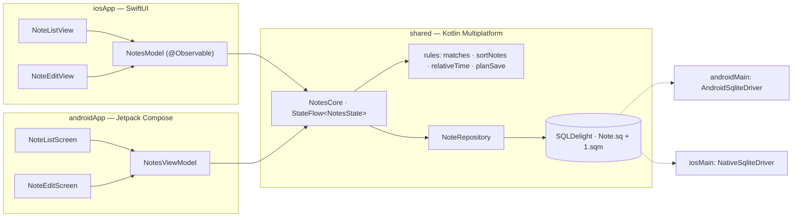

# Pocket Notes — app luyện tập 2

Ghi chú offline: thêm, sửa, xoá (có *Hoàn tác* 5 giây), ghim, tìm kiếm không cần gõ dấu. Tắt hẳn app mở lại vẫn còn.
Kiến trúc **KMP core + UI native** giống Tip Split: luật, state và database nằm trong `shared/`, Android vẽ bằng
**Jetpack Compose**, iOS vẽ bằng **SwiftUI**. Mới so với app 1: **SQLDelight** (CRUD, `Flow` tự phát khi bảng đổi,
migration), **Navigation** list → edit, **kotlinx-datetime**, và `platformModule` lần đầu có nội dung (driver SQLite).
Trang plan: [App 2 · Pocket Notes](https://tucarmd.github.io/kotlin-multi-platform/apps/02-pocket-notes/).



| | Android | iOS |
|---|---|---|
| UI | Compose, `LazyColumn`, `SwipeToDismissBox`, `Snackbar` có nút *Hoàn tác* | SwiftUI `List`, `.swipeActions`, `.searchable`, thanh *Hoàn tác* bằng `.safeAreaInset` |
| Điều hướng | Navigation Compose: `list` → `edit/{id}` | `NavigationStack(path:)` + `Route.edit(id)` |
| Đọc state từ core | `collectAsStateWithLifecycle()` | `for await` trên `StateFlow` (SKIE) |
| Scope của core | `viewModelScope` trong `NotesViewModel` | `MainScope()` trong `notesCore()`, `close()` khi bỏ model |
| Lưu khi rời màn sửa | `BackHandler` + nút Back | `.onDisappear` |
| Driver database | `AndroidSqliteDriver(context)` | `NativeSqliteDriver` + `-lsqlite3` |
| Chuỗi vi/en | `res/values*/strings.xml` | `*.lproj/Localizable.strings` (cùng key, sinh từ strings.xml) |

## Chạy

Cần: JDK 17+ (đã thử JDK 21), Android SDK 36, Xcode 16+ (đã thử 26.5), iOS 17+, XcodeGen.

```bash
cd PocketNotes
./gradlew :androidApp:installDebug                                  # Android: cài lên emulator / máy đang cắm
./gradlew :shared:testDebugUnitTest :shared:iosSimulatorArm64Test   # 29 test trên JVM (có SQLite thật) + 25 test trên iOS Simulator
cd iosApp && xcodegen generate && open iosApp.xcodeproj             # iOS: bấm Run
```

- Android: `applicationId` = `dev.pocketnotes`, activity mở app = `dev.pocketnotes.android.MainActivity`
  (`adb shell am start -n dev.pocketnotes/dev.pocketnotes.android.MainActivity`).
- iOS: bundle id = `dev.pocketnotes.ios`, sản phẩm `PocketNotes.app`.

iOS bằng dòng lệnh:

```bash
cd iosApp
xcodegen generate
xcodebuild -project iosApp.xcodeproj -scheme iosApp -destination 'generic/platform=iOS Simulator' \
  -derivedDataPath build/dd CODE_SIGNING_ALLOWED=NO build
xcrun simctl install booted build/dd/Build/Products/Debug-iphonesimulator/PocketNotes.app
xcrun simctl launch booted dev.pocketnotes.ios
```

`testDebugUnitTest` chạy cả `commonTest` lẫn `androidUnitTest`: `NoteRepositoryTest` dùng `JdbcSqliteDriver` in-memory
nên kiểm được `Note.sq`, `1.sqm` và migration mà không cần emulator. `iosSimulatorArm64Test` chỉ chạy `commonTest`
(driver JDBC không có trên iOS).

## Cấu trúc

```text
PocketNotes/
├── shared/src/
│   ├── commonMain/kotlin/dev/pocketnotes/
│   │   ├── model/Models.kt        Note, NoteDraft, SaveAction, RelativeTime, NoteItem, NotesState (sealed)  [B1]
│   │   ├── rules/Search.kt        fold, matches (bỏ dấu, có đ/Đ), sortNotes                              [B1]
│   │   ├── rules/Time.kt          relativeTime(from, now, timeZone)                                      [B1]
│   │   ├── rules/Save.kt          planSave: chèn / sửa / xoá / bỏ qua khi rời màn sửa                     [B1]
│   │   ├── core/NotesCore.kt      combine(database, query, recentlyDeleted, now) → StateFlow<NotesState> [B2]
│   │   ├── data/NoteRepository.kt interface + SqlNoteRepository (asFlow().mapToList())                   [B3]
│   │   └── di/Koin.kt             commonModule (repository) + expect platformModule + initKoin()          [B4]
│   ├── commonMain/sqldelight/dev/pocketnotes/db/
│   │   ├── Note.sq                bảng noteRecord (schema 2) + selectAll, insert, upsert, deleteById      [B3]
│   │   └── 1.sqm                  migration 1 → 2: ADD COLUMN pinned                                      [B3]
│   ├── androidMain/…/di/          createDriver(context) = AndroidSqliteDriver                             [B3 · B4]
│   ├── iosMain/…/di/              createDriver() = NativeSqliteDriver · notesCore() cho Swift            [B3 · B4]
│   ├── commonTest/                RulesTest, NotesCoreTest (Turbine), FakeNoteRepository                  [B7]
│   └── androidUnitTest/           NoteRepositoryTest (JdbcSqliteDriver in-memory, test migration)         [B7]
├── androidApp/src/main/
│   ├── kotlin/dev/pocketnotes/android/
│   │   ├── PocketNotesApp.kt      initKoin + appModule                                                     [B4]
│   │   ├── MainActivity.kt        setContent { App() }                                                     [B5]
│   │   └── ui/                    App (NavHost), NotesViewModel, NoteListScreen, NoteEditScreen, Labels   [B5]
│   └── res/values*/strings.xml    en + vi
├── iosApp/
│   ├── iosApp/                    iOSApp, NotesModel, Views/{RootView, NoteListView, NoteEditView, Labels}, *.lproj  [B6]
│   └── project.yml                XcodeGen (sửa file này rồi `xcodegen generate`, đừng sửa .pbxproj)
├── gradle/libs.versions.toml      cùng version với DevicePulse, bỏ Ktor / Kermit, thêm kotlinx-datetime
└── README.md
```

`[git]` là mọi thứ ở trên. `[máy]` (bị `.gitignore` bỏ qua): `local.properties` (đường dẫn Android SDK), `build/`,
`.gradle/`, `.kotlin/`, `iosApp/build/` (DerivedData khi build bằng dòng lệnh).

## Bản đồ function

| Hàm | File | Làm gì | Vì sao |
|---|---|---|---|
| `fold(text)` | [`rules/Search.kt#L34`](shared/src/commonMain/kotlin/dev/pocketnotes/rules/Search.kt#L34) | `"ĐẶT Hàng"` → `"dat hang"` | Bảng tay cho chữ có dấu + bỏ dấu tổ hợp U+0300..036F; `đ` phải map riêng |
| `matches(note, query)` | [`rules/Search.kt#L52`](shared/src/commonMain/kotlin/dev/pocketnotes/rules/Search.kt#L52) | Tìm trong tiêu đề / nội dung, không phân biệt hoa thường, bỏ dấu | Gõ "ghi chu" vẫn ra "Ghi chú" |
| `sortNotes(notes)` | [`rules/Search.kt#L65`](shared/src/commonMain/kotlin/dev/pocketnotes/rules/Search.kt#L65) | Ghim trước, rồi `updatedAt` giảm dần, rồi `id` | Thứ tự là luật, không để UI hay SQL tự sắp |
| `relativeTime(from, now, timeZone)` | [`rules/Time.kt#L28`](shared/src/commonMain/kotlin/dev/pocketnotes/rules/Time.kt#L28) | `Instant` → `JustNow / MinutesAgo / HoursAgo / Yesterday / DaysAgo / OnDate` | Truyền `now` vào để test được; "hôm qua" theo ngày lịch ở múi giờ của máy |
| `planSave(existing, draft, now)` | [`rules/Save.kt#L25`](shared/src/commonMain/kotlin/dev/pocketnotes/rules/Save.kt#L25) | Quyết định `Insert / Update / Delete / Skip` | Ghi chú rỗng không được tạo; mở ra rồi thoát không đẩy ghi chú lên đầu |
| `SqlNoteRepository.observeAll()` | [`data/NoteRepository.kt#L53`](shared/src/commonMain/kotlin/dev/pocketnotes/data/NoteRepository.kt#L53) | `Flow<List<Note>>` tự phát khi bảng đổi (`asFlow().mapToList()`) | UI không cần "reload" sau khi lưu |
| `SqlNoteRepository.insert(note)` | [`data/NoteRepository.kt#L70`](shared/src/commonMain/kotlin/dev/pocketnotes/data/NoteRepository.kt#L70) | `INSERT` + `last_insert_rowid()` trong một transaction | Lấy đúng id vừa tạo |
| `NotesCore.state` | [`core/NotesCore.kt#L71`](shared/src/commonMain/kotlin/dev/pocketnotes/core/NotesCore.kt#L71) | `combine(database, query, recentlyDeleted, now)` → lọc + sắp + thời gian | State luôn tính lại từ input, không lệch nhau; lỗi database thành `Failed` |
| `NotesCore.save(...)` | [`core/NotesCore.kt#L107`](shared/src/commonMain/kotlin/dev/pocketnotes/core/NotesCore.kt#L107) | Gọi `planSave` rồi làm đúng việc nó trả về | Cả hai UI chỉ gọi một hàm khi rời màn sửa |
| `NotesCore.delete(id)` | [`core/NotesCore.kt#L128`](shared/src/commonMain/kotlin/dev/pocketnotes/core/NotesCore.kt#L128) | Xoá, giữ bản sao 5 s cho `undoDelete()` | Hoàn tác không cần đọc lại database |
| `NotesCore.undoDelete()` | [`core/NotesCore.kt#L140`](shared/src/commonMain/kotlin/dev/pocketnotes/core/NotesCore.kt#L140) | `upsert` lại đúng id, ghim, thời gian cũ | Ghi chú quay lại đúng chỗ trong danh sách |
| `NotesCore.write(block)` | [`core/NotesCore.kt#L154`](shared/src/commonMain/kotlin/dev/pocketnotes/core/NotesCore.kt#L154) | Chạy các lệnh ghi lần lượt dưới một `Mutex` | Xoá rồi hoàn tác thật nhanh không bị đảo thứ tự |
| `createDriver(context)` | [`androidMain/…/PlatformModule.android.kt#L19`](shared/src/androidMain/kotlin/dev/pocketnotes/di/PlatformModule.android.kt#L19) | `AndroidSqliteDriver(NotesDb.Schema, context, "notes.db")` | Driver là thứ duy nhất khác giữa 2 máy; tự chạy migration |
| `createDriver()` | [`iosMain/…/PlatformModule.ios.kt#L20`](shared/src/iosMain/kotlin/dev/pocketnotes/di/PlatformModule.ios.kt#L20) | `NativeSqliteDriver(NotesDb.Schema, "notes.db")` | Như trên; cần `-lsqlite3` |
| `notesCore()` | [`iosMain/…/KoinIos.kt#L16`](shared/src/iosMain/kotlin/dev/pocketnotes/di/KoinIos.kt#L16) | Repository từ Koin + `MainScope()` mới | Swift không gọi được `get<T>()` (`reified`) và không tự tạo được `CoroutineScope` |
| `NotesViewModel` | [`ui/NotesViewModel.kt#L19`](androidApp/src/main/kotlin/dev/pocketnotes/android/ui/NotesViewModel.kt#L19) | Tạo `NotesCore(repository, viewModelScope)` | Core sống theo ViewModel, qua được xoay màn hình |
| `NoteListScreen(...)` | [`ui/NoteListScreen.kt#L86`](androidApp/src/main/kotlin/dev/pocketnotes/android/ui/NoteListScreen.kt#L86) | Tìm kiếm, danh sách, vuốt xoá, Snackbar *Hoàn tác* | Snackbar tắt khi core xoá `recentlyDeleted`, cùng lúc với iOS |
| `NoteEditRoute(...)` | [`ui/NoteEditScreen.kt#L45`](androidApp/src/main/kotlin/dev/pocketnotes/android/ui/NoteEditScreen.kt#L45) | Giữ bản nháp, lưu một lần khi bấm Back | Không lưu trong `onDispose` (chạy cả khi xoay màn hình) |
| `NotesModel.init` | [`NotesModel.swift#L19`](iosApp/iosApp/NotesModel.swift#L19) | `for await` StateFlow → `state` | `@Observable` để SwiftUI vẽ lại đúng chỗ |
| `NoteEditView.onDisappear` | [`Views/NoteEditView.swift#L64`](iosApp/iosApp/Views/NoteEditView.swift#L64) | Lưu khi rời màn sửa | Vuốt Back trên iOS không có callback riêng |

Tìm mọi chỗ dễ sai: `grep -rn "TRAP:\|PLATFORM:" shared androidApp/src iosApp/iosApp iosApp/project.yml`.

## Version và vì sao

Giống DevicePulse: Kotlin 2.4.20 · SKIE 0.10.15 · Koin 4.2.2 · AGP 8.13.2 · Compose BOM 2026.06.01 · Coroutines 1.11.0 ·
SQLDelight 2.4.1 · Navigation Compose 2.9.7 · Turbine 1.2.1. Lý do từng cái: mục *Version và vì sao* trong
[`DevicePulse/README.md`](../DevicePulse/README.md).

Mới ở app này:

| Thư viện | Version | Vì sao |
|---|---|---|
| `kotlinx-datetime` | 0.8.0 | Bản mới nhất trên Maven Central (kiểm tháng 10/2026), build với stdlib 2.1.20 nên chạy được trên Kotlin 2.4.20. Chỉ dùng `TimeZone` + `LocalDate` để biết "hôm qua". |
| `kotlin.time.Instant` / `Clock` | stdlib | Từ Kotlin 2.1.20 có sẵn trong stdlib; kotlinx-datetime 0.7+ dùng luôn kiểu này (bản `kotlinx.datetime.Instant` cũ đã deprecated). Giống DevicePulse, bật `optIn("kotlin.time.ExperimentalTime")`. |
| `sqldelight sqlite-driver` | 2.4.1 | `JdbcSqliteDriver` in-memory cho `NoteRepositoryTest` trong `androidUnitTest`. |
| `kotlinx-coroutines-test` | 1.11.0 | `runTest`, `backgroundScope`, `advanceTimeBy(5.seconds)` cho timer hoàn tác chạy trên thời gian ảo. |

## Mấy cái bẫy đã gặp khi làm

- **Undo xong ghi chú lại bị xoá lần nữa (chỉ thấy khi chạy thật).** `rememberSwipeToDismissBoxState()` dùng `rememberSaveable`,
  và `LazyColumn` giữ state đã lưu theo `key` kể cả khi dòng đã biến mất. Undo trả ghi chú về với **cùng id**, dòng đó khôi phục
  trạng thái "đã vuốt", `onDismiss` chạy lại và xoá tiếp. Sửa: tạo `SwipeToDismissBoxState` bằng `remember` thường
  (`NoteListScreen.kt`, hàm `SwipeToDelete`). Test của core không bắt được vì lỗi nằm ở UI.
- **Quên `-lsqlite3`.** `Shared` là framework tĩnh, nên `NativeSqliteDriver` cần `-lsqlite3` ở **cả hai** chỗ:
  `linkerOpts` trong `shared/build.gradle.kts` và `OTHER_LDFLAGS` trong `iosApp/project.yml`. Thiếu thì link lỗi `_sqlite3_*`.
- **Đổi schema mà không viết `.sqm`** thì người dùng bản cũ crash khi cập nhật (`no such column: pinned`). `Note.sq` là
  schema mới nhất cho máy cài mới; `1.sqm` nâng máy cũ từ 1 lên 2. Có test `migration from schema 1 keeps old notes and adds pinned`.
- **`Clock.System.now()` trong luật** làm test lúc đúng lúc sai. `relativeTime` nhận `now` và `timeZone` làm tham số;
  `NotesCore` giữ `now` là một input, UI gọi `refreshClock()` khi danh sách hiện lại.
- **"Hôm qua" là ngày lịch, không phải 24 giờ**, và phụ thuộc múi giờ: 23:00 → 01:00 hôm sau mới 2 tiếng nhưng là "hôm qua".
- **`đ` / `Đ` không phải "d + dấu".** Bỏ dấu kiểu Unicode (tách dấu rồi xoá) không đổi được `đ` thành `d`, phải map tay.
  Ngược lại chữ dán từ macOS hay ở dạng tách (`u` + U+0301), nên `fold` xoá thêm các dấu tổ hợp U+0300..U+036F.
- **Tên bảng `noteRecord`, không phải `note`.** SQLDelight sinh class public theo tên bảng; hai class `Note` trong
  framework iOS thì Swift thấy một cái thành `Note_`. Class query thì đặt theo tên **file** `.sq` (`NoteQueries`), không theo bảng.
- **Ghim không đổi `updatedAt`**, mở ghi chú rồi thoát không ghi gì: nếu không thì chỉ bấm ghim hay xem lại cũng đẩy ghi chú lên đầu.
- **Android: lưu ở `BackHandler`, không lưu ở `onDispose`.** `onDispose` chạy cả khi xoay màn hình, ghi chú mới bị tạo
  một lần mỗi lần xoay. Thêm cờ `left` để bấm Back hai lần không tạo hai ghi chú.
- **`LazyColumn` phải có `key = note.id`.** Không có key, trạng thái vuốt của dòng vừa xoá bị dòng trượt lên thế chỗ dùng lại.
- **Xoá rồi hoàn tác thật nhanh có thể tới SQLite sai thứ tự** vì mỗi lệnh ghi chạy trên `Dispatchers.Default`. Mọi lệnh
  ghi đi qua một `Mutex` trong `NotesCore.write`.
- **`xcodebuild -destination 'generic/platform=iOS Simulator'`** đòi cả x86_64, mà `shared/` chỉ có `iosSimulatorArm64()`:
  Gradle báo `Xcode Requested Architecture Not Configured in Gradle`. Đã thêm `EXCLUDED_ARCHS[sdk=iphonesimulator*]: x86_64`.
- **Swift không tạo được `CoroutineScope`** nên `notesCore()` (iosMain) tự tạo `MainScope()`; `NotesModel` gọi `close()` trong `deinit`.
