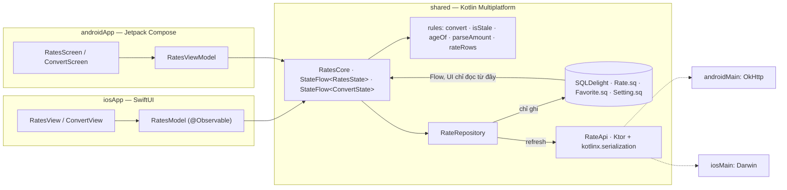

# Rate Watch — app luyện tập 3

Tỷ giá ngoại tệ theo đồng gốc, đổi tiền nhanh, đánh dấu yêu thích. **Offline-first**: UI chỉ đọc từ database SQLDelight,
mạng (Ktor) chỉ ghi vào database, nên mất mạng vẫn xem được tỷ giá lần trước kèm banner báo lỗi. Chạy **Android + iOS**,
kiến trúc **KMP core + UI native** giống Tip Split và Device Pulse. Trang plan:
[App 3 · Rate Watch](https://tucarmd.github.io/kotlin-multi-platform/apps/03-rate-watch/).



API: `GET https://open.er-api.com/v6/latest/{base}` (miễn phí, không cần key, nhà cung cấp cập nhật 1 lần / ngày).

| | Android | iOS |
|---|---|---|
| UI | Jetpack Compose, `NavigationBar` + `NavHost` 2 tab, `PullToRefreshBox`, `LazyColumn`, `AnimatedVisibility` | SwiftUI `TabView`, `List` + `Section`, `.refreshable`, `Menu`/`Picker` |
| Đọc state từ core | `collectAsStateWithLifecycle()` | `for await` trên `StateFlow` (SKIE) |
| Tự làm mới khi mở app | `LifecycleResumeEffect` → `start()` | `.onChange(of: scenePhase, initial: true)` → `start()` |
| HTTP engine | OkHttp (`PlatformModule.android.kt`) | Darwin / NSURLSession (`PlatformModule.ios.kt`) |
| SQLite driver | `AndroidSqliteDriver` | `NativeSqliteDriver` (+ `-lsqlite3`) |
| Quyền | `INTERNET` trong manifest | không cần |
| Chuỗi vi/en | `res/values*/strings.xml` | `*.lproj/Localizable.strings` (cùng key, sinh từ strings.xml) |

## Chạy

Cần: JDK 17+ (đã thử JDK 21), Android SDK 36, Xcode 16+ (đã thử 26.x), iOS 17+, XcodeGen.

```bash
cd RateWatch
./gradlew :shared:testDebugUnitTest :shared:iosSimulatorArm64Test   # 44 test trên JVM + iOS Simulator
./gradlew :androidApp:installDebug                                  # cài lên emulator / máy đang cắm
adb shell am start -n dev.ratewatch/dev.ratewatch.android.MainActivity
```

iOS:

```bash
cd iosApp
xcodegen generate                       # sinh iosApp.xcodeproj từ project.yml
xcodebuild -project iosApp.xcodeproj -scheme iosApp -destination 'generic/platform=iOS Simulator' \
  -derivedDataPath build/dd CODE_SIGNING_ALLOWED=NO build
xcrun simctl install booted build/dd/Build/Products/Debug-iphonesimulator/RateWatch.app
xcrun simctl launch booted dev.ratewatch.ios
```

Thử offline: Android bật chế độ máy bay. iOS Simulator dùng mạng của Mac, muốn thử offline phải **tắt Wi-Fi của Mac**.

## Cấu trúc

```text
RateWatch/
├── shared/src/
│   ├── commonMain/kotlin/dev/ratewatch/
│   │   ├── model/Models.kt        RateTable, RatesState, RefreshError, Freshness, Age, ConvertInput/Result/State   [B1]
│   │   ├── rules/Convert.kt       rateBetween, convert, convertInput                                         [B1]
│   │   ├── rules/Freshness.kt     isStale, freshnessOf, ageOf, MAX_AGE = 1 h                                 [B1]
│   │   ├── rules/Amount.kt        parseAmount (phần trăm đơn vị, Long), formatAmount, formatRate             [B1]
│   │   ├── rules/Rates.kt         rateRows (yêu thích lên đầu), currencyCodes                                [B1]
│   │   ├── core/RatesCore.kt      2 StateFlow, start / refresh / selectBase / toggleFavorite / convert       [B2]
│   │   ├── data/HttpClients.kt    createHttpClient(engine): ContentNegotiation + Json + HttpTimeout          [B3]
│   │   ├── data/RateApi.kt        RateApi.latest, @Serializable RateResponse, RateApiException                [B3]
│   │   ├── data/RateRepository.kt RateRepository + SqlRateRepository + resultOf                              [B3]
│   │   └── di/Koin.kt             commonModule + expect platformModule + initKoin()                          [B4]
│   ├── commonMain/sqldelight/dev/ratewatch/db/   Rate.sq · Favorite.sq · Setting.sq                          [B3]
│   ├── androidMain/…/di/          OkHttp + AndroidSqliteDriver                                               [B3 · B4]
│   ├── iosMain/…/di/              Darwin + NativeSqliteDriver + ratesCore() cho Swift                        [B3 · B4]
│   └── commonTest/                RulesTest, RateApiTest (MockEngine), RatesCoreTest (FakeRateRepository)    [B7]
├── androidApp/src/main/
│   ├── AndroidManifest.xml        quyền INTERNET
│   ├── kotlin/dev/ratewatch/android/
│   │   ├── RateWatchApp.kt        initKoin + appModule                                                       [B4]
│   │   ├── MainActivity.kt        setContent { App() }                                                       [B5]
│   │   └── ui/                    App (2 tab), RatesViewModel, RatesScreen, ConvertScreen, Components, Labels [B5]
│   └── res/values*/strings.xml    en + vi
├── iosApp/
│   ├── iosApp/                    iOSApp, RatesModel, Views/{RootView, RatesView, ConvertView, Labels}, *.lproj [B6]
│   └── project.yml                XcodeGen (sửa file này rồi `xcodegen generate`, đừng sửa .pbxproj)
├── gradle/libs.versions.toml      version của DevicePulse + serialization + content-negotiation
└── README.md
```

`[git]` là mọi file trên + `iosApp/iosApp.xcodeproj` (sinh bằng XcodeGen, commit giống Tip Split);
`[máy]` (không commit): `local.properties`, `build/`, `.gradle/`, `.kotlin/`, `iosApp/build/`, `xcuserdata/`.

## Bản đồ function

| Hàm | File | Làm gì | Vì sao |
|---|---|---|---|
| `convert(amount, from, to, table)` | [`rules/Convert.kt#L35`](shared/src/commonMain/kotlin/dev/ratewatch/rules/Convert.kt#L35) | `amount / rate[from] * rate[to]` | API chỉ trả tỷ giá theo 1 đồng gốc, đổi chéo phải qua nó |
| `convertInput(input, table)` | [`rules/Convert.kt#L49`](shared/src/commonMain/kotlin/dev/ratewatch/rules/Convert.kt#L49) | Input thô → `Waiting` / `Invalid` / `NoRates` / `Ready` | Một cửa vào cho màn Convert, chữ số đã format sẵn |
| `isStale(fetchedAt, now, maxAge)` | [`rules/Freshness.kt#L28`](shared/src/commonMain/kotlin/dev/ratewatch/rules/Freshness.kt#L28) | Cũ hơn `maxAge` (đúng 1 h vẫn còn mới) → `true` | Quyết định tự làm mới và tô đỏ "cập nhật lúc…" |
| `ageOf(fetchedAt, now)` | [`rules/Freshness.kt#L53`](shared/src/commonMain/kotlin/dev/ratewatch/rules/Freshness.kt#L53) | → `Age(2, Hours)` | UI chỉ chọn câu, không tự tính |
| `parseAmount(text)` | [`rules/Amount.kt#L32`](shared/src/commonMain/kotlin/dev/ratewatch/rules/Amount.kt#L32) | `"12,50"` / `"12.5"` → `1250` (Long) | Số người dùng gõ phải chính xác, không dùng `Double` |
| `formatRate(rate)` | [`rules/Amount.kt#L81`](shared/src/commonMain/kotlin/dev/ratewatch/rules/Amount.kt#L81) | ~6 chữ số có nghĩa | 26.312 và 0,000038 đều đọc được, 2 máy in giống nhau |
| `rateRows(table, favorites)` | [`rules/Rates.kt#L25`](shared/src/commonMain/kotlin/dev/ratewatch/rules/Rates.kt#L25) | Yêu thích lên đầu, A→Z, bỏ đồng gốc | Luật sắp xếp viết 1 lần, test 1 lần |
| `createHttpClient(engine)` | [`data/HttpClients.kt#L35`](shared/src/commonMain/kotlin/dev/ratewatch/data/HttpClients.kt#L35) | Json `ignoreUnknownKeys` + timeout trên engine bất kỳ | Test với MockEngine dùng đúng cấu hình app thật |
| `RateApi.latest(base)` | [`data/RateApi.kt#L39`](shared/src/commonMain/kotlin/dev/ratewatch/data/RateApi.kt#L39) | `GET /v6/latest/{base}` → `RateResponse`, lỗi → `RateApiException(reason)` | Chỉ biết HTTP + JSON, không biết database |
| `RateRepository.observe(base)` | [`data/RateRepository.kt#L62`](shared/src/commonMain/kotlin/dev/ratewatch/data/RateRepository.kt#L62) | `Flow<RateTable?>` từ database | UI luôn đọc từ một nguồn → offline tự nhiên |
| `RateRepository.refresh(base, now)` | [`data/RateRepository.kt#L77`](shared/src/commonMain/kotlin/dev/ratewatch/data/RateRepository.kt#L77) | API → DB trong 1 transaction, trả `Result<Unit>` | Không ném exception qua core; không lộ nửa bảng |
| `resultOf { }` | [`data/RateRepository.kt#L118`](shared/src/commonMain/kotlin/dev/ratewatch/data/RateRepository.kt#L118) | Như `runCatching` nhưng ném lại `CancellationException` | Rời màn không bị hiện thành lỗi mạng |
| `RatesCore.state` | [`core/RatesCore.kt#L66`](shared/src/commonMain/kotlin/dev/ratewatch/core/RatesCore.kt#L66) | `combine(base, DB, favorites, refreshing/error/now)` | Mọi thứ màn Rates cần trong một object |
| `RatesCore.start()` | [`core/RatesCore.kt#L88`](shared/src/commonMain/kotlin/dev/ratewatch/core/RatesCore.kt#L88) | Cập nhật "… trước", tự refresh nếu thiếu / cũ > 1 h | Mở app là thấy số mới mà không tải lại vô ích |
| `RatesCore.refresh()` | [`core/RatesCore.kt#L94`](shared/src/commonMain/kotlin/dev/ratewatch/core/RatesCore.kt#L94) | Bật `refreshing`, lỗi → `error`, **giữ** `table` | Mất mạng không làm trống màn hình |
| `httpClient()` | [`PlatformModule.android.kt#L26`](shared/src/androidMain/kotlin/dev/ratewatch/di/PlatformModule.android.kt#L26) · [`PlatformModule.ios.kt#L24`](shared/src/iosMain/kotlin/dev/ratewatch/di/PlatformModule.ios.kt#L24) | OkHttp / Darwin engine | Engine là thứ duy nhất khác giữa 2 máy |
| `ratesCore()` | [`iosMain/…/KoinIos.kt#L12`](shared/src/iosMain/kotlin/dev/ratewatch/di/KoinIos.kt#L12) | Lấy `RatesCore` từ Koin cho Swift | Swift không gọi được `get<T>()` (`reified`) |
| `App()` | [`ui/App.kt#L46`](androidApp/src/main/kotlin/dev/ratewatch/android/ui/App.kt#L46) | 2 tab, 1 ViewModel, `start()` mỗi lần resume | Hai tab chung một core |
| `RatesModel.init` | [`RatesModel.swift#L18`](iosApp/iosApp/RatesModel.swift#L18) | `for await` 2 StateFlow → `state`, `convert` | `@Observable` để SwiftUI vẽ lại đúng chỗ |
| `RatesModel.refreshAndWait()` | [`RatesModel.swift#L36`](iosApp/iosApp/RatesModel.swift#L36) | Gọi `refresh()` rồi chờ `refreshing` tắt | `.refreshable` giữ spinner theo thời gian của closure async |

Tìm mọi chỗ dễ sai: `grep -rn "TRAP:\|PLATFORM:" shared androidApp/src iosApp/iosApp`.

## Version và vì sao

Giống DevicePulse: Kotlin 2.4.20 · SKIE 0.10.15 · Koin 4.2.2 · AGP 8.13.2 · Compose BOM 2026.06.01 · Coroutines 1.11.0 ·
Ktor 3.5.1 · SQLDelight 2.4.1 · Navigation 2.9.7 · Turbine 1.2.1. Thêm mới ở app 3:

- **Plugin `org.jetbrains.kotlin.plugin.serialization` 2.4.20**: plugin compiler, version phải **trùng đúng** Kotlin.
  Sinh code (de)serialize cho `@Serializable RateResponse`.
- **`ktor-client-content-negotiation` + `ktor-serialization-kotlinx-json` 3.5.1**: cùng version Ktor core, để
  `response.body<RateResponse>()` tự đọc JSON.
- **`kotlinx-serialization-json` 1.11.0**: đúng bản mà `ktor-serialization-kotlinx-json` 3.5.1 phụ thuộc (đã xem pom
  trên Maven Central), nên Gradle chỉ có một bản. 1.12.0 lúc làm mới là RC.
- Bỏ Kermit (app này không cần log riêng).

## Mấy cái bẫy đã gặp khi làm

- **API báo lỗi bằng HTTP 200.** Base sai trả `200` với `{"result":"error","error-type":"unsupported-code"}`, không có
  `rates`. Chỉ kiểm status code thì lưu một bảng rỗng như thành công. Vì vậy mọi field trừ `result` có default, và
  `RateApi.latest` tự kiểm `result` + `rates`.
- **`Json { ignoreUnknownKeys = true }`.** API trả cả `provider`, `terms_of_use`, `time_next_update_utc`… mà model không
  khai báo. Thiếu dòng này là app crash ngay request đầu, và crash luôn ở bản cũ khi API thêm field mới.
- **`runCatching` nuốt `CancellationException`.** Coroutine bị huỷ sẽ chạy tiếp và hiện "Có lỗi xảy ra". Dùng `resultOf`
  ném lại `CancellationException`; `RateApi` cũng `catch` nó trước rồi ném lại.
- **Thời điểm "cập nhật" là giờ của máy mình, không phải `time_last_update_unix`.** Nhà cung cấp chỉ cập nhật 1 lần / ngày,
  dùng giờ của họ thì lần mở app nào cũng thấy "cũ > 1 h" và tải lại.
- **Đồng hồ máy bị lùi** (`fetchedAt` ở tương lai) thì coi là cũ, nếu không bảng bị "đóng băng" tới khi đồng hồ đuổi kịp.
- **Đổi đồng gốc: `flatMapLatest` còn giữ bảng của base cũ một nhịp.** Không lọc `table.base == base` thì màn hình hiện
  tỷ giá USD dưới tên VND trong chốc lát.
- **Ghi bảng trong một transaction.** `observe` query lại sau mỗi câu lệnh; không có transaction thì danh sách nháy rỗng
  (đã xoá, chưa chèn) hoặc hiện tỷ giá mới với giờ cũ.
- **Tỷ giá là `Double` (chỉ để hiển thị), số tiền người dùng gõ là `Long` phần trăm đơn vị** như Money ở app 1.
  `parseAmount` nhận cả `12,50` lẫn `12.5` lẫn `120.000`: dấu cuối cùng chỉ là dấu thập phân khi sau nó có 1–2 chữ số.
- **Test core không chạy trong `backgroundScope`.** `advanceUntilIdle()` chỉ chờ việc "foreground", nên coroutine của core
  trong `backgroundScope` không bao giờ chạy và mọi assert thấy state ban đầu. Dùng scope riêng trên `testScheduler`.
- **`xcodebuild -destination 'generic/platform=iOS Simulator'` đòi cả x86_64**, Gradle chỉ build `iosSimulatorArm64`
  → lỗi "Requested Architecture Not Configured". `project.yml` đặt `ARCHS[sdk=iphonesimulator*] = arm64`.
- **`-lsqlite3` hai chỗ**: `linkerOpts` trong `shared/build.gradle.kts` và `OTHER_LDFLAGS` trong `project.yml`
  (framework `Shared` là static).
- **Android thiếu quyền `INTERNET`** thì mọi request ném `SecurityException`, app chỉ hiện "Đang offline".
- **SwiftUI: `Button` trong hàng `List`** làm cả hàng thành vùng bấm; nút sao cần `.buttonStyle(.borderless)`.
- **iOS Simulator dùng mạng của Mac**: muốn thử offline phải tắt Wi-Fi của Mac.
