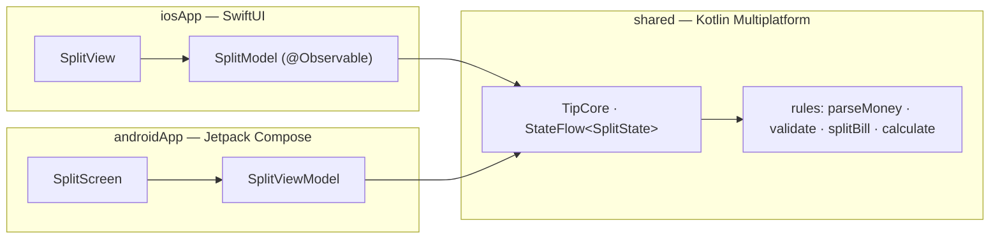

# Tip Split — app luyện tập 1

Chia tiền hóa đơn + tip cho cả nhóm, làm tròn lên 1.000đ mỗi người. Chạy **Android + iOS**, không mạng, không database, không quyền.
Kiến trúc **KMP core + UI native** giống Device Pulse: toàn bộ luật nằm trong `shared/`, Android vẽ bằng **Jetpack Compose**,
iOS vẽ bằng **SwiftUI**. Trang plan: [App 1 · Tip Split](https://tucarmd.github.io/kotlin-multi-platform/apps/01-tip-split/).



| | Android | iOS |
|---|---|---|
| UI | Jetpack Compose, `SegmentedButton`, `Switch` | SwiftUI `Form`, `Picker(.segmented)`, `Stepper`, `Toggle` |
| Đọc state từ core | `collectAsStateWithLifecycle()` | `for await` trên `StateFlow` (SKIE) |
| Gửi action | `SplitViewModel` chuyển tiếp sang `TipCore` | `SplitModel` chuyển tiếp sang `TipCore` |
| Bàn phím số | `KeyboardType.Number` | `.keyboardType(.numberPad)` |
| Chuỗi vi/en | `res/values*/strings.xml` | `*.lproj/Localizable.strings` (cùng key) |

## Chạy

Cần: JDK 17+ (đã thử JDK 21), Android SDK 36, Xcode 16+ (đã thử 26.5), iOS 17+.

```bash
cd TipSplit
./gradlew :androidApp:installDebug                                  # Android: cài lên emulator / máy đang cắm
./gradlew :shared:testDebugUnitTest :shared:iosSimulatorArm64Test   # 16 test core trên JVM + iOS Simulator
open iosApp/iosApp.xcodeproj                                        # iOS: bấm Run
```

iOS bằng dòng lệnh:

```bash
cd iosApp
xcodebuild -project iosApp.xcodeproj -scheme iosApp -destination 'platform=iOS Simulator,name=iPhone 17' \
  -derivedDataPath build/dd CODE_SIGNING_ALLOWED=NO build
xcrun simctl install booted build/dd/Build/Products/Debug-iphonesimulator/TipSplit.app
xcrun simctl launch booted dev.tipsplit.ios
```

Thử nhanh trên emulator Android không cần chạm: `adb shell input text 100000` khi ô tiền đang được chọn.

## Cấu trúc

```text
TipSplit/
├── shared/src/
│   ├── commonMain/kotlin/dev/tipsplit/
│   │   ├── model/Models.kt      SplitInput, Split, InputError, SplitResult (sealed), SplitState      [B1]
│   │   ├── rules/Money.kt       parseMoney, formatMoney                                             [B1]
│   │   ├── rules/Rules.kt       validate, splitBill, calculate, TIP_OPTIONS, ROUND_TO               [B1]
│   │   ├── core/TipCore.kt      giữ StateFlow<SplitState>, nhận action                              [B2]
│   │   └── di/Koin.kt           commonModule + expect platformModule + initKoin()                   [B4]
│   ├── androidMain/…/di/        platformModule rỗng (cố ý: app 1 không có gì riêng của Android)     [B3]
│   ├── iosMain/…/di/            platformModule rỗng + tipCore() cho Swift                           [B3 · B4]
│   └── commonTest/              MoneyTest, RulesTest, TipCoreTest                                   [B7]
├── androidApp/src/main/
│   ├── kotlin/dev/tipsplit/android/
│   │   ├── TipSplitApp.kt       initKoin + appModule                                                [B4]
│   │   ├── MainActivity.kt      setContent { SplitRoute() }                                         [B5]
│   │   └── ui/                  SplitViewModel, SplitScreen (Route + Screen + Preview), Labels      [B5]
│   └── res/values*/strings.xml  en + vi
├── iosApp/
│   ├── iosApp/                  iOSApp, SplitModel, Views/SplitView, Views/Labels, *.lproj           [B6]
│   └── project.yml              XcodeGen (sửa file này rồi `xcodegen generate`, đừng sửa .pbxproj)
├── gradle/libs.versions.toml    cùng version với DevicePulse, bỏ Ktor / SQLDelight / Navigation
└── README.md
```

**B3 không có ở app 1**: app không cần database, mạng hay API riêng của máy. Hai file `platformModule` để rỗng cho khuôn
đủ 7 bước; app 2 sẽ đặt driver SQLite vào đó.

## Bản đồ function

| Hàm | File | Làm gì | Vì sao |
|---|---|---|---|
| `parseMoney(text)` | [`rules/Money.kt#L18`](shared/src/commonMain/kotlin/dev/tipsplit/rules/Money.kt#L18) | `"120.000"` / `"120,000"` / `"120 000"` → `120000`; sai → `null` | Bàn phím mỗi máy, mỗi ngôn ngữ chèn dấu phân cách khác nhau |
| `formatMoney(amount)` | [`rules/Money.kt#L29`](shared/src/commonMain/kotlin/dev/tipsplit/rules/Money.kt#L29) | `1234567` → `"1.234.567"` | Hai nền tảng in ra giống hệt nhau |
| `validate(bill, people)` | [`rules/Rules.kt#L32`](shared/src/commonMain/kotlin/dev/tipsplit/rules/Rules.kt#L32) | Trả `InputError?` | UI chỉ việc hiện lỗi, không tự kiểm |
| `splitBill(bill, tip, people, roundTo)` | [`rules/Rules.kt#L51`](shared/src/commonMain/kotlin/dev/tipsplit/rules/Rules.kt#L50) | Tip làm tròn nửa lên; mỗi phần làm tròn **lên** | Làm tròn xuống thì cả nhóm trả thiếu |
| `calculate(input)` | [`rules/Rules.kt#L69`](shared/src/commonMain/kotlin/dev/tipsplit/rules/Rules.kt#L69) | Input thô → `Waiting` / `Invalid` / `Ready` | Một cửa vào duy nhất cho TipCore |
| `TipCore.update(change)` | [`core/TipCore.kt#L49`](shared/src/commonMain/kotlin/dev/tipsplit/core/TipCore.kt#L49) | Đổi input rồi tính lại cả state | Kết quả không bao giờ lệch với input |
| `tipCore()` | [`iosMain/…/KoinIos.kt#L12`](shared/src/iosMain/kotlin/dev/tipsplit/di/KoinIos.kt#L12) | Lấy `TipCore` từ Koin cho Swift | Swift không gọi được `get<T>()` (`reified`) |
| `SplitRoute()` | [`ui/SplitScreen.kt#L51`](androidApp/src/main/kotlin/dev/tipsplit/android/ui/SplitScreen.kt#L51) | Lấy ViewModel từ Koin, `collectAsStateWithLifecycle` | Tách khỏi `SplitScreen` để `@Preview` không cần Koin |
| `SplitModel.init` | [`SplitModel.swift#L18`](iosApp/iosApp/SplitModel.swift#L18) | `for await` StateFlow → `state` | `@Observable` để SwiftUI vẽ lại đúng chỗ |

Tìm mọi chỗ dễ sai: `grep -rn "TRAP:\|PLATFORM:" shared androidApp/src iosApp/iosApp`.

## Version và vì sao

Giống hệt DevicePulse: Kotlin 2.4.20 · SKIE 0.10.15 · Koin 4.2.2 · AGP 8.13.2 · Compose BOM 2026.06.01 · Coroutines 1.11.0.
Lý do chọn từng version: mục *Version và vì sao* trong [`DevicePulse/README.md`](../DevicePulse/README.md).

## Mấy cái bẫy đã gặp khi làm

- **Tiền dùng `Long`, không dùng `Double`.** Đơn vị là đồng. `0.1 + 0.2` trong `Double` ra `0.30000000000000004`.
- **Làm tròn lên từng phần, không làm tròn xuống.** 100.000đ chia 3 bằng `/` ra 33.333, cả nhóm trả thiếu 1đ.
- **Tip làm tròn nửa lên:** `(bill * tip + 50) / 100`. Chia thẳng thì 15% của 99.999 ra 14.999 thay vì 15.000.
- **SKIE đổi tên enum có chữ hoa liền nhau:** `NotANumber` sang Swift thành `.notAnumber`. Đã đổi thành `NotNumeric`.
- **Tên test có dấu phẩy chạy được trên JVM nhưng không biên dịch được trên iOS:** Kotlin/Native cấm `,` `.` `:` … trong tên
  hàm viết bằng backtick. Lỗi `Name contains illegal characters` chỉ hiện khi chạy `iosSimulatorArm64Test`.
- **Kotlin `Int` sang Swift là `Int32`, `List<Int>` là `[KotlinInt]`.** Đổi kiểu một lần trong `SplitModel`, không rải khắp view.
