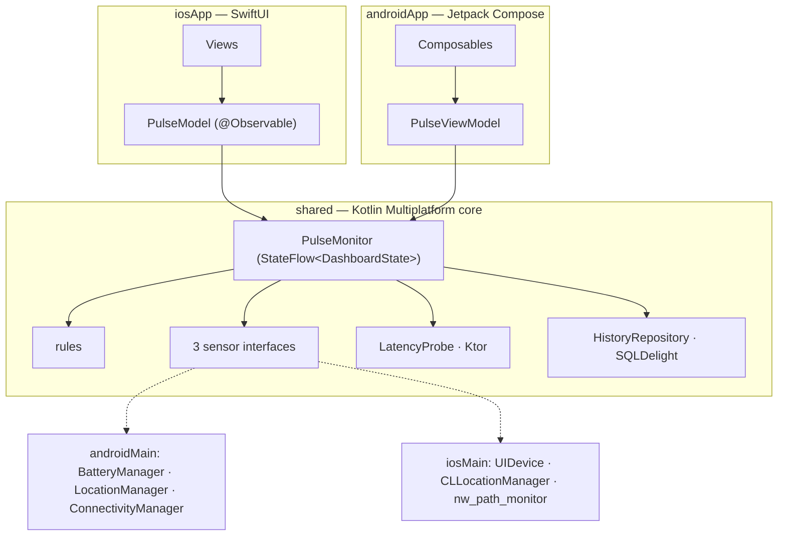

# Device Pulse — app mẫu Kotlin Multiplatform

App đo nhanh "sức khỏe" điện thoại: **pin, vị trí GPS, mạng + độ trễ HTTP**, chạy **Android + iOS**.
Kiến trúc **KMP core + UI native**: luật, cảm biến, đo độ trễ, lịch sử viết một lần bằng Kotlin trong `shared/`;
Android vẽ bằng **Jetpack Compose**, iOS vẽ bằng **SwiftUI**.



| | Android | iOS |
|---|---|---|
| UI | Jetpack Compose + Navigation Compose | SwiftUI + `NavigationStack` |
| Đọc state từ core | `collectAsStateWithLifecycle()` | `for await` trên `StateFlow` (nhờ SKIE) |
| Xin quyền vị trí | `rememberLauncherForActivityResult` | `CLLocationManager` trong Swift |
| Pin | `ACTION_BATTERY_CHANGED` | `UIDevice` (Simulator → "Không hỗ trợ") |
| Vị trí | `LocationManager` (không cần Play Services) | `CLLocationManager` + delegate Kotlin |
| Mạng | `ConnectivityManager` | `nw_path_monitor` |
| Lịch sử | SQLDelight (`AndroidSqliteDriver`) | SQLDelight (`NativeSqliteDriver`) |
| Chuỗi vi/en | `res/values*/strings.xml` | `*.lproj/Localizable.strings` (cùng key) |

Mockup UI (8 màn, prompt + bảng theo dõi): [design/mockups/README-MOCKUPS.md](design/mockups/README-MOCKUPS.md).

## Chạy

Cần: JDK 17+ (đã thử JDK 21), Android SDK 36, Xcode 16+ (đã thử 26.5), iOS 17+.

```bash
# Android: build + cài lên emulator/máy đang cắm
./gradlew :androidApp:installDebug

# Test core (rules, PulseMonitor, LatencyProbe) trên JVM và iOS Simulator
./gradlew :shared:testDebugUnitTest :shared:iosSimulatorArm64Test

# iOS: mở project rồi bấm Run (bước build tự gọi Gradle để dựng Shared.framework)
open iosApp/iosApp.xcodeproj
```

Chạy iOS bằng dòng lệnh, không mở Xcode:

```bash
cd iosApp
xcodebuild -project iosApp.xcodeproj -scheme iosApp -destination 'platform=iOS Simulator,name=iPhone 17' \
  -derivedDataPath build/dd CODE_SIGNING_ALLOWED=NO build
xcrun simctl install booted build/dd/Build/Products/Debug-iphonesimulator/DevicePulse.app
xcrun simctl launch booted dev.devicepulse.ios
```

Chạy iOS trên máy thật: chọn Team ở tab *Signing & Capabilities* của target `iosApp`.
Project Xcode sinh từ `iosApp/project.yml` bằng [XcodeGen](https://github.com/yonaskolb/XcodeGen). Muốn đổi thì sửa file yml
rồi chạy `xcodegen generate` trong `iosApp/`, đừng sửa `.pbxproj` bằng tay.

Thử cảm biến trên emulator Android: `adb emu geo fix 106.7009 10.7769` (vị trí), `adb emu power capacity 15` (pin).
iOS Simulator: `xcrun simctl location booted set 10.7769,106.7009`.

## Cấu trúc

Thư mục gốc. Cột phải cho biết file nằm trong git hay do máy tự sinh (đã gitignore, xoá đi sẽ được tạo lại):

```text
apps/DevicePulse/
├── shared/                       [git]  module KMP core (Kotlin chung + androidMain + iosMain)
├── androidApp/                   [git]  app Android, Jetpack Compose
├── iosApp/                       [git]  app iOS, SwiftUI + project.yml (XcodeGen)
├── design/mockups/               [git]  mockup UI 8 màn, chia android/ và ios/
├── gradle/
│   ├── libs.versions.toml        [git]  version catalog: mọi phiên bản thư viện + plugin
│   ├── gradle-daemon-jvm.properties [git] ghim Gradle chạy bằng JDK 21 (hết lỗi "Gradle JVM incompatible")
│   └── wrapper/                  [git]  gradle-wrapper.jar + .properties (Gradle 8.14.5)
├── build.gradle.kts              [git]  khai báo plugin cho cả project (apply false)
├── settings.gradle.kts           [git]  repo Maven + danh sách module :shared, :androidApp
├── gradle.properties             [git]  RAM cho Gradle/Kotlin daemon, bật cache, AndroidX
├── gradlew, gradlew.bat          [git]  chạy Gradle đúng phiên bản, không cần cài Gradle
├── .gitignore                    [git]
├── local.properties              [máy]  sdk.dir = đường dẫn Android SDK, Studio tự tạo
├── .idea/                        [máy]  setting Android Studio của riêng máy bạn
├── .gradle/                      [máy]  cache Gradle của project (+ config.properties: java.home)
├── .kotlin/                      [máy]  cache/session của Kotlin compiler daemon
└── build/                        [máy]  output build ở gốc; mỗi module còn có build/ riêng
```

Trong `src/` của từng module:

```text
shared/src/                     KMP core — không có UI
├── commonMain/kotlin/dev/devicepulse/
│   ├── model/    BatteryInfo, LocationFix, NetworkStatus, Reading (5 trạng thái, sealed class)
│   ├── rules/    batteryLevel · fixQuality · latencyGrade (hàm thuần, có test)
│   ├── sensor/   interface 3 cảm biến, LatencyProbe (Ktor)
│   ├── data/     HistoryRepository (SQLDelight)
│   ├── core/     PulseMonitor (gộp cảm biến thành StateFlow), PulseCore (cửa vào core)
│   └── di/       Koin: commonModule + expect platformModule, initKoin()
├── commonMain/sqldelight/      Snapshot.sq
├── androidMain/  3 cảm biến Android, platformModule
├── iosMain/      3 cảm biến iOS, platformModule, pulseCore() cho Swift
└── commonTest/   RulesTest, LatencyProbeTest, PulseMonitorTest (Turbine)

androidApp/src/main/            Jetpack Compose
├── kotlin/dev/devicepulse/android/
│   ├── DevicePulseApp.kt       initKoin { androidContext(); modules(appModule) }
│   └── ui/  App (NavHost), PulseViewModel, Dashboard, Detail, History, LocationPermission
└── res/values*/strings.xml     en + vi

iosApp/                         SwiftUI
├── iosApp/  iOSApp, PulseModel (@Observable), LocationPermission, Views/, *.lproj
└── project.yml                 XcodeGen
```

## Swift gọi Kotlin thế nào

Framework tên `Shared` (Swift viết `import Shared`). Plugin **[SKIE](https://skie.touchlab.co/)** sinh thêm lớp bọc để Swift dùng
Kotlin tự nhiên:

```swift
doInitKoin()                                        // Koin.kt: initKoin(), cùng module với Android
let monitor = pulseCore().startMonitor()            // hàm top-level Kotlin → hàm global Swift
for await state in monitor.state { ... }            // StateFlow → AsyncSequence
switch onEnum(of: state.battery) {                  // sealed class Reading → enum Swift, switch đủ nhánh
case .available(let a): a.value.levelPercent
case .loading, .permissionDenied, .unsupported, .error: ...
}
switch info.charging { case .charging: ... }        // enum Kotlin → enum Swift
```

## Version và vì sao

Kotlin 2.4.20 · SKIE 0.10.15 · Koin 4.2.2 · AGP 8.13.2 · Compose BOM 2026.06.01 (UI 1.11.4, Material3 1.4.0) · Ktor 3.5.1 ·
SQLDelight 2.4.1 · Navigation 2.9.7.

- **SKIE 0.10.15** là bản đầu tiên hỗ trợ Kotlin 2.4.20. Nâng Kotlin thì phải chờ SKIE ra bản tương ứng.
- **AGP 8.13** vẫn cho `shared/` dùng `androidTarget()` + `com.android.library`. Lên AGP 9 thì đổi `shared/` sang
  `com.android.kotlin.multiplatform.library`. App đã tách sẵn `:shared` + `:androidApp` nên việc đổi này nhỏ.
- **Compose BOM 2026.06.01** là bộ mới nhất build được với compileSdk 36. Bản mới hơn đòi compileSdk 37 + AGP 9.1.

## Mấy cái bẫy đã gặp khi làm

- **Swift mất kiểu generic của `sealed interface`**: Objective-C chỉ giữ generic cho *class*. `Reading` vì vậy là
  `sealed class Reading<out T : Any>`, để Swift thấy `Reading<BatteryInfo>` chứ không phải `any Reading`.
- **Swift không gọi được `get<T>()` của Koin** (hàm `reified`): `iosMain/di/KoinIos.kt` có `pulseCore()` lấy sẵn
  `PulseCore` cho Swift. Android thì dùng `koinViewModel()` như bình thường.
- **Tên hàm bắt đầu bằng `new`**: Objective-C dành tiền tố `new` cho hàm tạo object, nên `newMonitor()` sang Swift thành
  `doNewMonitor()`. Hàm được đặt tên `startMonitor()`.
- **Link lỗi `_sqlite3_*` trên iOS**: framework là static, nên `-lsqlite3` phải thêm vào `OTHER_LDFLAGS` của app, không chỉ ở
  `linkerOpts` của Gradle.
- **iOS chỉ hỏi quyền vị trí một lần**: sau "Don't Allow" chỉ đổi được trong Settings. `LocationPermission.canPrompt` cho UI
  biết khi nào nút "Cấp quyền" nên mở Settings thay vì hiện hộp thoại.
- **Chuỗi hai nền tảng phải giữ cùng key**: `Localizable.strings` của iOS sinh từ `strings.xml` của Android (`%1$s` → `%@`).
  Thêm chuỗi mới thì thêm ở cả hai chỗ.
