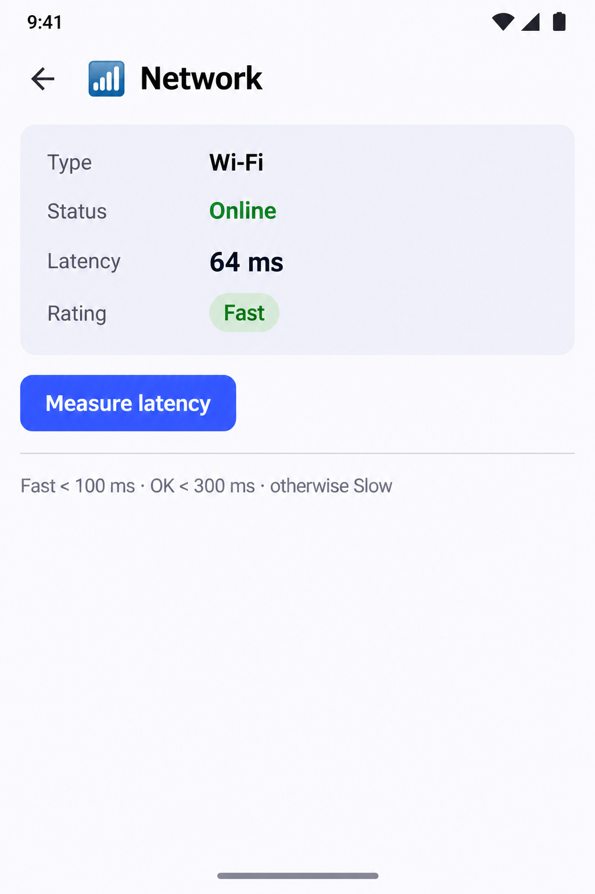
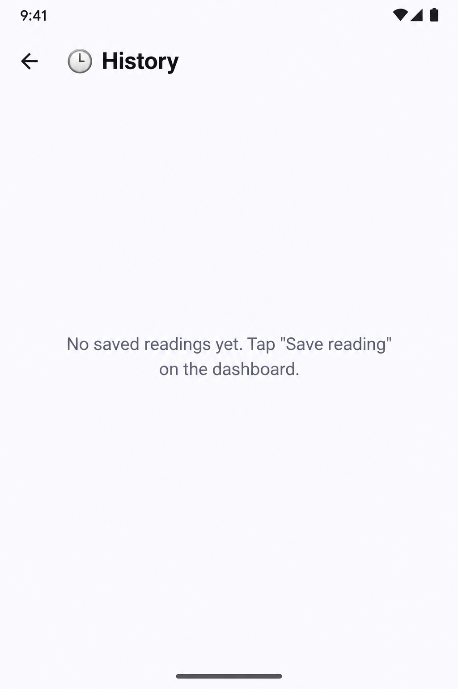
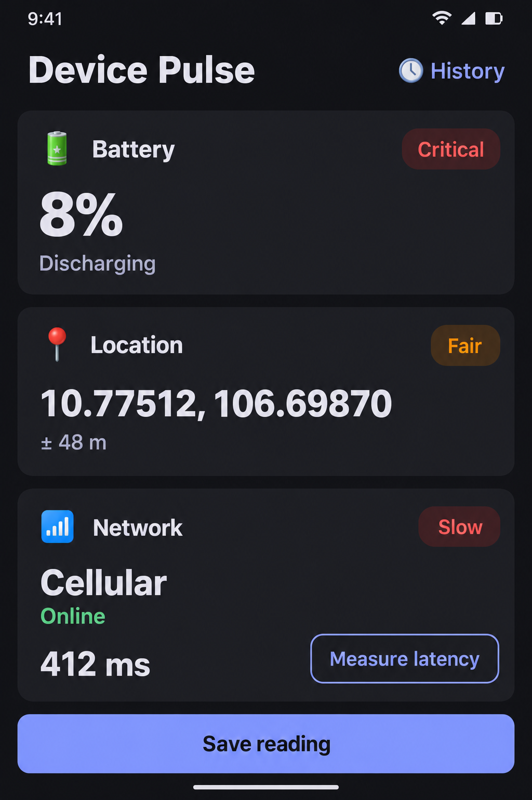
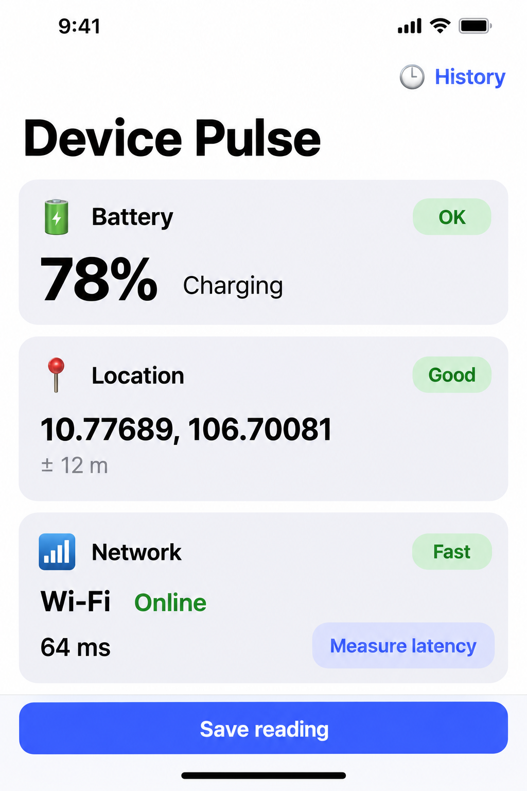
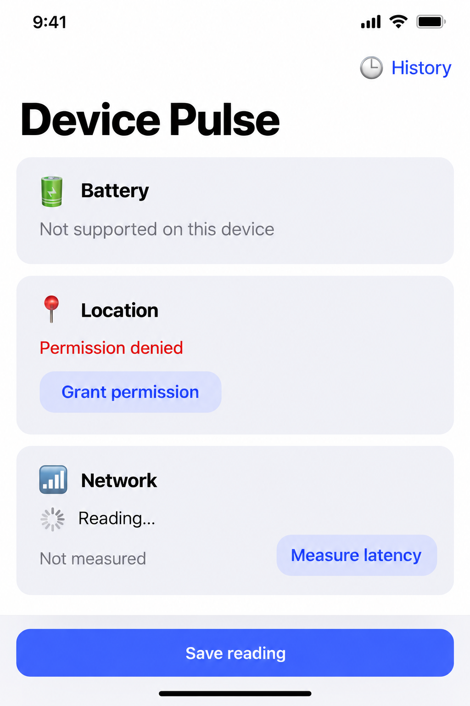
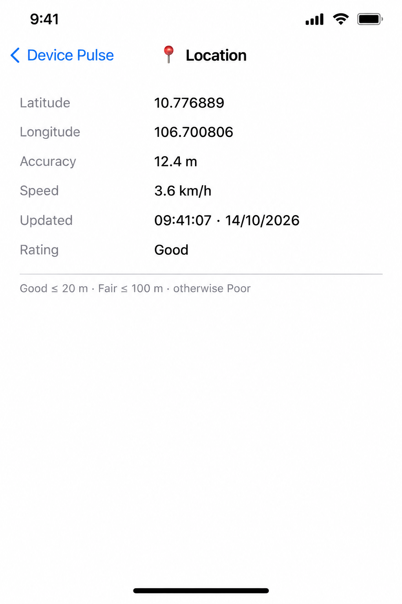

# Device Pulse — UI mockups

Mockup đơn giản cho dev nhìn và đối chiếu khi code UI. App giờ tách 3 module:

```
shared/      logic chung KMP (sensor, rules, PulseMonitor, SQLDelight) — không có UI
androidApp/  UI Jetpack Compose (Material 3)   → mockups/android/
iosApp/      UI SwiftUI                         → mockups/ios/
```

Hai bên cùng màn, cùng chuỗi (`androidApp/src/main/res/values/strings.xml` = `iosApp/iosApp/en.lproj/Localizable.strings`),
nhưng control native khác nhau nên mỗi nền tảng một bộ ảnh. Ảnh sinh bằng Codex CLI (`codex exec`, tool image_generation),
1024x1536. Prompt máy đọc: [`jobs.json`](jobs.json).

## Android (Compose)

| Ảnh | Màn | Code | Trạng thái |
|---|---|---|---|
| [01-dashboard](android/01-dashboard.png) | Dashboard (all sensors available) | [DashboardScreen.kt](../../androidApp/src/main/kotlin/dev/devicepulse/android/ui/DashboardScreen.kt) | ✅ |
| [02-dashboard-states](android/02-dashboard-states.png) | Dashboard (non-value states) | [Components.kt](../../androidApp/src/main/kotlin/dev/devicepulse/android/ui/Components.kt) | ✅ |
| [03-detail-battery](android/03-detail-battery.png) | Detail — Battery | [DetailScreen.kt](../../androidApp/src/main/kotlin/dev/devicepulse/android/ui/DetailScreen.kt) | ✅ |
| [04-detail-location](android/04-detail-location.png) | Detail — Location | [DetailScreen.kt](../../androidApp/src/main/kotlin/dev/devicepulse/android/ui/DetailScreen.kt) | ✅ — lệch: các dòng nằm trong card và Rating là chip; code là dòng chữ thường, không card |
| [05-detail-network](android/05-detail-network.png) | Detail — Network | [DetailScreen.kt](../../androidApp/src/main/kotlin/dev/devicepulse/android/ui/DetailScreen.kt) | ✅ — lệch: card và chip Rating giống 04; giá trị căn trái thay vì căn phải |
| [06-history](android/06-history.png) | History (with saved readings) | [HistoryScreen.kt](../../androidApp/src/main/kotlin/dev/devicepulse/android/ui/HistoryScreen.kt) | ✅ |
| [07-history-empty](android/07-history-empty.png) | History (empty) | [HistoryScreen.kt](../../androidApp/src/main/kotlin/dev/devicepulse/android/ui/HistoryScreen.kt) | ✅ |
| [08-dashboard-dark](android/08-dashboard-dark.png) | Dashboard (dark theme, warning grades) | [App.kt](../../androidApp/src/main/kotlin/dev/devicepulse/android/ui/App.kt) · [DashboardScreen.kt](../../androidApp/src/main/kotlin/dev/devicepulse/android/ui/DashboardScreen.kt) | ✅ — lệch: "Discharging"/"Online" xuống dòng thay vì nằm cạnh giá trị |







## iOS (SwiftUI)

| Ảnh | Màn | Code | Trạng thái |
|---|---|---|---|
| [01-dashboard](ios/01-dashboard.png) | Dashboard (all sensors available) | [DashboardView.swift](../../iosApp/iosApp/Views/DashboardView.swift) | ✅ |
| [02-dashboard-states](ios/02-dashboard-states.png) | Dashboard (non-value states) | [Components.swift](../../iosApp/iosApp/Views/Components.swift) | ✅ |
| [03-detail-battery](ios/03-detail-battery.png) | Detail — Battery | [DetailView.swift](../../iosApp/iosApp/Views/DetailView.swift) | ⬜ chưa có (Codex hết quota, sinh lại sau) |
| [04-detail-location](ios/04-detail-location.png) | Detail — Location | [DetailView.swift](../../iosApp/iosApp/Views/DetailView.swift) | ✅ — lệch: giá trị nằm cột giữa; code dùng Spacer nên giá trị căn phải |
| [05-detail-network](ios/05-detail-network.png) | Detail — Network | [DetailView.swift](../../iosApp/iosApp/Views/DetailView.swift) | ⬜ chưa có (Codex hết quota, sinh lại sau) |
| [06-history](ios/06-history.png) | History (with saved readings) | [HistoryView.swift](../../iosApp/iosApp/Views/HistoryView.swift) | ⬜ chưa có (Codex hết quota, sinh lại sau) |
| [07-history-empty](ios/07-history-empty.png) | History (empty) | [HistoryView.swift](../../iosApp/iosApp/Views/HistoryView.swift) | ⬜ chưa có (Codex hết quota, sinh lại sau) |
| [08-dashboard-dark](ios/08-dashboard-dark.png) | Dashboard (dark mode, warning grades) | [RootView.swift](../../iosApp/iosApp/Views/RootView.swift) · [DashboardView.swift](../../iosApp/iosApp/Views/DashboardView.swift) | ⬜ chưa có (Codex hết quota, sinh lại sau) |





Ảnh lệch code → ghi ở cột Trạng thái. Code đổi UI → sửa prompt/trạng thái trong [`gen_mockups.py`](gen_mockups.py), chạy lại nó, rồi sinh lại đúng màn đó.

## Sinh lại một ảnh

```bash
cd apps/DevicePulse/design/mockups
P=$(python3 -c "import json;print(next(j['prompt'] for j in json.load(open('jobs.json'))['jobs'] if j['id']=='ios-01-dashboard'))")
codex exec --skip-git-repo-check -s workspace-write "Use your image generation tool to generate exactly ONE image, portrait 1024x1536, \
  save it to ./raw/ios-01-dashboard.png. PROMPT: $P"
cd - && python3 ~/.claude/plugins/cache/tu-skills/core/0.13.4/skills/asset-prompt/scripts/collect_raw.py apps/DevicePulse/design/mockups/jobs.json --apply   # copy raw/ → android/ hoặc ios/
```

Soát chữ trong ảnh trước khi commit — generator hay viết sai chữ. Xong thì xoá ảnh trong `raw/`.

## Style lock

**Android:** Style: simple, flat developer UI mockup of a single Android phone screen built with Material 3 (Compose Multiplatform). Clean and readable like a spec screenshot, not a marketing render. Flat front view of the screen only, no hand, no device frame, no perspective, no shadows outside the screen. Android status bar at top (time 9:41, Wi-Fi and battery icons), gesture bar at bottom. Palette: background #FBFBFF, cards #F1F2FA with 12 px rounded corners and no heavy shadow, primary/brand #3D5AFE for filled buttons and accents, body text #1B1B1F, secondary text #5F6170, good/green #2E7D32, warn/amber #B26A00, bad/red #BA1A1A. Grade chips are pill-shaped with the tone colour at 14% opacity as fill and the tone colour as text. Font: Roboto-like sans-serif, sizes as in Material 3 (top app bar title 22 sp semibold, card title 16 sp, big value 36 sp bold). 16 dp screen padding, 12 dp gap between cards. Emoji icons are used exactly as written (🔋 📍 📶 🕘).

**iOS:** Style: simple, flat developer UI mockup of a single iPhone screen built with native SwiftUI (iOS 17/18 look). Clean and readable like a spec screenshot, not a marketing render. Flat front view of the screen only, no hand, no device frame, no perspective. iOS status bar at top (time 9:41 left, signal, Wi-Fi and battery icons right, space for the Dynamic Island), home indicator bar at bottom. Palette: system background #FFFFFF, grouped/secondary background #F2F2F7, app tint #3D5AFF for buttons and toolbar items, label text #000000, secondary label #8A8A8E, separators #C6C6C8, good/green #2E7D33, warn/amber #B36B00, bad/red #FF3B30. Grade chips are capsules with the tone colour at 14% opacity as fill and the tone colour as caption semibold text. Font: San Francisco (SF Pro). Sensor cards are #F2F2F7 rounded rectangles with 16 pt corner radius and 16 pt padding, no shadow, 12 pt apart, 16 pt screen margins. ".bordered" buttons are capsule-like rounded rectangles filled with the tint at about 15% opacity and tint-coloured text (no outline). ".borderedProminent" buttons are solid tint with white text. Emoji icons are used exactly as written (🔋 📍 📶 🕘).

## Prompts

### android-01-dashboard — Dashboard (all sensors available)

```text
Subject: Device Pulse app — Dashboard (all sensors available). Matches ui/DashboardScreen.kt with every Reading Available.
Style: simple, flat developer UI mockup of a single Android phone screen built with Material 3 (Compose Multiplatform). Clean and readable like a spec screenshot, not a marketing render. Flat front view of the screen only, no hand, no device frame, no perspective, no shadows outside the screen. Android status bar at top (time 9:41, Wi-Fi and battery icons), gesture bar at bottom. Palette: background #FBFBFF, cards #F1F2FA with 12 px rounded corners and no heavy shadow, primary/brand #3D5AFE for filled buttons and accents, body text #1B1B1F, secondary text #5F6170, good/green #2E7D32, warn/amber #B26A00, bad/red #BA1A1A. Grade chips are pill-shaped with the tone colour at 14% opacity as fill and the tone colour as text. Font: Roboto-like sans-serif, sizes as in Material 3 (top app bar title 22 sp semibold, card title 16 sp, big value 36 sp bold). 16 dp screen padding, 12 dp gap between cards. Emoji icons are used exactly as written (🔋 📍 📶 🕘).
Composition (top to bottom, render every text exactly as quoted, nothing else):
- Top app bar: title "Device Pulse" left; text button "🕘 History" right in brand blue.
- Card 1: header row "🔋" + "Battery" and a green chip "OK" on the right; below, big bold "78%" and next to it smaller "Charging".
- Card 2: header row "📍" + "Location" and a green chip "Good"; below, "10.77689, 106.70081" (title size) and a grey line "± 12 m".
- Card 3: header row "📶" + "Network" and a green chip "Fast"; below, "Wi-Fi" (title size) with green "Online" next to it; then a row with "64 ms" on the left and an outlined button "Measure latency" on the right.
- Empty space, then a full-width filled brand-blue button "Save reading" pinned at the bottom with 16 dp margin.
Spec: portrait 1024x1536, opaque background, one screen only, all text crisp and legible.
Negative: watermark, logo, signature, extra text not listed, lorem ipsum, misspelled words, device frame, hands, 3D perspective, collage of several screens, gradients, illustrations, photos.
```

### android-02-dashboard-states — Dashboard (non-value states)

```text
Subject: Device Pulse app — Dashboard (non-value states). Shows how ReadingContent in ui/Components.kt draws Loading, PermissionDenied and Unsupported.
Style: simple, flat developer UI mockup of a single Android phone screen built with Material 3 (Compose Multiplatform). Clean and readable like a spec screenshot, not a marketing render. Flat front view of the screen only, no hand, no device frame, no perspective, no shadows outside the screen. Android status bar at top (time 9:41, Wi-Fi and battery icons), gesture bar at bottom. Palette: background #FBFBFF, cards #F1F2FA with 12 px rounded corners and no heavy shadow, primary/brand #3D5AFE for filled buttons and accents, body text #1B1B1F, secondary text #5F6170, good/green #2E7D32, warn/amber #B26A00, bad/red #BA1A1A. Grade chips are pill-shaped with the tone colour at 14% opacity as fill and the tone colour as text. Font: Roboto-like sans-serif, sizes as in Material 3 (top app bar title 22 sp semibold, card title 16 sp, big value 36 sp bold). 16 dp screen padding, 12 dp gap between cards. Emoji icons are used exactly as written (🔋 📍 📶 🕘).
Composition (top to bottom, render every text exactly as quoted, nothing else):
- Top app bar: "Device Pulse" left, text button "🕘 History" right.
- Card 1: header "🔋" + "Battery", no chip; body grey text "Not supported on this device".
- Card 2: header "📍" + "Location", no chip; body red text "Permission denied" and under it an outlined button "Grant permission".
- Card 3: header "📶" + "Network", no chip; body a small circular spinner followed by "Reading…"; then a row with "Not measured" left and outlined button "Measure latency" right.
- Full-width filled brand-blue button "Save reading" at the bottom.
Spec: portrait 1024x1536, opaque background, one screen only, all text crisp and legible.
Negative: watermark, logo, signature, extra text not listed, lorem ipsum, misspelled words, device frame, hands, 3D perspective, collage of several screens, gradients, illustrations, photos.
```

### android-03-detail-battery — Detail — Battery

```text
Subject: Device Pulse app — Detail — Battery. Matches ui/DetailScreen.kt for SensorKind.Battery.
Style: simple, flat developer UI mockup of a single Android phone screen built with Material 3 (Compose Multiplatform). Clean and readable like a spec screenshot, not a marketing render. Flat front view of the screen only, no hand, no device frame, no perspective, no shadows outside the screen. Android status bar at top (time 9:41, Wi-Fi and battery icons), gesture bar at bottom. Palette: background #FBFBFF, cards #F1F2FA with 12 px rounded corners and no heavy shadow, primary/brand #3D5AFE for filled buttons and accents, body text #1B1B1F, secondary text #5F6170, good/green #2E7D32, warn/amber #B26A00, bad/red #BA1A1A. Grade chips are pill-shaped with the tone colour at 14% opacity as fill and the tone colour as text. Font: Roboto-like sans-serif, sizes as in Material 3 (top app bar title 22 sp semibold, card title 16 sp, big value 36 sp bold). 16 dp screen padding, 12 dp gap between cards. Emoji icons are used exactly as written (🔋 📍 📶 🕘).
Composition (top to bottom, render every text exactly as quoted, nothing else):
- Top app bar: back arrow icon left, title "🔋  Battery".
- A list of label/value rows (label grey on the left, value medium weight right-aligned), no cards:
  "Level" — "78%"; "Status" — "Charging"; "Rating" — "OK".
- A thin horizontal divider, then small grey text "Critical ≤ 10% · Low ≤ 20% · otherwise OK".
- The rest of the screen empty.
Spec: portrait 1024x1536, opaque background, one screen only, all text crisp and legible.
Negative: watermark, logo, signature, extra text not listed, lorem ipsum, misspelled words, device frame, hands, 3D perspective, collage of several screens, gradients, illustrations, photos.
```

### android-04-detail-location — Detail — Location

```text
Subject: Device Pulse app — Detail — Location. Matches ui/DetailScreen.kt for SensorKind.Location.
Style: simple, flat developer UI mockup of a single Android phone screen built with Material 3 (Compose Multiplatform). Clean and readable like a spec screenshot, not a marketing render. Flat front view of the screen only, no hand, no device frame, no perspective, no shadows outside the screen. Android status bar at top (time 9:41, Wi-Fi and battery icons), gesture bar at bottom. Palette: background #FBFBFF, cards #F1F2FA with 12 px rounded corners and no heavy shadow, primary/brand #3D5AFE for filled buttons and accents, body text #1B1B1F, secondary text #5F6170, good/green #2E7D32, warn/amber #B26A00, bad/red #BA1A1A. Grade chips are pill-shaped with the tone colour at 14% opacity as fill and the tone colour as text. Font: Roboto-like sans-serif, sizes as in Material 3 (top app bar title 22 sp semibold, card title 16 sp, big value 36 sp bold). 16 dp screen padding, 12 dp gap between cards. Emoji icons are used exactly as written (🔋 📍 📶 🕘).
Composition (top to bottom, render every text exactly as quoted, nothing else):
- Top app bar: back arrow icon left, title "📍  Location".
- Label/value rows (label grey left, value right):
  "Latitude" — "10.776889"; "Longitude" — "106.700806"; "Accuracy" — "12.4 m"; "Speed" — "3.6 km/h"; "Updated" — "09:41:07 · 14/10/2026"; "Rating" — "Good".
- Thin divider, then small grey text "Good ≤ 20 m · Fair ≤ 100 m · otherwise Poor".
- No map. The rest of the screen empty.
Spec: portrait 1024x1536, opaque background, one screen only, all text crisp and legible.
Negative: watermark, logo, signature, extra text not listed, lorem ipsum, misspelled words, device frame, hands, 3D perspective, collage of several screens, gradients, illustrations, photos.
```

### android-05-detail-network — Detail — Network

```text
Subject: Device Pulse app — Detail — Network. Matches ui/DetailScreen.kt for SensorKind.Network.
Style: simple, flat developer UI mockup of a single Android phone screen built with Material 3 (Compose Multiplatform). Clean and readable like a spec screenshot, not a marketing render. Flat front view of the screen only, no hand, no device frame, no perspective, no shadows outside the screen. Android status bar at top (time 9:41, Wi-Fi and battery icons), gesture bar at bottom. Palette: background #FBFBFF, cards #F1F2FA with 12 px rounded corners and no heavy shadow, primary/brand #3D5AFE for filled buttons and accents, body text #1B1B1F, secondary text #5F6170, good/green #2E7D32, warn/amber #B26A00, bad/red #BA1A1A. Grade chips are pill-shaped with the tone colour at 14% opacity as fill and the tone colour as text. Font: Roboto-like sans-serif, sizes as in Material 3 (top app bar title 22 sp semibold, card title 16 sp, big value 36 sp bold). 16 dp screen padding, 12 dp gap between cards. Emoji icons are used exactly as written (🔋 📍 📶 🕘).
Composition (top to bottom, render every text exactly as quoted, nothing else):
- Top app bar: back arrow icon left, title "📶  Network".
- Label/value rows: "Type" — "Wi-Fi"; "Status" — "Online"; "Latency" — "64 ms"; "Rating" — "Fast".
- A filled brand-blue button "Measure latency" (wrap content width, left aligned).
- Thin divider, then small grey text "Fast < 100 ms · OK < 300 ms · otherwise Slow".
- The rest of the screen empty.
Spec: portrait 1024x1536, opaque background, one screen only, all text crisp and legible.
Negative: watermark, logo, signature, extra text not listed, lorem ipsum, misspelled words, device frame, hands, 3D perspective, collage of several screens, gradients, illustrations, photos.
```

### android-06-history — History (with saved readings)

```text
Subject: Device Pulse app — History (with saved readings). Matches ui/HistoryScreen.kt with three snapshots.
Style: simple, flat developer UI mockup of a single Android phone screen built with Material 3 (Compose Multiplatform). Clean and readable like a spec screenshot, not a marketing render. Flat front view of the screen only, no hand, no device frame, no perspective, no shadows outside the screen. Android status bar at top (time 9:41, Wi-Fi and battery icons), gesture bar at bottom. Palette: background #FBFBFF, cards #F1F2FA with 12 px rounded corners and no heavy shadow, primary/brand #3D5AFE for filled buttons and accents, body text #1B1B1F, secondary text #5F6170, good/green #2E7D32, warn/amber #B26A00, bad/red #BA1A1A. Grade chips are pill-shaped with the tone colour at 14% opacity as fill and the tone colour as text. Font: Roboto-like sans-serif, sizes as in Material 3 (top app bar title 22 sp semibold, card title 16 sp, big value 36 sp bold). 16 dp screen padding, 12 dp gap between cards. Emoji icons are used exactly as written (🔋 📍 📶 🕘).
Composition (top to bottom, render every text exactly as quoted, nothing else):
- Top app bar: back arrow icon left, title "🕘 History", text button "Clear" right in brand blue.
- Three stacked cards, 10 dp apart, each with 4 lines (first line semibold):
  Card 1: "09:41:07 · 14/10/2026" / "🔋 78% · Charging" / "📍 10.77689, 106.70081 (± 12 m)" / "📶 Wi-Fi · 64 ms".
  Card 2: "08:15:32 · 14/10/2026" / "🔋 19% · Discharging" / "📍 10.77512, 106.69870 (± 48 m)" / "📶 Cellular · 212 ms".
  Card 3: "22:03:55 · 13/10/2026" / "🔋 100% · Full" / "📍 —" / "📶 No connection · Offline".
- The rest of the screen empty.
Spec: portrait 1024x1536, opaque background, one screen only, all text crisp and legible.
Negative: watermark, logo, signature, extra text not listed, lorem ipsum, misspelled words, device frame, hands, 3D perspective, collage of several screens, gradients, illustrations, photos.
```

### android-07-history-empty — History (empty)

```text
Subject: Device Pulse app — History (empty). Matches the empty branch of ui/HistoryScreen.kt.
Style: simple, flat developer UI mockup of a single Android phone screen built with Material 3 (Compose Multiplatform). Clean and readable like a spec screenshot, not a marketing render. Flat front view of the screen only, no hand, no device frame, no perspective, no shadows outside the screen. Android status bar at top (time 9:41, Wi-Fi and battery icons), gesture bar at bottom. Palette: background #FBFBFF, cards #F1F2FA with 12 px rounded corners and no heavy shadow, primary/brand #3D5AFE for filled buttons and accents, body text #1B1B1F, secondary text #5F6170, good/green #2E7D32, warn/amber #B26A00, bad/red #BA1A1A. Grade chips are pill-shaped with the tone colour at 14% opacity as fill and the tone colour as text. Font: Roboto-like sans-serif, sizes as in Material 3 (top app bar title 22 sp semibold, card title 16 sp, big value 36 sp bold). 16 dp screen padding, 12 dp gap between cards. Emoji icons are used exactly as written (🔋 📍 📶 🕘).
Composition (top to bottom, render every text exactly as quoted, nothing else):
- Top app bar: back arrow icon left, title "🕘 History", no action button.
- Centered in the screen, grey centered text on two lines: "No saved readings yet. Tap \"Save reading\" on the dashboard."
- Nothing else.
Spec: portrait 1024x1536, opaque background, one screen only, all text crisp and legible.
Negative: watermark, logo, signature, extra text not listed, lorem ipsum, misspelled words, device frame, hands, 3D perspective, collage of several screens, gradients, illustrations, photos.
```

### android-08-dashboard-dark — Dashboard (dark theme, warning grades)

```text
Subject: Device Pulse app — Dashboard (dark theme, warning grades). Same layout as 01 but isSystemInDarkTheme() = true and readings that trigger warn/bad chips.
Style: simple, flat developer UI mockup of a single Android phone screen built with Material 3 (Compose Multiplatform). Clean and readable like a spec screenshot, not a marketing render. Flat front view of the screen only, no hand, no device frame, no perspective, no shadows outside the screen. Android status bar at top (time 9:41, Wi-Fi and battery icons), gesture bar at bottom. Palette: background #FBFBFF, cards #F1F2FA with 12 px rounded corners and no heavy shadow, primary/brand #3D5AFE for filled buttons and accents, body text #1B1B1F, secondary text #5F6170, good/green #2E7D32, warn/amber #B26A00, bad/red #BA1A1A. Grade chips are pill-shaped with the tone colour at 14% opacity as fill and the tone colour as text. Font: Roboto-like sans-serif, sizes as in Material 3 (top app bar title 22 sp semibold, card title 16 sp, big value 36 sp bold). 16 dp screen padding, 12 dp gap between cards. Emoji icons are used exactly as written (🔋 📍 📶 🕘).
Composition (top to bottom, render every text exactly as quoted, nothing else):
- DARK THEME: background #121318, cards #1E1F25, text #E4E1E6, secondary text #C6C5D0, primary #8C9EFF.
- Top app bar: "Device Pulse" left, text button "🕘 History" right.
- Card 1: "🔋" + "Battery", red chip "Critical"; big "8%" and "Discharging".
- Card 2: "📍" + "Location", amber chip "Fair"; "10.77512, 106.69870" and grey "± 48 m".
- Card 3: "📶" + "Network", red chip "Slow"; "Cellular" with green "Online"; row "412 ms" left, outlined button "Measure latency" right.
- Full-width filled button "Save reading" in #8C9EFF with dark text at the bottom.
Spec: portrait 1024x1536, opaque background, one screen only, all text crisp and legible.
Negative: watermark, logo, signature, extra text not listed, lorem ipsum, misspelled words, device frame, hands, 3D perspective, collage of several screens, gradients, illustrations, photos.
```

### ios-01-dashboard — Dashboard (all sensors available)

```text
Subject: Device Pulse iOS app — Dashboard (all sensors available). Matches iosApp Views/DashboardView.swift with every Reading available.
Style: simple, flat developer UI mockup of a single iPhone screen built with native SwiftUI (iOS 17/18 look). Clean and readable like a spec screenshot, not a marketing render. Flat front view of the screen only, no hand, no device frame, no perspective. iOS status bar at top (time 9:41 left, signal, Wi-Fi and battery icons right, space for the Dynamic Island), home indicator bar at bottom. Palette: system background #FFFFFF, grouped/secondary background #F2F2F7, app tint #3D5AFF for buttons and toolbar items, label text #000000, secondary label #8A8A8E, separators #C6C6C8, good/green #2E7D33, warn/amber #B36B00, bad/red #FF3B30. Grade chips are capsules with the tone colour at 14% opacity as fill and the tone colour as caption semibold text. Font: San Francisco (SF Pro). Sensor cards are #F2F2F7 rounded rectangles with 16 pt corner radius and 16 pt padding, no shadow, 12 pt apart, 16 pt screen margins. ".bordered" buttons are capsule-like rounded rectangles filled with the tint at about 15% opacity and tint-coloured text (no outline). ".borderedProminent" buttons are solid tint with white text. Emoji icons are used exactly as written (🔋 📍 📶 🕘).
Composition (top to bottom, render every text exactly as quoted, nothing else):
- Navigation bar: a toolbar button "🕘 History" in tint colour at the top right; below it the LARGE left-aligned bold navigation title "Device Pulse".
- Card 1: header row "🔋" (title2 size) + "Battery" (headline) and a green capsule chip "OK" at the right; below, "78%" in largeTitle bold and on the same baseline "Charging" in body size.
- Card 2: header "📍" + "Location" and green chip "Good"; below, "10.77689, 106.70081" (title3) and on the next line secondary grey "± 12 m".
- Card 3: header "📶" + "Network" and green chip "Fast"; below, "Wi-Fi" (title3) and on the same baseline green "Online"; then a row with "64 ms" on the left and a .bordered button "Measure latency" on the right.
- Bottom: a translucent bar material strip pinned above the home indicator containing a full-width large .borderedProminent button "Save reading" (solid #3D5AFF, white text, rounded corners, 16 pt margin).
Spec: portrait 1024x1536, opaque background, one screen only, all text crisp and legible.
Negative: watermark, logo, signature, extra text not listed, lorem ipsum, misspelled words, device frame, hands, 3D perspective, collage of several screens, gradients, illustrations, photos, Android status bar, Material Design, floating action button.
```

### ios-02-dashboard-states — Dashboard (non-value states)

```text
Subject: Device Pulse iOS app — Dashboard (non-value states). Shows how ReadingView in Views/Components.swift draws loading, permission denied and unsupported.
Style: simple, flat developer UI mockup of a single iPhone screen built with native SwiftUI (iOS 17/18 look). Clean and readable like a spec screenshot, not a marketing render. Flat front view of the screen only, no hand, no device frame, no perspective. iOS status bar at top (time 9:41 left, signal, Wi-Fi and battery icons right, space for the Dynamic Island), home indicator bar at bottom. Palette: system background #FFFFFF, grouped/secondary background #F2F2F7, app tint #3D5AFF for buttons and toolbar items, label text #000000, secondary label #8A8A8E, separators #C6C6C8, good/green #2E7D33, warn/amber #B36B00, bad/red #FF3B30. Grade chips are capsules with the tone colour at 14% opacity as fill and the tone colour as caption semibold text. Font: San Francisco (SF Pro). Sensor cards are #F2F2F7 rounded rectangles with 16 pt corner radius and 16 pt padding, no shadow, 12 pt apart, 16 pt screen margins. ".bordered" buttons are capsule-like rounded rectangles filled with the tint at about 15% opacity and tint-coloured text (no outline). ".borderedProminent" buttons are solid tint with white text. Emoji icons are used exactly as written (🔋 📍 📶 🕘).
Composition (top to bottom, render every text exactly as quoted, nothing else):
- Navigation bar: a toolbar button "🕘 History" in tint colour at the top right; below it the LARGE left-aligned bold navigation title "Device Pulse".
- Card 1: header "🔋" + "Battery", no chip; body secondary grey text "Not supported on this device".
- Card 2: header "📍" + "Location", no chip; body red text "Permission denied" and under it a .bordered button "Grant permission".
- Card 3: header "📶" + "Network", no chip; body a small iOS activity spinner (grey spokes) followed by "Reading…" in subheadline; then a row with "Not measured" left and .bordered button "Measure latency" right.
- Bottom: a translucent bar material strip pinned above the home indicator containing a full-width large .borderedProminent button "Save reading" (solid #3D5AFF, white text, rounded corners, 16 pt margin).
Spec: portrait 1024x1536, opaque background, one screen only, all text crisp and legible.
Negative: watermark, logo, signature, extra text not listed, lorem ipsum, misspelled words, device frame, hands, 3D perspective, collage of several screens, gradients, illustrations, photos, Android status bar, Material Design, floating action button.
```

### ios-03-detail-battery — Detail — Battery

```text
Subject: Device Pulse iOS app — Detail — Battery. Matches Views/DetailView.swift for .battery.
Style: simple, flat developer UI mockup of a single iPhone screen built with native SwiftUI (iOS 17/18 look). Clean and readable like a spec screenshot, not a marketing render. Flat front view of the screen only, no hand, no device frame, no perspective. iOS status bar at top (time 9:41 left, signal, Wi-Fi and battery icons right, space for the Dynamic Island), home indicator bar at bottom. Palette: system background #FFFFFF, grouped/secondary background #F2F2F7, app tint #3D5AFF for buttons and toolbar items, label text #000000, secondary label #8A8A8E, separators #C6C6C8, good/green #2E7D33, warn/amber #B36B00, bad/red #FF3B30. Grade chips are capsules with the tone colour at 14% opacity as fill and the tone colour as caption semibold text. Font: San Francisco (SF Pro). Sensor cards are #F2F2F7 rounded rectangles with 16 pt corner radius and 16 pt padding, no shadow, 12 pt apart, 16 pt screen margins. ".bordered" buttons are capsule-like rounded rectangles filled with the tint at about 15% opacity and tint-coloured text (no outline). ".borderedProminent" buttons are solid tint with white text. Emoji icons are used exactly as written (🔋 📍 📶 🕘).
Composition (top to bottom, render every text exactly as quoted, nothing else):
- Navigation bar (inline, small centered title): back chevron "‹ Device Pulse" in tint at left; centered title "🔋  Battery".
- Plain white background, no cards. Label/value rows (label secondary grey on the left, value medium weight black on the right):
  "Level" — "78%"; "Status" — "Charging"; "Rating" — "OK" (plain text, not a chip).
- A thin divider, then footnote grey text "Critical ≤ 10% · Low ≤ 20% · otherwise OK".
- The rest of the screen empty.
Spec: portrait 1024x1536, opaque background, one screen only, all text crisp and legible.
Negative: watermark, logo, signature, extra text not listed, lorem ipsum, misspelled words, device frame, hands, 3D perspective, collage of several screens, gradients, illustrations, photos, Android status bar, Material Design, floating action button.
```

### ios-04-detail-location — Detail — Location

```text
Subject: Device Pulse iOS app — Detail — Location. Matches Views/DetailView.swift for .location.
Style: simple, flat developer UI mockup of a single iPhone screen built with native SwiftUI (iOS 17/18 look). Clean and readable like a spec screenshot, not a marketing render. Flat front view of the screen only, no hand, no device frame, no perspective. iOS status bar at top (time 9:41 left, signal, Wi-Fi and battery icons right, space for the Dynamic Island), home indicator bar at bottom. Palette: system background #FFFFFF, grouped/secondary background #F2F2F7, app tint #3D5AFF for buttons and toolbar items, label text #000000, secondary label #8A8A8E, separators #C6C6C8, good/green #2E7D33, warn/amber #B36B00, bad/red #FF3B30. Grade chips are capsules with the tone colour at 14% opacity as fill and the tone colour as caption semibold text. Font: San Francisco (SF Pro). Sensor cards are #F2F2F7 rounded rectangles with 16 pt corner radius and 16 pt padding, no shadow, 12 pt apart, 16 pt screen margins. ".bordered" buttons are capsule-like rounded rectangles filled with the tint at about 15% opacity and tint-coloured text (no outline). ".borderedProminent" buttons are solid tint with white text. Emoji icons are used exactly as written (🔋 📍 📶 🕘).
Composition (top to bottom, render every text exactly as quoted, nothing else):
- Navigation bar (inline, small centered title): back chevron "‹ Device Pulse" in tint at left; centered title "📍  Location".
- Plain white background, no cards. Label/value rows (label secondary grey left, value medium weight right):
  "Latitude" — "10.776889"; "Longitude" — "106.700806"; "Accuracy" — "12.4 m"; "Speed" — "3.6 km/h"; "Updated" — "09:41:07 · 14/10/2026"; "Rating" — "Good" (plain text, not a chip).
- Thin divider, then footnote grey text "Good ≤ 20 m · Fair ≤ 100 m · otherwise Poor".
- No map. The rest of the screen empty.
Spec: portrait 1024x1536, opaque background, one screen only, all text crisp and legible.
Negative: watermark, logo, signature, extra text not listed, lorem ipsum, misspelled words, device frame, hands, 3D perspective, collage of several screens, gradients, illustrations, photos, Android status bar, Material Design, floating action button.
```

### ios-05-detail-network — Detail — Network

```text
Subject: Device Pulse iOS app — Detail — Network. Matches Views/DetailView.swift for .network.
Style: simple, flat developer UI mockup of a single iPhone screen built with native SwiftUI (iOS 17/18 look). Clean and readable like a spec screenshot, not a marketing render. Flat front view of the screen only, no hand, no device frame, no perspective. iOS status bar at top (time 9:41 left, signal, Wi-Fi and battery icons right, space for the Dynamic Island), home indicator bar at bottom. Palette: system background #FFFFFF, grouped/secondary background #F2F2F7, app tint #3D5AFF for buttons and toolbar items, label text #000000, secondary label #8A8A8E, separators #C6C6C8, good/green #2E7D33, warn/amber #B36B00, bad/red #FF3B30. Grade chips are capsules with the tone colour at 14% opacity as fill and the tone colour as caption semibold text. Font: San Francisco (SF Pro). Sensor cards are #F2F2F7 rounded rectangles with 16 pt corner radius and 16 pt padding, no shadow, 12 pt apart, 16 pt screen margins. ".bordered" buttons are capsule-like rounded rectangles filled with the tint at about 15% opacity and tint-coloured text (no outline). ".borderedProminent" buttons are solid tint with white text. Emoji icons are used exactly as written (🔋 📍 📶 🕘).
Composition (top to bottom, render every text exactly as quoted, nothing else):
- Navigation bar (inline, small centered title): back chevron "‹ Device Pulse" in tint at left; centered title "📶  Network".
- Plain white background, no cards. Label/value rows (label grey left, value right): "Type" — "Wi-Fi"; "Status" — "Online"; "Latency" — "64 ms"; "Rating" — "Fast" (all plain black text).
- A .borderedProminent button "Measure latency" (solid #3D5AFF, white text, wrap-content width, left aligned).
- Thin divider, then footnote grey text "Fast < 100 ms · OK < 300 ms · otherwise Slow".
- The rest of the screen empty.
Spec: portrait 1024x1536, opaque background, one screen only, all text crisp and legible.
Negative: watermark, logo, signature, extra text not listed, lorem ipsum, misspelled words, device frame, hands, 3D perspective, collage of several screens, gradients, illustrations, photos, Android status bar, Material Design, floating action button.
```

### ios-06-history — History (with saved readings)

```text
Subject: Device Pulse iOS app — History (with saved readings). Matches Views/HistoryView.swift with three snapshots in a SwiftUI List.
Style: simple, flat developer UI mockup of a single iPhone screen built with native SwiftUI (iOS 17/18 look). Clean and readable like a spec screenshot, not a marketing render. Flat front view of the screen only, no hand, no device frame, no perspective. iOS status bar at top (time 9:41 left, signal, Wi-Fi and battery icons right, space for the Dynamic Island), home indicator bar at bottom. Palette: system background #FFFFFF, grouped/secondary background #F2F2F7, app tint #3D5AFF for buttons and toolbar items, label text #000000, secondary label #8A8A8E, separators #C6C6C8, good/green #2E7D33, warn/amber #B36B00, bad/red #FF3B30. Grade chips are capsules with the tone colour at 14% opacity as fill and the tone colour as caption semibold text. Font: San Francisco (SF Pro). Sensor cards are #F2F2F7 rounded rectangles with 16 pt corner radius and 16 pt padding, no shadow, 12 pt apart, 16 pt screen margins. ".bordered" buttons are capsule-like rounded rectangles filled with the tint at about 15% opacity and tint-coloured text (no outline). ".borderedProminent" buttons are solid tint with white text. Emoji icons are used exactly as written (🔋 📍 📶 🕘).
Composition (top to bottom, render every text exactly as quoted, nothing else):
- Navigation bar (inline): back chevron "‹ Device Pulse" in tint at left; centered title "🕘 History"; toolbar button "Clear" in tint at right.
- Background #F2F2F7. An inset-grouped List: one white rounded-corner group with three rows separated by thin inset separators. Each row has 4 lines (first line semibold):
  Row 1: "09:41:07 · 14/10/2026" / "🔋 78% · Charging" / "📍 10.77689, 106.70081 (± 12 m)" / "📶 Wi-Fi · 64 ms".
  Row 2: "08:15:32 · 14/10/2026" / "🔋 19% · Discharging" / "📍 10.77512, 106.69870 (± 48 m)" / "📶 Cellular · 212 ms".
  Row 3: "22:03:55 · 13/10/2026" / "🔋 100% · Full" / "📍 —" / "📶 No connection · Offline".
- The rest of the screen empty grey.
Spec: portrait 1024x1536, opaque background, one screen only, all text crisp and legible.
Negative: watermark, logo, signature, extra text not listed, lorem ipsum, misspelled words, device frame, hands, 3D perspective, collage of several screens, gradients, illustrations, photos, Android status bar, Material Design, floating action button.
```

### ios-07-history-empty — History (empty)

```text
Subject: Device Pulse iOS app — History (empty). Matches the empty branch of Views/HistoryView.swift.
Style: simple, flat developer UI mockup of a single iPhone screen built with native SwiftUI (iOS 17/18 look). Clean and readable like a spec screenshot, not a marketing render. Flat front view of the screen only, no hand, no device frame, no perspective. iOS status bar at top (time 9:41 left, signal, Wi-Fi and battery icons right, space for the Dynamic Island), home indicator bar at bottom. Palette: system background #FFFFFF, grouped/secondary background #F2F2F7, app tint #3D5AFF for buttons and toolbar items, label text #000000, secondary label #8A8A8E, separators #C6C6C8, good/green #2E7D33, warn/amber #B36B00, bad/red #FF3B30. Grade chips are capsules with the tone colour at 14% opacity as fill and the tone colour as caption semibold text. Font: San Francisco (SF Pro). Sensor cards are #F2F2F7 rounded rectangles with 16 pt corner radius and 16 pt padding, no shadow, 12 pt apart, 16 pt screen margins. ".bordered" buttons are capsule-like rounded rectangles filled with the tint at about 15% opacity and tint-coloured text (no outline). ".borderedProminent" buttons are solid tint with white text. Emoji icons are used exactly as written (🔋 📍 📶 🕘).
Composition (top to bottom, render every text exactly as quoted, nothing else):
- Navigation bar (inline): back chevron "‹ Device Pulse" in tint at left; centered title "🕘 History"; no right button.
- White background. Centered in the screen, secondary grey centered text on two lines: "No saved readings yet. Tap \"Save reading\" on the dashboard."
- Nothing else.
Spec: portrait 1024x1536, opaque background, one screen only, all text crisp and legible.
Negative: watermark, logo, signature, extra text not listed, lorem ipsum, misspelled words, device frame, hands, 3D perspective, collage of several screens, gradients, illustrations, photos, Android status bar, Material Design, floating action button.
```

### ios-08-dashboard-dark — Dashboard (dark mode, warning grades)

```text
Subject: Device Pulse iOS app — Dashboard (dark mode, warning grades). Same layout as ios-01 in iOS dark appearance, with readings that trigger warn/bad chips.
Style: simple, flat developer UI mockup of a single iPhone screen built with native SwiftUI (iOS 17/18 look). Clean and readable like a spec screenshot, not a marketing render. Flat front view of the screen only, no hand, no device frame, no perspective. iOS status bar at top (time 9:41 left, signal, Wi-Fi and battery icons right, space for the Dynamic Island), home indicator bar at bottom. Palette: system background #FFFFFF, grouped/secondary background #F2F2F7, app tint #3D5AFF for buttons and toolbar items, label text #000000, secondary label #8A8A8E, separators #C6C6C8, good/green #2E7D33, warn/amber #B36B00, bad/red #FF3B30. Grade chips are capsules with the tone colour at 14% opacity as fill and the tone colour as caption semibold text. Font: San Francisco (SF Pro). Sensor cards are #F2F2F7 rounded rectangles with 16 pt corner radius and 16 pt padding, no shadow, 12 pt apart, 16 pt screen margins. ".bordered" buttons are capsule-like rounded rectangles filled with the tint at about 15% opacity and tint-coloured text (no outline). ".borderedProminent" buttons are solid tint with white text. Emoji icons are used exactly as written (🔋 📍 📶 🕘).
Composition (top to bottom, render every text exactly as quoted, nothing else):
- DARK MODE: background #000000, cards #1C1C1E, label text #FFFFFF, secondary label #8D8D93, tint stays #3D5AFF, red #FF453A.
- Navigation bar: a toolbar button "🕘 History" in tint colour at the top right; below it the LARGE left-aligned bold navigation title "Device Pulse".
- Card 1: "🔋" + "Battery", red chip "Critical"; "8%" largeTitle bold and on the same baseline "Discharging".
- Card 2: "📍" + "Location", amber chip "Fair"; "10.77512, 106.69870" and below grey "± 48 m".
- Card 3: "📶" + "Network", red chip "Slow"; "Cellular" with green "Online" on the same baseline; row "412 ms" left, .bordered button "Measure latency" right.
- Bottom: dark translucent bar with a full-width .borderedProminent button "Save reading" (solid #3D5AFF, white text).
Spec: portrait 1024x1536, opaque background, one screen only, all text crisp and legible.
Negative: watermark, logo, signature, extra text not listed, lorem ipsum, misspelled words, device frame, hands, 3D perspective, collage of several screens, gradients, illustrations, photos, Android status bar, Material Design, floating action button.
```
