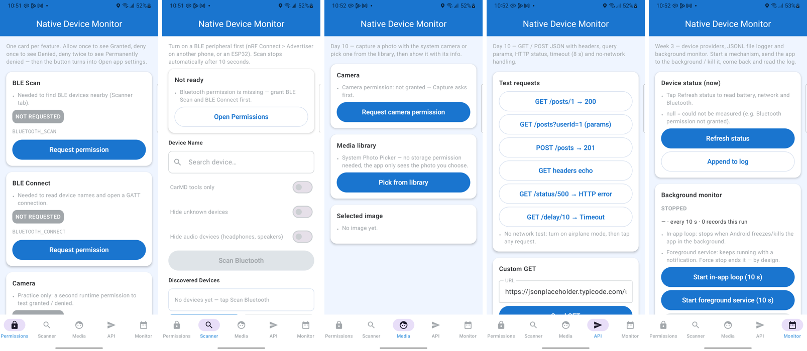
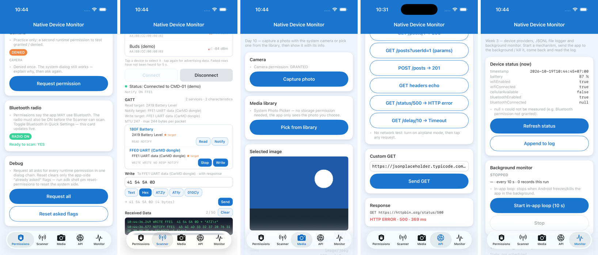

# Native Device Monitor — KMP

> Demo app of [kotlin-multi-platform](../../README.md) (moved here 2026-10-21 from the private repo `native-device-monitor-kmp`, history kept).
> The same app as `native-device-monitor/` in the private repo [tucarmd/native-mobile-learning](https://github.com/tucarmd/native-mobile-learning/tree/main/native-device-monitor), rebuilt as
> **KMP core + native UI**: the UI is written per platform (Android = Kotlin + Jetpack Compose, iOS = Swift + SwiftUI),
> everything shared (models, rules, ViewModels, interfaces, Ktor HTTP, logger, monitor loop) lives once in `shared/`.
> Docs: **https://tucarmd.github.io/kotlin-multi-platform/apps/native-device-monitor/**
> Plan + progress, one phase list P0–P16: [plan/README-KMP-MIGRATION.md](../../docs/apps/native-device-monitor/plan/README-KMP-MIGRATION.md) · why the native-UI switch (P8–P12): [spec](../../docs/apps/native-device-monitor/plan/README-KMP-NATIVE-UI-SPEC.md) · next: port into `shared/` (P13–P15): [spec](../../docs/apps/native-device-monitor/plan/README-KMP-SHARED-PORT-SPEC.md)
> Folder map (every folder and file explained): [README-KMP-FOLDER-MAP.md](../../docs/apps/native-device-monitor/README-KMP-FOLDER-MAP.md)
> How it works (diagrams, function flow, SDK map): [README-KMP-HOW-IT-WORKS.md](../../docs/apps/native-device-monitor/README-KMP-HOW-IT-WORKS.md)
> What the dev did per phase (UI vs shared KMP vs Android/iOS): [README-KMP-PHASES.md](../../docs/apps/native-device-monitor/README-KMP-PHASES.md)

Kotlin 2.4.10 · AGP 9.1 · Gradle 9.6 · Jetpack Compose BOM 2026.06.01 · SKIE 0.10.15 · iOS 17+.
IDs: Android `com.learn.ndmkmp`, iOS `com.learn.ndmkmp` — installs next to the old app.

## Modules

| Folder | Language | What |
|---|---|---|
| `shared/commonMain` | Kotlin (KMP) | `core/` models · rules · interfaces · Ktor · FileLogger · monitor loop — `presentation/` 5 ViewModels + `AppViewModel` + strings |
| `shared/androidMain` | Kotlin · Android SDK | permissions, BLE (BluetoothGatt), camera / photo picker, FGS + WorkManager |
| `shared/iosMain` | Kotlin/Native | iOS adapters (`IosPermissionController`, `IosBleClient`, `IosMediaPicker`, `iosDeviceMonitor`): state + rules |
| `androidApp/` | Kotlin · Jetpack Compose | `MainActivity` → `App(AppViewModel)` → 5 screens |
| `iosApp/` | Swift · SwiftUI | `AppModel` owns `AppViewModel` → `RootView` (TabView) → 5 views; `Observed<T>` turns a Kotlin `StateFlow` into `@Published`; `Platform/` = Apple SDK calls in Swift |

## Run

```bash
# Android (JDK 17+), from this folder (apps/NativeDeviceMonitor/)
./gradlew :androidApp:assembleDebug
adb install -r androidApp/build/outputs/apk/debug/androidApp-debug.apk
adb shell am start -n com.learn.ndmkmp/.MainActivity --es tab scanner
```

```bash
# iOS Simulator (or open iosApp/iosApp.xcodeproj in Xcode and press Run)
xcodebuild -project iosApp/iosApp.xcodeproj -scheme iosApp -destination 'platform=iOS Simulator,name=iPhone 17' -derivedDataPath iosApp/build/dd build
xcrun simctl install "iPhone 17" "iosApp/build/dd/Build/Products/Debug-iphonesimulator/Device Monitor KMP.app"
xcrun simctl launch "iPhone 17" com.learn.ndmkmp -tab scanner
```

`iosApp/iosApp/` is an Xcode synchronized folder: a new `.swift` file dropped in it is built, no `project.pbxproj` edit.

## Test

```bash
./gradlew :shared:allTests   # commonTest (rules + ViewModels + iOS adapters, 82 tests on iOS) on the Android host JVM + iOS simulator
```

## Status

| | Android | iOS |
|---|:-:|:-:|
| Shared core + ViewModels (P1, P8) | ✅ | ✅ |
| UI: 5 tabs, native per platform (P10, P11) | ✅ Jetpack Compose | ✅ SwiftUI |
| API tab (Ktor) | ✅ | ✅ |
| Permissions · BLE · Camera · Monitor on the real SDK | ✅ (P3 P4 P5 P7) | ✅ P12 in Swift — simulator checked, real iPhone pending |

| Android — Jetpack Compose (Samsung A32) | iOS — SwiftUI (iPhone 17 Simulator) |
|---|---|
|  |  |
