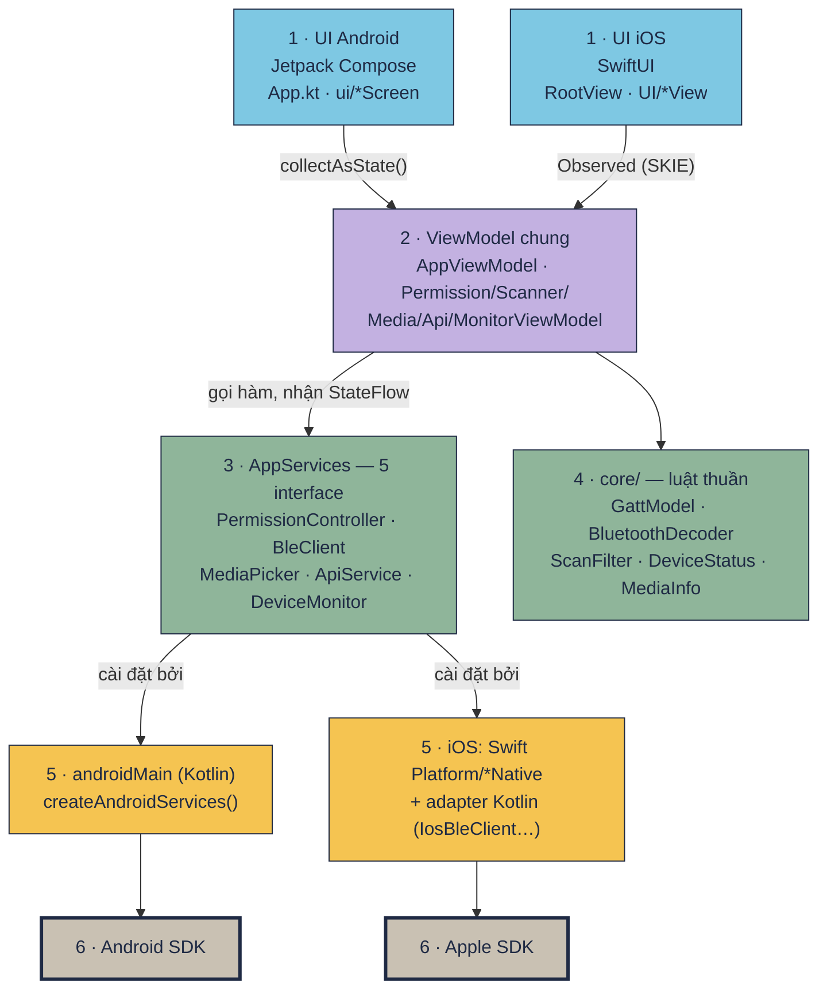
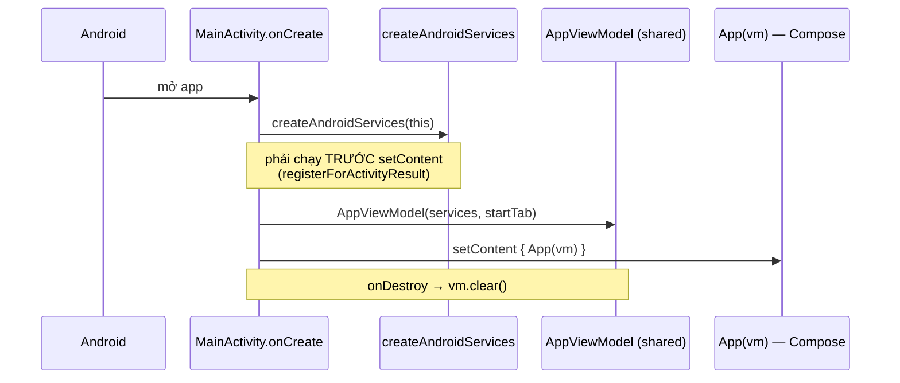
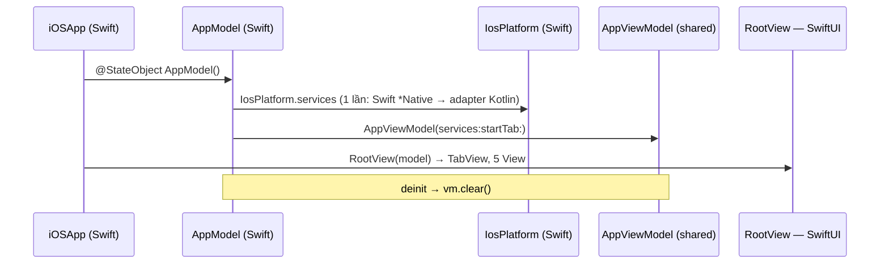
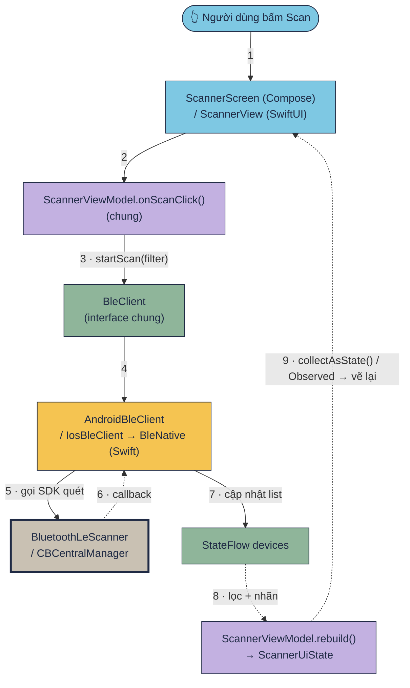
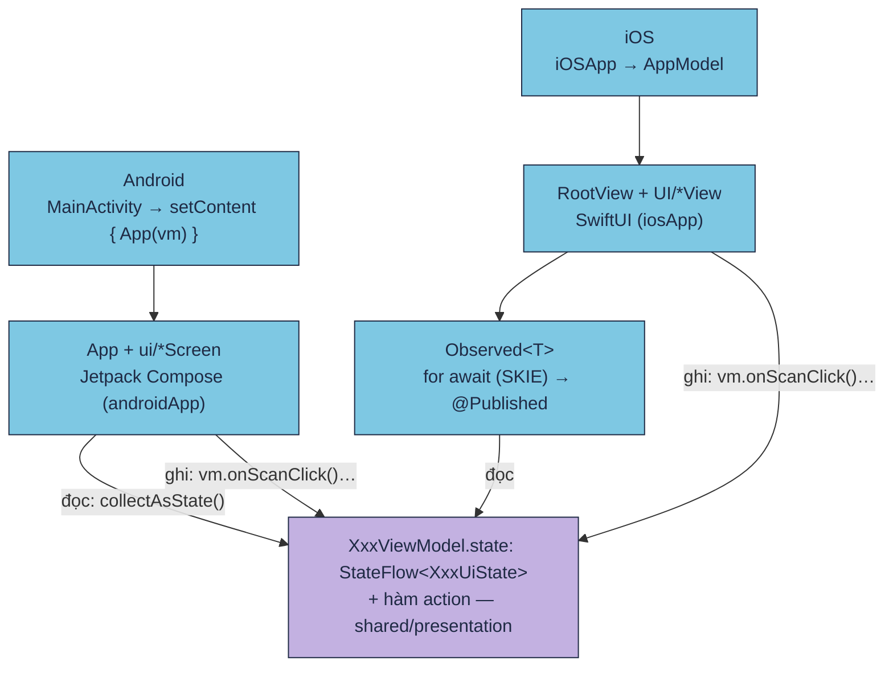

[🏠 README](../README.md) · Kế hoạch: [README-KMP-MIGRATION.md](plan/README-KMP-MIGRATION.md) · Vì sao UI native: [spec](plan/README-KMP-NATIVE-UI-SPEC.md) · Lộ trình học: [Học KMP qua Device Pulse](https://tucarmd.github.io/kotlin-multi-platform/lessons/02-setup/)

# Native Device Monitor KMP chạy thế nào

Trang này vẽ lại app từ trên xuống dưới: **UI native từng nền tảng** (Jetpack Compose / SwiftUI) → **ViewModel dùng chung** → 5 interface → code riêng từng nền tảng → SDK của Android / Apple. Mỗi ô trong sơ đồ có link tới đúng file và dòng code.

> Cập nhật 2026-10-19 (sau bước P11). **Android: cả 5 interface đã là code thật (P3–P7).** **iOS: UI SwiftUI đủ 5 tab, và từ P12 cả 5 interface đều gọi SDK thật**: Swift (`iosApp/iosApp/Platform/`) cùng adapter Kotlin (`shared/iosMain`). Đã chạy trên simulator, chưa chạy trên iPhone thật. Muốn xem dev làm gì theo thứ tự, đọc [Từng phase: dev đã làm gì](README-KMP-PHASES.md).

Màu trong mọi sơ đồ trang này:

| Màu | Tầng | Chung hay riêng |
|---|---|---|
| 🟦 xanh dương | 🎨 UI native: Jetpack Compose (`androidApp/`) · SwiftUI (`iosApp/`) | riêng, **viết 2 lần** |
| 🟪 tím | 🧠 ViewModel (`shared/commonMain/presentation`) | **chung** |
| 🟩 xanh lá | 🧩 KMP chung: interface + luật (`shared/commonMain/core`) | **chung** |
| 🟨 vàng | 🤖 `androidMain` (Kotlin) / 🍎 `iosApp/Platform` (Swift) + adapter `iosMain` (Kotlin) | riêng |
| ⬜ xám viền đậm | SDK của Google / Apple | — |

## Mục lục

1. [Bức tranh tổng: 6 tầng](#1-bức-tranh-tổng-6-tầng)
2. [App khởi động: ai gọi ai](#2-app-khởi-động-ai-gọi-ai)
3. [Bấm "Scan": hàm nào chạy](#3-bấm-scan-hàm-nào-chạy)
4. [KMP gọi SDK nào bên dưới](#4-kmp-gọi-sdk-nào-bên-dưới)
5. [Tầng UI: hai UI native nối với ViewModel chung thế nào](#5-tầng-ui-hai-ui-native-nối-với-viewmodel-chung-thế-nào)
6. [So với app cũ và với bản Compose Multiplatform (P0–P7)](#6-so-với-app-cũ-và-với-bản-compose-multiplatform-p0p7)
7. [Tự kiểm tra](#7-tự-kiểm-tra)

## 1. Bức tranh tổng: 6 tầng

| Tầng | Ở đâu | Viết bằng | Chung / riêng |
|---|---|---|---|
| **1. UI** | `androidApp/` (`MainActivity`, `App.kt`, `ui/`) · `iosApp/` (`iOSApp`, `AppModel`, `UI/`) | **Kotlin + Jetpack Compose** · **Swift + SwiftUI** | riêng, viết 2 lần |
| **2. ViewModel** | `shared/commonMain/.../presentation/` | Kotlin | **chung**: `state` + hàm action, mọi `if` "hiện gì" nằm ở đây |
| **3. Hợp đồng** | `AppServices` gom 5 interface | Kotlin | **chung** |
| **4. Luật thuần** | `core/` (GattModel, BluetoothDecoder, ScanFilter, DeviceStatus, MediaInfo…) + `ScannerActions` | Kotlin | **chung**; 78 test (luật + ViewModel) chạy cả JVM lẫn iOS Simulator |
| **5. Cài đặt theo nền tảng** | `shared/androidMain/` · iOS: `iosApp/iosApp/Platform/` (Swift) + `shared/iosMain/platform/` (adapter Kotlin) | Kotlin (Android) · **Swift + adapter Kotlin** (iOS) | riêng |
| **6. SDK hệ điều hành** | Android SDK · Apple SDK | — | của Google / Apple |

Hai câu để nhớ: **chỉ tầng 1 biết vẽ**, **chỉ tầng 5 biết mình đang chạy trên máy nào**. Tầng 2–4 là KMP, dùng chung y nguyên.

## 2. App khởi động: ai gọi ai

**Android**

**iOS**

| # | Hàm | File | Làm gì |
|---|---|---|---|
| A1 | `MainActivity.onCreate` | [MainActivity.kt](../androidApp/src/main/kotlin/com/learn/ndmkmp/MainActivity.kt) | tạo services **trước** `setContent`, tạo `AppViewModel`, đọc `--es tab`; `onDestroy` gọi `vm.clear()` |
| A2 | `createAndroidServices(activity)` | [AndroidServices.kt](../shared/src/androidMain/kotlin/com/learn/ndmkmp/platform/AndroidServices.kt) | chỗ **duy nhất** bên Android chọn fake hay thật cho 5 interface |
| A3 | `App(vm)` | [App.kt](../androidApp/src/main/kotlin/com/learn/ndmkmp/App.kt) | Scaffold + top bar + `NavigationBar` 5 tab (icon Material), `when (tab)` chọn màn |
| I1 | `iOSApp` | [iOSApp.swift](../iosApp/iosApp/iOSApp.swift) | `@StateObject AppModel`, `scenePhase == .active` → `vm.onResume()` |
| I2 | `AppModel` | [AppModel.swift](../iosApp/iosApp/App/AppModel.swift) | giữ `AppViewModel`, đọc launch arg `-tab`, `deinit` → `vm.clear()` |
| I3 | `IosPlatform.services` → `createIosServices(permissions:ble:media:device:)` | [IosPlatform.swift](../iosApp/iosApp/Platform/IosPlatform.swift) · [IosServices.kt](../shared/src/iosMain/kotlin/com/learn/ndmkmp/platform/IosServices.kt) | Swift tạo 4 object gọi SDK, Kotlin bọc chúng bằng adapter; tạo **một lần** cho cả màn hình lẫn BGAppRefresh |
| I4 | `RootView` | [RootView.swift](../iosApp/iosApp/UI/RootView.swift) | `TabView` theo `AppTab` dùng chung, icon SF Symbols |
| C1 | `AppViewModel` | [AppViewModel.kt](../shared/src/commonMain/kotlin/com/learn/ndmkmp/presentation/AppViewModel.kt) | tab đang chọn + 5 ViewModel con; radio tắt → `ble.onRadioOff()` |
| C2 | `AppServices` | [AppServices.kt](../shared/src/commonMain/kotlin/com/learn/ndmkmp/AppServices.kt) | gom 5 interface; `AppServices.fake()` cho preview / test |

> Swift gọi `IosServicesKt.createIosServices(...)`: hàm top-level trong file `IosServices.kt` hiện ra bên Swift thành hàm static của class `IosServicesKt`.

## 3. Bấm "Scan": hàm nào chạy

| # | Hàm | File | Làm gì |
|---|---|---|---|
| 1 | nút Scan | [ScannerScreen.kt#L136](../androidApp/src/main/kotlin/com/learn/ndmkmp/ui/scanner/ScannerScreen.kt#L136) · [ScannerView.swift#L109](../iosApp/iosApp/UI/Scanner/ScannerView.swift#L109) | hai UI chỉ gọi `vm.onScanClick()`, không có `if` nghiệp vụ |
| 2 | `ScannerViewModel.onScanClick` | [ScannerViewModel.kt#L190](../shared/src/commonMain/kotlin/com/learn/ndmkmp/presentation/scanner/ScannerViewModel.kt#L190) | đang quét → `stopScan()`, không thì `startScan(filter)` (CarMD only hay không) |
| 3 | `bleReadiness()` | [BleClient.kt#L22](../shared/src/commonMain/kotlin/com/learn/ndmkmp/core/bluetooth/BleClient.kt#L22) | luật thuần: không phần cứng > thiếu quyền > tắt radio > sẵn sàng; quyết định nút Scan bật hay tắt |
| 4 | `BleClient.startScan` | [BleClient.kt#L57](../shared/src/commonMain/kotlin/com/learn/ndmkmp/core/bluetooth/BleClient.kt#L57) | hợp đồng; ViewModel không biết ai cài đặt |
| 5 | `AndroidBleClient.startScan` · `FakeBleClient.startScan` | [AndroidBleClient.kt](../shared/src/androidMain/kotlin/com/learn/ndmkmp/core/bluetooth/AndroidBleClient.kt) · [FakeBleClient.kt#L51](../shared/src/commonMain/kotlin/com/learn/ndmkmp/fake/FakeBleClient.kt#L51) | 🤖 Android (P4): `BluetoothLeScanner` thật. 🍎 iOS (P12d): [IosBleClient.kt](../shared/src/iosMain/kotlin/com/learn/ndmkmp/platform/IosBleClient.kt) giữ luật → [BleNative.swift](../iosApp/iosApp/Platform/BleNative.swift) gọi `scanForPeripherals` |
| 6 | `BluetoothScanFilter.matches` | [BluetoothScanFilter.kt#L31](../shared/src/commonMain/kotlin/com/learn/ndmkmp/core/bluetooth/BluetoothScanFilter.kt#L31) | lọc tên lúc quét (CarMD2 · CMD-*) |
| 7 | `ScannerViewModel.rebuild` | [ScannerViewModel.kt#L240](../shared/src/commonMain/kotlin/com/learn/ndmkmp/presentation/scanner/ScannerViewModel.kt#L240) | bất kỳ flow nào đổi → dựng lại cả `ScannerUiState` từ giá trị hiện tại |
| 8 | `isDeviceShown` · `scannerButtonsOf` | [ScannerActions.kt#L70](../shared/src/commonMain/kotlin/com/learn/ndmkmp/presentation/scanner/ScannerActions.kt#L70) · [#L106](../shared/src/commonMain/kotlin/com/learn/ndmkmp/presentation/scanner/ScannerActions.kt#L106) | ô tìm + ẩn thiết bị không tên / âm thanh; nút Connect / Disconnect bật hay tắt |
| 9 | `collectAsState()` · `Observed` | [ScannerScreen.kt#L88](../androidApp/src/main/kotlin/com/learn/ndmkmp/ui/scanner/ScannerScreen.kt#L88) · [Observed.swift](../iosApp/iosApp/App/Observed.swift) | `StateFlow` → state của UI; giá trị mới → vẽ lại |
| 10 | `BluetoothDecoder.decode` | [BluetoothDecoder.kt#L74](../shared/src/commonMain/kotlin/com/learn/ndmkmp/core/bluetooth/BluetoothDecoder.kt#L74) | byte GATT → chữ đọc được (pin %, heart rate, text…) |

Bước 2–4 và 6–8, 10 là **cùng một đoạn code Kotlin** trên cả hai máy. Bước 1 và 9 viết 2 lần (Compose / SwiftUI), bước 5 khác nhau theo nền tảng.

### Một luồng khác: app vừa quay lại foreground

Không có sự kiện nào báo "quyền vừa đổi trong Settings", nên mỗi lần app quay lại phải đọc lại. Hai UI bắt sự kiện bằng cách riêng, rồi cùng gọi **một hàm chung** `AppViewModel.onResume()`:

- Android: [App.kt `LifecycleResumeEffect`](../androidApp/src/main/kotlin/com/learn/ndmkmp/App.kt#L63) → `Activity.onResume`.
- iOS: [iOSApp.swift `scenePhase == .active`](../iosApp/iosApp/iOSApp.swift#L22).

## 4. KMP gọi SDK nào bên dưới

### 4.1 Năm interface trong `AppServices`

| Interface (commonMain) | Tab | Android: SDK bên dưới (Kotlin) | iOS: SDK bên dưới (Swift `Platform/*Native` + adapter Kotlin) | Trạng thái |
|---|---|---|---|---|
| [`PermissionController`](../shared/src/commonMain/kotlin/com/learn/ndmkmp/core/permission/PermissionController.kt#L32) | Permissions | `ActivityResultContracts.RequestMultiplePermissions`, `shouldShowRequestPermissionRationale`, `BLUETOOTH_SCAN/CONNECT` (API 31+) hoặc `ACCESS_FINE_LOCATION` (≤ 30), `Settings.ACTION_APPLICATION_DETAILS_SETTINGS` | `CBManager.authorization`, `AVCaptureDevice.authorizationStatus`, `UIApplication.openSettingsURLString` | 🤖 P3 ✅ · 🍎 P12a ✅ |
| [`BleClient`](../shared/src/commonMain/kotlin/com/learn/ndmkmp/core/bluetooth/BleClient.kt#L39) | Scanner | `BluetoothLeScanner`, `BluetoothGatt` (hàng đợi thao tác tự viết, ghi CCCD để bật notify, `requestMtu`) | `CoreBluetooth`: `CBCentralManager`, `CBPeripheral` + delegate, timeout connect 15 s | 🤖 P4 ✅ · 🍎 P12d ✅ (GATT cần máy thật) |
| [`MediaPicker`](../shared/src/commonMain/kotlin/com/learn/ndmkmp/core/media/MediaPicker.kt#L14) | Media | `ActivityResultContracts.TakePicture`, `PickVisualMedia`, `FileProvider` | `UIImagePickerController` (camera), `PHPickerViewController` (thư viện ảnh) | 🤖 P5 ✅ · 🍎 P12b ✅ |
| [`ApiService`](../shared/src/commonMain/kotlin/com/learn/ndmkmp/core/network/ApiService.kt#L22) | API | **Ktor** engine `OkHttp` | **Ktor** engine `Darwin` → `NSURLSession` (vẫn là Kotlin dùng chung) | **P6 ✅ cả 2 máy** (`KtorApiService`) |
| [`DeviceMonitor`](../shared/src/commonMain/kotlin/com/learn/ndmkmp/core/background/DeviceMonitor.kt#L49) | Monitor | `BatteryManager`, `ConnectivityManager`, **Foreground Service**, **WorkManager** (15 phút) | `UIDevice.batteryLevel`, `Network.framework`, **BGTaskScheduler** (`BGAppRefreshTask`); **không có** foreground service | 🤖 P7 ✅ · 🍎 P12c ✅ |

### 4.2 `expect` / `actual` nhỏ (không cần interface)

| `expect` trong [Platform.kt](../shared/src/commonMain/kotlin/com/learn/ndmkmp/Platform.kt) | Android ([Platform.android.kt](../shared/src/androidMain/kotlin/com/learn/ndmkmp/Platform.android.kt)) | iOS ([Platform.ios.kt](../shared/src/iosMain/kotlin/com/learn/ndmkmp/Platform.ios.kt)) |
|---|---|---|
| `platformName()` | `Build.VERSION.RELEASE` | `UIDevice.currentDevice.systemVersion` |
| `monotonicMs()` | `SystemClock.elapsedRealtime()` | `NSProcessInfo.systemUptime` |
| `clockText()` · `isoLocalTimestamp()` | `java.text.SimpleDateFormat` | `NSDateFormatter` + locale `en_US_POSIX` |

### 4.3 Thư viện (một API, engine khác nhau bên dưới)

| Thư viện | Dùng cho | Android chạy trên | iOS chạy trên |
|---|---|---|---|
| Jetpack Compose (BOM 2026.06.01) | UI Android | `View` của Android | — |
| SwiftUI | UI iOS | — | UIKit |
| kotlinx.coroutines | `StateFlow`, `suspend`, scope của ViewModel | main = `Looper` chính | main = main queue (GCD) |
| SKIE 0.10.15 | Swift đọc Flow của Kotlin | — | `StateFlow` → `AsyncSequence` (`for await`) |
| kotlinx.serialization | JSONL của `DeviceStatus` | — (thuần Kotlin) | — (thuần Kotlin) |
| Ktor 3.5.1 | HTTP | OkHttp | `NSURLSession` |

### Khi nào dùng cái nào?

| Cách | Dùng khi | Ví dụ |
|---|---|---|
| `expect fun` / `actual fun` | 1 hàm nhỏ, không trạng thái | `monotonicMs()` |
| `interface` + class riêng mỗi bên + `Fake*` | có trạng thái, có callback, cần giả khi chạy simulator / test | `BleClient` ← `FakeBleClient` / `AndroidBleClient` / `IosBleClient` |
| interface callback nhỏ cho Swift + adapter Kotlin | iOS: code SDK viết bằng Swift nhưng state phải là `StateFlow` | `IosBleNative` (Swift) ← `IosBleClient` (Kotlin) |
| ViewModel chung | quyết định "màn hình hiện gì" | `ScannerViewModel`: dòng nào hiện, nút nào bật, chữ gì |

## 5. Tầng UI: hai UI native nối với ViewModel chung thế nào

Từ P11, app chọn **D1 = KMP core + UI native**: mỗi nền tảng tự vẽ bằng công cụ của mình, nhưng **cùng đọc một ViewModel**.

| Câu hỏi | Android | iOS |
|---|---|---|
| Ai vẽ màn hình? | `App()` + `ui/*Screen` (Jetpack Compose) | `RootView` + `UI/*View` (SwiftUI) |
| Ai giữ ViewModel? | `MainActivity` (cùng vòng đời với services) | `AppModel` (`@StateObject`) |
| Đọc state | `vm.state.collectAsState()` | `@StateObject Observed(vm.state)` → `model.value` |
| Ô nhập chữ | `OutlinedTextField(value = state.query, onValueChange = vm::onQueryChange)` | `TextField(text: Binding(get: { state.query }, set: { vm.onQueryChange(text: $0) }))` |
| Dọn coroutine | `MainActivity.onDestroy` → `vm.clear()` | `AppModel.deinit` → `vm.clear()` (iOS không có `ViewModelStore`) |
| Biết app quay lại foreground | `LifecycleResumeEffect` → `onResume` | `scenePhase == .active` |
| Mở thẳng một tab (để chụp màn hình) | `adb shell am start … --es tab monitor` | `xcrun simctl launch … -tab monitor` |
| Ảnh đã chọn | `BitmapFactory.decodeByteArray` | `IosBridgeKt.previewData` → `UIImage(data:)` |
| Thứ phải khai báo ngoài code | `AndroidManifest.xml` (quyền, FGS) | `Info.plist` (chuỗi xin quyền, `BGTaskSchedulerPermittedIdentifiers`) |
| Trông ra sao | Material 3 | control iOS thật (TabView, Toggle, thanh tab iOS 26) |

Luật một chiều: `UI → ViewModel → interface → (luật thuần)`. ViewModel và `core/` **không bao giờ** import `android.*`, `platform.*` hay thư viện UI. Hai gói đầu chỉ được dùng trong `androidMain` / `iosMain`, còn Compose chỉ có trong `androidApp`.

## 6. So với app cũ và với bản Compose Multiplatform (P0–P7)

| | App cũ `native-device-monitor/` | Bản P0–P7 (Compose Multiplatform) | **App này từ P11** (KMP core + UI native) |
|---|---|---|---|
| UI | Compose (Android) + SwiftUI (iOS), viết 2 lần | Compose 1 lần cho cả 2 | **Compose + SwiftUI, viết 2 lần** |
| Logic "hiện gì" | viết 2 lần, nằm trong View | 1 lần, nằm trong composable | **1 lần, trong ViewModel chung** (có test) |
| Luật / model | viết 2 lần (~6.5k + ~5.6k dòng) | 1 lần | 1 lần, 78 test chạy 2 nơi |
| Swift | toàn bộ app iOS | ~20 dòng vỏ | UI SwiftUI + `AppModel` / `Observed` + `Platform/*Native` (SDK) |
| Code đụng SDK | Kotlin (Android) + Swift (iOS) | Kotlin cả 2 bên (dự kiến) | Kotlin (Android) + **Swift (iOS)**, state iOS trong adapter Kotlin |
| Giao diện iOS | thuần iOS | Material trên iOS | **thuần iOS** |

## 7. Tự kiểm tra

- [ ] Chỉ vào sơ đồ 6 tầng, nói được `ScannerView.swift`, `ScannerScreen.kt`, `ScannerViewModel`, `BleClient`, `FakeBleClient`, `CBCentralManager` thuộc tầng nào.
- [ ] Kể được thứ tự hàm khi bấm **Scan**, từ nút bấm tới lúc danh sách vẽ lại, và chỉ ra bước nào viết 2 lần.
- [ ] Giải thích được vì sao `createAndroidServices(this)` phải đứng **trước** `setContent`, và vì sao `vm.clear()` phải gọi ở `onDestroy` / `deinit`.
- [ ] Giải thích được `Observed<T>` và SKIE làm gì, nếu không có SKIE thì Swift thấy `StateFlow` ra sao.
- [ ] Nói được với mỗi tab: Android gọi SDK nào, iOS gọi SDK nào, và tab đó đang fake hay đã thật.
