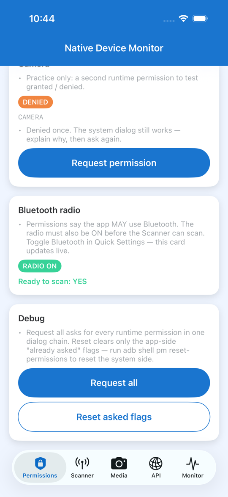
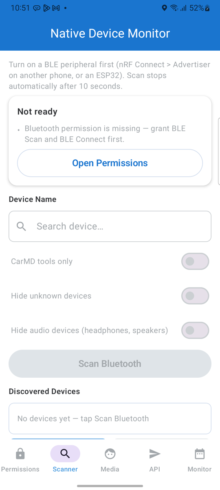
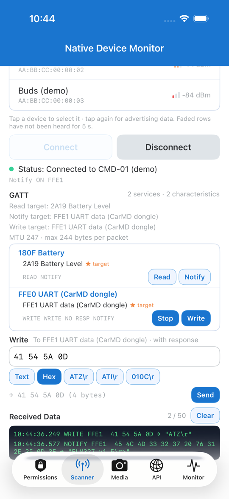
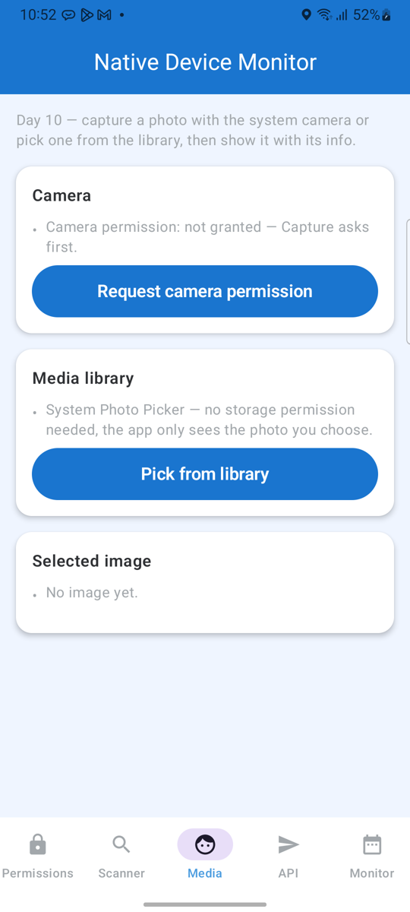
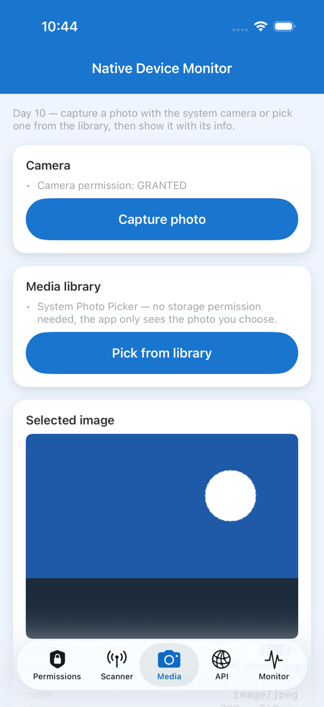
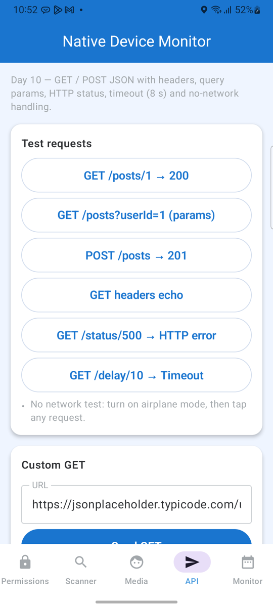
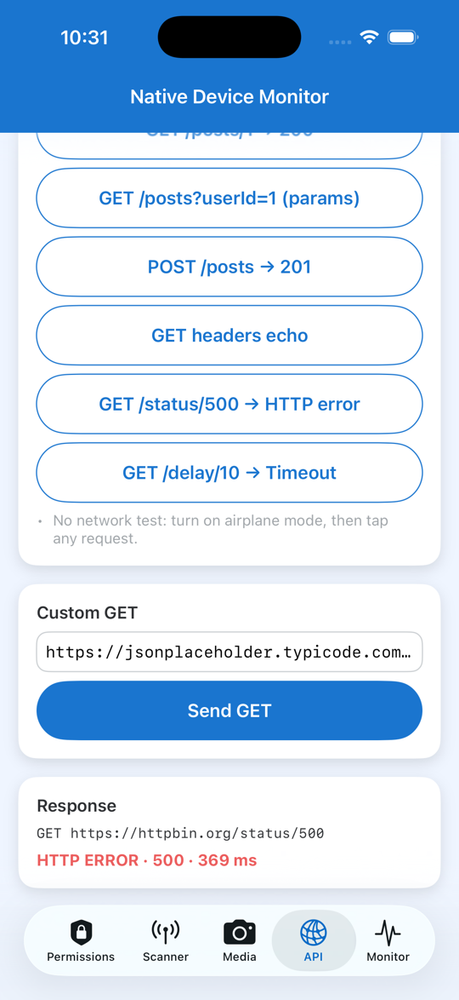
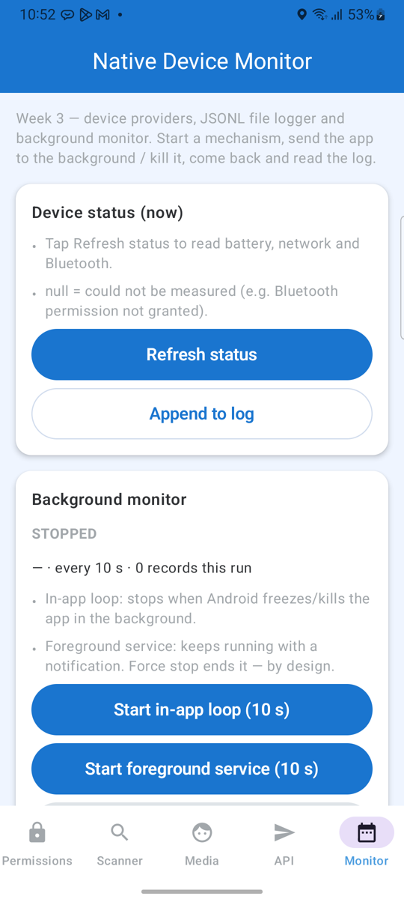
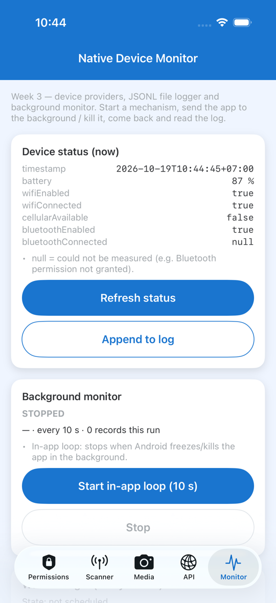

# Native Device Monitor KMP

App `native-device-monitor` cũ (repo private [tucarmd/native-mobile-learning](https://github.com/tucarmd/native-mobile-learning/tree/main/native-device-monitor)) viết **hai lần toàn bộ** (Kotlin + Swift). Bản này làm lại theo hướng **KMP core + UI native**:

1. **UI vẫn viết riêng từng nền tảng:** Android là Kotlin + Jetpack Compose (`androidApp/`), iOS là Swift + SwiftUI (`iosApp/`).
2. **Chỉ phần dùng chung mới viết bằng KMP** (`shared/`): model, luật, ViewModel, interface, HTTP (Ktor), logger, vòng lặp monitor.

!!! info "Một dãy phase P0–P16"
    P0–P7 dùng **Compose Multiplatform** (một UI Kotlin vẽ cho cả 2 bên). P8–P11 (2026-10-19) chuyển sang UI native:
    Android vẽ bằng Jetpack Compose, iOS vẽ bằng SwiftUI, cả hai đọc **cùng một ViewModel** trong `shared/`.
    P12: iOS gọi SDK Apple thật bằng Swift. Đã chạy trên simulator, **chưa chạy trên iPhone thật**.
    **Tiếp theo (2026-10-21): tập trung port vào `shared/`.** P13 Pomodoro (app cũ chỉ có iOS) viết thẳng bằng KMP · P14 luật BLE
    đang chép 2 nơi về `commonMain` · P15 code SDK Apple từ Swift sang Kotlin/Native. P16 Final. Chờ duyệt D6–D8:
    [spec port vào shared](plan/README-KMP-SHARED-PORT-SPEC.md).
    Bảng đầy đủ: [Kế hoạch + tiến độ §3](plan/README-KMP-MIGRATION.md#3-phases-each-ends-with-something-you-can-run--screenshot) · lý do đổi hướng: [Spec](plan/README-KMP-NATIVE-UI-SPEC.md).
    Commit của P8–P12 ghi nhãn tạm **R1–R5** (đã nằm trong lịch sử git nên không sửa).

## Đọc theo thứ tự

0. [Bản đồ thư mục](README-KMP-FOLDER-MAP.md): từng thư mục, từng file làm gì (bản `main` + bản P0), thêm code mới đặt ở đâu.
1. [Kế hoạch + tiến độ](plan/README-KMP-MIGRATION.md): mục tiêu, kiến trúc, ai viết phần nào (KMP hay native), bảng phase P0–P16.
2. [Port vào shared: còn gì, viết sao](plan/README-KMP-SHARED-PORT-SPEC.md): app cũ còn gì chưa port, công thức ①–⑤ viết một tính năng vào KMP, bảng dịch Swift → Kotlin, spec P13–P15.
3. [Vì sao đổi sang UI native](plan/README-KMP-NATIVE-UI-SPEC.md): spec của P8–P12 (quyết định N1–N3).
4. [Từng phase: dev đã làm gì](README-KMP-PHASES.md): P0 → P12, mỗi bước gắn nhãn 🎨 UI · 🧩 KMP chung · 🤖 Android · 🍎 iOS. **Đọc trang này khi trình bày / review.**
5. [App chạy thế nào](README-KMP-HOW-IT-WORKS.md): 6 tầng, app khởi động ai gọi ai, bấm "Scan" hàm nào chạy, KMP gọi SDK nào.
6. [Android cơ bản qua code](README-KMP-ANDROID-BASICS.md) (tab **Học Kotlin**): `onCreate` chạy khi nào, app có mấy Activity, `Bundle` và `savedInstanceState`, dấu `?` (null safety), xoay màn hình mất gì, `enum class AppTab`.
   Cùng tab đó là toàn bộ lộ trình [Học Kotlin Multiplatform](kotlin/index.md): 14 bài, khái niệm khó, 900 lỗi Kotlin, tra cứu.
7. [Kế hoạch site này](plan/README-KMP-DOCS-SITE-PLAN.md): site tài liệu được dựng ra sao (S1–S5).

## Module

| Thư mục | Ngôn ngữ | Chứa gì |
|---|---|---|
| `shared/commonMain` | Kotlin (KMP) | `core/`: model, luật, interface, Ktor, FileLogger, vòng monitor · `presentation/`: 5 ViewModel + `AppViewModel` + chuỗi hiển thị |
| `shared/androidMain` | Kotlin · Android SDK | xin quyền, BLE (BluetoothGatt), camera / chọn ảnh, FGS + WorkManager |
| `shared/iosMain` | Kotlin/Native | adapter iOS (`IosPermissionController`, `IosBleClient`, `IosMediaPicker`, `iosDeviceMonitor`) giữ state + luật |
| `androidApp/` | Kotlin · **Jetpack Compose** | `MainActivity` → `App(AppViewModel)` → 5 màn hình |
| `iosApp/` | **Swift · SwiftUI** | `AppModel` giữ `AppViewModel` → `RootView` (TabView) → 5 View · `Observed<T>` đổi `StateFlow` Kotlin thành `@Published` · `Platform/`: code SDK Apple bằng Swift |

## Chạy

```bash
# Android (JDK 17+), từ thư mục gốc repo
./gradlew :androidApp:assembleDebug
adb install -r androidApp/build/outputs/apk/debug/androidApp-debug.apk
adb shell am start -n com.learn.ndmkmp/.MainActivity --es tab scanner   # --es tab: mở thẳng 1 tab
```

```bash
# iOS Simulator (hoặc mở iosApp/iosApp.xcodeproj trong Xcode rồi bấm Run)
xcodebuild -project iosApp/iosApp.xcodeproj -scheme iosApp -destination 'platform=iOS Simulator,name=iPhone 17' -derivedDataPath iosApp/build/dd build
xcrun simctl install "iPhone 17" "iosApp/build/dd/Build/Products/Debug-iphonesimulator/Device Monitor KMP.app"
xcrun simctl launch "iPhone 17" com.learn.ndmkmp -tab scanner
```

```bash
./gradlew :shared:allTests   # 78 test (luật + ViewModel) trên JVM của Android host + iOS simulator
```

## Ảnh chạy thật

Chọn tab bên dưới để xem từng màn, Android (Jetpack Compose) bên trái · iOS (SwiftUI) bên phải. Hai UI viết riêng nhưng đọc cùng một ViewModel, nên chữ và trạng thái giống nhau. Ảnh iOS chụp trước P12 (lúc đó service còn fake). Bấm vào ảnh để mở ảnh gốc.

=== "Permissions"

    <div class="shots shots--pair" markdown>
    <figure markdown>
    [](assets/kmp_tab_android_1_permissions.png)
    <figcaption>Android · Jetpack Compose · Samsung A32</figcaption>
    </figure>
    <figure markdown>
    [](assets/kmp_tab_ios_1_permissions.png)
    <figcaption>iOS · SwiftUI · iPhone 17 Simulator</figcaption>
    </figure>
    </div>

=== "Scanner"

    <div class="shots shots--pair" markdown>
    <figure markdown>
    [](assets/kmp_tab_android_2_scanner.png)
    <figcaption>Android · Jetpack Compose · Samsung A32</figcaption>
    </figure>
    <figure markdown>
    [](assets/kmp_tab_ios_2_scanner.png)
    <figcaption>iOS · SwiftUI · iPhone 17 Simulator</figcaption>
    </figure>
    </div>

=== "Media"

    <div class="shots shots--pair" markdown>
    <figure markdown>
    [](assets/kmp_tab_android_3_media.png)
    <figcaption>Android · Jetpack Compose · Samsung A32</figcaption>
    </figure>
    <figure markdown>
    [](assets/kmp_tab_ios_3_media.png)
    <figcaption>iOS · SwiftUI · iPhone 17 Simulator</figcaption>
    </figure>
    </div>

=== "API"

    <div class="shots shots--pair" markdown>
    <figure markdown>
    [](assets/kmp_tab_android_4_api.png)
    <figcaption>Android · Jetpack Compose · Samsung A32</figcaption>
    </figure>
    <figure markdown>
    [](assets/kmp_tab_ios_4_api.png)
    <figcaption>iOS · SwiftUI · iPhone 17 Simulator</figcaption>
    </figure>
    </div>

=== "Monitor"

    <div class="shots shots--pair" markdown>
    <figure markdown>
    [](assets/kmp_tab_android_5_monitor.png)
    <figcaption>Android · Jetpack Compose · Samsung A32</figcaption>
    </figure>
    <figure markdown>
    [](assets/kmp_tab_ios_5_monitor.png)
    <figcaption>iOS · SwiftUI · iPhone 17 Simulator</figcaption>
    </figure>
    </div>
