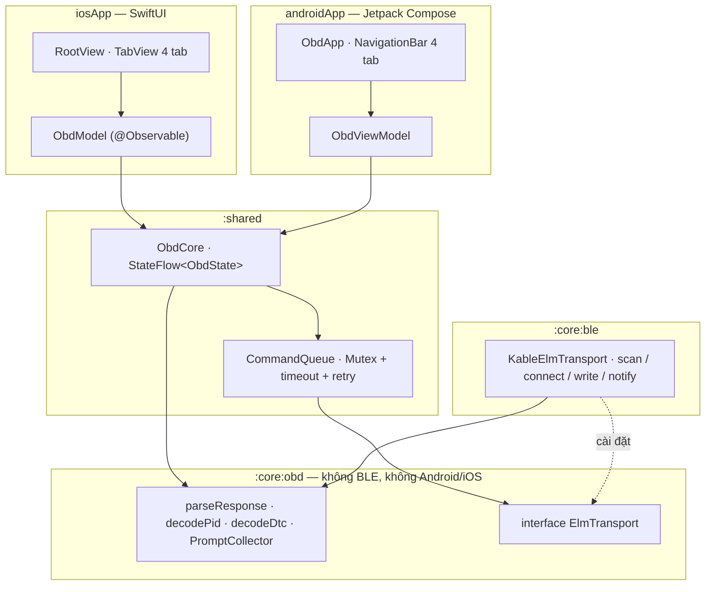
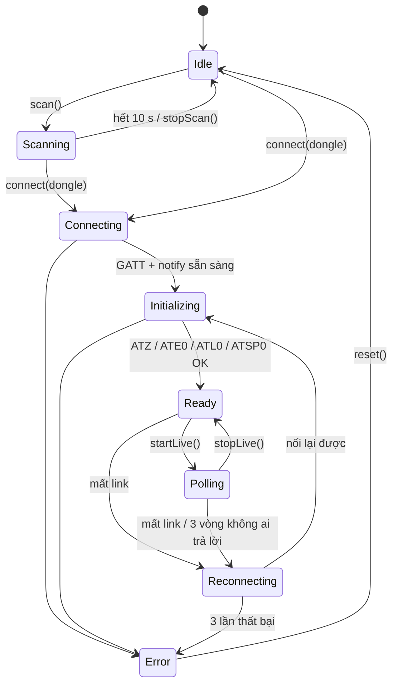

# OBD Link — app luyện tập 5

Cắm dongle **ELM327 Bluetooth LE** vào cổng OBD-II của xe → app tìm dongle, kết nối, hiện **vòng tua, tốc độ, nhiệt độ nước
làm mát** theo thời gian thực, **đọc và xoá mã lỗi (DTC)**, và có một **console** gõ lệnh AT / PID tay. Chạy **Android + iOS**.
Kiến trúc **KMP core + UI native**, lần đầu tách thành **nhiều module Gradle**: `:core:obd` (ngôn ngữ ELM327, Kotlin thuần),
`:core:ble` (BLE bằng Kable), `:shared` (state machine, hàng đợi lệnh, Koin, cửa vào Swift).
Trang plan: [App 5 · OBD Link](https://tucarmd.github.io/kotlin-multi-platform/apps/05-obd-link/).



State machine kết nối (mỗi ô là một nhánh của `sealed class ConnectionState`):



| | Android | iOS |
|---|---|---|
| UI | Jetpack Compose, `NavigationBar` 4 tab, đồng hồ vẽ bằng `Canvas` | SwiftUI `TabView` 4 tab, đồng hồ bằng `Gauge(.accessoryCircular)` |
| Đọc state từ core | `collectAsStateWithLifecycle()` | `for await` trên `StateFlow` (SKIE) |
| Gửi action | `ObdViewModel` chuyển tiếp sang `ObdCore` | `ObdModel` chuyển tiếp sang `ObdCore` |
| BLE | Kable → `BluetoothGatt` | Kable → CoreBluetooth |
| Quyền | API ≤ 30: `ACCESS_FINE_LOCATION` · API 31+: `BLUETOOTH_SCAN` (`neverForLocation`) + `BLUETOOTH_CONNECT`, hỏi trong `BlePermission.kt` | `NSBluetoothAlwaysUsageDescription`, hệ thống tự hỏi ở lần quét đầu |
| Id của dongle | Địa chỉ MAC | UUID ngẫu nhiên theo từng máy (Apple giấu MAC) |
| Xác nhận xoá mã | `AlertDialog` | `.alert` |
| Chuỗi vi/en | `res/values*/strings.xml` | `*.lproj/Localizable.strings` (cùng key, sinh từ strings.xml) |

## Chạy

Cần: JDK 17+ (đã thử JDK 17 và 21), Android SDK 36, Xcode 16+ (đã thử 26.5), iOS 17+, Mac Apple silicon.
**BLE không chạy trên emulator Android hay iOS Simulator**: muốn kết nối thật phải dùng máy thật.

```bash
cd apps/ObdLink
./gradlew :androidApp:installDebug                       # Android: cài lên máy đang cắm (applicationId dev.obdlink)

# Test: :core:obd chạy JVM + iOS Simulator; :core:ble và :shared chạy Android unit test + iOS Simulator
./gradlew :core:obd:allTests \
  :core:ble:testDebugUnitTest :core:ble:iosSimulatorArm64Test \
  :shared:testDebugUnitTest :shared:iosSimulatorArm64Test

open iosApp/iosApp.xcodeproj                             # iOS: chọn iPhone thật, bấm Run
```

iOS bằng dòng lệnh (chỉ build, không ký):

```bash
cd iosApp
xcodegen generate
xcodebuild -project iosApp.xcodeproj -scheme iosApp -destination 'generic/platform=iOS Simulator' \
  -derivedDataPath build/dd CODE_SIGNING_ALLOWED=NO build
# Bundle id: dev.obdlink.ios · app: build/dd/Build/Products/Debug-iphonesimulator/ObdLink.app
```

**Không có xe?** Dựng thiết bị giả bằng app **nRF Connect** trên một điện thoại khác (tab *Advertiser* + *GATT Server*):
service `FFF0`, characteristic `FFF1` (notify) và `FFF2` (write), đặt tên quảng bá `OBDII`. Trả lời tay theo bảng
trong `FakeElmTransport.defaultAnswers()` (`ATZ` → `ELM327 v1.5\r\r>`, `010C` → `41 0C 1A F8\r\r>`, `03` → `43 01 03 01\r\r>`…),
nhớ kết thúc bằng `>`. Hoặc dùng ESP32 như `peripheral-setup.md` của native-mobile-learning.

## Cấu trúc

```text
apps/ObdLink/
├── settings.gradle.kts           include :core:obd, :core:ble, :shared, :androidApp                        [git]
├── core/obd/                     Kotlin thuần: jvm + iosArm64 + iosSimulatorArm64, KHÔNG có plugin Android  [B1]
│   └── src/commonMain/kotlin/dev/obdlink/obd/
│       ├── model/                ObdCommand, ObdPid, ObdResult, ElmFailure, Exchange, Dtc, Dongle, LinkStatus
│       ├── rules/                Parser.kt, Pid.kt, Dtc.kt (+ DtcCatalog), ConsoleInput.kt
│       └── transport/            ElmTransport (interface), PromptCollector, các exception                   [B3]
│   └── src/commonTest/           ObdParserTest, PidTest, DtcTest, PromptCollectorTest, ConsoleInputTest     [B7]
├── core/ble/                     Kable. Phụ thuộc :core:obd                                                 [B3]
│   ├── src/commonMain/…/ble/     ElmProfiles (bảng UUID FFF0 / FFE0 / 18F0), KableElmTransport
│   └── src/commonTest/           ElmProfilesTest
├── shared/src/
│   ├── commonMain/kotlin/dev/obdlink/
│   │   ├── model/ObdState.kt     ObdState, ConnectionState, LiveData, CodesState, ConsoleLine…              [B2]
│   │   ├── core/                 CommandQueue, ObdCore (+ ObdTiming)                                         [B2]
│   │   └── di/Koin.kt            bleModule + obdModule + expect platformModule + initKoin()                  [B4]
│   ├── androidMain/ · iosMain/   platformModule rỗng (cố ý) · obdCore() cho Swift                            [B4]
│   └── commonTest/               FakeElmTransport, CommandQueueTest, ObdCoreTest                             [B7]
├── androidApp/src/main/
│   ├── AndroidManifest.xml       quyền BLE theo API level
│   ├── kotlin/dev/obdlink/android/
│   │   ├── ObdLinkApp.kt         initKoin + appModule                                                        [B4]
│   │   ├── MainActivity.kt       setContent { ObdRoute() }                                                   [B5]
│   │   └── ui/                   App (Route + tabs + Preview), Connect/Live/Codes/ConsoleScreen,
│   │                             Components (Gauge Canvas), BlePermission, Labels, ObdViewModel              [B5]
│   └── res/values*/strings.xml   en + vi
├── iosApp/
│   ├── iosApp/                   iOSApp, ObdModel, Views/{Root,Connect,Live,Codes,Console}View, Labels,
│   │                             *.lproj, Info.plist (sinh bởi XcodeGen)                                    [B6]
│   ├── project.yml               XcodeGen (sửa file này rồi `xcodegen generate`, đừng sửa .pbxproj)
│   └── build/                    DerivedData của xcodebuild                                                  [máy]
├── local.properties              sdk.dir                                                                     [máy]
└── gradle/libs.versions.toml     version giống DevicePulse + Kable
```

## Bản đồ function

| Hàm | File | Làm gì | Vì sao |
|---|---|---|---|
| `parseResponse(raw, sent)` | [`rules/Parser.kt#L44`](core/obd/src/commonMain/kotlin/dev/obdlink/obd/rules/Parser.kt#L44) | Làm sạch chuỗi ELM327 → `ObdResult.Data / Ok / Text / NoData / Error` | Dongle rẻ trả đủ kiểu rác: echo, `SEARCHING...`, `\r`, có/không dấu cách, khung CAN nhiều dòng |
| `cleanLines(raw, sent)` | [`rules/Parser.kt#L21`](core/obd/src/commonMain/kotlin/dev/obdlink/obd/rules/Parser.kt#L21) | Tách dòng theo `\r`, bỏ `>`, dòng trống, `SEARCHING...`, echo | ELM327 xuống dòng bằng `\r`, tách theo `\n` ra một dòng dài |
| `decodePid(pid, bytes)` | [`rules/Pid.kt#L24`](core/obd/src/commonMain/kotlin/dev/obdlink/obd/rules/Pid.kt#L24) | `41 0C 1A F8` → 1726 rpm; `0D` = A km/h; `05` = A − 40 °C | Công thức SAE J1979 nằm một chỗ, test với số đã biết |
| `decodeDtc(first, second)` | [`rules/Dtc.kt#L21`](core/obd/src/commonMain/kotlin/dev/obdlink/obd/rules/Dtc.kt#L21) | 2 byte → `P0301`, `C0123`, `U0100`… | 2 bit đầu chọn P/C/B/U, dễ sai nhất app |
| `decodeDtcResponse(messages)` | [`rules/Dtc.kt#L48`](core/obd/src/commonMain/kotlin/dev/obdlink/obd/rules/Dtc.kt#L48) | Cả câu trả lời mode 03 → danh sách mã, bỏ `00 00`, bỏ trùng | CAN có byte đếm sau `43`, giao thức cũ thì không: phân biệt bằng chẵn/lẻ |
| `parseConsoleInput(typed)` | [`rules/ConsoleInput.kt#L31`](core/obd/src/commonMain/kotlin/dev/obdlink/obd/rules/ConsoleInput.kt#L31) | Chuẩn hoá lệnh gõ tay; chặn mode `04` | Xoá mã từ console là bỏ qua bước xác nhận |
| `PromptCollector.feed(chunk)` | [`transport/PromptCollector.kt#L23`](core/obd/src/commonMain/kotlin/dev/obdlink/obd/transport/PromptCollector.kt#L23) | Gom các mảnh notify tới dấu `>` | BLE chia gói ~20 byte, một câu trả lời tới thành nhiều notify |
| `ElmTransport` | [`transport/ElmTransport.kt#L17`](core/obd/src/commonMain/kotlin/dev/obdlink/obd/transport/ElmTransport.kt#L17) | `scan / connect / disconnect / send(text): String` + `link` | Core test bằng `FakeElmTransport`, không cần Bluetooth |
| `CommandQueue.sendText(text)` | [`core/CommandQueue.kt#L50`](shared/src/commonMain/kotlin/dev/obdlink/core/CommandQueue.kt#L50) | Khoá `Mutex`, gửi, chờ `>`, `withTimeout` 2 s (10 s cho lệnh đầu sau `ATSP0`), retry 1 lần | ELM327 chỉ xử lý **một** lệnh; gửi chồng là nhận câu trả lời của lệnh khác |
| `ObdCore.scan()` | [`core/ObdCore.kt#L85`](shared/src/commonMain/kotlin/dev/obdlink/core/ObdCore.kt#L85) | Idle → Scanning 10 s, gom dongle | Danh sách giữ lại sau khi dừng để người dùng chọn |
| `ObdCore.connect(dongle)` | [`core/ObdCore.kt#L116`](shared/src/commonMain/kotlin/dev/obdlink/core/ObdCore.kt#L116) | Connecting → Initializing → Ready, lỗi thành `Error(reason)` | Mọi trạng thái là sealed class, UI chỉ vẽ |
| `ObdCore.initialize()` | [`core/ObdCore.kt#L247`](shared/src/commonMain/kotlin/dev/obdlink/core/ObdCore.kt#L247) | Gửi `ATZ`, `ATE0`, `ATL0`, `ATSP0`, ghi log console | Dongle có thể còn giữ cài đặt của app khác |
| `ObdCore.startLive()` | [`core/ObdCore.kt#L151`](shared/src/commonMain/kotlin/dev/obdlink/core/ObdCore.kt#L151) | Ready → Polling, chạy `pollLoop()` ([#L281](shared/src/commonMain/kotlin/dev/obdlink/core/ObdCore.kt#L281)) hỏi RPM / tốc độ / nhiệt độ luân phiên | Huỷ được bằng `stopLive()` hoặc khi rớt kết nối |
| `ObdCore.linkLost()` | [`core/ObdCore.kt#L319`](shared/src/commonMain/kotlin/dev/obdlink/core/ObdCore.kt#L319) | Ready/Polling → Reconnecting, xoá giá trị cũ, chạy `reconnect()` ([#L337](shared/src/commonMain/kotlin/dev/obdlink/core/ObdCore.kt#L337)) 3 lần | Đặt state ngay (không suspend) để lần gọi thứ hai không mở vòng nối lại thứ hai |
| `ObdCore.requestClearCodes()` / `confirmClearCodes()` | [`core/ObdCore.kt#L172`](shared/src/commonMain/kotlin/dev/obdlink/core/ObdCore.kt#L172) · [`#L188`](shared/src/commonMain/kotlin/dev/obdlink/core/ObdCore.kt#L188) | Hai bước: `ConfirmClear` → gửi `04` → đọc lại mã | Mode 04 tắt đèn check-engine và reset readiness monitor |
| `ObdCore.sendConsole(typed)` | [`core/ObdCore.kt#L207`](shared/src/commonMain/kotlin/dev/obdlink/core/ObdCore.kt#L207) | Gửi lệnh gõ tay qua cùng hàng đợi, log hai chiều | Console không bao giờ chen ngang lệnh live |
| `KableElmTransport.scan()` | [`ble/KableElmTransport.kt#L71`](core/ble/src/commonMain/kotlin/dev/obdlink/ble/KableElmTransport.kt#L71) | Lọc theo service UUID **hoặc** tiền tố tên | Nhiều dongle không quảng bá service UUID |
| `KableElmTransport.connect(dongle)` | [`ble/KableElmTransport.kt#L93`](core/ble/src/commonMain/kotlin/dev/obdlink/ble/KableElmTransport.kt#L93) | Kết nối, chọn characteristic, bật notify, chờ đăng ký xong | Ghi trước khi notify bật là mất câu trả lời của `ATZ` |
| `KableElmTransport.send(text)` | [`ble/KableElmTransport.kt#L161`](core/ble/src/commonMain/kotlin/dev/obdlink/ble/KableElmTransport.kt#L161) | Bỏ mảnh cũ, write `text + "\r"`, gom notify tới `>` | Câu trả lời muộn của lệnh đã timeout không được thành câu trả lời của lệnh mới |
| `ElmProfiles.pick(services)` | [`ble/ElmProfiles.kt#L49`](core/ble/src/commonMain/kotlin/dev/obdlink/ble/ElmProfiles.kt#L49) | Chọn cặp write / notify: `FFF0` (`FFF2`/`FFF1`), `FFE0` (`FFE1`), `18F0` | ELM327 BLE không chuẩn hoá UUID; hàm thuần nên test không cần máy |
| `obdCore()` | [`iosMain/…/KoinIos.kt#L12`](shared/src/iosMain/kotlin/dev/obdlink/di/KoinIos.kt#L12) | Lấy `ObdCore` từ Koin cho Swift | Swift không gọi được `get<T>()` (`reified`) |
| `blePermissions(sdk)` | [`ui/BlePermission.kt#L30`](androidApp/src/main/kotlin/dev/obdlink/android/ui/BlePermission.kt#L30) | API ≤ 30 → vị trí; 31+ → `BLUETOOTH_SCAN` + `BLUETOOTH_CONNECT` | Thiếu quyền thì Android quét ra rỗng mà không báo lỗi |
| `ObdRoute()` | [`ui/App.kt#L54`](androidApp/src/main/kotlin/dev/obdlink/android/ui/App.kt#L54) | Lấy ViewModel từ Koin, `collectAsStateWithLifecycle`, nối quyền BLE | Tách khỏi `ObdApp` để `@Preview` không cần Koin |
| `Gauge(...)` | [`ui/Components.kt#L31`](androidApp/src/main/kotlin/dev/obdlink/android/ui/Components.kt#L31) | Đồng hồ cung 240° vẽ bằng `Canvas` | Compose không có sẵn gauge tròn |
| `ObdModel.init` | [`ObdModel.swift#L18`](iosApp/iosApp/ObdModel.swift#L18) | `for await` StateFlow → `state` | `@Observable` để SwiftUI vẽ lại đúng chỗ |
| `LiveView.gauge(...)` | [`Views/LiveView.swift#L48`](iosApp/iosApp/Views/LiveView.swift#L48) | SwiftUI `Gauge(.accessoryCircular)` | Bản iOS của đồng hồ Canvas |

Tìm mọi chỗ dễ sai: `grep -rn "TRAP:\|PLATFORM:\|TEST:" core shared androidApp/src iosApp/iosApp`.

## Version và vì sao

Giống DevicePulse: Kotlin 2.4.20 · SKIE 0.10.15 · Koin 4.2.2 · AGP 8.13.2 · Compose BOM 2026.06.01 · Coroutines 1.11.0.
Thêm:

| Thư viện | Version | Vì sao |
|---|---|---|
| `com.juul.kable:kable-core` | **0.45.0** | BLE cho KMP (Android + CoreBluetooth) bằng coroutine. Bản ổn định mới nhất trên Maven Central (9/2026), build với Kotlin 2.4.10 + coroutines 1.11.0 nên link được với 2.4.20. API hiện tại dùng `kotlin.uuid.Uuid` (cần opt-in `ExperimentalUuidApi`) và `Peripheral(advertisement)` |
| `kotlinx-coroutines-test` | 1.11.0 | `runTest` + đồng hồ ảo: test timeout 2 s, retry, nối lại 3 lần chạy trong vài ms |
| `compose-material-icons-core` | theo BOM | Icon 4 tab |

Không thêm Turbine: test đọc `StateFlow.value` sau khi tua đồng hồ ảo, và ghi lại đường đi state bằng một collector
`UnconfinedTestDispatcher`.

## Mấy cái bẫy đã gặp khi làm

- **Câu trả lời tới nhiều mảnh qua notify; chỉ coi là xong khi gặp `>`.** Dừng ở `\r` là sai: `SEARCHING...\r41 0C …\r` có
  nhiều `\r` trước dấu `>` (`PromptCollector`).
- **Lệnh đầu sau `ATSP0` mất vài giây (`SEARCHING...`).** Timeout 2 s làm lệnh đó hỏng, retry còn cắt ngang việc dò giao
  thức (`STOPPED`). `CommandQueue` cho lệnh OBD đầu tiên sau `ATZ`/`ATSP` 10 s.
- **Mutex phải bọc cả lần retry.** Nếu nhả khoá giữa timeout và retry, lệnh khác chen vào và nhận câu trả lời muộn của lệnh trước.
- **Bắt đúng `TimeoutCancellationException`.** Bắt `CancellationException` chung sẽ nuốt luôn lệnh huỷ thật (bấm Tạm dừng).
- **Câu trả lời muộn của lệnh đã timeout** vẫn có thể tới: `KableElmTransport.send` xả hết mảnh cũ trước khi ghi lệnh mới.
- **Bật notify xong mới được ghi.** `observe()` bật notify bất đồng bộ; ghi `ATZ` ngay sau `connect()` thì mất câu trả lời
  và init timeout không rõ lý do. Chờ `onSubscription` rồi mới báo Connected.
- **Nhiều dongle không quảng bá service UUID** → chỉ lọc theo service thì quét ra rỗng. Lọc thêm theo tiền tố tên (`OBD`, `V-LINK`…).
- **iOS không cho thấy địa chỉ MAC**, chỉ có UUID riêng của từng máy: không lưu "dongle quen" bằng MAC, không so id giữa hai máy.
- **Android ≤ 30 quét BLE cần quyền vị trí**, API 31+ cần `BLUETOOTH_SCAN`. Thiếu quyền thì không có lỗi, chỉ là danh sách rỗng.
  API 31+ gọi `ACTION_REQUEST_ENABLE` khi chưa có `BLUETOOTH_CONNECT` là `SecurityException`.
- **Xoá mã (mode `04`) tắt đèn check-engine và reset readiness monitor**: core bắt buộc qua `ConfirmClear`, console chặn `04`.
- **DTC: CAN có byte đếm sau `43`, giao thức cũ thì không.** `43 01 03 01` đọc nhầm kiểu cũ ra `P0103` thay vì `P0301`.
  Phân biệt bằng số byte sau `43` chẵn hay lẻ.
- **CAN nhiều khung (`00A` / `0:` / `1:`)** là **một** câu trả lời; dòng `00A` (3 ký tự hex, lẻ) là tổng số byte.
- **Rớt kết nối có thể được phát hiện hai lần** (watcher của link và vòng poll). `linkLost()` đặt `Reconnecting` ngay lập tức,
  lần gọi thứ hai thấy state đó và bỏ qua; nếu không sẽ có hai vòng nối lại giành nhau một link.
- **Dongle treo mà BLE vẫn "connected"**: 3 vòng poll không lệnh nào được trả lời thì coi như mất link.
- **`decodePid(pid, List<Int>)` và `decodePid(pid, List<List<Int>>)` không cùng tồn tại được** trên JVM ("Platform
  declaration clash" do type erasure) → hàm thứ hai tên `decodePidAnswer`.
- **Tên làm hỏng Swift:** property `description` va với `NSObject.description` (Swift thấy `description_`) → đặt `summary`;
  enum `InitFailed` bắt đầu bằng `init` (họ initializer của Objective-C) → đặt `SetupFailed`. Trạng thái lỗi vẫn là
  `ConnectionState.Error`, SKIE cho `case .error`.
- **Kiểu của `:core:obd` phải `export()` vào framework** (kèm `api(project(":core:obd"))`), nếu không Swift thấy chúng với tiền tố module.
- **`xcodebuild -destination 'generic/platform=iOS Simulator'`** đòi cả x86_64; Gradle chỉ có `iosSimulatorArm64` →
  `EXCLUDED_ARCHS[sdk=iphonesimulator*]: x86_64` trong `project.yml`.
- **Kotlin `Int?` sang Swift là `KotlinInt?`**: giá trị đồng hồ bọc trong `Reading(value)`, Swift nhận `Reading?` và `Int32`.
- **Tên test có dấu phẩy, chấm, hai chấm** chạy được trên JVM nhưng hỏng trên iOS: viết `41 0C 1A F8 is 1726 rpm`, không có dấu.
