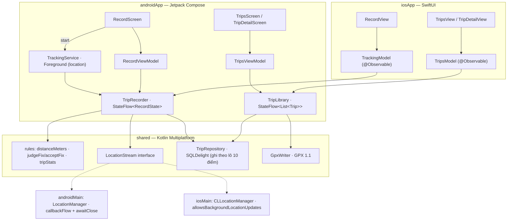

# Trip Log — app luyện tập 4

Bấm *Bắt đầu*, cất điện thoại vào túi, đi một vòng: app ghi đường đi, quãng đường, tốc độ, **kể cả khi tắt màn hình**,
lưu chuyến vào SQLite và xuất file GPX. Chạy **Android + iOS**. Kiến trúc **KMP core + UI native** như Device Pulse:
`TripRecorder` (state machine) nằm trong `shared/`, Android giữ app sống bằng **Foreground Service**, iOS bằng
**background location**. Trang plan: [App 4 · Trip Log](https://tucarmd.github.io/kotlin-multi-platform/apps/04-trip-log/).



| | Android | iOS |
|---|---|---|
| UI | Jetpack Compose, Navigation Compose, `SwipeToDismissBox` | SwiftUI `NavigationStack`, `List.onDelete`, Swift Charts |
| Bản đồ | Tự vẽ bằng Compose `Canvas` (không cần API key) | SwiftUI `Map` + `MapPolyline` + `Marker` |
| Đọc state từ core | `collectAsStateWithLifecycle()` | `for await` trên `StateFlow` (SKIE) |
| Sống khi tắt màn hình | `TrackingService` (Foreground Service, `foregroundServiceType="location"`) + notification có nút *Dừng* | `UIBackgroundModes = location` + `allowsBackgroundLocationUpdates = true` |
| GPS | `LocationManager.GPS_PROVIDER` (không cần Play Services) | `CLLocationManager` delegate viết bằng Kotlin |
| Quyền | Vị trí chính xác + `POST_NOTIFICATIONS` (13+) khi bấm *Bắt đầu* | When-In-Use; bị từ chối → banner + nút mở Cài đặt |
| Xuất GPX | `FileProvider` + `ACTION_SEND` | `ShareLink` với file trong `temporaryDirectory` |
| Chuỗi vi/en | `res/values*/strings.xml` | `*.lproj/Localizable.strings` (cùng key, sinh từ strings.xml) |

## Chạy

Cần: JDK 17+ (đã thử JDK 21), Android SDK 36, Xcode 16+ (đã thử 26.5), iOS 17+, Mac Apple silicon.

```bash
cd apps/TripLog
./gradlew :shared:testDebugUnitTest :shared:iosSimulatorArm64Test   # 32 test JVM + 31 test iOS Simulator
./gradlew :androidApp:installDebug                                  # cài lên emulator / máy đang cắm
adb shell am start -n dev.triplog/dev.triplog.android.MainActivity
```

iOS bằng dòng lệnh:

```bash
cd iosApp
xcodegen generate
xcodebuild -project iosApp.xcodeproj -scheme iosApp -destination 'platform=iOS Simulator,name=iPhone 17' \
  -derivedDataPath build/dd CODE_SIGNING_ALLOWED=NO build
xcrun simctl install booted build/dd/Build/Products/Debug-iphonesimulator/TripLog.app
xcrun simctl launch booted dev.triplog.ios
```

**Giả lập đi đường** (sau khi bấm *Bắt đầu* và cho phép vị trí):

```bash
# Android emulator: mỗi lệnh là một điểm GPS (kinh độ trước, vĩ độ sau). Chạy cả vòng lặp ~1 điểm/giây:
for i in $(seq 0 60); do adb emu geo fix $(echo "106.7009 + $i*0.0001" | bc) 10.7769; sleep 1; done
# Hoặc Extended Controls → Location → Routes, chọn 2 điểm rồi bấm Play route.

# iOS Simulator (Xcode 15+): chạy một tuyến dựng sẵn, hoặc Features → Location → City Run / Freeway Drive
xcrun simctl location booted start --speed=8 21.0285,105.8542 21.0300,105.8560 21.0320,105.8570
xcrun simctl location booted clear
```

Mỗi bước 0,0001° ≈ 11 m trong 1 giây ≈ 40 km/h: qua được bộ lọc nhiễu. Thử bước 0,01° (1,1 km/giây) để thấy
dòng *"Đã bỏ N điểm nhiễu"*.

## Cấu trúc

```text
apps/TripLog/
├── shared/src/
│   ├── commonMain/kotlin/dev/triplog/
│   │   ├── model/Models.kt          TrackPoint, Trip, TripStats, LiveTrip, RecordState (sealed), FixVerdict      [B1]
│   │   ├── rules/Geo.kt             distanceMeters (haversine), judgeFix, acceptFix                            [B1]
│   │   ├── rules/Stats.kt           tripStats (bỏ thời gian tạm dừng), speedSeries                             [B1]
│   │   ├── rules/Format.kt          formatFixed, formatDistance, formatDuration, formatSpeedKmh               [B1]
│   │   ├── core/TripRecorder.kt     state machine Idle/Recording/Paused/Saving, actor 1 coroutine              [B2]
│   │   ├── core/TripLibrary.kt      danh sách chuyến, load, xoá, GPX                                           [B2]
│   │   ├── platform/LocationStream  interface Flow<TrackPoint>                                                 [B3]
│   │   ├── data/TripRepository.kt   SQLDelight, ghi điểm theo lô trong 1 transaction                           [B3]
│   │   ├── data/GpxWriter.kt        Trip → GPX 1.1                                                             [B3]
│   │   └── di/Koin.kt               app scope + TripRecorder single + expect platformModule                    [B4]
│   ├── commonMain/sqldelight/…/     Trip.sq, Point.sq                                                          [B3]
│   ├── androidMain/                 AndroidLocationStream (callbackFlow) + platformModule                      [B3]
│   ├── iosMain/                     IosLocationStream (delegate Kotlin) + platformModule + KoinIos             [B3 · B4]
│   ├── commonTest/                  RulesTest, TripRecorderTest, TripLibraryTest, GpxWriterTest, Fakes         [B7]
│   └── androidUnitTest/             GpxParseTest (parse lại GPX bằng javax.xml)                                [B7]
├── androidApp/src/main/
│   ├── AndroidManifest.xml          quyền FGS + location, <service foregroundServiceType="location">, FileProvider
│   ├── kotlin/dev/triplog/android/
│   │   ├── TripLogApplication.kt    initKoin + appModule                                                       [B4]
│   │   ├── service/TrackingService  Foreground Service, notification có nút Dừng                               [B5]
│   │   └── ui/                      App (NavHost), Record/Trips/TripDetail Screen, ViewModel, Components
│   │                                (RouteCanvas, SpeedChart), Permissions, GpxShare, Labels                   [B5]
│   └── res/                         values*/strings.xml (en + vi), xml/file_paths.xml
├── iosApp/
│   ├── iosApp/                      iOSApp, TrackingModel, TripsModel, LocationPermission,
│   │                                Views/(Record, Trips, TripDetail, Components, Labels), *.lproj             [B6]
│   └── project.yml                  XcodeGen: UIBackgroundModes, NSLocation…, -lsqlite3, EXCLUDED_ARCHS
├── gradle/libs.versions.toml        như DevicePulse, bỏ Ktor/Kermit, thêm androidx-core + lifecycle-service
└── README.md
```

Những thứ chỉ có `[máy]` (không commit): `local.properties`, `build/`, `iosApp/iosApp.xcodeproj` sinh lại được bằng `xcodegen`.

## Bản đồ function

| Hàm | File | Làm gì | Vì sao |
|---|---|---|---|
| `distanceMeters(a, b)` | [`rules/Geo.kt#L37`](shared/src/commonMain/kotlin/dev/triplog/rules/Geo.kt#L37) | Khoảng cách 2 tọa độ theo haversine | Không dùng `Location.distanceTo` / `CLLocation.distance` → test được, 2 máy ra cùng số |
| `judgeFix(prev, next)` | [`rules/Geo.kt#L58`](shared/src/commonMain/kotlin/dev/triplog/rules/Geo.kt#L58) | `Accepted` / `TooInaccurate` (> 30 m) / `TooFast` (> 50 m/s) / `OutOfOrder` | GPS trong nhà nhảy vài trăm mét, cộng vào là sai quãng đường |
| `acceptFix(prev, next)` | [`rules/Geo.kt#L71`](shared/src/commonMain/kotlin/dev/triplog/rules/Geo.kt#L71) | `judgeFix(...) == Accepted` | Tên ngắn đúng như plan, lý do chi tiết nằm ở `judgeFix` |
| `tripStats(points)` | [`rules/Stats.kt#L22`](shared/src/commonMain/kotlin/dev/triplog/rules/Stats.kt#L22) | Quãng đường, thời gian chạy, tốc độ TB / max | Chỉ cộng trong cùng `segment` → bỏ thời gian và quãng đường lúc `Paused` |
| `speedSeries(points)` | [`rules/Stats.kt#L48`](shared/src/commonMain/kotlin/dev/triplog/rules/Stats.kt#L48) | ≤ 60 giá trị tốc độ cho biểu đồ | Chuyến 3 tiếng có 10.000 điểm, vẽ hết thì biểu đồ thành vệt đen |
| `formatFixed(value, decimals)` | [`rules/Format.kt#L20`](shared/src/commonMain/kotlin/dev/triplog/rules/Format.kt#L20) | Số thập phân cố định, không bao giờ `1.0E-4` | commonMain không có `String.format`; GPX cần tọa độ dạng thường |
| `TripRecorder.start()` | [`core/TripRecorder.kt#L90`](shared/src/commonMain/kotlin/dev/triplog/core/TripRecorder.kt#L90) | `Idle → Recording`: mở trip trong DB, bắt đầu thu `points()` | Một state machine duy nhất cho cả 2 nền tảng |
| `TripRecorder.pause()` / `resume()` | [`core/TripRecorder.kt#L93`](shared/src/commonMain/kotlin/dev/triplog/core/TripRecorder.kt#L93) | Tắt GPS, đóng băng đồng hồ / mở segment mới | Tạm dừng không tốn pin và không cộng đoạn đi lúc dừng |
| `TripRecorder.onFix()` | [`core/TripRecorder.kt#L154`](shared/src/commonMain/kotlin/dev/triplog/core/TripRecorder.kt#L154) | Lọc, cộng dồn quãng đường, đủ 10 điểm thì ghi DB | Ghi từng điểm = mỗi giây một lần fsync |
| `TripRecorder.finish()` | [`core/TripRecorder.kt#L182`](shared/src/commonMain/kotlin/dev/triplog/core/TripRecorder.kt#L182) | `Saving`: ghi nốt lô cuối, đóng trip (hoặc xoá nếu < 2 điểm) | Chuyến không có đường đi thì không đáng lưu |
| `TripLibrary.load(id)` | [`core/TripLibrary.kt#L40`](shared/src/commonMain/kotlin/dev/triplog/core/TripLibrary.kt#L40) | Trip + điểm, lỗi → `null` | Exception Kotlin từ `suspend` sang Swift làm app crash |
| `SqlTripRepository.appendPoints()` | [`data/TripRepository.kt#L62`](shared/src/commonMain/kotlin/dev/triplog/data/TripRepository.kt#L62) | Ghi một lô trong **một** transaction | 10 INSERT rời = 10 lần sync đĩa |
| `GpxWriter.write(trip, points)` | [`data/GpxWriter.kt#L29`](shared/src/commonMain/kotlin/dev/triplog/data/GpxWriter.kt#L29) | `Trip` → chuỗi GPX 1.1, mỗi segment một `<trkseg>` | Ở `commonMain`: chỉ là XML, 2 máy xuất file giống hệt |
| `AndroidLocationStream.points()` | [`androidMain/…/AndroidLocationStream.kt#L35`](shared/src/androidMain/kotlin/dev/triplog/platform/AndroidLocationStream.kt#L35) | `callbackFlow` bọc listener, `awaitClose` gỡ listener | Quên gỡ listener = GPS chạy mãi, hết pin |
| `IosLocationStream.points()` | [`iosMain/…/IosLocationStream.kt#L41`](shared/src/iosMain/kotlin/dev/triplog/platform/IosLocationStream.kt#L41) | Delegate CLLocationManager → `Flow`, chạy trên main thread | `allowsBackgroundLocationUpdates` chỉ bật được khi Info.plist có mode `location` |
| `tripRecorder()` | [`iosMain/…/KoinIos.kt#L15`](shared/src/iosMain/kotlin/dev/triplog/di/KoinIos.kt#L15) | Lấy `TripRecorder` single cho Swift | Swift không gọi được `get<T>()` (`reified`) |
| `TrackingService.onStartCommand()` | [`service/TrackingService.kt#L55`](androidApp/src/main/kotlin/dev/triplog/android/service/TrackingService.kt#L55) | `startForeground(type = LOCATION)` rồi `recorder.start()` | Quá 5 giây không `startForeground` thì Android 12+ ném `ForegroundServiceDidNotStartInTimeException` |
| `TrackingService.followRecorder()` | [`service/TrackingService.kt#L83`](androidApp/src/main/kotlin/dev/triplog/android/service/TrackingService.kt#L83) | State → notification; `Idle` sau khi đã ghi → `stopSelf()` | Một nguồn sự thật: bấm *Kết thúc* ở màn hình hay ở notification đều đi qua recorder |
| `TrackingPermissions.requestThen()` | [`ui/Permissions.kt#L39`](androidApp/src/main/kotlin/dev/triplog/android/ui/Permissions.kt#L39) | Xin vị trí chính xác + thông báo rồi mới start service | Android 14 ném `SecurityException` nếu start FGS location khi chưa có quyền |
| `RouteCanvas()` | [`ui/Components.kt#L46`](androidApp/src/main/kotlin/dev/triplog/android/ui/Components.kt#L46) | Vẽ đường đi bằng `Canvas`, chiếu equirectangular | Không cần Google Maps API key, chạy mọi emulator |
| `shareGpx()` | [`ui/GpxShare.kt#L19`](androidApp/src/main/kotlin/dev/triplog/android/ui/GpxShare.kt#L19) | Ghi file vào `cacheDir/gpx`, `FileProvider` + `ACTION_SEND` | `file://` crash từ Android 7 (`FileUriExposedException`) |
| `TrackingModel.init` | [`TrackingModel.swift#L20`](iosApp/iosApp/TrackingModel.swift#L20) | `for await` StateFlow → `state` | `@Observable` để SwiftUI vẽ lại đúng chỗ |
| `TripsModel.load()` | [`TripsModel.swift#L26`](iosApp/iosApp/TripsModel.swift#L26) | `await library.load`, ghi file GPX cho `ShareLink` | `ShareLink(item: URL)` cho share sheet một file `.gpx` thật |
| `RouteMap` | [`Views/Components.swift#L9`](iosApp/iosApp/Views/Components.swift#L9) | `Map` + một `MapPolyline` mỗi segment | Tạm dừng hiện thành khoảng trống, không kẻ thẳng qua |

Tìm mọi chỗ dễ sai: `grep -rn "TRAP:\|PLATFORM:" shared androidApp/src iosApp/iosApp iosApp/project.yml`.

## Version và vì sao

Giống DevicePulse: Kotlin 2.4.20 · SKIE 0.10.15 · Koin 4.2.2 · AGP 8.13.2 · Compose BOM 2026.06.01 · Coroutines 1.11.0 ·
SQLDelight 2.4.1 · Navigation Compose 2.9.7 · Turbine 1.2.1. Lý do từng cái: mục *Version và vì sao* trong
[`apps/DevicePulse/README.md`](../DevicePulse/README.md).

Thêm mới ở app 4:

| Thư viện | Version | Vì sao |
|---|---|---|
| `androidx.core:core-ktx` | 1.17.0 | `NotificationCompat`, `ServiceCompat.startForeground(type)`, `FileProvider`. Khai rõ vì service import trực tiếp |
| `androidx.lifecycle:lifecycle-service` | 2.10.0 (cùng lifecycle) | `LifecycleService` cho service một `lifecycleScope` để theo dõi state recorder |

Bỏ so với DevicePulse: Ktor, Kermit (app không lên mạng, không cần log riêng). **Không** dùng `maps-compose` /
Play Services Location: bản đồ Android vẽ bằng `Canvas`, GPS dùng `LocationManager` như DevicePulse.

## Mấy cái bẫy đã gặp khi làm

- **Emulator báo tốc độ = 0.** `adb emu geo fix` gửi điểm có `hasSpeed() = true` nhưng `speed = 0`, nên "Tốc độ hiện tại" và
  "Tốc độ tối đa" hiện 0 km/h dù quãng đường và tốc độ trung bình đúng. Máy thật báo tốc độ thật. `tripStats` chỉ tự tính tốc độ
  khi chip **không** báo (`speedMps == null`).
- **Recorder không sống trong ViewModel.** `viewModelScope` chết khi bấm Back, chuyến đang ghi mất theo. `TripRecorder`
  là `single` trong Koin, chạy trong một `CoroutineScope` của cả app; service và màn hình chỉ điều khiển nó.
- **Android 14+: thiếu `foregroundServiceType` ở manifest hoặc lúc gọi `startForeground` là crash.** Cả hai phải là
  `location`, kèm quyền `FOREGROUND_SERVICE_LOCATION`. `ServiceCompat.startForeground` tự bỏ tham số type trên Android 9-.
- **Service thấy `Idle` trước khi recorder kịp chạy.** `recorder.start()` xử lý bất đồng bộ, nên service chỉ coi `Idle`
  là "chuyến xong" khi trước đó đã thấy `Recording`/`Paused`; không thì nó `stopSelf()` ngay lúc vừa mở.
- **Chỉ cấp "vị trí gần đúng" = chuyến trống.** Điểm rộng ~2 km bị bộ lọc 30 m bỏ hết. App báo riêng trường hợp này.
- **`LocationListener { }` dạng lambda crash trên Android < 11**: 3 hàm còn lại khi đó chưa có default. Viết `object`.
- **iOS: thiếu `UIBackgroundModes = location` mà bật `allowsBackgroundLocationUpdates` → crash ngay.** Và để mặc định
  `pausesLocationUpdatesAutomatically = true` thì iOS tự tắt GPS khi đứng đèn đỏ, không bật lại.
- **`CLLocationManager` tạo trên `Dispatchers.Default` không bao giờ gọi delegate** (thread không có run loop).
  `IosLocationStream` chạy `flowOn(Dispatchers.Main)`.
- **Ghi từng điểm xuống DB một → chậm và tốn pin.** Ghi lô 10 điểm, mỗi lô một transaction.
- **`last_insert_rowid()` phải chạy cùng transaction với `INSERT`**: driver native có pool nhiều connection.
- **`WHERE endedAtMillis IS NOT NULL` làm SQLDelight sinh class riêng** (`SelectFinished`) thay vì `Trip`: dùng mapper.
- **Khoảng cách không nối qua chỗ tạm dừng.** Mỗi lần *Tiếp tục* là một `segment` mới; thống kê, bản đồ, GPX đều tách theo segment.
- **`Double.toString()` trên JVM in `1.0E-4`.** Tọa độ GPX dùng `formatFixed(…, 7)`.
- **`-destination 'generic/platform=iOS Simulator'` build cả x86_64**, mà `shared` chỉ có `iosSimulatorArm64` → Gradle báo
  *Requested Architecture Not Configured*. `project.yml` đặt `EXCLUDED_ARCHS[sdk=iphonesimulator*] = x86_64`.
- **Tên test có dấu phẩy / chấm / hai chấm chạy được trên JVM nhưng không biên dịch trên iOS.** Viết
  `Ha Noi to Ho Chi Minh City is about 1137 km within 1 percent`, không viết `1,137 km` hay `1.137 km`.
- **Haversine Hà Nội → TP.HCM ra 1.143,5 km** (bán kính trung bình 6.371.008,8 m), lệch 0,57 % so với con số 1.137 km
  hay được trích: nằm trong sai số 1 % của plan.
