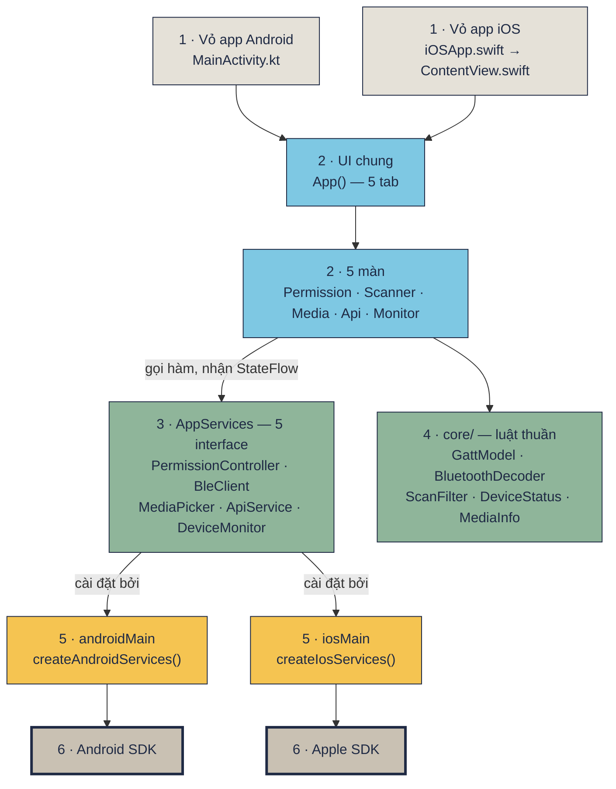
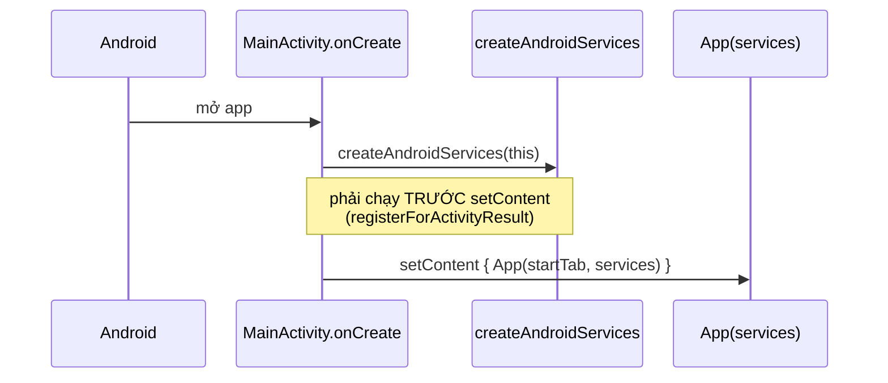
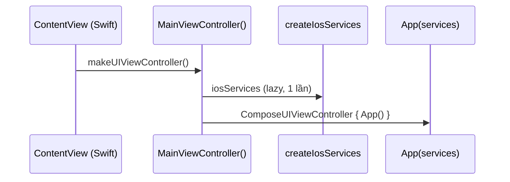
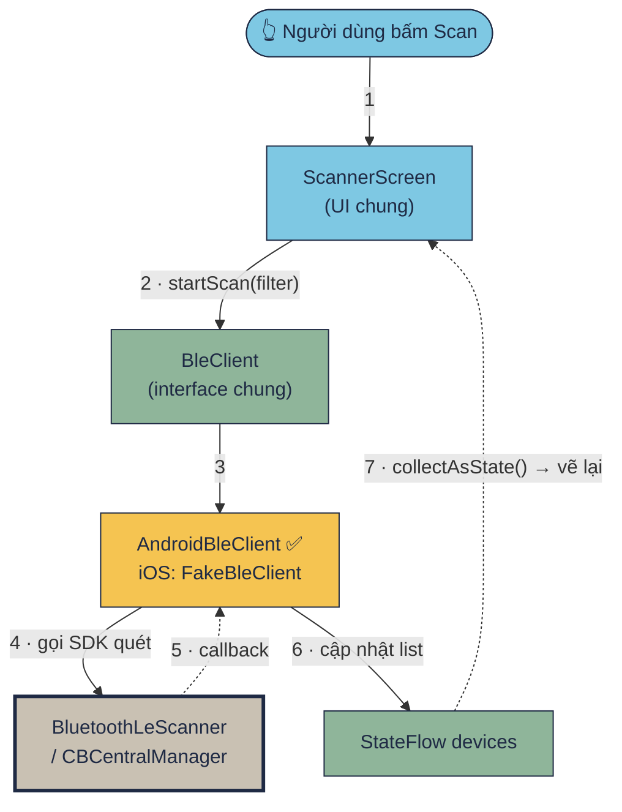
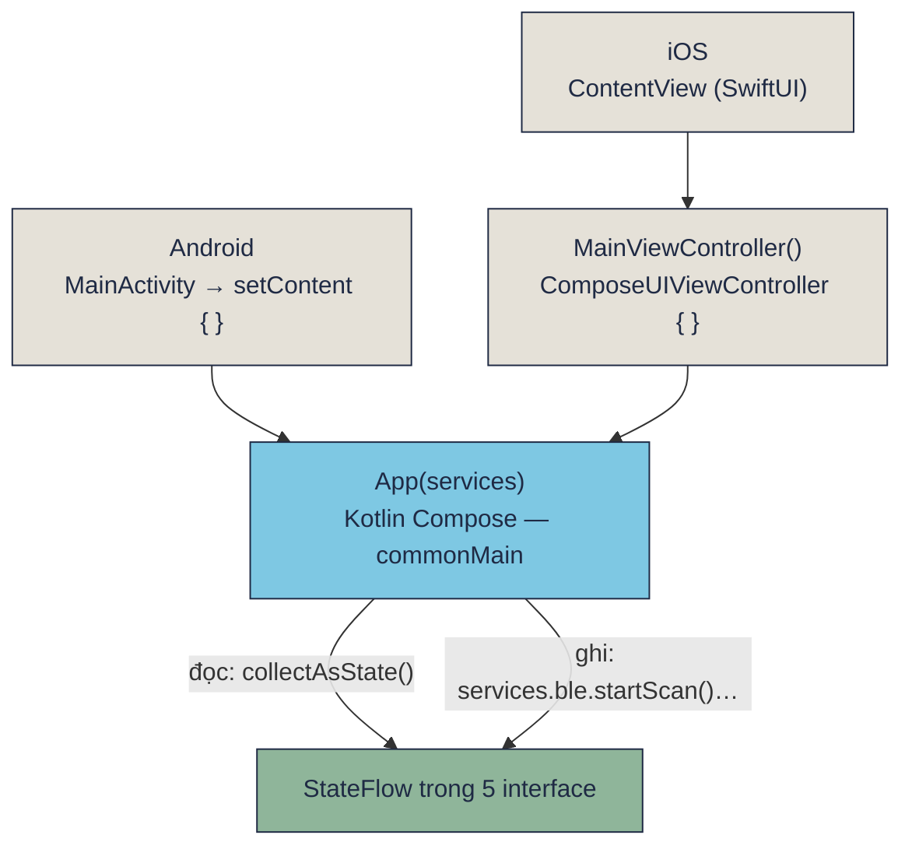

[🏠 README](../README.md) · Kế hoạch: [README-KMP-MIGRATION.md](plan/README-KMP-MIGRATION.md) · Lộ trình học: [Học KMP qua Device Pulse](https://tucarmd.github.io/kotlin-multi-platform/lessons/02-setup/)

# Native Device Monitor KMP chạy thế nào

Trang này vẽ lại app từ trên xuống dưới: Swift vỏ → UI Compose dùng chung → 5 interface → code riêng từng nền tảng → SDK của Android / Apple. Mỗi ô trong sơ đồ có link tới đúng file và dòng code.

> Cập nhật 2026-10-16. **Android: cả 5 interface đã là code thật (P3–P7).** **iOS: mới có API (P6)**, 4 tab còn lại vẫn chạy `Fake*`. Muốn xem dev làm gì theo thứ tự, đọc [Từng phase: dev đã làm gì](README-KMP-PHASES.md).

Màu trong mọi sơ đồ trang này:

| Màu | Tầng | Chung hay riêng |
|---|---|---|
| 🟫 xám | 📱 Vỏ app (`MainActivity`, Swift) | riêng |
| 🟦 xanh dương | 🎨 UI Compose (`commonMain/ui`) | **chung** |
| 🟩 xanh lá | 🧩 KMP chung: interface + luật (`commonMain/core`) | **chung** |
| 🟨 vàng | 🤖 `androidMain` / 🍎 `iosMain` | riêng |
| ⬜ xám viền đậm | SDK của Google / Apple | — |

## Mục lục

1. [Bức tranh tổng: 6 tầng](#1-bức-tranh-tổng-6-tầng)
2. [App khởi động: ai gọi ai](#2-app-khởi-động-ai-gọi-ai)
3. [Bấm "Scan": hàm nào chạy](#3-bấm-scan-hàm-nào-chạy)
4. [KMP gọi SDK nào bên dưới](#4-kmp-gọi-sdk-nào-bên-dưới)
5. [Tầng UI: Compose Multiplatform liên hệ gì với bên dưới](#5-tầng-ui-compose-multiplatform-liên-hệ-gì-với-bên-dưới)
6. [So với app cũ (Kotlin + Swift viết 2 lần)](#6-so-với-app-cũ-kotlin--swift-viết-2-lần)
7. [Tự kiểm tra](#7-tự-kiểm-tra)

## 1. Bức tranh tổng: 6 tầng

<!-- ảnh chưa sinh, sơ đồ mermaid bên dưới cùng nội dung:  -->

| Tầng | Ở đâu | Viết bằng | Chung / riêng |
|---|---|---|---|
| **1. Vỏ app** | `androidApp/` `MainActivity` · `iosApp/` `iOSApp.swift` + `ContentView.swift` | Kotlin · **Swift (~20 dòng)** | riêng, gần như không đổi |
| **2. UI** | `shared/src/commonMain/.../App.kt` + `ui/` (5 màn) | Kotlin, Compose Multiplatform | **chung** |
| **3. Hợp đồng** | `AppServices` gom 5 interface | Kotlin | **chung** |
| **4. Luật thuần** | `core/` (GattModel, BluetoothDecoder, ScanFilter, DeviceStatus, MediaInfo…) | Kotlin | **chung**, 52 test chạy cả JVM lẫn iOS Simulator |
| **5. Cài đặt theo nền tảng** | `androidMain/` · `iosMain/` | **Kotlin** (cả bên iOS, qua Kotlin/Native) | riêng |
| **6. SDK hệ điều hành** | Android SDK · Apple SDK | — | của Google / Apple |

Một câu để nhớ: **chỉ tầng 5 biết mình đang chạy trên máy nào**. Mọi thứ phía trên chỉ biết interface.

## 2. App khởi động: ai gọi ai

<!-- ảnh chưa sinh, sơ đồ mermaid bên dưới cùng nội dung:  -->

**Android**

**iOS**

| # | Hàm | File | Làm gì |
|---|---|---|---|
| A1 | `MainActivity.onCreate` | [MainActivity.kt](../androidApp/src/main/kotlin/com/learn/ndmkmp/MainActivity.kt) | tạo services **trước** `setContent`, đọc `--es tab` để mở thẳng một tab |
| A2 | `createAndroidServices(activity)` | [AndroidServices.kt](../shared/src/androidMain/kotlin/com/learn/ndmkmp/platform/AndroidServices.kt) | chỗ **duy nhất** bên Android chọn fake hay thật cho 5 interface |
| I1 | `iOSApp` → `ContentView` | [iOSApp.swift](../iosApp/iosApp/iOSApp.swift) · [ContentView.swift#L7](../iosApp/iosApp/ContentView.swift#L7) | Swift chỉ bọc một `UIViewController` do Kotlin trả về |
| I2 | `MainViewController()` | [MainViewController.kt](../shared/src/iosMain/kotlin/com/learn/ndmkmp/MainViewController.kt) | `ComposeUIViewController { App(...) }`, đọc launch arg `-tab` |
| I3 | `createIosServices()` | [IosServices.kt](../shared/src/iosMain/kotlin/com/learn/ndmkmp/platform/IosServices.kt) | chỗ duy nhất bên iOS chọn fake hay thật |
| C1 | `App(startTab, services)` | [App.kt](../shared/src/commonMain/kotlin/com/learn/ndmkmp/App.kt) | Scaffold + top bar + `NavigationBar` 5 tab, `when (tab)` chọn màn |
| C2 | `AppServices` | [App.kt](../shared/src/commonMain/kotlin/com/learn/ndmkmp/App.kt) | gom 5 interface; `AppServices.fake()` cho preview / P2 |

> Swift gọi `MainViewControllerKt.MainViewController()`: hàm top-level trong file `MainViewController.kt` hiện ra bên Swift thành method static của class `MainViewControllerKt`.

## 3. Bấm "Scan": hàm nào chạy

<!-- ảnh chưa sinh, sơ đồ mermaid bên dưới cùng nội dung:  -->

| # | Hàm | File | Làm gì |
|---|---|---|---|
| 1 | nút Scan `onClick` | [ScannerScreen.kt#L245-L247](../shared/src/commonMain/kotlin/com/learn/ndmkmp/ui/scanner/ScannerScreen.kt#L245-L247) | `if (isScanning) stopScan() else startScan(filter)` |
| 2 | `bleReadiness()` | [BleClient.kt#L22](../shared/src/commonMain/kotlin/com/learn/ndmkmp/core/bluetooth/BleClient.kt#L22) | luật thuần: không phần cứng > thiếu quyền > tắt radio > sẵn sàng; quyết định nút Scan bật hay tắt |
| 3 | `BleClient.startScan` | [BleClient.kt#L57](../shared/src/commonMain/kotlin/com/learn/ndmkmp/core/bluetooth/BleClient.kt#L57) | hợp đồng; UI không biết ai cài đặt |
| 4 | `AndroidBleClient.startScan` · `FakeBleClient.startScan` | [AndroidBleClient.kt](../shared/src/androidMain/kotlin/com/learn/ndmkmp/core/bluetooth/AndroidBleClient.kt) · [FakeBleClient.kt#L51](../shared/src/commonMain/kotlin/com/learn/ndmkmp/fake/FakeBleClient.kt#L51) | 🤖 Android (P4): `BluetoothLeScanner` thật. 🍎 iOS: còn bản giả, có `delay` giống máy thật |
| 5 | `BluetoothScanFilter.matches` · `isDeviceShown` | [BluetoothScanFilter.kt#L31](../shared/src/commonMain/kotlin/com/learn/ndmkmp/core/bluetooth/BluetoothScanFilter.kt#L31) · [ScannerActions.kt#L70](../shared/src/commonMain/kotlin/com/learn/ndmkmp/ui/scanner/ScannerActions.kt#L70) | lọc tên, ẩn thiết bị không tên / thiết bị âm thanh |
| 6 | `devices.collectAsState()` | [ScannerScreen.kt#L115](../shared/src/commonMain/kotlin/com/learn/ndmkmp/ui/scanner/ScannerScreen.kt#L115) | `StateFlow` → Compose `State`; giá trị mới → vẽ lại |
| 7 | nút Connect → `service.connect(address)` | [ScannerScreen.kt#L322](../shared/src/commonMain/kotlin/com/learn/ndmkmp/ui/scanner/ScannerScreen.kt#L322) | bước kế: connect → discover → read / notify / write |
| 8 | `BluetoothDecoder.decode` | [BluetoothDecoder.kt#L74](../shared/src/commonMain/kotlin/com/learn/ndmkmp/core/bluetooth/BluetoothDecoder.kt#L74) | byte GATT → chữ đọc được (pin %, heart rate, text…) |

Bước 1–3 và 5–8 là **cùng một đoạn code Kotlin** trên cả hai máy. Chỉ bước 4 (cài đặt) là khác nhau.

### Một luồng khác: tab vừa quay lại foreground

[App.kt `LifecycleResumeEffect`](../shared/src/commonMain/kotlin/com/learn/ndmkmp/App.kt) gọi `services.permissions.refresh()` mỗi lần app quay lại. Compose Multiplatform nối sự kiện này vào `Activity.onResume` (Android) và *app did become active* (iOS), nên chỉ cần viết **một lần**.

## 4. KMP gọi SDK nào bên dưới

<!-- ảnh chưa sinh, sơ đồ mermaid bên dưới cùng nội dung:  -->

### 4.1 Năm interface trong `AppServices`

| Interface (commonMain) | Tab | Android: SDK bên dưới | iOS: SDK bên dưới (gọi từ Kotlin/Native) | Trạng thái |
|---|---|---|---|---|
| [`PermissionController`](../shared/src/commonMain/kotlin/com/learn/ndmkmp/core/permission/PermissionController.kt#L32) | Permissions | `ActivityResultContracts.RequestMultiplePermissions`, `shouldShowRequestPermissionRationale`, `BLUETOOTH_SCAN/CONNECT` (API 31+) hoặc `ACCESS_FINE_LOCATION` (≤ 30), `Settings.ACTION_APPLICATION_DETAILS_SETTINGS` | `CBManager.authorization`, `AVCaptureDevice.authorizationStatus`, `UIApplication.openSettingsURLString` | 🤖 P3 ✅ · 🍎 fake |
| [`BleClient`](../shared/src/commonMain/kotlin/com/learn/ndmkmp/core/bluetooth/BleClient.kt#L39) | Scanner | `BluetoothLeScanner`, `BluetoothGatt` (hàng đợi thao tác tự viết, ghi CCCD để bật notify, `requestMtu`) | `CoreBluetooth`: `CBCentralManager`, `CBPeripheral` + delegate kế thừa `NSObject`, timeout connect 15 s | 🤖 P4 ✅ (GATT cần máy thật) · 🍎 fake |
| [`MediaPicker`](../shared/src/commonMain/kotlin/com/learn/ndmkmp/core/media/MediaPicker.kt#L13) | Media | `ActivityResultContracts.TakePicture`, `PickVisualMedia`, `FileProvider` | `UIImagePickerController` (camera), `PHPickerViewController` (thư viện ảnh) | 🤖 P5 ✅ · 🍎 fake |
| [`ApiService`](../shared/src/commonMain/kotlin/com/learn/ndmkmp/core/network/ApiService.kt#L22) | API | **Ktor** engine `OkHttp` | **Ktor** engine `Darwin` → `NSURLSession` | **P6 ✅ cả 2 máy** (`KtorApiService`) |
| [`DeviceMonitor`](../shared/src/commonMain/kotlin/com/learn/ndmkmp/core/background/DeviceMonitor.kt#L49) | Monitor | `BatteryManager`, `ConnectivityManager`, **Foreground Service**, **WorkManager** (15 phút) | `UIDevice.batteryLevel`, `Network.framework`, **BGTaskScheduler** (`BGAppRefreshTask`); **không có** foreground service | 🤖 P7 ✅ · 🍎 fake |

### 4.2 `expect` / `actual` nhỏ (không cần interface)

| `expect` trong [Platform.kt](../shared/src/commonMain/kotlin/com/learn/ndmkmp/Platform.kt) | Android ([Platform.android.kt](../shared/src/androidMain/kotlin/com/learn/ndmkmp/Platform.android.kt)) | iOS ([Platform.ios.kt](../shared/src/iosMain/kotlin/com/learn/ndmkmp/Platform.ios.kt)) |
|---|---|---|
| `platformName()` | `Build.VERSION.RELEASE` | `UIDevice.currentDevice.systemVersion` |
| `monotonicMs()` | `SystemClock.elapsedRealtime()` | `NSProcessInfo.systemUptime` |
| `clockText()` · `isoLocalTimestamp()` | `java.text.SimpleDateFormat` | `NSDateFormatter` + locale `en_US_POSIX` |

### 4.3 Thư viện multiplatform (một API, engine khác nhau bên dưới)

| Thư viện | Dùng cho | Android chạy trên | iOS chạy trên |
|---|---|---|---|
| Compose Multiplatform 1.11.1 | toàn bộ UI | Jetpack Compose → `View` của Android | Compose vẽ bằng Skia trong một `UIViewController` |
| kotlinx.coroutines | `StateFlow`, `suspend` | main = `Looper` chính | main = main queue (GCD) |
| kotlinx.serialization | JSONL của `DeviceStatus` | — (thuần Kotlin) | — (thuần Kotlin) |
| Ktor 3.5.1 | HTTP | OkHttp | `NSURLSession` |

### Khi nào dùng cái nào?

| Cách | Dùng khi | Ví dụ |
|---|---|---|
| `expect fun` / `actual fun` | 1 hàm nhỏ, không trạng thái | `monotonicMs()` |
| `interface` + class riêng mỗi bên + `Fake*` | có trạng thái, có callback, cần giả khi chạy simulator / test | `BleClient` ← `FakeBleClient` / `AndroidBleClient` / `IosBleClient` |

## 5. Tầng UI: Compose Multiplatform liên hệ gì với bên dưới

App này chọn **D1 = Compose Multiplatform**: một UI viết bằng Kotlin cho cả hai máy. Swift không vẽ gì cả.

| Câu hỏi | Android | iOS |
|---|---|---|
| Ai vẽ màn hình? | `App()` (Compose) trong `setContent` | **cùng** `App()`, trong `ComposeUIViewController` |
| Swift làm gì? | — | `iOSApp` + `ContentView` bọc `UIViewController` (~20 dòng) |
| Đọc state từ tầng dưới | `collectAsState()` | **cùng một dòng code** |
| Biết app quay lại foreground | `LifecycleResumeEffect` → `onResume` | cùng `LifecycleResumeEffect` → *did become active* |
| Mở thẳng một tab (để chụp màn hình) | `adb shell am start … --es tab monitor` | `xcrun simctl launch … -tab monitor` |
| Xin quyền, mở camera | cần `Activity` → nên tạo services **trong** `onCreate`, trước `setContent` | trình bày `UIViewController` từ Kotlin (P5) |
| Thứ phải khai báo ngoài code | `AndroidManifest.xml` (quyền, FGS) | `Info.plist` (chuỗi xin quyền, `BGTaskSchedulerPermittedIdentifiers`) |
| Trông ra sao | Material 3 | **vẫn Material 3**, không phải control iOS; đã chấp nhận ở mục *Risks* của kế hoạch |

Luật một chiều: `ui → interface → (luật thuần)`. UI **không bao giờ** import `android.*` hay `platform.*`: hai gói đó chỉ được dùng trong `androidMain` / `iosMain`. Code `commonMain` có import chúng thì sẽ không compile.

## 6. So với app cũ (Kotlin + Swift viết 2 lần)

| | App cũ `native-device-monitor/` | App này (KMP + Compose Multiplatform) | Tip Split (KMP + UI native) |
|---|---|---|---|
| UI | Compose (Android) + SwiftUI (iOS), viết 2 lần | **Compose 1 lần** | Compose + SwiftUI, viết 2 lần |
| Luật / model | viết 2 lần (~6.5k + ~5.6k dòng) | 1 lần, 52 test chạy 2 nơi | 1 lần |
| Swift | toàn bộ app iOS | ~20 dòng vỏ | màn hình + `@Observable` model |
| Code đụng SDK | Kotlin (Android) + Swift (iOS) | **Kotlin cả 2 bên** | Kotlin cả 2 bên |
| Giao diện iOS | thuần iOS | Material trên iOS | thuần iOS |

## 7. Tự kiểm tra

- [ ] Chỉ vào sơ đồ 6 tầng, nói được `ContentView.swift`, `App()`, `BleClient`, `FakeBleClient`, `CBCentralManager` thuộc tầng nào.
- [ ] Kể được thứ tự hàm khi bấm **Scan**, từ `onClick` tới lúc danh sách vẽ lại.
- [ ] Giải thích được vì sao `createAndroidServices(this)` phải đứng **trước** `setContent`.
- [ ] Nói được với mỗi tab: Android gọi SDK nào, iOS gọi SDK nào, và tab đó đang fake hay đã thật.
- [ ] Nói được 2 khác biệt giữa app này và Tip Split ở tầng UI.
