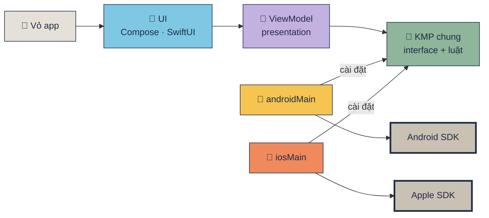

[🏠 README](../README.md) · Kế hoạch: [README-KMP-MIGRATION.md](plan/README-KMP-MIGRATION.md) · Kiến trúc: [App chạy thế nào](README-KMP-HOW-IT-WORKS.md)

# Từng phase: dev đã làm gì

Trang này để **trình bày và review lại**. Mỗi phase đọc từ trên xuống: bước 1 → 2 → 3 là đúng thứ tự dev làm, mỗi bước gắn **một nhãn tầng** để biết đang đụng UI, code KMP dùng chung hay code riêng Android / iOS.

> Cập nhật 2026-10-19. **Android: P0–P7 chạy thật** (trừ BLE connect/GATT cần máy thật). **iOS: UI SwiftUI đủ 5 tab (P10), cả 5 interface gọi SDK thật (P12)**, đã chạy trên simulator, chưa chạy trên iPhone thật.
>
> **Đổi hướng 2026-10-19:** P0–P7 dùng Compose Multiplatform (một UI cho cả 2 bên). Từ P8–P11 UI tách riêng: Android = Jetpack Compose, iOS = SwiftUI, cả hai đọc chung ViewModel trong `shared/`. Các mục P0–P7 bên dưới là **lịch sử đúng lúc làm** (đường dẫn `shared/.../ui/` nay đã dời sang `androidApp/`).

## Đọc nhãn tầng

| Nhãn | Tầng | Thư mục | Chạy ở đâu |
|---|---|---|---|
| 🎨 **UI** | Màn hình: Jetpack Compose · SwiftUI (P0–P7: Compose MP trong `shared/`) | `androidApp/…/ui/` · `iosApp/iosApp/UI/` | **riêng**, viết 2 lần |
| 🧠 **ViewModel** | state + action của từng tab (P8) | `shared/src/commonMain/.../presentation/` | **chung** Android + iOS |
| 🧩 **KMP chung** | interface, luật, model, Ktor, logger | `shared/src/commonMain/.../core/` · `fake/` | **chung** Android + iOS |
| 🤖 **Android** | cài đặt interface bằng Android SDK | `shared/src/androidMain/` | chỉ Android |
| 🍎 **iOS** | cài đặt interface bằng Apple SDK (Swift, P12) · cầu nối `AppModel` / `Observed` | `iosApp/` · `shared/src/iosMain/` | chỉ iOS |
| 📱 **Vỏ app** | `MainActivity` · `iOSApp.swift` · Manifest · Info.plist | `androidApp/` · `iosApp/` | riêng |
| ✅ **Kiểm tra** | build, test, chạy máy, chụp màn hình | — | — |



## Bảng tổng: phase nào đụng tầng nào

| Phase | 🎨 UI | 🧠 VM | 🧩 KMP chung | 🤖 Android | 🍎 iOS | 📱 Vỏ | Trạng thái |
|---|:-:|:-:|:-:|:-:|:-:|:-:|---|
| [P0 Setup](#p0--setup-khung-kmp) | ● | | ● | ● | ● | ● | ✅ 2 máy |
| [P1 Core](#p1--đưa-luật-thuần-vào-commonmain) | | | ● | | | | ✅ 52 test × 2 máy |
| [P2 UI shell](#p2--5-tab-ui-chạy-bằng-fake) | ● | | ● | ● | ● | ● | ✅ 2 máy (data giả) |
| [P3 Permissions](#p3--xin-quyền-thật-android) | | | | ● | → | | 🤖 ✅ · 🍎 → P12 |
| [P4 BLE](#p4--bluetooth-thật-android) | | | | ● | → | | 🤖 scan ✅, GATT cần máy thật · 🍎 → P12 |
| [P5 Media](#p5--camera--thư-viện-ảnh-android) | | | | ● | → | | 🤖 ✅ · 🍎 → P12 |
| [P6 API](#p6--api-thật-bằng-ktor) | | | ● | ● | ● | ● | ✅ 2 máy |
| [P7 Monitor](#p7--monitor--chạy-nền-android) | | | ● | ● | → | | 🤖 ✅ · 🍎 → P12 |
| [P8 ViewModel chung](#p8--viewmodel-dùng-chung-cho-5-tab) | ● | ● | ● | ● | | ● | ✅ 78 test × 2 máy |
| [P9 SwiftUI + SKIE](#p9--swiftui-đầu-tiên-tab-api) | ● | | | | ● | ● | ✅ iOS |
| [P10 SwiftUI 4 tab](#p10--swiftui-đủ-5-tab) | ● | ● | | | ● | | ✅ iOS (Maestro) |
| [P11 Compose → androidApp](#p11--compose-về-androidapp-shared-hết-compose) | ● | | ● | ● | ● | ● | ✅ A32 |
| [P12 iOS SDK thật (Swift)](#p12--ios-gọi-sdk-apple-thật-bằng-swift) | | | | | ● | ● | ✅ code + simulator · iPhone thật chưa |
| P13 Final | | | | | | | chưa |

● = phase này có sửa · ○ = phải làm nhưng chưa làm · → = phần iOS làm sau, ở P12.

Một dãy số duy nhất P0–P13. Commit của P8–P12 ghi nhãn tạm **R1–R5** (P8 = R1 … P12a–d = R5a–d); lịch sử git không sửa, nên tra commit theo nhãn đó.

Điều cần thấy khi nhìn bảng: **từ P3 tới P7 UI không đổi một dòng**. Thứ tự làm thật hơi khác số: P6 (mạng, chạy được trên simulator) làm **trước** P3–P5 (cần máy thật). Màn hình đã viết xong ở P2 trên interface; mỗi phase sau chỉ thay `Fake*` bằng cài đặt thật ở 🤖 / 🍎, rồi đổi **một dòng** trong `createAndroidServices` / `createIosServices`.

## P0 · Setup khung KMP

**Mục tiêu:** một màn hình "Hello" chạy được trên cả Android và iOS từ một codebase.

1. 📱 **Vỏ app**: tạo layout chuẩn KMP-App-Template (`shared/` + `androidApp/` + `iosApp/`), package `com.learn.ndmkmp`, AGP 9.1, Kotlin 2.4.10, Compose Multiplatform 1.11.1.
2. 🎨 **UI**: một hàm `App()` trong [App.kt](https://github.com/tucarmd/native-device-monitor-kmp/blob/b93e618/shared/src/commonMain/kotlin/com/learn/ndmkmp/App.kt) (Compose Multiplatform, 3 dòng chữ: tên app, `platformName()`, gợi ý).
3. 🧩 **KMP chung**: `expect fun platformName()` trong [Platform.kt](https://github.com/tucarmd/native-device-monitor-kmp/blob/b93e618/shared/src/commonMain/kotlin/com/learn/ndmkmp/Platform.kt).
4. 🤖 / 🍎: hai `actual`: [Platform.android.kt](https://github.com/tucarmd/native-device-monitor-kmp/blob/b93e618/shared/src/androidMain/kotlin/com/learn/ndmkmp/Platform.android.kt) (`Build.VERSION`) · [Platform.ios.kt](https://github.com/tucarmd/native-device-monitor-kmp/blob/b93e618/shared/src/iosMain/kotlin/com/learn/ndmkmp/Platform.ios.kt) (`UIDevice`, Kotlin/Native gọi thẳng UIKit).
5. 📱 **Vỏ app**: [MainActivity.kt](https://github.com/tucarmd/native-device-monitor-kmp/blob/b93e618/androidApp/src/main/kotlin/com/learn/ndmkmp/MainActivity.kt) gọi `App()`; [ContentView.swift](https://github.com/tucarmd/native-device-monitor-kmp/blob/b93e618/iosApp/iosApp/ContentView.swift) bọc [MainViewController()](https://github.com/tucarmd/native-device-monitor-kmp/blob/b93e618/shared/src/iosMain/kotlin/com/learn/ndmkmp/MainViewController.kt) cho SwiftUI.
6. ✅ **Kiểm tra**: Pixel 8 emulator + iPhone 17 Simulator.

Link file ở mục này trỏ vào **commit P0** (`b93e618`), không phải `main`, vì sau đó code đã đổi:

| File lúc P0 | Bây giờ (`main`) |
|---|---|
| `shared/commonMain/.../App.kt` (Compose MP) | dời sang [androidApp/.../App.kt](../androidApp/src/main/kotlin/com/learn/ndmkmp/App.kt) ở P11, Jetpack Compose thường |
| `shared/iosMain/.../MainViewController.kt` | xoá ở P11: iOS không còn vẽ Compose |
| `iosApp/iosApp/ContentView.swift` | xoá ở P9, thay bằng [RootView.swift](../iosApp/iosApp/UI/RootView.swift) (SwiftUI `TabView`) |
| `MainActivity.kt` | còn, từ P8 tạo `AppViewModel` rồi `setContent { App(vm) }` |
| `Platform.kt` + 2 `actual` | còn nguyên |

**Mở lại P0 để đọc code** (không đụng `main`): một folder phụ dùng chung kho git, đổi phase bằng `checkout`.

```bash
git worktree add ../native-device-monitor-kmp-phase-view phase-p0   # 1 lần; tag phase-p0 = b93e618
git -C ../native-device-monitor-kmp-phase-view checkout notes/p0     # bản P0 có thêm comment giải thích (chỉ ở máy local)
```

Mở folder đó bằng Android Studio; muốn thấy `iosApp/` thì đổi chế độ xem cây thư mục từ **Android** sang **Project**
(`iosApp` không phải module Gradle). Chạy iOS: mở `iosApp/iosApp.xcodeproj` bằng Xcode.

<div class="shots shots--pair" markdown>

<figure markdown>
[](assets/kmp_p0_android.png)
<figcaption>Android</figcaption>
</figure>

<figure markdown>
[](assets/kmp_p0_ios.png)
<figcaption>iOS</figcaption>
</figure>

</div>

## P1 · Đưa luật thuần vào commonMain

**Mục tiêu:** phần không đụng phần cứng chỉ viết **một lần**, test chạy trên cả 2 máy. **Chỉ đụng 🧩.**

1. 🧩 **KMP chung**: chép 9 file thuần từ app Android cũ sang `commonMain/core/`: [GattModel](https://github.com/tucarmd/native-device-monitor-kmp/blob/9535496/shared/src/commonMain/kotlin/com/learn/ndmkmp/core/bluetooth/GattModel.kt), [BluetoothDecoder](https://github.com/tucarmd/native-device-monitor-kmp/blob/9535496/shared/src/commonMain/kotlin/com/learn/ndmkmp/core/bluetooth/BluetoothDecoder.kt), [BluetoothLookup](https://github.com/tucarmd/native-device-monitor-kmp/blob/9535496/shared/src/commonMain/kotlin/com/learn/ndmkmp/core/bluetooth/BluetoothLookup.kt), [BluetoothScanFilter](https://github.com/tucarmd/native-device-monitor-kmp/blob/9535496/shared/src/commonMain/kotlin/com/learn/ndmkmp/core/bluetooth/BluetoothScanFilter.kt), [BluetoothDeviceInfo](https://github.com/tucarmd/native-device-monitor-kmp/blob/9535496/shared/src/commonMain/kotlin/com/learn/ndmkmp/core/bluetooth/BluetoothDeviceInfo.kt), [DeviceStatus](https://github.com/tucarmd/native-device-monitor-kmp/blob/9535496/shared/src/commonMain/kotlin/com/learn/ndmkmp/core/device/DeviceStatus.kt), [MediaInfo](https://github.com/tucarmd/native-device-monitor-kmp/blob/9535496/shared/src/commonMain/kotlin/com/learn/ndmkmp/core/media/MediaInfo.kt), [PermissionStatus](https://github.com/tucarmd/native-device-monitor-kmp/blob/9535496/shared/src/commonMain/kotlin/com/learn/ndmkmp/core/permission/PermissionStatus.kt), [ScannerActions](https://github.com/tucarmd/native-device-monitor-kmp/blob/9535496/shared/src/commonMain/kotlin/com/learn/ndmkmp/ui/scanner/ScannerActions.kt).
2. 🧩 **KMP chung**: thay API chỉ có trên JVM (commonMain không có JVM):

    | App Android cũ | P1 trong commonMain | Vì sao |
    |---|---|---|
    | `java.util.UUID` | `String` | iOS không có `java.util`; Android đưa `uuid.toString()`, iOS đưa `CBUUID.uuidString` |
    | `"%02X".format(b)` | hàm `hex()` tự viết | `String.format` là của JVM |
    | `Charsets.UTF_8` | `decodeToString()` / `encodeToByteArray()` | có sẵn trong Kotlin chung |
    | `"%.1f".format(Locale.US)` | `oneDecimal()` | như trên |
    | `org.json.JSONObject` | `@Serializable` + kotlinx.serialization | `org.json` chỉ có trên Android |
    | `BluetoothDevice` (Android) | `address: String` | commonMain không thấy class của Android |

3. 🧩 **Gradle**: thêm plugin `kotlinxSerialization` + thư viện `kotlinx-serialization-json`, `kotlin-test` cho `commonTest`, và `withHostTest {}` để test chạy cả trên JVM.
4. 🧩 **KMP chung**: chuyển 50 test JUnit sang `kotlin.test` trong `commonTest` (chỉ đổi import `org.junit.*` → `kotlin.test.*`), thêm 2 test.
5. ✅ **Kiểm tra**: `./gradlew :shared:allTests`: **52/52** trên Android host (`testAndroidHostTest`) **và** iOS Simulator (`iosSimulatorArm64Test`). Cùng một file test, chạy 2 nơi = bằng chứng code thật sự dùng chung.

Link file ở mục này trỏ vào **commit P1** (`9535496`). Sau đó:

| File lúc P1 | Bây giờ (`main`) |
|---|---|
| `commonMain/core/**` (9 file) | còn nguyên, thêm interface + Ktor + logger ở P2–P7 |
| `commonMain/ui/scanner/ScannerActions.kt` | dời sang [presentation/scanner/](../shared/src/commonMain/kotlin/com/learn/ndmkmp/presentation/scanner/ScannerActions.kt) ở P8, cạnh `ScannerViewModel` |
| 52 test `commonTest` | còn, thêm test ViewModel (P8) + `iosTest` (P12) → 78 JVM / 82 iOS |
| `shared/build.gradle.kts` (có Compose MP) | P11 bỏ Compose, P9 thêm SKIE |

**Mở P1 để đọc code** (nhánh `notes/p1` = P1 + comment `📍 P1 note` giải thích, chỉ ở máy local):

```bash
git -C ../native-device-monitor-kmp-phase-view checkout notes/p1
cd ../native-device-monitor-kmp-phase-view && ./gradlew :shared:allTests   # 52/52 × 2
```

Tìm `📍 P1 note` trong Android Studio (Cmd+Shift+F) để đi qua 5 chỗ có ghi chú: `shared/build.gradle.kts`,
`gradle/libs.versions.toml`, `GattModelTest.kt`, `BluetoothDeviceInfo.kt`, `ScannerActions.kt`. P1 chưa có màn hình mới:
app vẫn là màn hello của P0, cái cần xem là code + test.

## P2 · 5 tab UI chạy bằng fake

**Mục tiêu:** cả 5 màn hình hiện trên 2 máy **trước khi** có code phần cứng nào. Đây là phase duy nhất viết UI cho tới P8.
**Commit:** `88c6f13` · tag `phase-p2`.

1. 🧩 **KMP chung, hợp đồng trước**: 5 interface UI sẽ gọi vào, mỗi tab một cái:
    [PermissionController.kt](https://github.com/tucarmd/native-device-monitor-kmp/blob/88c6f13/shared/src/commonMain/kotlin/com/learn/ndmkmp/core/permission/PermissionController.kt) · [BleClient.kt](https://github.com/tucarmd/native-device-monitor-kmp/blob/88c6f13/shared/src/commonMain/kotlin/com/learn/ndmkmp/core/bluetooth/BleClient.kt) · [MediaPicker.kt](https://github.com/tucarmd/native-device-monitor-kmp/blob/88c6f13/shared/src/commonMain/kotlin/com/learn/ndmkmp/core/media/MediaPicker.kt) · [ApiService.kt](https://github.com/tucarmd/native-device-monitor-kmp/blob/88c6f13/shared/src/commonMain/kotlin/com/learn/ndmkmp/core/network/ApiService.kt) · [DeviceMonitor.kt](https://github.com/tucarmd/native-device-monitor-kmp/blob/88c6f13/shared/src/commonMain/kotlin/com/learn/ndmkmp/core/background/DeviceMonitor.kt).
    State đưa ra bằng `StateFlow` để màn hình tự vẽ lại khi giá trị đổi.
2. 🧩 **KMP chung**: 5 bản giả trong `fake/` ([FakeBleClient](https://github.com/tucarmd/native-device-monitor-kmp/blob/88c6f13/shared/src/commonMain/kotlin/com/learn/ndmkmp/fake/FakeBleClient.kt), [FakePermissionController](https://github.com/tucarmd/native-device-monitor-kmp/blob/88c6f13/shared/src/commonMain/kotlin/com/learn/ndmkmp/fake/FakePermissionController.kt)…) có `delay` giống máy thật, để UI chạy ngay trên simulator.
3. 🎨 **UI nền**: theme [AppColor](https://github.com/tucarmd/native-device-monitor-kmp/blob/88c6f13/shared/src/commonMain/kotlin/com/learn/ndmkmp/ui/theme/AppColor.kt) (bảng màu CarMD) · `AppSpacing` · `AppTheme`, component chung [AppCard](https://github.com/tucarmd/native-device-monitor-kmp/blob/88c6f13/shared/src/commonMain/kotlin/com/learn/ndmkmp/ui/common/AppCard.kt) · `AppPrimaryButton` · `AppHintText`.
4. 🎨 **UI 5 màn** (Compose Multiplatform, lúc đó nằm trong `shared/commonMain/ui/`): [PermissionScreen](https://github.com/tucarmd/native-device-monitor-kmp/blob/88c6f13/shared/src/commonMain/kotlin/com/learn/ndmkmp/ui/permission/PermissionScreen.kt) · [ScannerScreen](https://github.com/tucarmd/native-device-monitor-kmp/blob/88c6f13/shared/src/commonMain/kotlin/com/learn/ndmkmp/ui/scanner/ScannerScreen.kt) + `GattSection` · `MediaScreen` · `ApiScreen` · `MonitorScreen`, mỗi màn có file `*Strings.kt` riêng (Rule 5.3, không `strings.xml`).
5. 🎨 **Khung app**: [App.kt](https://github.com/tucarmd/native-device-monitor-kmp/blob/88c6f13/shared/src/commonMain/kotlin/com/learn/ndmkmp/App.kt) = Scaffold + thanh trên + thanh 5 tab; `AppServices` gom 5 interface, `AppServices.fake()` dùng 5 bản giả.
6. 🧩 → 🤖 / 🍎: thêm `expect` cho đồng hồ trong [Platform.kt](https://github.com/tucarmd/native-device-monitor-kmp/blob/88c6f13/shared/src/commonMain/kotlin/com/learn/ndmkmp/Platform.kt): `monotonicMs()` (Android `SystemClock`, iOS `systemUptime`), `clockText()` / `isoLocalTimestamp()` (thay `SimpleDateFormat` của JVM).
7. 📱 **Vỏ app**: `--es tab monitor` (Android) / `-tab monitor` (iOS) mở thẳng 1 tab để chụp màn hình.
8. ✅ **Kiểm tra**: 5 tab trên Pixel 8 + iPhone 17 Simulator; flow giả: xin quyền → bật radio → scan → chọn → connect → discover (Battery + FFE0 UART, MTU 247). Sửa 1 lỗi iOS: nhãn tab "Permissions" xuống 2 dòng → `maxLines = 1`, 11 sp.

| Lúc P2 | Bây giờ (`main`) |
|---|---|
| UI trong `shared/commonMain/ui/` (Compose MP, chung 2 máy) | P8 rút logic ra ViewModel · P11 dời UI Android về `androidApp/` · P9–P10 iOS viết lại bằng SwiftUI |
| `*Strings.kt` cạnh từng màn | P8 dời sang `presentation/`, cả Compose lẫn SwiftUI dùng chung |
| 5 interface + 5 fake | còn nguyên, fake giờ chỉ dùng cho test / preview |

**Mở P2 để đọc code** (worktree xem phase, không đụng `main`):

```bash
git -C ../native-device-monitor-kmp-phase-view checkout phase-p2
```

<div class="shots shots--pair" markdown>

<figure markdown>
[](assets/kmp_p2_android_tabs.png)
<figcaption>Android lúc P2 (Compose MP, data giả)</figcaption>
</figure>

<figure markdown>
[](assets/kmp_p2_ios_tabs.png)
<figcaption>iOS lúc P2 (cùng UI Compose MP)</figcaption>
</figure>

<figure markdown>
[](assets/kmp_p2_android_gatt_fake.png)
<figcaption>GATT giả (Android)</figcaption>
</figure>

</div>

## P3 · Xin quyền thật (Android)

**Mục tiêu:** tab Permissions đúng 4 trạng thái như app cũ. **UI không đổi một dòng**, chỉ thay `FakePermissionController` bằng code thật.
**Commit:** `fbde3e7` · tag `phase-p3`. Phần iOS làm ở P12a.

1. 🤖 **Đọc trạng thái**: [AndroidPermissions.kt](https://github.com/tucarmd/native-device-monitor-kmp/blob/fbde3e7/shared/src/androidMain/kotlin/com/learn/ndmkmp/core/permission/AndroidPermissions.kt)
    - nhánh API ≤ 30: BLE cần `ACCESS_FINE_LOCATION`; API 31+: `BLUETOOTH_SCAN` + `BLUETOOTH_CONNECT`;
    - Android chỉ trả lời "đã cấp chưa" + `shouldShowRequestPermissionRationale`, không phân biệt được "chưa hỏi" với "từ chối 2 lần" → tự lưu cờ "đã hỏi" trong SharedPreferences.
2. 🤖 **Xin quyền**: [AndroidPermissionController.kt](https://github.com/tucarmd/native-device-monitor-kmp/blob/fbde3e7/shared/src/androidMain/kotlin/com/learn/ndmkmp/core/permission/AndroidPermissionController.kt) cài đặt interface `PermissionController` bằng `ActivityResultContracts.RequestMultiplePermissions`. Launcher phải đăng ký **trước** khi Activity STARTED → được tạo trong `MainActivity.onCreate`.
3. 🤖 **Radio**: [AndroidBluetoothRadio.kt](https://github.com/tucarmd/native-device-monitor-kmp/blob/fbde3e7/shared/src/androidMain/kotlin/com/learn/ndmkmp/core/bluetooth/AndroidBluetoothRadio.kt) nghe `ACTION_STATE_CHANGED` (BroadcastReceiver) → thẻ "Bluetooth radio" đổi ON/OFF ngay; nút "Turn on Bluetooth" = `ACTION_REQUEST_ENABLE`.
4. 📱 **Khai báo**: quyền BLE + CAMERA trong [AndroidManifest.xml (shared)](https://github.com/tucarmd/native-device-monitor-kmp/blob/fbde3e7/shared/src/androidMain/AndroidManifest.xml) (`neverForLocation`, `maxSdkVersion` cho quyền cũ).
5. 🤖 **Nối dây**: đổi **1 dòng** trong [AndroidServices.kt](https://github.com/tucarmd/native-device-monitor-kmp/blob/fbde3e7/shared/src/androidMain/kotlin/com/learn/ndmkmp/platform/AndroidServices.kt): `FakePermissionController()` → `AndroidPermissionController(activity)`.
6. ✅ **Kiểm tra** (Pixel 8 API 34): mới cài = NOT REQUESTED → từ chối 1 lần = DENIED (có lý do) → 2 lần = PERMANENTLY DENIED → "Open app settings" mở đúng trang; `cmd bluetooth_manager disable` → thẻ đổi OFF ngay.

| Lúc P3 | Bây giờ |
|---|---|
| `PermissionScreen` tự quyết nút nào hiện | P8: `PermissionViewModel` quyết (`PermissionCardUi.action`), màn chỉ vẽ |
| iOS vẫn `FakePermissionController` | P12a: `PermissionNative.swift` + `IosPermissionController` |

**Mở P3 để đọc code** (worktree xem phase, không đụng `main`):

```bash
git -C ../native-device-monitor-kmp-phase-view checkout phase-p3
```

## P4 · Bluetooth thật (Android)

**Mục tiêu:** tab Scanner quét, kết nối và đọc/ghi GATT bằng Bluetooth thật. **Commit:** `2964e21` · tag `phase-p4`. Phần iOS làm ở P12d.

1. 🤖 **Client BLE**: [AndroidBleClient.kt](https://github.com/tucarmd/native-device-monitor-kmp/blob/2964e21/shared/src/androidMain/kotlin/com/learn/ndmkmp/core/bluetooth/AndroidBleClient.kt) (~780 dòng, port từ `BluetoothClientService.kt` của app cũ):
    - **scan** 10 s tự dừng, lọc trùng theo MAC (giữ thứ tự thấy trước, không sort theo RSSI để dòng không nhảy), lọc tên CarMD lúc quét, đếm số thiết bị bị ẩn;
    - **connect**: `connectGatt` → `discoverServices` → `requestMtu(247)`;
    - **hàng đợi GATT**: Android chỉ cho **1 thao tác một lúc**; gửi read khi read trước chưa xong = mất lệnh → tự viết queue;
    - **notify** = bật local (`setCharacteristicNotification`) **+** ghi descriptor CCCD `2902`;
    - **dọn dẹp**: tắt radio / mất sóng → xoá state; quên `close()` → lần sau connect lỗi `status=133`.
2. 🧩 **KMP chung** (dùng lại từ P1, không sửa): `BluetoothDecoder` giải mã byte, `GattModel` chọn target + `planWrite()`.
3. 🤖 **Nối dây**: [AndroidServices.kt](https://github.com/tucarmd/native-device-monitor-kmp/blob/2964e21/shared/src/androidMain/kotlin/com/learn/ndmkmp/platform/AndroidServices.kt) đổi sang `AndroidBleClient(applicationContext)` (không giữ Activity → không leak), gọi `release()` khi Activity bị huỷ.
4. ✅ **Kiểm tra** (emulator, không có thiết bị BLE): Scan chạy và tự dừng sau 10 s; tắt radio giữa chừng → danh sách bị xoá; thu hồi quyền → "Not ready".
5. ⏳ **Chưa kiểm tra**: connect / discover / read / notify / write / MTU với thiết bị thật (Samsung A32 + nRF Connect) → P13.

| Lúc P4 | Bây giờ |
|---|---|
| `ScannerScreen` đọc thẳng 12 `StateFlow` của `BleClient` | P8: `ScannerViewModel` gom thành 1 `ScannerUiState` |
| iOS vẫn `FakeBleClient` | P12d: `BleNative.swift` (CoreBluetooth) + `IosBleClient` giữ cùng các luật trên |

**Mở P4 để đọc code** (worktree xem phase, không đụng `main`):

```bash
git -C ../native-device-monitor-kmp-phase-view checkout phase-p4
```

## P5 · Camera + thư viện ảnh (Android)

**Mục tiêu:** tab Media chụp ảnh / chọn ảnh thật và hiện thông tin ảnh. **Commit:** `f935a79` · tag `phase-p5`. Phần iOS làm ở P12b.

1. 🤖 **Picker**: [AndroidMediaPicker.kt](https://github.com/tucarmd/native-device-monitor-kmp/blob/f935a79/shared/src/androidMain/kotlin/com/learn/ndmkmp/core/media/AndroidMediaPicker.kt)
    - chụp: `ActivityResultContracts.TakePicture` ghi ảnh vào 1 file tạm trong `cacheDir`, đưa cho app Camera qua `FileProvider` (`content://`, không được dùng `file://` từ API 24);
    - chọn: `PickVisualMedia` (Photo Picker), **không cần quyền đọc bộ nhớ**;
    - hàm `suspend` chờ người dùng xong (`CompletableDeferred`) → màn hình đọc từ trên xuống, không callback;
    - đọc tên / dung lượng qua `ContentResolver`, kích thước + xoay theo EXIF, thu nhỏ ảnh xem trước (`inSampleSize`) để không nghẽn RAM.
2. 🧩 **KMP chung** (dùng lại): `MediaInfo` + `formatBytes()` + `sampleSizeFor()` từ P1.
3. 📱 **Khai báo**: `<provider>` FileProvider trong [AndroidManifest.xml (shared)](https://github.com/tucarmd/native-device-monitor-kmp/blob/f935a79/shared/src/androidMain/AndroidManifest.xml) + [file_paths.xml](https://github.com/tucarmd/native-device-monitor-kmp/blob/f935a79/shared/src/androidMain/res/xml/file_paths.xml).
4. 🤖 **Nối dây**: `AndroidServices.kt` đổi sang `AndroidMediaPicker(activity)` (launcher cũng phải đăng ký trước STARTED).
5. ✅ **Kiểm tra**: chụp → hiện ảnh + info (1392 × 1856, 70 KB); huỷ chụp → "Capture cancelled"; chọn ảnh từ thư viện; từ chối quyền → chữ đỏ + nút mở Settings.
6. ⚠️ **Giới hạn đã ghi**: Android kill app khi đang mở Camera (máy ít RAM) thì mất ảnh; app thật sẽ lưu uri vào `SavedStateHandle`.

| Lúc P5 | Bây giờ |
|---|---|
| `PickedImage.preview` là `ImageBitmap` (của Compose) | P8: đổi sang `ByteArray` (JPEG) để SwiftUI cũng giải mã được |
| iOS vẫn `FakeMediaPicker` | P12b: `MediaNative.swift` (UIImagePickerController / PHPicker) + `IosMediaPicker` |

**Mở P5 để đọc code** (worktree xem phase, không đụng `main`):

```bash
git -C ../native-device-monitor-kmp-phase-view checkout phase-p5
```

## P6 · API thật bằng Ktor

**Mục tiêu:** tab API gọi mạng thật trên **cả 2 máy** bằng **một** file Kotlin. **Commit:** `3d8a0e5` · tag `phase-p6`.
**Thứ tự làm thật: P6 làm trước P3**, vì gọi mạng chạy được trên emulator / simulator, không cần máy thật.

1. 🧩 **HTTP dùng chung**: [KtorApiService.kt](https://github.com/tucarmd/native-device-monitor-kmp/blob/3d8a0e5/shared/src/commonMain/kotlin/com/learn/ndmkmp/core/network/KtorApiService.kt): GET (có query params) / POST JSON / đọc status / timeout 8 s; kết quả là `ApiResult` 5 nhánh (`Success`, `HttpError`, `Timeout`, `NoNetwork`, `Failure`) → màn hình chỉ `when`, không thấy exception.
2. 🤖 / 🍎 **chỉ khác engine**: Android dùng `ktor-client-okhttp`, iOS dùng `ktor-client-darwin` (NSURLSession), khai báo trong `shared/build.gradle.kts` + `libs.versions.toml`.
3. 🤖 / 🍎 **nhận ra "không có mạng"** (mỗi OS ném exception khác nhau) bằng `expect`/`actual`: [NetworkErrorKind.android.kt](https://github.com/tucarmd/native-device-monitor-kmp/blob/3d8a0e5/shared/src/androidMain/kotlin/com/learn/ndmkmp/core/network/NetworkErrorKind.android.kt) (`UnknownHostException`…) · [NetworkErrorKind.ios.kt](https://github.com/tucarmd/native-device-monitor-kmp/blob/3d8a0e5/shared/src/iosMain/kotlin/com/learn/ndmkmp/core/network/NetworkErrorKind.ios.kt) (`NSURLErrorNotConnectedToInternet`…).
4. 🧩 **làm sẵn cho P7**: [FileLogger.kt](https://github.com/tucarmd/native-device-monitor-kmp/blob/3d8a0e5/shared/src/commonMain/kotlin/com/learn/ndmkmp/core/logging/FileLogger.kt) (ghi/đọc JSONL bằng kotlinx-io, đếm dòng hỏng) + [LoopDeviceMonitor.kt](https://github.com/tucarmd/native-device-monitor-kmp/blob/3d8a0e5/shared/src/commonMain/kotlin/com/learn/ndmkmp/core/background/LoopDeviceMonitor.kt) (vòng đọc → ghi file, dùng chung 2 máy).
5. 🤖 / 🍎 **chỗ duy nhất chọn fake hay thật**: tạo [AndroidServices.kt](https://github.com/tucarmd/native-device-monitor-kmp/blob/3d8a0e5/shared/src/androidMain/kotlin/com/learn/ndmkmp/platform/AndroidServices.kt) · [IosServices.kt](https://github.com/tucarmd/native-device-monitor-kmp/blob/3d8a0e5/shared/src/iosMain/kotlin/com/learn/ndmkmp/platform/IosServices.kt). Từ đây mỗi phase sau chỉ đổi 1 dòng trong 2 file này.
6. ✅ **Kiểm tra**: test bằng Ktor `MockEngine` (không cần mạng) + test FileLogger / LoopDeviceMonitor → **67 test × 2 máy**; emulator gọi mạng thật: GET 200, POST 201, HTTP 500, timeout 8 s.

| Lúc P6 | Bây giờ |
|---|---|
| `ApiScreen` tự giữ state request | P8: `ApiViewModel` |
| `KtorApiService` | còn nguyên, vẫn là phần dùng chung 100% |

**Mở P6 để đọc code** (worktree xem phase, không đụng `main`):

```bash
git -C ../native-device-monitor-kmp-phase-view checkout phase-p6
```

<div class="shots shots--pair" markdown>

<figure markdown>
[](assets/kmp_p6_android_api.png)
<figcaption>Android — tab API gọi mạng thật</figcaption>
</figure>

</div>

## P7 · Monitor + chạy nền (Android)

**Mục tiêu:** tab Monitor đọc trạng thái máy, ghi log JSONL, và vẫn ghi khi app ở nền. **Commit:** `51c3cf5` · tag `phase-p7`. Phần iOS làm ở P12c.

1. 🧩 **KMP chung** (có từ P6): `LoopDeviceMonitor` + `FileLogger`. P7 chỉ cần đưa vào 2 mảnh riêng của Android: "đọc máy" và "chạy nền".
2. 🤖 **Đọc máy**: [AndroidDeviceStatusSource.kt](https://github.com/tucarmd/native-device-monitor-kmp/blob/51c3cf5/shared/src/androidMain/kotlin/com/learn/ndmkmp/core/device/AndroidDeviceStatusSource.kt): pin (`BatteryManager`), Wi-Fi / 4G (`ConnectivityManager`), Bluetooth bật / đang nối. Không đọc được thì ghi `null`, không đoán `false`.
3. 🤖 **Chạy nền**, 2 cơ chế, sống / chết khác nhau:
    - [MonitorService.kt](https://github.com/tucarmd/native-device-monitor-kmp/blob/51c3cf5/shared/src/androidMain/kotlin/com/learn/ndmkmp/core/background/MonitorService.kt): **Foreground Service** có notification (+ nút Stop), Android giữ process → vòng 10 s chạy tiếp ở nền;
    - [MonitorWorker.kt](https://github.com/tucarmd/native-device-monitor-kmp/blob/51c3cf5/shared/src/androidMain/kotlin/com/learn/ndmkmp/core/background/MonitorWorker.kt): **WorkManager** mỗi ≥ 15 phút, hệ thống chọn giờ, sống qua kill app và khởi động lại máy;
    - điều khiển cả hai qua [AndroidPlatformBackground.kt](https://github.com/tucarmd/native-device-monitor-kmp/blob/51c3cf5/shared/src/androidMain/kotlin/com/learn/ndmkmp/core/background/AndroidPlatformBackground.kt).
4. 🤖 **Một monitor cho cả process**: [AndroidMonitorRuntime.kt](https://github.com/tucarmd/native-device-monitor-kmp/blob/51c3cf5/shared/src/androidMain/kotlin/com/learn/ndmkmp/core/background/AndroidMonitorRuntime.kt): màn hình, service, worker dùng **chung** 1 vòng + 1 file (không thì Stop trên màn hình không dừng được vòng của service). [NotificationGatedMonitor.kt](https://github.com/tucarmd/native-device-monitor-kmp/blob/51c3cf5/shared/src/androidMain/kotlin/com/learn/ndmkmp/core/background/NotificationGatedMonitor.kt) xin `POST_NOTIFICATIONS` (API 33+) trước khi bật FGS.
5. 📱 **Khai báo**: `FOREGROUND_SERVICE`, `FOREGROUND_SERVICE_DATA_SYNC`, `POST_NOTIFICATIONS`, `<service android:foregroundServiceType="dataSync">` trong [AndroidManifest.xml (shared)](https://github.com/tucarmd/native-device-monitor-kmp/blob/51c3cf5/shared/src/androidMain/AndroidManifest.xml).
6. ✅ **Kiểm tra**: pin đổi theo `adb emu power capacity 42`; app ở nền vẫn ghi bản ghi `"source":"fgs"`; WorkManager `ENQUEUED` + bản ghi `"worker"` đầu tiên. Từ đây **cả 5 interface trên Android đều là code thật**.

| Lúc P7 | Bây giờ |
|---|---|
| `MonitorScreen` tự reload log | P8: `MonitorViewModel` |
| iOS vẫn `FakeDeviceMonitor` | P12c: `DeviceNative.swift` (UIDevice, NWPathMonitor, BGTaskScheduler) + **cùng** `LoopDeviceMonitor` |

**Mở P7 để đọc code** (worktree xem phase, không đụng `main`):

```bash
git -C ../native-device-monitor-kmp-phase-view checkout phase-p7
```

## P8 · ViewModel dùng chung cho 5 tab

**Commit:** `8236c54` (nhãn R1).

1. 🧠 **ViewModel**: [SharedViewModel.kt](../shared/src/commonMain/kotlin/com/learn/ndmkmp/presentation/SharedViewModel.kt) (lớp nền ~10 dòng: scope trên Main + `clear()`), rồi 5 ViewModel + [AppViewModel.kt](../shared/src/commonMain/kotlin/com/learn/ndmkmp/presentation/AppViewModel.kt). Mỗi cái có `state: StateFlow<XxxUiState>` + hàm action. Mọi `if` "hiện gì" (nút nào, chữ gì, dòng nào) dời từ composable vào đây.
2. 🧠 **ViewModel**: `*Strings` và `ScannerActions` dời từ `ui/` sang `presentation/`, để hai UI dùng chung chữ và luật.
3. 🧩 **KMP chung**: `PickedImage.preview` đổi từ `ImageBitmap` (Compose) sang `ByteArray`. Fake picker tự vẽ một ảnh BMP.
4. 🎨 **UI**: 5 màn Compose chỉ còn `vm.state.collectAsState()` + gọi hàm. 📱 `MainActivity` tạo `AppViewModel` và `onDestroy` thì `clear()`.
5. ✅ **Kiểm tra**: 12 test ViewModel mới, 78/78 trên JVM + iOS simulator. Chạy A32, emulator, iPhone simulator (vẫn Compose).

## P9 · SwiftUI đầu tiên: tab API

**Commit:** `13e687a` (nhãn R2).

1. 🧩 **Gradle**: thêm plugin **SKIE 0.10.15**. Swift thấy `StateFlow` thành `AsyncSequence`, enum Kotlin thành enum Swift.
2. 🍎 **iOS**: [Observed.swift](../iosApp/iosApp/App/Observed.swift): `for await v in flow { value = v }` → `@Published` (bản Swift của `collectAsState()`). [AppModel.swift](../iosApp/iosApp/App/AppModel.swift) giữ `AppViewModel`, `deinit` gọi `clear()`.
3. 🎨 **UI iOS**: [RootView.swift](../iosApp/iosApp/UI/RootView.swift) (TabView) + [ApiView.swift](../iosApp/iosApp/UI/Api/ApiView.swift), port từ app cũ, đọc `ApiViewModel.state`.
4. 📱 **Xcode**: thư mục `iosApp/` chuyển sang *synchronized folder*: thả file `.swift` vào là được build, không phải sửa `project.pbxproj`. Deployment target iOS 17. Xoá `ContentView.swift`.
5. ✅ **Kiểm tra**: Maestro bấm GET 200 và 500 trên simulator. Tìm ra lỗi có sẵn từ app cũ: nút viền chỉ nhận chạm ở phần chữ → thêm `.contentShape(Capsule())`.

## P10 · SwiftUI đủ 5 tab

**Commit:** `84ac538` (nhãn R3).

1. 🎨 **UI iOS**: [PermissionView](../iosApp/iosApp/UI/Permission/PermissionView.swift), [ScannerView](../iosApp/iosApp/UI/Scanner/ScannerView.swift) + [GattSection](../iosApp/iosApp/UI/Scanner/GattSection.swift), [MediaView](../iosApp/iosApp/UI/Media/MediaView.swift), [MonitorView](../iosApp/iosApp/UI/Monitor/MonitorView.swift), cùng các mảnh dùng chung `AppChip` / `InfoTable` / `TerminalBox`.
2. 🧠 **ViewModel**: `InfoRow(label, value)` thay cho `Pair<String, String>` (Swift thấy `Pair` thành `KotlinPair` với field optional, khó đọc).
3. 🍎 **iOS**: [IosBridge.kt](../shared/src/iosMain/kotlin/com/learn/ndmkmp/platform/IosBridge.kt): `ByteArray` → `NSData` cho `UIImage(data:)`.
4. ✅ **Kiểm tra**: Maestro chạy hết 5 tab: xin quyền → bật BT → scan → connect → notify → write `41 54 5A 0D` → nhận NOTIFY; chụp ảnh fake; refresh monitor.

## P11 · Compose về androidApp, shared hết Compose

**Commit:** `a4f2c0b` (nhãn R4).

1. 🎨 **UI Android**: `ui/` + `App.kt` dời từ `shared/commonMain` sang [androidApp](../androidApp/src/main/kotlin/com/learn/ndmkmp/App.kt), dùng Jetpack Compose thường (BOM 2026.06.01). Ảnh giải mã bằng `BitmapFactory`.
2. 🧩 **Gradle**: `shared/` bỏ plugin + thư viện Compose Multiplatform. commonMain chỉ còn coroutines, serialization, Ktor, kotlinx-io. androidMain thêm `androidx.activity` + `coroutines-android`.
3. 📱 **Dọn**: xoá `MainViewController.kt` (lối vào Compose của iOS), `composeResources` của template, các dòng Compose MP trong version catalog.
4. ✅ **Kiểm tra**: 78/78 JVM + iOS, A32 đủ 5 tab, Maestro refresh monitor thật + API 200; Xcode build không đổi.

## P12 · iOS gọi SDK Apple thật bằng Swift

**Commit:** `a2eccb9` P12a · `f2a8bf7` P12b · `65b3987` P12c · `82f45c6` P12d (nhãn R5a–d).

Cách nối: interface `core/` giữ nguyên. Swift implement các interface **callback nhỏ** trong `iosMain`, còn adapter Kotlin giữ `StateFlow` và luật.

```
 Swift Platform/*Native  ──callback──►  Kotlin iosMain adapter  ──implements──►  core/ interface  ◄── ViewModel chung
```

1. 🍎 **P12a quyền**: [PermissionNative.swift](../iosApp/iosApp/Platform/PermissionNative.swift) đọc `CBManager.authorization` (static, không bật hộp thoại), xin camera, theo dõi radio. [IosPermissionController.kt](../shared/src/iosMain/kotlin/com/learn/ndmkmp/platform/IosPermissionController.kt) đổi sang 4 trạng thái: DENIED → PERMANENTLY_DENIED vì iOS chỉ hỏi 1 lần, và một hộp thoại Bluetooth dùng chung cho 2 thẻ BLE.
2. 🍎 **P12b media**: [MediaNative.swift](../iosApp/iosApp/Platform/MediaNative.swift) mở `UIImagePickerController` / `PHPickerViewController` bằng UIKit, thu nhỏ ảnh còn 1024 px. [IosMediaPicker.kt](../shared/src/iosMain/kotlin/com/learn/ndmkmp/platform/IosMediaPicker.kt) đổi callback thành `suspend`.
3. 🍎 **P12c monitor**: [DeviceNative.swift](../iosApp/iosApp/Platform/DeviceNative.swift) đọc pin, `NWPathMonitor`, `BGTaskScheduler`. [IosMonitor.kt](../shared/src/iosMain/kotlin/com/learn/ndmkmp/platform/IosMonitor.kt) dựng `LoopDeviceMonitor` dùng chung, file `monitor.jsonl` nằm trong Documents. Handler BGAppRefresh đăng ký ở `iOSApp.init`.
4. 🍎 **P12d BLE**: [BleNative.swift](../iosApp/iosApp/Platform/BleNative.swift) bọc mỏng CoreBluetooth (giữ ref mạnh `CBPeripheral`). [IosBleClient.kt](../shared/src/iosMain/kotlin/com/learn/ndmkmp/platform/IosBleClient.kt) giữ luật của `BluetoothClientService.swift` cũ: lọc, khử trùng lặp, quét 10 s, timeout 15 s, phân biệt read với notify, dọn dẹp khi tắt radio.
5. 🧠 **ViewModel**: `MonitorUiState` thêm tiêu đề / gợi ý theo nền tảng (iOS: BGAppRefresh, không phải WorkManager).
6. ✅ **Kiểm tra**: 82/82 test trên iOS (thêm `IosAdaptersTest`). Simulator: xin quyền camera → GRANTED, PHPicker thật chọn được ảnh, loop ghi JSONL và log còn sau khi mở lại app, Schedule báo lỗi 1 đúng như mong đợi. **Chưa chạy trên iPhone thật.**

## Còn lại

| Việc | Tầng | Cần gì |
|---|---|---|
| Chạy P12 trên iPhone thật | ✅ | chụp ảnh, BLE scan → GATT với nRF Connect, BGAppRefresh (LLDB `_simulateLaunchForTaskWithIdentifier`) |
| P4 GATT end-to-end | ✅ | Samsung A32 + iPhone + nRF Connect |
| P13 Final | ✅ | | chạy P12 trên iPhone thật, checklist E2E task 006, README "cũ vs mới" |
