[🏠 README](../README.md) · Kế hoạch: [README-KMP-MIGRATION.md](plan/README-KMP-MIGRATION.md) · Kiến trúc: [App chạy thế nào](README-KMP-HOW-IT-WORKS.md)

# Từng phase: dev đã làm gì

Trang này để **trình bày và review lại**. Mỗi phase đọc từ trên xuống: bước 1 → 2 → 3 là đúng thứ tự dev làm, mỗi bước gắn **một nhãn tầng** để biết đang đụng UI, code KMP dùng chung hay code riêng Android / iOS.

> Cập nhật 2026-10-19. **Android: P0–P7 chạy thật** (trừ BLE connect/GATT cần máy thật). **iOS: UI SwiftUI đủ 5 tab (P10), cả 5 interface gọi SDK thật (P12)**, đã chạy trên simulator, chưa chạy trên iPhone thật.
>
> **Đổi hướng 2026-10-19:** P0–P7 dùng Compose Multiplatform (một UI cho cả 2 bên). Từ P8–P11 UI tách riêng: Android = Jetpack Compose, iOS = SwiftUI, cả hai đọc chung ViewModel trong `shared/`. Các mục P0–P7 bên dưới là **lịch sử đúng lúc làm** (đường dẫn `shared/.../ui/` nay đã dời sang `androidApp/`).

## Đọc nhãn tầng

| Nhãn | Tầng | Thư mục | Chạy ở đâu |
|---|---|---|---|
| 🎨 **UI** | Màn hình: Jetpack Compose · SwiftUI (P0–P7: Compose MP trong `shared/`) | `androidApp/…/ui/` · `iosApp/iosApp/UI/` | **riêng**, viết 2 lần |
| 🧠 **ViewModel** | state + action của từng tab (P8) | `shared/src/commonMain/.../presentation/` | **chung** Android + iOS |
| 🧩 **KMP chung** | interface, luật, model, Ktor, logger | `shared/src/commonMain/.../core/` · `fake/` | **chung** Android + iOS |
| 🤖 **Android** | cài đặt interface bằng Android SDK | `shared/src/androidMain/` | chỉ Android |
| 🍎 **iOS** | cài đặt interface bằng Apple SDK (Swift, P12) · cầu nối `AppModel` / `Observed` | `iosApp/` · `shared/src/iosMain/` | chỉ iOS |
| 📱 **Vỏ app** | `MainActivity` · `iOSApp.swift` · Manifest · Info.plist | `androidApp/` · `iosApp/` | riêng |
| ✅ **Kiểm tra** | build, test, chạy máy, chụp màn hình | — | — |

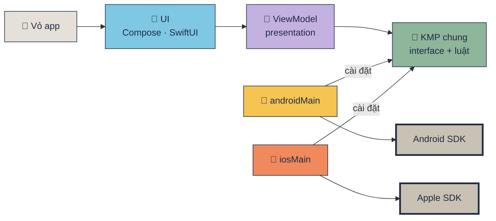

## Bảng tổng: phase nào đụng tầng nào

| Phase | 🎨 UI | 🧠 VM | 🧩 KMP chung | 🤖 Android | 🍎 iOS | 📱 Vỏ | Trạng thái |
|---|:-:|:-:|:-:|:-:|:-:|:-:|---|
| [P0 Setup](#p0--setup-khung-kmp) | ● | | ● | ● | ● | ● | ✅ 2 máy |
| [P1 Core](#p1--đưa-luật-thuần-vào-commonmain) | | | ● | | | | ✅ 52 test × 2 máy |
| [P2 UI shell](#p2--5-tab-ui-chạy-bằng-fake) | ● | | ● | ● | ● | ● | ✅ 2 máy (data giả) |
| [P6 API](#p6--api-thật-bằng-ktor) | | | ● | ● | ● | ● | ✅ 2 máy |
| [P3 Permissions](#p3--xin-quyền-thật-android) | | | | ● | → | | 🤖 ✅ · 🍎 → P12 |
| [P4 BLE](#p4--bluetooth-thật-android) | | | | ● | → | | 🤖 scan ✅, GATT cần máy thật · 🍎 → P12 |
| [P5 Media](#p5--camera--thư-viện-ảnh-android) | | | | ● | → | | 🤖 ✅ · 🍎 → P12 |
| [P7 Monitor](#p7--monitor--chạy-nền-android) | | | ● | ● | → | | 🤖 ✅ · 🍎 → P12 |
| [P8 ViewModel chung](#p8--viewmodel-dùng-chung-cho-5-tab) | ● | ● | ● | ● | | ● | ✅ 78 test × 2 máy |
| [P9 SwiftUI + SKIE](#p9--swiftui-đầu-tiên-tab-api) | ● | | | | ● | ● | ✅ iOS |
| [P10 SwiftUI 4 tab](#p10--swiftui-đủ-5-tab) | ● | ● | | | ● | | ✅ iOS (Maestro) |
| [P11 Compose → androidApp](#p11--compose-về-androidapp-shared-hết-compose) | ● | | ● | ● | ● | ● | ✅ A32 |
| [P12 iOS SDK thật (Swift)](#p12--ios-gọi-sdk-apple-thật-bằng-swift) | | | | | ● | ● | ✅ code + simulator · iPhone thật chưa |
| P13 Final | | | | | | | chưa |

● = phase này có sửa · ○ = phải làm nhưng chưa làm · → = phần iOS làm sau, ở P12.

Một dãy số duy nhất P0–P13. Commit của P8–P12 ghi nhãn tạm **R1–R5** (P8 = R1 … P12a–d = R5a–d); lịch sử git không sửa, nên tra commit theo nhãn đó.

Điều cần thấy khi nhìn bảng: **từ P3 tới P7 UI không đổi một dòng**. Màn hình đã viết xong ở P2 trên interface; mỗi phase sau chỉ thay `Fake*` bằng cài đặt thật ở 🤖 / 🍎, rồi đổi **một dòng** trong `createAndroidServices` / `createIosServices`.

## P0 · Setup khung KMP

**Mục tiêu:** một màn hình "Hello" chạy được trên cả Android và iOS từ một codebase.

1. 📱 **Vỏ app**: tạo layout chuẩn KMP-App-Template (`shared/` + `androidApp/` + `iosApp/`), package `com.learn.ndmkmp`, AGP 9.1, Kotlin 2.4.10, Compose Multiplatform 1.11.1.
2. 🎨 **UI**: một hàm `App()` trong [App.kt](https://github.com/tucarmd/native-device-monitor-kmp/blob/b93e618/shared/src/commonMain/kotlin/com/learn/ndmkmp/App.kt) (Compose Multiplatform, 3 dòng chữ: tên app, `platformName()`, gợi ý).
3. 🧩 **KMP chung**: `expect fun platformName()` trong [Platform.kt](https://github.com/tucarmd/native-device-monitor-kmp/blob/b93e618/shared/src/commonMain/kotlin/com/learn/ndmkmp/Platform.kt).
4. 🤖 / 🍎: hai `actual`: [Platform.android.kt](https://github.com/tucarmd/native-device-monitor-kmp/blob/b93e618/shared/src/androidMain/kotlin/com/learn/ndmkmp/Platform.android.kt) (`Build.VERSION`) · [Platform.ios.kt](https://github.com/tucarmd/native-device-monitor-kmp/blob/b93e618/shared/src/iosMain/kotlin/com/learn/ndmkmp/Platform.ios.kt) (`UIDevice`, Kotlin/Native gọi thẳng UIKit).
5. 📱 **Vỏ app**: [MainActivity.kt](https://github.com/tucarmd/native-device-monitor-kmp/blob/b93e618/androidApp/src/main/kotlin/com/learn/ndmkmp/MainActivity.kt) gọi `App()`; [ContentView.swift](https://github.com/tucarmd/native-device-monitor-kmp/blob/b93e618/iosApp/iosApp/ContentView.swift) bọc [MainViewController()](https://github.com/tucarmd/native-device-monitor-kmp/blob/b93e618/shared/src/iosMain/kotlin/com/learn/ndmkmp/MainViewController.kt) cho SwiftUI.
6. ✅ **Kiểm tra**: Pixel 8 emulator + iPhone 17 Simulator.

Link file ở mục này trỏ vào **commit P0** (`b93e618`), không phải `main`, vì sau đó code đã đổi:

| File lúc P0 | Bây giờ (`main`) |
|---|---|
| `shared/commonMain/.../App.kt` (Compose MP) | dời sang [androidApp/.../App.kt](../androidApp/src/main/kotlin/com/learn/ndmkmp/App.kt) ở P11, Jetpack Compose thường |
| `shared/iosMain/.../MainViewController.kt` | xoá ở P11: iOS không còn vẽ Compose |
| `iosApp/iosApp/ContentView.swift` | xoá ở P9, thay bằng [RootView.swift](../iosApp/iosApp/UI/RootView.swift) (SwiftUI `TabView`) |
| `MainActivity.kt` | còn, từ P8 tạo `AppViewModel` rồi `setContent { App(vm) }` |
| `Platform.kt` + 2 `actual` | còn nguyên |

**Mở lại P0 để đọc code** (không đụng `main`): một folder phụ dùng chung kho git, đổi phase bằng `checkout`.

```bash
git worktree add ../native-device-monitor-kmp-phase-view phase-p0   # 1 lần; tag phase-p0 = b93e618
git -C ../native-device-monitor-kmp-phase-view checkout notes/p0     # bản P0 có thêm comment giải thích (chỉ ở máy local)
```

Mở folder đó bằng Android Studio; muốn thấy `iosApp/` thì đổi chế độ xem cây thư mục từ **Android** sang **Project**
(`iosApp` không phải module Gradle). Chạy iOS: mở `iosApp/iosApp.xcodeproj` bằng Xcode.

<div class="shots shots--pair" markdown>

<figure markdown>
[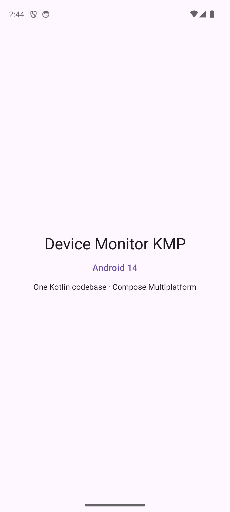](assets/kmp_p0_android.png)
<figcaption>Android</figcaption>
</figure>

<figure markdown>
[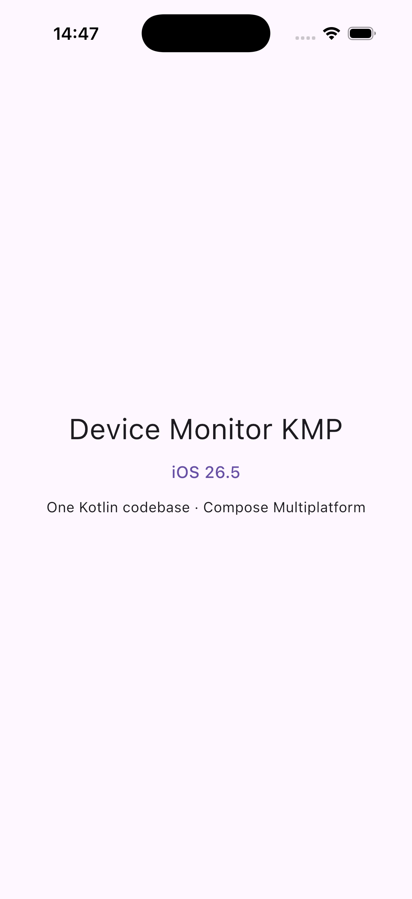](assets/kmp_p0_ios.png)
<figcaption>iOS</figcaption>
</figure>

</div>

## P1 · Đưa luật thuần vào commonMain

**Mục tiêu:** phần không đụng phần cứng chỉ viết **một lần**, test chạy trên cả 2 máy. **Chỉ đụng 🧩.**

1. 🧩 **KMP chung**: chép 9 file thuần từ app Android cũ sang `commonMain/core/`: `GattModel`, `BluetoothDecoder`, `BluetoothLookup`, `BluetoothScanFilter`, `BluetoothDeviceInfo`, `DeviceStatus`, `MediaInfo`, `PermissionStatus`, `ScannerActions`.
2. 🧩 **KMP chung**: thay API chỉ có trên JVM: `java.util.UUID` → `String`, `"%02X".format` → `hex()`, `Charsets` → `decodeToString()`, `org.json` → kotlinx.serialization.
3. 🧩 **KMP chung**: chuyển 50 test JUnit sang `kotlin.test` trong `commonTest`, thêm 2 test.
4. ✅ **Kiểm tra**: `./gradlew :shared:allTests`: **52/52** trên Android host **và** iOS Simulator.

## P2 · 5 tab UI chạy bằng fake

**Mục tiêu:** cả 5 màn hình hiện trên 2 máy **trước khi** có code phần cứng nào. Đây là phase duy nhất viết UI.

1. 🎨 **UI**: theme (`AppColor`, `AppSpacing`, `AppTheme`) + component chung (`AppCard`, `AppPrimaryButton`, `AppHintText`) trong `ui/theme/`, `ui/common/`.
2. 🎨 **UI**: 5 màn `PermissionScreen` · `ScannerScreen` (+ `GattSection`) · `MediaScreen` · `ApiScreen` · `MonitorScreen`; `App()` = Scaffold + thanh 5 tab.
3. 🧩 **KMP chung**: 5 interface UI gọi vào: [`PermissionController`](../shared/src/commonMain/kotlin/com/learn/ndmkmp/core/permission/PermissionController.kt) · [`BleClient`](../shared/src/commonMain/kotlin/com/learn/ndmkmp/core/bluetooth/BleClient.kt) · [`MediaPicker`](../shared/src/commonMain/kotlin/com/learn/ndmkmp/core/media/MediaPicker.kt) · [`ApiService`](../shared/src/commonMain/kotlin/com/learn/ndmkmp/core/network/ApiService.kt) · [`DeviceMonitor`](../shared/src/commonMain/kotlin/com/learn/ndmkmp/core/background/DeviceMonitor.kt), gom trong `AppServices`.
4. 🧩 **KMP chung**: 5 bản giả `fake/Fake*.kt` để UI chạy được ngay.
5. 🧩 → 🤖 / 🍎: `expect` cho đồng hồ (`monotonicMs`, `clockText`, `isoLocalTimestamp`), `actual` mỗi bên.
6. ✅ **Kiểm tra**: 5 tab trên Pixel + iPhone Simulator; flow giả request → bật radio → scan → connect → discover chạy. Sửa 1 lỗi iOS: nhãn tab "Permissions" xuống 2 dòng.

Chọn tab bên dưới để xem từng màn, Android bên trái · iOS bên phải. Bấm vào ảnh để mở ảnh gốc.

=== "Permissions"

    <div class="shots shots--pair" markdown>
    <figure markdown>
    [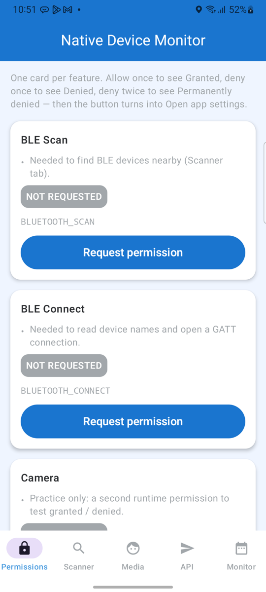](assets/kmp_tab_android_1_permissions.png)
    <figcaption>Android — Pixel 8, API 34</figcaption>
    </figure>
    <figure markdown>
    [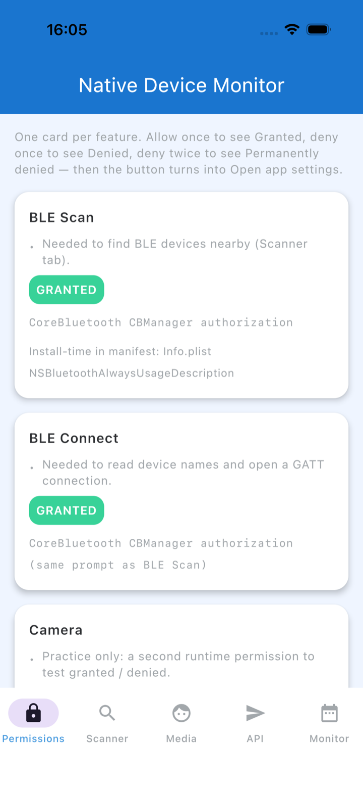](assets/kmp_tab_ios_1_permissions.png)
    <figcaption>iOS — iPhone 17, iOS 26.5</figcaption>
    </figure>
    </div>

=== "Scanner"

    <div class="shots shots--pair" markdown>
    <figure markdown>
    [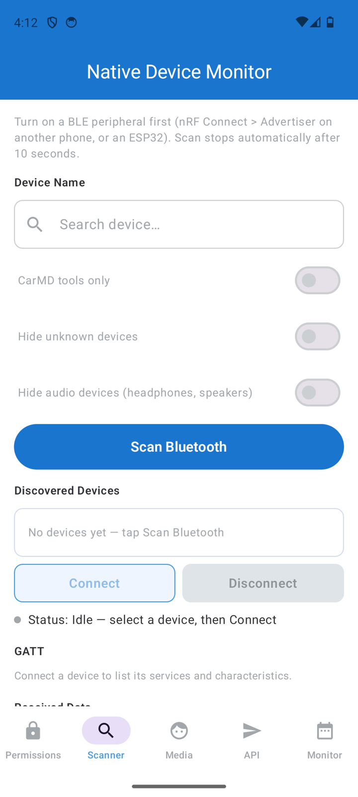](assets/kmp_tab_android_2_scanner.png)
    <figcaption>Android — Pixel 8, API 34</figcaption>
    </figure>
    <figure markdown>
    [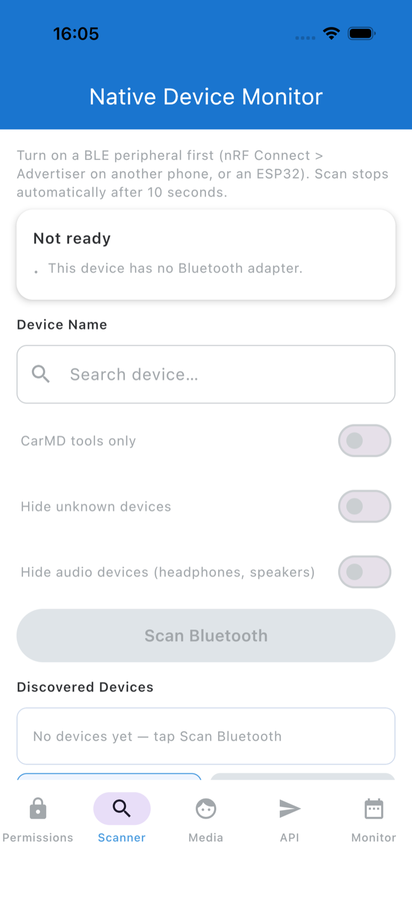](assets/kmp_tab_ios_2_scanner.png)
    <figcaption>iOS — iPhone 17, iOS 26.5</figcaption>
    </figure>
    </div>

=== "Media"

    <div class="shots shots--pair" markdown>
    <figure markdown>
    [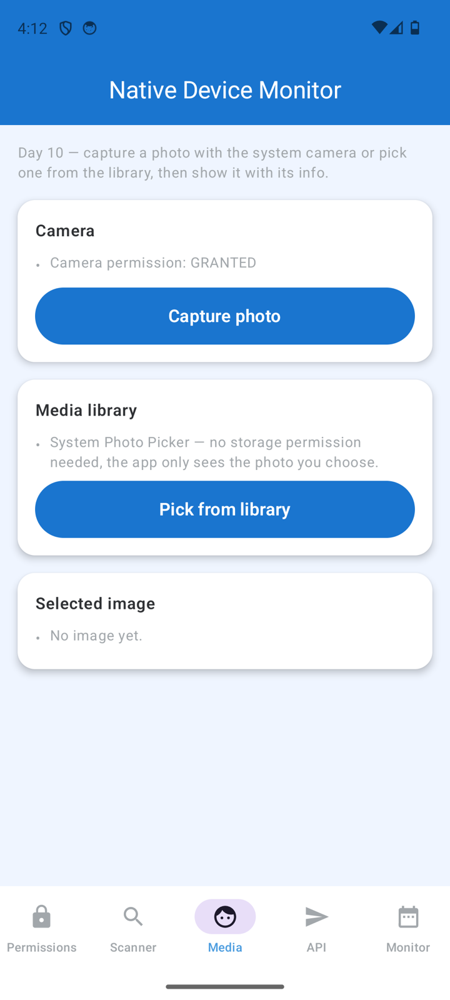](assets/kmp_tab_android_3_media.png)
    <figcaption>Android — Pixel 8, API 34</figcaption>
    </figure>
    <figure markdown>
    [](assets/kmp_tab_ios_3_media.png)
    <figcaption>iOS — iPhone 17, iOS 26.5</figcaption>
    </figure>
    </div>

=== "API"

    <div class="shots shots--pair" markdown>
    <figure markdown>
    [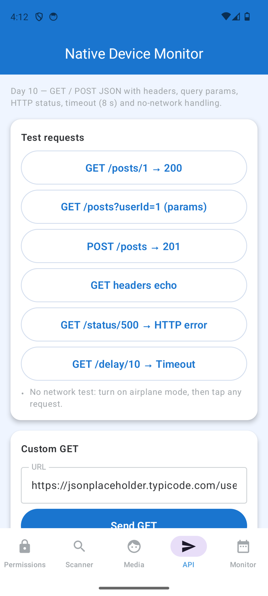](assets/kmp_tab_android_4_api.png)
    <figcaption>Android — Pixel 8, API 34</figcaption>
    </figure>
    <figure markdown>
    [](assets/kmp_tab_ios_4_api.png)
    <figcaption>iOS — iPhone 17, iOS 26.5</figcaption>
    </figure>
    </div>

=== "Monitor"

    <div class="shots shots--pair" markdown>
    <figure markdown>
    [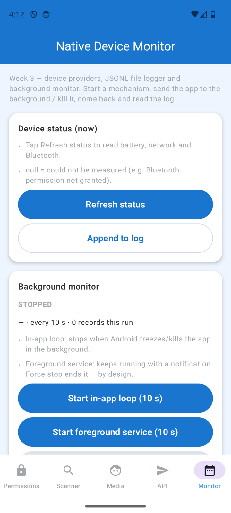](assets/kmp_tab_android_5_monitor.png)
    <figcaption>Android — Pixel 8, API 34</figcaption>
    </figure>
    <figure markdown>
    [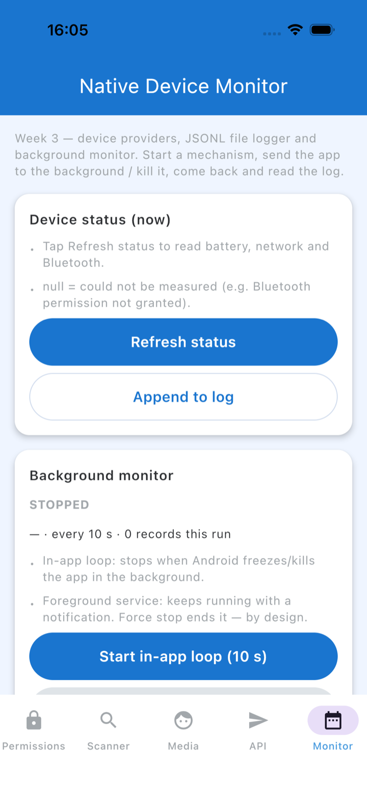](assets/kmp_tab_ios_5_monitor.png)
    <figcaption>iOS — iPhone 17, iOS 26.5</figcaption>
    </figure>
    </div>

<div class="shots shots--pair" markdown>

<figure markdown>
[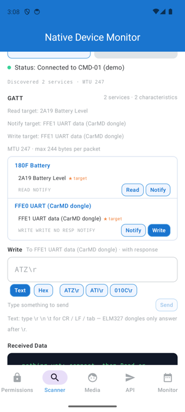](assets/kmp_p2_android_gatt_fake.png)
<figcaption>GATT giả (Android)</figcaption>
</figure>

</div>

## P6 · API thật bằng Ktor

**Mục tiêu:** tab API gọi mạng thật trên **cả 2 máy** bằng **một** file Kotlin. Làm trước P3 vì không cần máy thật.

1. 🧩 **KMP chung**: [KtorApiService.kt](../shared/src/commonMain/kotlin/com/learn/ndmkmp/core/network/KtorApiService.kt): GET / POST / HTTP 500 / timeout, kết quả 5 nhánh `ApiResult`.
2. 🤖 / 🍎: chỉ khác **engine** (OkHttp / Darwin) và cách nhận ra "không có mạng": [NetworkErrorKind.android.kt](../shared/src/androidMain/kotlin/com/learn/ndmkmp/core/network/NetworkErrorKind.android.kt) · [NetworkErrorKind.ios.kt](../shared/src/iosMain/kotlin/com/learn/ndmkmp/core/network/NetworkErrorKind.ios.kt).
3. 🧩 **KMP chung**: làm sẵn cho P7: [FileLogger.kt](../shared/src/commonMain/kotlin/com/learn/ndmkmp/core/logging/FileLogger.kt) (JSONL, kotlinx-io) + [LoopDeviceMonitor.kt](../shared/src/commonMain/kotlin/com/learn/ndmkmp/core/background/LoopDeviceMonitor.kt).
4. 🤖 / 🍎: tạo **chỗ duy nhất chọn fake hay thật**: [AndroidServices.kt](../shared/src/androidMain/kotlin/com/learn/ndmkmp/platform/AndroidServices.kt) · [IosServices.kt](../shared/src/iosMain/kotlin/com/learn/ndmkmp/platform/IosServices.kt).
5. ✅ **Kiểm tra**: test MockEngine, tổng **67 test × 2 máy**; emulator gọi mạng thật: GET 200, POST 201, HTTP 500, timeout 8 s.

<div class="shots shots--pair" markdown>

<figure markdown>
[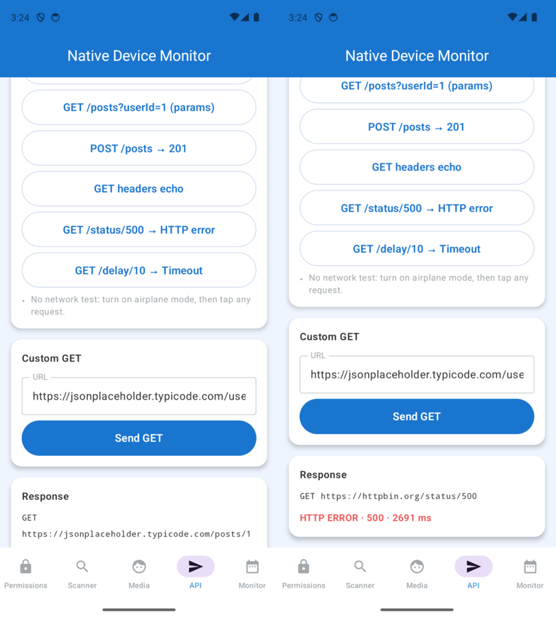](assets/kmp_p6_android_api.png)
<figcaption>Android — tab API gọi mạng thật</figcaption>
</figure>

</div>

## P3 · Xin quyền thật (Android)

**Mục tiêu:** tab Permissions đúng 4 trạng thái như app cũ. **UI không đổi**, chỉ thay `FakePermissionController`.

1. 🤖 **Android**: [AndroidPermissions.kt](../shared/src/androidMain/kotlin/com/learn/ndmkmp/core/permission/AndroidPermissions.kt): đọc trạng thái, nhánh API ≤ 30 (`ACCESS_FINE_LOCATION`) và 31+ (`BLUETOOTH_SCAN/CONNECT`), cờ "đã hỏi" để phân biệt DENIED với PERMANENTLY DENIED.
2. 🤖 **Android**: [AndroidPermissionController.kt](../shared/src/androidMain/kotlin/com/learn/ndmkmp/core/permission/AndroidPermissionController.kt): cài đặt interface `PermissionController` bằng `RequestMultiplePermissions`, mở Settings.
3. 🤖 **Android**: [AndroidBluetoothRadio.kt](../shared/src/androidMain/kotlin/com/learn/ndmkmp/core/bluetooth/AndroidBluetoothRadio.kt): theo dõi bật/tắt Bluetooth, nút "Turn on Bluetooth".
4. 📱 **Khai báo**: quyền BLE + CAMERA trong [shared AndroidManifest.xml](../shared/src/androidMain/AndroidManifest.xml).
5. 🤖 **Nối dây**: đổi 1 dòng trong `createAndroidServices`: `FakePermissionController` → `AndroidPermissionController`.
6. ✅ **Kiểm tra** (Pixel 8 API 34): mới cài = NOT REQUESTED → từ chối 1 lần = DENIED → 2 lần = PERMANENTLY DENIED → "Open app settings" mở đúng trang; tắt radio thì thẻ đổi OFF ngay.

## P4 · Bluetooth thật (Android)

1. 🤖 **Android**: [AndroidBleClient.kt](../shared/src/androidMain/kotlin/com/learn/ndmkmp/core/bluetooth/AndroidBleClient.kt) (~780 dòng, port từ `BluetoothClientService` cũ): scan 10 s + lọc trùng, `connectGatt`, hàng đợi thao tác GATT (1 lệnh một lúc), ghi CCCD để bật notify, `requestMtu(247)`, dọn dẹp khi tắt radio.
2. 🧩 **KMP chung** (dùng lại, không sửa): `BluetoothDecoder`, `GattModel` từ P1 giải mã byte.
3. 🤖 **Nối dây**: `createAndroidServices` đổi sang `AndroidBleClient`, `release()` khi Activity bị hủy.
4. ✅ **Kiểm tra** (emulator, không có thiết bị BLE): Scan chạy và tự dừng sau 10 s; tắt radio giữa chừng → danh sách bị xóa; thu hồi quyền → "Not ready".
5. ⏳ **Chưa kiểm tra**: connect / discover / read / notify / write / MTU: cần Samsung A32 + nRF Connect.

## P5 · Camera + thư viện ảnh (Android)

1. 🤖 **Android**: [AndroidMediaPicker.kt](../shared/src/androidMain/kotlin/com/learn/ndmkmp/core/media/AndroidMediaPicker.kt): `TakePicture` + `PickVisualMedia`, xin quyền CAMERA, đọc tên / dung lượng / kích thước ảnh, xoay theo EXIF.
2. 🧩 **KMP chung** (dùng lại): `MediaInfo` từ P1.
3. 📱 **Khai báo**: `FileProvider` + [file_paths.xml](../shared/src/androidMain/res/xml/file_paths.xml) trong manifest.
4. ✅ **Kiểm tra**: chụp ảnh → hiện ảnh + info (1392 × 1856, 70 KB); hủy chụp → "Capture cancelled"; chọn ảnh từ thư viện; từ chối quyền → chữ đỏ + mở Settings.
5. ⚠️ **Giới hạn đã ghi**: Android kill app khi đang mở Camera thì mất ảnh.

## P7 · Monitor + chạy nền (Android)

1. 🧩 **KMP chung** (đã có từ P6): `LoopDeviceMonitor` + `FileLogger` = vòng đọc trạng thái và ghi JSONL, dùng chung.
2. 🤖 **Android**: [AndroidDeviceStatusSource.kt](../shared/src/androidMain/kotlin/com/learn/ndmkmp/core/device/AndroidDeviceStatusSource.kt): đọc pin, mạng, Bluetooth.
3. 🤖 **Android**: [MonitorService.kt](../shared/src/androidMain/kotlin/com/learn/ndmkmp/core/background/MonitorService.kt) (Foreground Service + notification Stop) và [MonitorWorker.kt](../shared/src/androidMain/kotlin/com/learn/ndmkmp/core/background/MonitorWorker.kt) (WorkManager 15 phút), điều khiển qua [AndroidPlatformBackground.kt](../shared/src/androidMain/kotlin/com/learn/ndmkmp/core/background/AndroidPlatformBackground.kt).
4. 🤖 **Android**: [AndroidMonitorRuntime.kt](../shared/src/androidMain/kotlin/com/learn/ndmkmp/core/background/AndroidMonitorRuntime.kt): một monitor cho cả màn hình, service và worker; [NotificationGatedMonitor.kt](../shared/src/androidMain/kotlin/com/learn/ndmkmp/core/background/NotificationGatedMonitor.kt) xin quyền thông báo trước khi bật FGS.
5. 📱 **Khai báo**: quyền mạng, `FOREGROUND_SERVICE_DATA_SYNC`, `POST_NOTIFICATIONS`, `<service>` trong manifest.
6. ✅ **Kiểm tra**: pin đổi theo `adb emu power capacity 42`; app ở nền vẫn ghi bản ghi "fgs"; WorkManager ENQUEUED + bản ghi "worker" đầu tiên. Từ đây **cả 5 interface trên Android đều là code thật**.

## P8 · ViewModel dùng chung cho 5 tab

1. 🧠 **ViewModel**: [SharedViewModel.kt](../shared/src/commonMain/kotlin/com/learn/ndmkmp/presentation/SharedViewModel.kt) (lớp nền ~10 dòng: scope trên Main + `clear()`), rồi 5 ViewModel + [AppViewModel.kt](../shared/src/commonMain/kotlin/com/learn/ndmkmp/presentation/AppViewModel.kt). Mỗi cái có `state: StateFlow<XxxUiState>` + hàm action. Mọi `if` "hiện gì" (nút nào, chữ gì, dòng nào) dời từ composable vào đây.
2. 🧠 **ViewModel**: `*Strings` và `ScannerActions` dời từ `ui/` sang `presentation/`, để hai UI dùng chung chữ và luật.
3. 🧩 **KMP chung**: `PickedImage.preview` đổi từ `ImageBitmap` (Compose) sang `ByteArray`. Fake picker tự vẽ một ảnh BMP.
4. 🎨 **UI**: 5 màn Compose chỉ còn `vm.state.collectAsState()` + gọi hàm. 📱 `MainActivity` tạo `AppViewModel` và `onDestroy` thì `clear()`.
5. ✅ **Kiểm tra**: 12 test ViewModel mới, 78/78 trên JVM + iOS simulator. Chạy A32, emulator, iPhone simulator (vẫn Compose).

## P9 · SwiftUI đầu tiên: tab API

1. 🧩 **Gradle**: thêm plugin **SKIE 0.10.15**. Swift thấy `StateFlow` thành `AsyncSequence`, enum Kotlin thành enum Swift.
2. 🍎 **iOS**: [Observed.swift](../iosApp/iosApp/App/Observed.swift): `for await v in flow { value = v }` → `@Published` (bản Swift của `collectAsState()`). [AppModel.swift](../iosApp/iosApp/App/AppModel.swift) giữ `AppViewModel`, `deinit` gọi `clear()`.
3. 🎨 **UI iOS**: [RootView.swift](../iosApp/iosApp/UI/RootView.swift) (TabView) + [ApiView.swift](../iosApp/iosApp/UI/Api/ApiView.swift), port từ app cũ, đọc `ApiViewModel.state`.
4. 📱 **Xcode**: thư mục `iosApp/` chuyển sang *synchronized folder*: thả file `.swift` vào là được build, không phải sửa `project.pbxproj`. Deployment target iOS 17. Xoá `ContentView.swift`.
5. ✅ **Kiểm tra**: Maestro bấm GET 200 và 500 trên simulator. Tìm ra lỗi có sẵn từ app cũ: nút viền chỉ nhận chạm ở phần chữ → thêm `.contentShape(Capsule())`.

## P10 · SwiftUI đủ 5 tab

1. 🎨 **UI iOS**: [PermissionView](../iosApp/iosApp/UI/Permission/PermissionView.swift), [ScannerView](../iosApp/iosApp/UI/Scanner/ScannerView.swift) + [GattSection](../iosApp/iosApp/UI/Scanner/GattSection.swift), [MediaView](../iosApp/iosApp/UI/Media/MediaView.swift), [MonitorView](../iosApp/iosApp/UI/Monitor/MonitorView.swift), cùng các mảnh dùng chung `AppChip` / `InfoTable` / `TerminalBox`.
2. 🧠 **ViewModel**: `InfoRow(label, value)` thay cho `Pair<String, String>` (Swift thấy `Pair` thành `KotlinPair` với field optional, khó đọc).
3. 🍎 **iOS**: [IosBridge.kt](../shared/src/iosMain/kotlin/com/learn/ndmkmp/platform/IosBridge.kt): `ByteArray` → `NSData` cho `UIImage(data:)`.
4. ✅ **Kiểm tra**: Maestro chạy hết 5 tab: xin quyền → bật BT → scan → connect → notify → write `41 54 5A 0D` → nhận NOTIFY; chụp ảnh fake; refresh monitor.

## P11 · Compose về androidApp, shared hết Compose

1. 🎨 **UI Android**: `ui/` + `App.kt` dời từ `shared/commonMain` sang [androidApp](../androidApp/src/main/kotlin/com/learn/ndmkmp/App.kt), dùng Jetpack Compose thường (BOM 2026.06.01). Ảnh giải mã bằng `BitmapFactory`.
2. 🧩 **Gradle**: `shared/` bỏ plugin + thư viện Compose Multiplatform. commonMain chỉ còn coroutines, serialization, Ktor, kotlinx-io. androidMain thêm `androidx.activity` + `coroutines-android`.
3. 📱 **Dọn**: xoá `MainViewController.kt` (lối vào Compose của iOS), `composeResources` của template, các dòng Compose MP trong version catalog.
4. ✅ **Kiểm tra**: 78/78 JVM + iOS, A32 đủ 5 tab, Maestro refresh monitor thật + API 200; Xcode build không đổi.

## P12 · iOS gọi SDK Apple thật bằng Swift

Cách nối: interface `core/` giữ nguyên. Swift implement các interface **callback nhỏ** trong `iosMain`, còn adapter Kotlin giữ `StateFlow` và luật.

```
 Swift Platform/*Native  ──callback──►  Kotlin iosMain adapter  ──implements──►  core/ interface  ◄── ViewModel chung
```

1. 🍎 **P12a quyền**: [PermissionNative.swift](../iosApp/iosApp/Platform/PermissionNative.swift) đọc `CBManager.authorization` (static, không bật hộp thoại), xin camera, theo dõi radio. [IosPermissionController.kt](../shared/src/iosMain/kotlin/com/learn/ndmkmp/platform/IosPermissionController.kt) đổi sang 4 trạng thái: DENIED → PERMANENTLY_DENIED vì iOS chỉ hỏi 1 lần, và một hộp thoại Bluetooth dùng chung cho 2 thẻ BLE.
2. 🍎 **P12b media**: [MediaNative.swift](../iosApp/iosApp/Platform/MediaNative.swift) mở `UIImagePickerController` / `PHPickerViewController` bằng UIKit, thu nhỏ ảnh còn 1024 px. [IosMediaPicker.kt](../shared/src/iosMain/kotlin/com/learn/ndmkmp/platform/IosMediaPicker.kt) đổi callback thành `suspend`.
3. 🍎 **P12c monitor**: [DeviceNative.swift](../iosApp/iosApp/Platform/DeviceNative.swift) đọc pin, `NWPathMonitor`, `BGTaskScheduler`. [IosMonitor.kt](../shared/src/iosMain/kotlin/com/learn/ndmkmp/platform/IosMonitor.kt) dựng `LoopDeviceMonitor` dùng chung, file `monitor.jsonl` nằm trong Documents. Handler BGAppRefresh đăng ký ở `iOSApp.init`.
4. 🍎 **P12d BLE**: [BleNative.swift](../iosApp/iosApp/Platform/BleNative.swift) bọc mỏng CoreBluetooth (giữ ref mạnh `CBPeripheral`). [IosBleClient.kt](../shared/src/iosMain/kotlin/com/learn/ndmkmp/platform/IosBleClient.kt) giữ luật của `BluetoothClientService.swift` cũ: lọc, khử trùng lặp, quét 10 s, timeout 15 s, phân biệt read với notify, dọn dẹp khi tắt radio.
5. 🧠 **ViewModel**: `MonitorUiState` thêm tiêu đề / gợi ý theo nền tảng (iOS: BGAppRefresh, không phải WorkManager).
6. ✅ **Kiểm tra**: 82/82 test trên iOS (thêm `IosAdaptersTest`). Simulator: xin quyền camera → GRANTED, PHPicker thật chọn được ảnh, loop ghi JSONL và log còn sau khi mở lại app, Schedule báo lỗi 1 đúng như mong đợi. **Chưa chạy trên iPhone thật.**

## Còn lại

| Việc | Tầng | Cần gì |
|---|---|---|
| Chạy P12 trên iPhone thật | ✅ | chụp ảnh, BLE scan → GATT với nRF Connect, BGAppRefresh (LLDB `_simulateLaunchForTaskWithIdentifier`) |
| P4 GATT end-to-end | ✅ | Samsung A32 + iPhone + nRF Connect |
| P13 Final | ✅ | | chạy P12 trên iPhone thật, checklist E2E task 006, README "cũ vs mới" |
