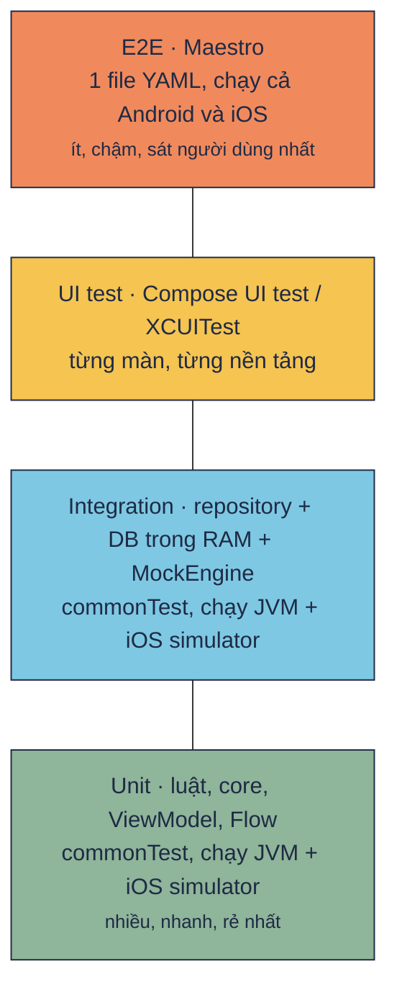

# Phụ lục: Test, Automation, Debug & Tool

Bốn mục đi kèm lộ trình, dùng khi bắt đầu viết code thật: **viết test** cho code chung, **tự động hoá** kiểm tra trên
cả 2 nền tảng, **debug** bằng công cụ thay vì đoán, và **cài/tự làm tool** để code nhanh hơn.

Mọi ví dụ lấy từ app có thật trong repo, chủ yếu là [Tip Split](../apps/01-tip-split.md) (app đơn giản nhất)
và [Rate Watch](../apps/03-rate-watch.md) (có mạng và database). Mỗi kỹ thuật là **một commit riêng**, có ghi chương,
app và lệnh chạy thử, nên đọc `git log` cũng là một cách học (xem [cách đọc commit](#hoc-qua-commit)).

## Kim tự tháp test của app KMP { #kim-tu-thap }



Với KMP, đáy kim tự tháp **rất rộng**: luật và state đều nằm trong `commonMain`, nên một test trong `commonTest` kiểm
được **cả hai** nền tảng. Phần trên (UI, E2E) chỉ cần kiểm những gì code chung không thấy: vẽ đúng, bấm được, quyền,
vòng đời app.

| Tầng | Kiểm cái gì | Công cụ | Chạy bằng |
|---|---|---|---|
| Unit | Hàm luật, core (`TipCore`, `RatesCore`), Flow | `kotlin.test`, `kotlinx-coroutines-test`, Turbine | `./gradlew :shared:allTests` |
| Integration | Repository với DB thật (trong RAM) và HTTP giả | SQLDelight driver in-memory, Ktor `MockEngine` | như trên |
| UI | Một màn hình trên một nền tảng | Compose UI test, XCUITest | `connectedAndroidTest`, `xcodebuild test` |
| E2E | Luồng người dùng trên app đã cài | Maestro | `maestro test .maestro/` |

## 4 mục

| Mục | Trang | Trạng thái |
|---|---|---|
| **P1 · Unit test** | [Cơ bản & test bảng](unit-basics.md) · [Coroutine & Flow](unit-coroutines-flow.md) · [Fake & mock](unit-fakes-mocks.md) · [Coverage](unit-coverage.md) | ✅ xong |
| **P2 · Automation test** | Chiến lược · Compose UI test · XCUITest · Maestro · Screenshot · CI | kế hoạch |
| **P3 · Debug trong Android Studio** | Breakpoint · Coroutine · Inspector · Kotlin trên iOS · Bug hunt | kế hoạch |
| **P4 · Tool hỗ trợ code** | Tool nên cài · Tool tự làm | kế hoạch |

Kế hoạch chi tiết: [`specs/2026-10-15-testing-debug-appendix-plan.md`](https://github.com/tucarmd/kotlin-multi-platform/blob/main/specs/2026-10-15-testing-debug-appendix-plan.md).

## Học qua commit { #hoc-qua-commit }

Mỗi commit của phụ lục có thân commit viết theo cùng một khuôn:

```text
test(tip-split): table-driven tests for splitBill and its invariants

Chương:   Phụ lục P1 · Unit test – cơ bản & test bảng
App:      TipSplit (shared/commonTest)
Áp dụng:  test bảng nhiều input + kiểm bất biến trên ~10.000 tổ hợp
Học được: một test, nhiều case, thông báo lỗi chỉ đúng case hỏng
Chạy thử: cd apps/TipSplit && ./gradlew :shared:allTests
```

Lọc commit theo chương hoặc theo app:

```bash
git log --grep "Phụ lục P1"          # mọi commit của mục Unit test
git log --grep "App:      TipSplit"  # mọi kỹ thuật đã áp dụng vào Tip Split
git show <hash>                      # xem đúng phần code + docs của một kỹ thuật
```

Cách học hiệu quả: đọc thân commit → tự làm lại trên app khác (vd áp dụng vào Pocket Notes) → mới mở `git show` để so.
