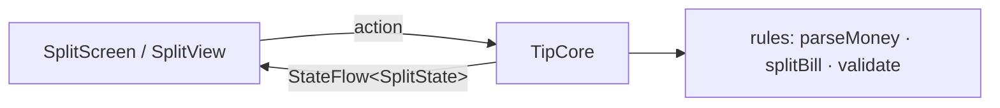

# App 1 · Tip Split 🧾

> Nhập tiền hóa đơn, % tip, số người → mỗi người trả bao nhiêu. Một màn, không mạng, không database, không quyền.

## 1. Tóm tắt

| | |
|---|---|
| **Cấp độ** | ⭐ Dễ nhất |
| **Mới học** | Hàm thuần ở `commonMain` · tiền là `Long` chứ không phải `Double` · `StateFlow` · Koin chỉ một module · `commonTest` |
| **Cần trước** | [Bài 2](../lessons/02-setup.md) – [4](../lessons/04-share-code.md) |
| **Thư mục code** | `TipSplit/` · package `dev.tipsplit` |
| **Thời gian** | 2–3 buổi tối |

App này cố tình **không** đụng API nền tảng. Mục tiêu là gõ trọn một vòng 7 bước, làm quen đường đi
`commonMain → Koin → ViewModel / @Observable → UI` khi chưa có gì phức tạp.

## 2. Màn hình

| Màn | Hiện gì | Action |
|---|---|---|
| **Split** (màn duy nhất) | Ô tiền hóa đơn · nút tip 0/5/10/15 % · stepper số người · công tắc "làm tròn 1.000đ" · thẻ kết quả: tip, tổng, mỗi người | Gõ số, chọn tip, +/- người, bật/tắt làm tròn, nút *Reset* |

## 3. Phạm vi

| Có | Làm sau |
|---|---|
| Chia đều, tip theo % | Chia theo món, mỗi người một phần |
| Làm tròn lên 1.000đ | Nhiều loại tiền |
| Báo lỗi khi nhập sai (âm, 0 người, quá lớn) | Lưu lịch sử hóa đơn (để app 2 làm) |
| Tiếng Việt + Anh | |

## 4. Kiến trúc



Không có `data/`, không có `platform/`. `di/` chỉ có `single { TipCore() }`.

## 5. 7 bước làm

| Bước | Ở app này làm gì |
|:-:|---|
| **B1** | `model/`: `Money(cents: Long)`, `SplitInput`, `Split`, `InputError`. `rules/`: `parseMoney("120.000") → Money`, `validate(input)`, `splitBill(...)`. Viết test **trước**. |
| **B2** | `core/TipCore`: giữ `MutableStateFlow<SplitState>`, hàm `onBillChanged(text)`, `onTipSelected(p)`, `onPeopleChanged(n)`, `onRoundingToggled()`, `reset()`. Mỗi hàm chỉ cập nhật input rồi tính lại bằng `rules/`. |
| **B3** | Bỏ qua: app này không có data, không cần API nền tảng. README vẫn ghi dòng "B3: không có ở app 1" để khuôn đủ 7 bước. |
| **B4** | `di/Koin.kt`: `commonModule { single { TipCore() } }`, `initKoin()`. `iosMain/di/KoinIos.kt`: `fun tipCore(): TipCore` cho Swift. |
| **B5** | `SplitViewModel` bọc `TipCore`; `SplitScreen` đọc state bằng `collectAsStateWithLifecycle()`; `OutlinedTextField` với `KeyboardType.Decimal`. |
| **B6** | `SplitModel` (`@Observable`) `for await` state; `SplitView` dùng `TextField` + `.keyboardType(.decimalPad)`, `Picker` dạng segmented. |
| **B7** | `RulesTest` (≥ 8 case), `TipCoreTest`. README theo khung. Chạy máy thật cả 2 bên. |

## 6. Bản đồ function (dự kiến)

| Hàm | File | Làm gì | Vì sao |
|---|---|---|---|
| `parseMoney(text)` | `rules/Money.kt` | `"120.000"` / `"120,000"` → `Money(12_000_000)`; sai định dạng → `null` | Bàn phím iOS / Android ra dấu phân cách khác nhau theo locale |
| `validate(input)` | `rules/Rules.kt` | Trả `InputError?`: `Empty`, `Negative`, `NoPeople`, `TooLarge` | UI chỉ việc hiện lỗi, không tự kiểm |
| `splitBill(bill, tip, people, roundTo)` | `rules/Rules.kt` | Tính tip, tổng, mỗi người; làm tròn **lên** | Làm tròn xuống thì cả nhóm trả thiếu tiền |
| `TipCore.onBillChanged(text)` | `core/TipCore.kt` | Lưu text, tính lại state | Giữ text gốc để ô nhập không nhảy số khi đang gõ |
| `tipCore()` | `iosMain/di/KoinIos.kt` | Lấy `TipCore` từ Koin cho Swift | Swift không gọi được `get<T>()` (hàm `reified`) |

Bẫy cần ghi `// TRAP:` trong code:

- Tiền lưu `Long` theo đơn vị nhỏ nhất. `Double` cho `0.1 + 0.2 = 0.30000000000000004`.
- Chia rồi làm tròn từng phần **khác** làm tròn tổng rồi chia. Test cả hai cách để thấy chênh.
- `Int.MAX_VALUE` tràn khi nhân tip: kiểm `TooLarge` trước khi tính.

## 7. Test

```bash
cd TipSplit
./gradlew :shared:testDebugUnitTest :shared:iosSimulatorArm64Test
```

Case tối thiểu: 0 % tip · 3 người chia 100.000 · làm tròn lên · nhập `"abc"` · nhập âm · 0 người · số rất lớn ·
`"1.234,5"` theo locale Đức.

## 8. Xong khi

- [ ] Test luật + core xanh trên JVM và iOS Simulator
- [ ] Android và iOS cho **cùng kết quả** với cùng input (chụp 2 màn đặt cạnh nhau)
- [ ] Nhập sai thì hiện lỗi, không crash
- [ ] Mọi file có KDoc đầu file `[App 1 · Bx]`; `grep -rn "TRAP:" TipSplit/` ra ít nhất 3 dòng
- [ ] README đủ 7 mục theo [khung chung](conventions.md#6-readme-cua-moi-app)

## 9. Tham khảo

- [Kotlin/kmp-basic-sample](https://github.com/Kotlin/kmp-basic-sample): project KMP nhỏ nhất
- [Kotlin/KMP-App-Template-Native](https://github.com/Kotlin/KMP-App-Template-Native): cách nối core với Compose + SwiftUI
- Device Pulse: `shared/.../rules/Rules.kt`, `core/PulseMonitor.kt`, `iosMain/di/KoinIos.kt`

**Tiếp:** [App 2 · Pocket Notes](02-pocket-notes.md)
