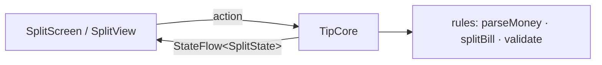

# App 1 · Tip Split 🧾

> Nhập tiền hóa đơn, % tip, số người → mỗi người trả bao nhiêu. Một màn, không mạng, không database, không quyền.

## 1. Tóm tắt

| | |
|---|---|
| **Cấp độ** | ⭐ Dễ nhất |
| **Mới học** | Hàm thuần ở `commonMain` · tiền là `Long` chứ không phải `Double` · `StateFlow` · Koin chỉ một module · `commonTest` |
| **Cần trước** | [Bài 2](../lessons/02-setup.md) – [4](../lessons/04-share-code.md) |
| **Thư mục code** | [`apps/TipSplit/`](https://github.com/tucarmd/kotlin-multi-platform/tree/main/apps/TipSplit) · package `dev.tipsplit` · ✅ đã có code |
| **Thời gian** | 2–3 buổi tối |

App này cố tình **không** đụng API nền tảng. Mục tiêu là gõ trọn một vòng 7 bước, làm quen đường đi
`commonMain → Koin → ViewModel / @Observable → UI` khi chưa có gì phức tạp.

## 2. Màn hình

| Màn | Hiện gì | Action |
|---|---|---|
| **Split** (màn duy nhất) | Ô tiền hóa đơn · nút tip 0/5/10/15 % · stepper số người · công tắc "làm tròn 1.000đ" · thẻ kết quả: tip, tổng, mỗi người | Gõ số, chọn tip, +/- người, bật/tắt làm tròn, nút *Reset* |

## 3. Phạm vi

| Có | Làm sau |
|---|---|
| Chia đều, tip theo % | Chia theo món, mỗi người một phần |
| Làm tròn lên 1.000đ | Nhiều loại tiền |
| Báo lỗi khi nhập sai (âm, 0 người, quá lớn) | Lưu lịch sử hóa đơn (để app 2 làm) |
| Tiếng Việt + Anh | |

## 4. Kiến trúc



Không có `data/`, không có `platform/`. `di/` chỉ có `single { TipCore() }`.

## 5. 7 bước làm

| Bước | Ở app này làm gì |
|:-:|---|
| **B1** | `model/`: `SplitInput`, `Split`, `InputError`, `SplitResult` (sealed), `SplitState`; tiền là `Long` tính bằng đồng. `rules/`: `parseMoney("120.000") → 120000`, `validate(bill, people)`, `splitBill(...)`, `calculate(input)`. Viết test **trước**. |
| **B2** | `core/TipCore`: giữ `MutableStateFlow<SplitState>`, hàm `onBillChanged(text)`, `onTipSelected(p)`, `onPeopleChanged(n)`, `onRoundingToggled()`, `reset()`. Mỗi hàm chỉ cập nhật input rồi tính lại bằng `rules/`. |
| **B3** | Bỏ qua: app này không có data, không cần API nền tảng. README vẫn ghi dòng "B3: không có ở app 1" để khuôn đủ 7 bước. |
| **B4** | `di/Koin.kt`: `commonModule { single { TipCore() } }`, `initKoin()`. `iosMain/di/KoinIos.kt`: `fun tipCore(): TipCore` cho Swift. |
| **B5** | `SplitViewModel` bọc `TipCore`; `SplitScreen` đọc state bằng `collectAsStateWithLifecycle()`; `OutlinedTextField` với `KeyboardType.Decimal`. |
| **B6** | `SplitModel` (`@Observable`) `for await` state; `SplitView` dùng `TextField` + `.keyboardType(.decimalPad)`, `Picker` dạng segmented. |
| **B7** | `RulesTest` (≥ 8 case), `TipCoreTest`. README theo khung. Chạy máy thật cả 2 bên. |

## 6. Bản đồ function

Bảng có link tới đúng dòng code nằm trong [`apps/TipSplit/README.md`](https://github.com/tucarmd/kotlin-multi-platform/blob/main/apps/TipSplit/README.md#ban-o-function).
Thử luật ngay trên trình duyệt, không cần cài gì: xem mục [Thử trên Playground](#thu-tren-playground) bên dưới.

| Hàm | File | Làm gì | Vì sao |
|---|---|---|---|
| `parseMoney(text)` | `rules/Money.kt` | `"120.000"` / `"120,000"` → `120000`; sai định dạng → `null` | Bàn phím iOS / Android ra dấu phân cách khác nhau theo locale |
| `validate(input)` | `rules/Rules.kt` | Trả `InputError?`: `Empty`, `Negative`, `NoPeople`, `TooLarge` | UI chỉ việc hiện lỗi, không tự kiểm |
| `splitBill(bill, tip, people, roundTo)` | `rules/Rules.kt` | Tính tip, tổng, mỗi người; làm tròn **lên** | Làm tròn xuống thì cả nhóm trả thiếu tiền |
| `TipCore.onBillChanged(text)` | `core/TipCore.kt` | Lưu text, tính lại state | Giữ text gốc để ô nhập không nhảy số khi đang gõ |
| `tipCore()` | `iosMain/di/KoinIos.kt` | Lấy `TipCore` từ Koin cho Swift | Swift không gọi được `get<T>()` (hàm `reified`) |

Bẫy cần ghi `// TRAP:` trong code:

- Tiền lưu `Long` theo đơn vị nhỏ nhất. `Double` cho `0.1 + 0.2 = 0.30000000000000004`.
- Chia rồi làm tròn từng phần **khác** làm tròn tổng rồi chia. Test cả hai cách để thấy chênh.
- `Int.MAX_VALUE` tràn khi nhân tip: kiểm `TooLarge` trước khi tính.

## Thử trên Playground

Mỗi link mở [Playground](../playground/index.html) với code nạp sẵn. Bấm **Run** (`⌘ Enter`), đọc kết quả, rồi sửa số và chạy lại.
Code chạy trên compiler của JetBrains (api.kotlinlang.org), không cần cài gì.

| Link | So sánh gì | Kết quả cần thấy |
|---|---|---|
| [▶ Bẫy 1: Double hay Long](../playground/index.html#code=Ly8gVGlwIFNwbGl0IMK3IGLhuqt5IDE6IHRp4buBbiBkw7luZyBEb3VibGUgaGF5IExvbmc_Ci8vIELhuqVtIFJ1biwgc28gMiBkw7JuZyBr4bq_dCBxdeG6oy4gUuG7k2kgdGjhu60gxJHhu5VpIHPhu5EgdGnhu4FuIHbDoCBjaOG6oXkgbOG6oWkuCgpmdW4gbWFpbigpIHsKICAgIC8vIEPDoWNoIFNBSTogRG91YmxlIChz4buRIHRo4buxYykga2jDtG5nIGJp4buDdSBkaeG7hW4gY2jDrW5oIHjDoWMgMC4xLCAwLjIKICAgIHZhbCBhID0gMC4xICsgMC4yCiAgICBwcmludGxuKCJEb3VibGU6IDAuMSArIDAuMiA9ICRhICAg4oaSIGLhurFuZyAwLjM_ICR7YSA9PSAwLjN9IikKCiAgICAvLyBDw6FjaCDEkMOaTkcgKFRpcFNwbGl0IGTDuW5nKTogTG9uZywgxJHGoW4gduG7iyBuaOG7jyBuaOG6pXQgKMSR4buTbmcpLiBQaMOpcCBj4buZbmcgc-G7kSBuZ3V5w6puIGx1w7RuIGNow61uaCB4w6FjLgogICAgdmFsIGIgPSAxMDBMICsgMjAwTAogICAgcHJpbnRsbigiTG9uZzogICAxMDAgKyAyMDAgPSAkYiAgIOKGkiBi4bqxbmcgMzAwPyAke2IgPT0gMzAwTH0iKQoKICAgIC8vIEPhu5luZyAxMCBs4bqnbiAwLjEgbmdow6xuIMSR4buTbmcKICAgIHZhciBkID0gMC4wCiAgICByZXBlYXQoMTApIHsgZCArPSAwLjEgfQogICAgcHJpbnRsbigiRG91YmxlOiAxMCDDlyAwLjEgPSAkZCIpCiAgICB2YXIgbCA9IDBMCiAgICByZXBlYXQoMTApIHsgbCArPSAxMDAgfQogICAgcHJpbnRsbigiTG9uZzogICAxMCDDlyAxMDAgPSAkbCIpCn0K) | Cộng tiền bằng `Double` và bằng `Long` | `0.1 + 0.2 = 0.30000000000000004` so với `300` |
| [▶ Bẫy 2–3: làm tròn](../playground/index.html#code=Ly8gVGlwIFNwbGl0IMK3IGLhuqt5IDIgdsOgIDM6IGzDoG0gdHLDsm4gdGjhur8gbsOgbyBjaG8gxJHDum5nPwovLyBDb2RlIGdp4buRbmcgaOG7h3QgVGlwU3BsaXQvc2hhcmVkL3NyYy9jb21tb25NYWluL2tvdGxpbi9kZXYvdGlwc3BsaXQvcnVsZXMvUnVsZXMua3QKCmZ1biBjZWlsRGl2KGE6IExvbmcsIGI6IExvbmcpOiBMb25nID0gKGEgKyBiIC0gMSkgLyBiCmZ1biByb3VuZFVwVG8odmFsdWU6IExvbmcsIHN0ZXA6IExvbmcpOiBMb25nID0gY2VpbERpdih2YWx1ZSwgc3RlcCkgKiBzdGVwCgpmdW4gbWFpbigpIHsKICAgIHZhbCB0b3RhbCA9IDEwMF8wMDBMCiAgICB2YWwgcGVvcGxlID0gMwoKICAgIC8vIELhuqt5IDI6IGNoaWEgYuG6sW5nIGAvYCBsw6AgbMOgbSB0csOybiBYVeG7kE5HIOKGkiBj4bqjIG5ow7NtIHRy4bqjIHRoaeG6v3UKICAgIHZhbCBkb3duID0gdG90YWwgLyBwZW9wbGUKICAgIHZhbCB1cCA9IGNlaWxEaXYodG90YWwsIHBlb3BsZS50b0xvbmcoKSkKICAgIHByaW50bG4oIkzDoG0gdHLDsm4geHXhu5FuZzogbeG7l2kgbmfGsOG7nWkgJGRvd24g4oaSIGPhuqMgbmjDs20gJHtkb3duICogcGVvcGxlfSAodGhp4bq_dSAke3RvdGFsIC0gZG93biAqIHBlb3BsZX3EkSkiKQogICAgcHJpbnRsbigiTMOgbSB0csOybiBsw6puOiAgIG3hu5dpIG5nxrDhu51pICR1cCDihpIgY-G6oyBuaMOzbSAke3VwICogcGVvcGxlfSIpCiAgICBwcmludGxuKCJMw6puIDEuMDAwxJE6ICAgICBt4buXaSBuZ8aw4budaSAke3JvdW5kVXBUbyh1cCwgMV8wMDApfSIpCgogICAgLy8gQuG6q3kgMzogdGlwIDE1JSBj4bunYSA5OS45OTkKICAgIHZhbCBiaWxsID0gOTlfOTk5TAogICAgcHJpbnRsbigpCiAgICBwcmludGxuKCJUaXAgY-G6r3QgYuG7jzogICAgICAke2JpbGwgKiAxNSAvIDEwMH0iKQogICAgcHJpbnRsbigiVGlwIG7hu61hIGzDqm4gKCs1MCk6ICR7KGJpbGwgKiAxNSArIDUwKSAvIDEwMH0iKQp9Cg) | Chia `/` (tròn xuống) và `ceilDiv` (tròn lên); tip cắt bỏ và tip `+50` | Tròn xuống thiếu 1đ · tip `14999` so với `15000` |
| [▶ Toàn bộ luật Tip Split](../playground/index.html#code=Ly8gVGlwIFNwbGl0IMK3IHRvw6BuIGLhu5kgbHXhuq10LCBjaOG6oXkgdGjhu60gduG7m2kgbmhp4buBdSBpbnB1dC4KLy8gQ29weSB04burIFRpcFNwbGl0L3NoYXJlZC9zcmMvY29tbW9uTWFpbi9rb3RsaW4vZGV2L3RpcHNwbGl0LyAobW9kZWwvTW9kZWxzLmt0LCBydWxlcy9Nb25leS5rdCwgcnVsZXMvUnVsZXMua3QpLgovLyBCw6BpIHThuq1wOiB0aMOqbSB0aXAgMjAlIMK3IMSR4buVaSBST1VORF9UTyA9IDVfMDAwIMK3IHRow6ptIGNhc2Ugbmjhuq1wICIxLjIuMyIgcuG7k2kgxJFvw6FuIGvhur90IHF14bqjIHRyxrDhu5tjIGtoaSBSdW4uCgpkYXRhIGNsYXNzIFNwbGl0SW5wdXQodmFsIGJpbGxUZXh0OiBTdHJpbmcgPSAiIiwgdmFsIHRpcFBlcmNlbnQ6IEludCA9IDEwLCB2YWwgcGVvcGxlOiBJbnQgPSAyLCB2YWwgcm91bmRVcDogQm9vbGVhbiA9IHRydWUpCgpkYXRhIGNsYXNzIFNwbGl0KHZhbCBiaWxsOiBMb25nLCB2YWwgdGlwOiBMb25nLCB2YWwgdG90YWw6IExvbmcsIHZhbCBwZXJQZXJzb246IExvbmcsIHZhbCBjb2xsZWN0ZWQ6IExvbmcpIHsKICAgIHZhbCBleHRyYTogTG9uZyBnZXQoKSA9IGNvbGxlY3RlZCAtIHRvdGFsCn0KCmVudW0gY2xhc3MgSW5wdXRFcnJvciB7IE5vdE51bWVyaWMsIE5vdFBvc2l0aXZlLCBUb29MYXJnZSwgTm9QZW9wbGUsIFRvb01hbnlQZW9wbGUgfQoKc2VhbGVkIGNsYXNzIFNwbGl0UmVzdWx0IHsKICAgIGRhdGEgb2JqZWN0IFdhaXRpbmcgOiBTcGxpdFJlc3VsdCgpCiAgICBkYXRhIGNsYXNzIEludmFsaWQodmFsIGVycm9yOiBJbnB1dEVycm9yKSA6IFNwbGl0UmVzdWx0KCkKICAgIGRhdGEgY2xhc3MgUmVhZHkodmFsIHNwbGl0OiBTcGxpdCkgOiBTcGxpdFJlc3VsdCgpCn0KCmNvbnN0IHZhbCBNQVhfUEVPUExFID0gNTAKY29uc3QgdmFsIFJPVU5EX1RPID0gMV8wMDBMCmNvbnN0IHZhbCBNQVhfQklMTCA9IDFfMDAwXzAwMF8wMDBfMDAwTApwcml2YXRlIHZhbCBTRVBBUkFUT1JTID0gc2V0T2YoJy4nLCAnLCcsICcgJywgJ8KgJywgJ1wnJykKCmZ1biBwYXJzZU1vbmV5KHRleHQ6IFN0cmluZyk6IExvbmc_IHsKICAgIHZhbCBkaWdpdHMgPSB0ZXh0LnRyaW0oKS5maWx0ZXJOb3QgeyBpdCBpbiBTRVBBUkFUT1JTIH0KICAgIGlmIChkaWdpdHMuaXNFbXB0eSgpIHx8ICFkaWdpdHMuYWxsIHsgaXQgaW4gJzAnLi4nOScgfSkgcmV0dXJuIG51bGwKICAgIHJldHVybiBkaWdpdHMudG9Mb25nT3JOdWxsKCkKfQoKZnVuIGZvcm1hdE1vbmV5KGFtb3VudDogTG9uZyk6IFN0cmluZyA9CiAgICBhbW91bnQudG9TdHJpbmcoKS5yZXZlcnNlZCgpLmNodW5rZWQoMykuam9pblRvU3RyaW5nKCIuIikucmV2ZXJzZWQoKQoKZnVuIHZhbGlkYXRlKGJpbGw6IExvbmc_LCBwZW9wbGU6IEludCk6IElucHV0RXJyb3I_ID0gd2hlbiB7CiAgICBiaWxsID09IG51bGwgLT4gSW5wdXRFcnJvci5Ob3ROdW1lcmljCiAgICBiaWxsIDw9IDAgLT4gSW5wdXRFcnJvci5Ob3RQb3NpdGl2ZQogICAgYmlsbCA-IE1BWF9CSUxMIC0-IElucHV0RXJyb3IuVG9vTGFyZ2UKICAgIHBlb3BsZSA8IDEgLT4gSW5wdXRFcnJvci5Ob1Blb3BsZQogICAgcGVvcGxlID4gTUFYX1BFT1BMRSAtPiBJbnB1dEVycm9yLlRvb01hbnlQZW9wbGUKICAgIGVsc2UgLT4gbnVsbAp9CgpmdW4gY2VpbERpdihhOiBMb25nLCBiOiBMb25nKTogTG9uZyA9IChhICsgYiAtIDEpIC8gYgpmdW4gcm91bmRVcFRvKHZhbHVlOiBMb25nLCBzdGVwOiBMb25nKTogTG9uZyA9IGNlaWxEaXYodmFsdWUsIHN0ZXApICogc3RlcAoKZnVuIHNwbGl0QmlsbChiaWxsOiBMb25nLCB0aXBQZXJjZW50OiBJbnQsIHBlb3BsZTogSW50LCByb3VuZFRvOiBMb25nID0gMSk6IFNwbGl0IHsKICAgIHZhbCB0aXAgPSAoYmlsbCAqIHRpcFBlcmNlbnQgKyA1MCkgLyAxMDAKICAgIHZhbCB0b3RhbCA9IGJpbGwgKyB0aXAKICAgIHZhbCBwZXJQZXJzb24gPSByb3VuZFVwVG8oY2VpbERpdih0b3RhbCwgcGVvcGxlLnRvTG9uZygpKSwgcm91bmRUbykKICAgIHJldHVybiBTcGxpdChiaWxsLCB0aXAsIHRvdGFsLCBwZXJQZXJzb24sIHBlclBlcnNvbiAqIHBlb3BsZSkKfQoKZnVuIGNhbGN1bGF0ZShpbnB1dDogU3BsaXRJbnB1dCk6IFNwbGl0UmVzdWx0IHsKICAgIGlmIChpbnB1dC5iaWxsVGV4dC5pc0JsYW5rKCkpIHJldHVybiBTcGxpdFJlc3VsdC5XYWl0aW5nCiAgICB2YWwgYmlsbCA9IHBhcnNlTW9uZXkoaW5wdXQuYmlsbFRleHQpCiAgICB2YWxpZGF0ZShiaWxsLCBpbnB1dC5wZW9wbGUpPy5sZXQgeyByZXR1cm4gU3BsaXRSZXN1bHQuSW52YWxpZChpdCkgfQogICAgcmV0dXJuIFNwbGl0UmVzdWx0LlJlYWR5KHNwbGl0QmlsbChiaWxsISEsIGlucHV0LnRpcFBlcmNlbnQsIGlucHV0LnBlb3BsZSwgaWYgKGlucHV0LnJvdW5kVXApIFJPVU5EX1RPIGVsc2UgMSkpCn0KCmZ1biBtYWluKCkgewogICAgdmFsIGNhc2VzID0gbGlzdE9mKAogICAgICAgIFNwbGl0SW5wdXQoIjEwMC4wMDAiLCB0aXBQZXJjZW50ID0gMTAsIHBlb3BsZSA9IDMpLAogICAgICAgIFNwbGl0SW5wdXQoIjEwMC4wMDAiLCB0aXBQZXJjZW50ID0gMTAsIHBlb3BsZSA9IDMsIHJvdW5kVXAgPSBmYWxzZSksCiAgICAgICAgU3BsaXRJbnB1dCgiMSwyNTAsMDAwIiwgdGlwUGVyY2VudCA9IDE1LCBwZW9wbGUgPSA0KSwKICAgICAgICBTcGxpdElucHV0KCIiKSwKICAgICAgICBTcGxpdElucHV0KCJhYmMiKSwKICAgICAgICBTcGxpdElucHV0KCIwIiksCiAgICAgICAgU3BsaXRJbnB1dCgiNTAgMDAwIiwgcGVvcGxlID0gMCksCiAgICApCiAgICBmb3IgKGlucHV0IGluIGNhc2VzKSB7CiAgICAgICAgdmFsIHRleHQgPSB3aGVuICh2YWwgciA9IGNhbGN1bGF0ZShpbnB1dCkpIHsKICAgICAgICAgICAgU3BsaXRSZXN1bHQuV2FpdGluZyAtPiAiY2jhu50gbmjhuq1wIgogICAgICAgICAgICBpcyBTcGxpdFJlc3VsdC5JbnZhbGlkIC0-ICJs4buXaSAke3IuZXJyb3J9IgogICAgICAgICAgICBpcyBTcGxpdFJlc3VsdC5SZWFkeSAtPiB3aXRoKHIuc3BsaXQpIHsKICAgICAgICAgICAgICAgICJt4buXaSBuZ8aw4budaSAke2Zvcm1hdE1vbmV5KHBlclBlcnNvbil9xJEgwrcgdOG7lW5nICR7Zm9ybWF0TW9uZXkodG90YWwpfcSRIMK3IGTGsCAke2Zvcm1hdE1vbmV5KGV4dHJhKX3EkSIKICAgICAgICAgICAgfQogICAgICAgIH0KICAgICAgICBwcmludGxuKCJcIiR7aW5wdXQuYmlsbFRleHR9XCIgJHtpbnB1dC50aXBQZXJjZW50fSUgJHtpbnB1dC5wZW9wbGV9IG5nxrDhu51pIHRyw7JuPSR7aW5wdXQucm91bmRVcH0gIOKGkiAgJHRleHQiKQogICAgfQp9Cg) | `calculate()` với 7 input, gồm cả input sai | `"100.000" 10% 3 người → 37.000đ`, giống app trên máy |

Code trong link copy từ `apps/TipSplit/shared/`. Sửa luật trong app thì nhớ tạo lại link.

## 7. Test

```bash
cd apps/TipSplit
./gradlew :shared:testDebugUnitTest :shared:iosSimulatorArm64Test
```

Case tối thiểu: 0 % tip · 3 người chia 100.000 · làm tròn lên · nhập `"abc"` · nhập âm · 0 người · số rất lớn ·
`"120.000"` / `"120,000"` / `"120 000"` cho cùng một số.

## 8. Xong khi

- [ ] Test luật + core xanh trên JVM và iOS Simulator
- [ ] Android và iOS cho **cùng kết quả** với cùng input (chụp 2 màn đặt cạnh nhau)
- [ ] Nhập sai thì hiện lỗi, không crash
- [ ] Mọi file có KDoc đầu file `[App 1 · Bx]`; `grep -rn "TRAP:" apps/TipSplit/` ra ít nhất 3 dòng
- [ ] README đủ 7 mục theo [khung chung](conventions.md#6-readme-cua-moi-app)

## 9. Tham khảo

- [Kotlin/kmp-basic-sample](https://github.com/Kotlin/kmp-basic-sample): project KMP nhỏ nhất
- [Kotlin/KMP-App-Template-Native](https://github.com/Kotlin/KMP-App-Template-Native): cách nối core với Compose + SwiftUI
- Device Pulse: `shared/.../rules/Rules.kt`, `core/PulseMonitor.kt`, `iosMain/di/KoinIos.kt`

**Tiếp:** [App 2 · Pocket Notes](02-pocket-notes.md)
