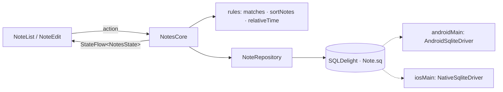

# App 2 · Pocket Notes 📝

> Ghi chú offline: thêm, sửa, xoá, ghim, tìm kiếm. Tắt app mở lại vẫn còn.

## 1. Tóm tắt

| | |
|---|---|
| **Cấp độ** | ⭐⭐ |
| **Mới học** | SQLDelight CRUD · `Flow` tự phát khi bảng đổi · điều hướng list → edit · `kotlinx-datetime` · `platformModule` đầu tiên (driver database) |
| **Cần trước** | App 1 · [bài 8](../lessons/08-viewmodel-navigation.md), [12](../lessons/12-history-sqldelight.md) |
| **Thư mục code** | [`apps/PocketNotes/`](https://github.com/tucarmd/kotlin-multi-platform/tree/main/apps/PocketNotes) · package `dev.pocketnotes` · ✅ đã có code |
| **Thời gian** | 4–5 buổi tối |

So với app 1: thêm `data/` và lần đầu có code ở `androidMain` / `iosMain` (tạo `SqlDriver`).

## 2. Màn hình

| Màn | Hiện gì | Action |
|---|---|---|
| **Note list** | Ô tìm kiếm · ghi chú ghim ở trên · mỗi dòng: tiêu đề, 2 dòng đầu, "sửa 5 phút trước" · trạng thái rỗng | Gõ tìm · bấm dòng → Edit · vuốt xoá (có *Hoàn tác*) · nút **+** |
| **Note edit** | Ô tiêu đề, ô nội dung, nút ghim | Tự lưu khi rời màn · nút xoá |

## 3. Phạm vi

| Có | Làm sau |
|---|---|
| CRUD + ghim + tìm theo tiêu đề / nội dung | Đồng bộ cloud |
| Hoàn tác xoá trong 5 giây | Ảnh đính kèm, markdown |
| Thời gian tương đối "5 phút trước" | Nhãn / thư mục |
| Migration lần 1 (thêm cột `pinned`) | |

## 4. Kiến trúc



## 5. 7 bước làm

| Bước | Ở app này làm gì |
|:-:|---|
| **B1** | `model/Note(id, title, body, pinned, updatedAt: Instant)`. `rules/`: `matches(note, query)` (bỏ dấu tiếng Việt), `sortNotes()` (ghim trước, mới trước), `relativeTime(from, now)`. |
| **B2** | `NotesCore`: `state` = `combine(repository.observeAll(), query)` → lọc + sắp xếp. Action: `search`, `save`, `delete` (giữ bản xoá 5 s để hoàn tác), `undoDelete`, `togglePin`. Test với `FakeNoteRepository`. |
| **B3** | `Note.sq`: bảng + query `selectAll`, `upsert`, `deleteById`. `NoteRepository` bọc query, `observeAll()` dùng `asFlow().mapToList()`. Migration `1.sqm` thêm cột `pinned`. |
| **B4** | `platformModule` (expect/actual): Android tạo `AndroidSqliteDriver(context)`, iOS tạo `NativeSqliteDriver`. `notesCore()` cho Swift. |
| **B5** | Navigation Compose: `list` → `edit/{id}`. `SwipeToDismissBox` để xoá, `Snackbar` có nút *Hoàn tác*. |
| **B6** | `NavigationStack` + `.swipeActions` + `.searchable`. Lưu khi `onDisappear`. |
| **B7** | `RulesTest`, `NotesCoreTest` (Turbine), `NoteRepositoryTest` ở `androidUnitTest` với `JdbcSqliteDriver` in-memory. |

## 6. Bản đồ function

Bảng đầy đủ (20 hàm, có link tới đúng dòng code) nằm trong
[`apps/PocketNotes/README.md`](https://github.com/tucarmd/kotlin-multi-platform/blob/main/apps/PocketNotes/README.md#ban-o-function). Các hàm chính:

| Hàm | File | Làm gì | Vì sao |
|---|---|---|---|
| `fold(text)` | `rules/Search.kt` | "ĐẶT Hàng" → "dat hang" | `đ/Đ` không phải "d + dấu", phải map tay |
| `matches(note, query)` | `rules/Search.kt` | Tìm trong tiêu đề + nội dung, bỏ dấu, không phân biệt hoa thường | Gõ "ghi chu" vẫn ra "Ghi chú" |
| `sortNotes(notes)` | `rules/Search.kt` | Ghim lên đầu, rồi `updatedAt` mới trước | Thứ tự là luật, không để UI hay SQL tự sắp |
| `relativeTime(from, now, timeZone)` | `rules/Time.kt` | Trả `RelativeTime` (vừa xong / phút / giờ / hôm qua / ngày) | Truyền `now` vào để test được; "hôm qua" tính theo ngày lịch |
| `planSave(existing, draft, now)` | `rules/Save.kt` | Quyết định Insert / Update / Delete / Skip | Ghi chú rỗng không được tạo; ghim không đẩy ghi chú lên đầu |
| `SqlNoteRepository.observeAll()` | `data/NoteRepository.kt` | `asFlow().mapToList()` | List tự cập nhật sau khi lưu |
| `NotesCore.delete(id)` / `undoDelete()` | `core/NotesCore.kt` | Xoá, giữ bản sao 5 s; hoàn tác ghi lại đúng id, ghim, thời gian | Hoàn tác không đọc lại database, ghi chú về đúng chỗ |
| `NotesCore.write(block)` | `core/NotesCore.kt` | Mọi lệnh ghi đi qua một `Mutex` | Xoá rồi hoàn tác thật nhanh không bị đảo thứ tự |
| `createDriver()` | `androidMain` / `iosMain` `di/PlatformModule.*.kt` | `AndroidSqliteDriver` / `NativeSqliteDriver` | Driver là thứ duy nhất khác giữa 2 máy |

!!! note "Code khác plan ở đâu"
    - `NoteRepository` là **interface**, bản thật là `SqlNoteRepository`, để test core bằng `FakeNoteRepository`.
    - Bảng tên `noteRecord`, database `NotesDb`. Đặt tên bảng là `note` thì SQLDelight sinh thêm một class `Note`, Swift sẽ thấy `Note_`.
    - `NotesState` là sealed: `Loading` / `Failed` / `Ready`. `NotesCore` **không** phải singleton: Android tạo trong ViewModel với `viewModelScope`, iOS lấy từ `notesCore()` với `MainScope()`.
    - Android lưu ghi chú trong `BackHandler`, không phải `onDispose` (vì `onDispose` cũng chạy khi xoay màn → lưu trùng). iOS lưu ở `onDisappear`.
    - Xoá hết tiêu đề và nội dung của một ghi chú cũ = xoá ghi chú (có hoàn tác). Ghim được ngay từ danh sách.
    - App bị kill khi đang mở màn sửa thì bản nháp chưa lưu sẽ mất.

Bẫy cần ghi `// TRAP:` trong code:

- Quên `-lsqlite3` trong `OTHER_LDFLAGS` của Xcode → link lỗi `_sqlite3_*` (Device Pulse đã gặp).
- Đổi schema mà không viết file `.sqm` → app cũ crash khi cập nhật.
- `Clock.System.now()` gọi trong luật → test không ổn định. Luôn truyền `now` vào.
- Build iOS với "Any iOS Simulator" đòi cả x86_64 mà Gradle không build → thêm `EXCLUDED_ARCHS[sdk=iphonesimulator*]: x86_64` vào `project.yml`.
- **Undo xong ghi chú bị xoá lần nữa**: `rememberSwipeToDismissBoxState()` là *saveable*, `LazyColumn` nhớ state theo `key` nên dòng quay lại vẫn ở trạng thái "đã vuốt" và tự xoá tiếp. Dùng `remember { SwipeToDismissBoxState(...) }`. Chỉ phát hiện khi chạy trên emulator, test core không thấy.
- `LazyColumn` phải có `key = id`, không thì vuốt xoá một dòng sẽ làm dòng kế tiếp mang trạng thái vuốt của dòng đã xoá.

## 7. Test

```bash
cd apps/PocketNotes
./gradlew :shared:testDebugUnitTest :shared:iosSimulatorArm64Test
```

Case tối thiểu: tìm bỏ dấu · ghim lên đầu · xoá rồi hoàn tác · lưu ghi chú rỗng thì không tạo · migration từ schema 1 lên 2.

## 8. Xong khi

- [ ] Thêm 3 ghi chú, tắt hẳn app (vuốt khỏi đa nhiệm), mở lại vẫn còn, trên cả 2 máy
- [ ] Xoá rồi bấm *Hoàn tác* thì ghi chú quay lại đúng chỗ
- [ ] Tìm "ghi chu" ra "Ghi chú"
- [ ] Test xanh, có test migration
- [ ] KDoc `[App 2 · Bx]` mọi file · README đủ 7 mục

## 9. Tham khảo

- [kotlin-hands-on/kmp-networking-and-data-storage](https://github.com/kotlin-hands-on/kmp-networking-and-data-storage): SQLDelight + Koin
- [SQLDelight: Multiplatform](https://sqldelight.github.io/sqldelight/latest/multiplatform_sqlite/) · [Migrations](https://sqldelight.github.io/sqldelight/latest/multiplatform_sqlite/migrations/)
- Device Pulse: `data/HistoryRepository.kt`, `Snapshot.sq`

**Trước:** [App 1 · Tip Split](01-tip-split.md) · **Tiếp:** [App 3 · Rate Watch](03-rate-watch.md)
