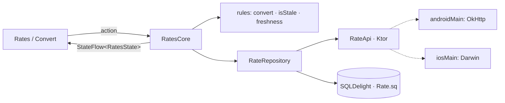

# App 3 · Rate Watch 💱

> Tỷ giá ngoại tệ theo đồng gốc (VND, USD…), đổi tiền nhanh, đánh dấu yêu thích. Mất mạng vẫn xem được tỷ giá lần trước.

## 1. Tóm tắt

| | |
|---|---|
| **Cấp độ** | ⭐⭐⭐ |
| **Mới học** | Ktor client + `kotlinx.serialization` · engine OkHttp / Darwin · **offline-first** (mạng + cache SQLDelight) · dữ liệu "cũ" (stale) · `MockEngine` |
| **Cần trước** | App 2 · [bài 11](../lessons/11-network.md) |
| **Thư mục code** | `RateWatch/` · package `dev.ratewatch` |
| **API** | [open.er-api.com](https://www.exchangerate-api.com/docs/free) `GET /v6/latest/{base}`, miễn phí, không cần key, cập nhật 1 lần / ngày |
| **Thời gian** | 5–6 buổi tối |

So với app 2: repository giờ có **hai nguồn** (mạng và database), và core phải trả lời "đang hiện dữ liệu mới hay cũ".

## 2. Màn hình

| Màn | Hiện gì | Action |
|---|---|---|
| **Rates** | Đồng gốc · "cập nhật 2 giờ trước" (đỏ nếu cũ) · banner "Đang offline" · danh sách tỷ giá, yêu thích ở trên | Kéo để làm mới · bấm sao · chọn đồng gốc |
| **Convert** | Ô số tiền, 2 đồng tiền, nút đảo chiều, kết quả | Gõ số, đổi đồng, đảo |

## 3. Phạm vi

| Có | Làm sau |
|---|---|
| Lấy tỷ giá, cache, xem offline | Biểu đồ tỷ giá theo ngày |
| Yêu thích, đổi đồng gốc | Thông báo khi tỷ giá vượt ngưỡng |
| Kéo để làm mới, tự làm mới khi cache > 1 giờ | Widget |
| Lỗi mạng / server / JSON sai đều thành state | |

## 4. Kiến trúc



Luồng **offline-first**: UI luôn đọc từ database. Mạng chỉ ghi vào database. Mạng lỗi thì vẫn còn dữ liệu cũ + thông báo lỗi.

## 5. 7 bước làm

| Bước | Ở app này làm gì |
|:-:|---|
| **B1** | `model/`: `RateTable(base, rates: Map<String, Double>, fetchedAt)`, `RatesState(table, freshness, refreshing, error)`. `rules/`: `convert(amount, from, to, table)` qua đồng gốc, `isStale(fetchedAt, now, maxAge = 1.h)`. |
| **B2** | `RatesCore`: `state` từ `repository.observe(base)`; `refresh()` bật `refreshing`, gọi repository, lỗi → `error` nhưng **giữ** `table`. Tự gọi `refresh()` khi mở app nếu `isStale`. |
| **B3** | `RateApi` (Ktor + `ContentNegotiation` + `@Serializable RateResponse`). `RateRepository.refresh(base)`: gọi API → map sang model → ghi DB trong một transaction. `Rate.sq` + bảng `Favorite`. |
| **B4** | `platformModule`: `HttpClient(OkHttp)` / `HttpClient(Darwin)` + driver DB. `ratesCore()` cho Swift. |
| **B5** | `PullToRefreshBox`, `LazyColumn` có header yêu thích, banner offline bằng `AnimatedVisibility`. |
| **B6** | `.refreshable { }`, `List` + `Section`, `.toolbar` chọn đồng gốc. |
| **B7** | `RateApiTest` với `MockEngine` (200, 500, JSON thiếu field, timeout) · `RatesCoreTest` (refresh lỗi vẫn giữ dữ liệu cũ) · `RulesTest`. |

## 6. Bản đồ function (dự kiến)

| Hàm | File | Làm gì | Vì sao |
|---|---|---|---|
| `convert(amount, from, to, table)` | `rules/Convert.kt` | `amount / rate[from] * rate[to]` | API chỉ trả tỷ giá theo 1 đồng gốc, đổi chéo phải qua nó |
| `isStale(fetchedAt, now, maxAge)` | `rules/Freshness.kt` | Cũ hơn `maxAge` → `true` | Quyết định tự làm mới và tô đỏ "cập nhật lúc…" |
| `RateApi.latest(base)` | `data/RateApi.kt` | `GET /v6/latest/{base}` → `RateResponse` | Chỉ biết HTTP + JSON, không biết database |
| `RateRepository.observe(base)` | `data/RateRepository.kt` | `Flow<RateTable?>` từ database | UI luôn đọc từ một nguồn → offline tự nhiên |
| `RateRepository.refresh(base)` | `data/RateRepository.kt` | API → DB trong 1 transaction, trả `Result<Unit>` | Không ném exception qua core |
| `RatesCore.refresh()` | `core/RatesCore.kt` | Bật `refreshing`, lỗi → `error`, **giữ** `table` | Mất mạng không làm trống màn hình |
| `httpClient()` | `di/PlatformModule.*.kt` | OkHttp / Darwin engine | Engine là thứ duy nhất khác giữa 2 máy |

Bẫy cần ghi `// TRAP:` trong code:

- `Json { ignoreUnknownKeys = true }`: API thêm field mới thì app cũ không được crash.
- Tỷ giá `Double` là chấp nhận được (hiển thị), nhưng số tiền người dùng nhập vẫn dùng `Money` từ app 1.
- Hủy coroutine khi rời màn: lỗi `CancellationException` không phải lỗi mạng, đừng hiện cho người dùng.
- iOS Simulator dùng mạng của Mac: muốn thử offline thì tắt Wi-Fi của Mac.

## 7. Test

```bash
cd RateWatch
./gradlew :shared:testDebugUnitTest :shared:iosSimulatorArm64Test
```

Case tối thiểu: JSON đúng · HTTP 500 · JSON thiếu `rates` · timeout · refresh lỗi giữ dữ liệu cũ · đổi chéo EUR → JPY qua USD · stale đúng 1 giờ.

## 8. Xong khi

- [ ] Mở app có mạng → thấy tỷ giá; bật chế độ máy bay, tắt mở lại app → vẫn thấy + banner offline
- [ ] Kéo làm mới khi offline → báo lỗi, danh sách **không** trống
- [ ] Đổi tiền ra cùng kết quả trên 2 máy
- [ ] Test `MockEngine` đủ 4 case lỗi
- [ ] KDoc `[App 3 · Bx]` mọi file · README đủ 7 mục

## 9. Tham khảo

- [kotlin-hands-on/kmp-networking-and-data-storage](https://github.com/kotlin-hands-on/kmp-networking-and-data-storage): Ktor + SQLDelight cùng nhau
- [touchlab/KaMPKit](https://github.com/touchlab/KaMPKit): repository có cache, test với `MockEngine`
- [Ktor client: testing](https://ktor.io/docs/client-testing.html)
- Device Pulse: `sensor/LatencyProbe.kt`, `LatencyProbeTest.kt`

**Trước:** [App 2 · Pocket Notes](02-pocket-notes.md) · **Giữa:** [Device Pulse](../project/index.md) (cảm biến + quyền) · **Tiếp:** [App 4 · Trip Log](04-trip-log.md)
