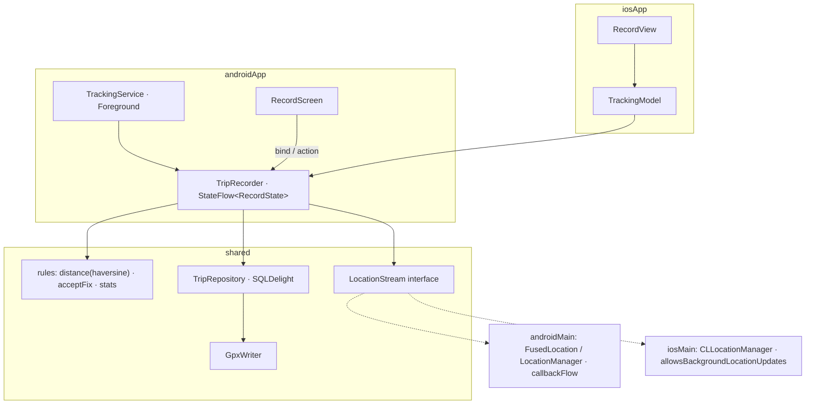

# App 4 · Trip Log 🗺️

> Bấm *Bắt đầu*, cất điện thoại vào túi, đi một vòng. App ghi lại đường đi, quãng đường, tốc độ, kể cả khi tắt màn hình.

## 1. Tóm tắt

| | |
|---|---|
| **Cấp độ** | ⭐⭐⭐⭐ |
| **Mới học** | **Chạy ngầm**: Android Foreground Service (`foregroundServiceType="location"`), iOS background location · `callbackFlow` · core sống ngoài màn hình · bản đồ native · xuất file GPX |
| **Cần trước** | App 3 · Device Pulse ([bài 10](../lessons/10-location.md) GPS + quyền) |
| **Thư mục code** | `TripLog/` · package `dev.triplog` |
| **Thời gian** | 7–10 buổi tối |

So với Device Pulse: GPS không chỉ đọc khi màn hình mở, mà phải **sống tiếp** khi app ra nền. Core không còn gắn với
`viewModelScope` nữa, mà gắn với Service (Android) hoặc vòng đời app (iOS).

## 2. Màn hình

| Màn | Hiện gì | Action |
|---|---|---|
| **Record** | Đồng hồ thời gian, quãng đường, tốc độ hiện tại / trung bình, bản đồ vẽ đường đi trực tiếp, độ chính xác GPS | *Bắt đầu* · *Tạm dừng* · *Kết thúc* |
| **Trips** | Danh sách chuyến: ngày, quãng đường, thời gian | Bấm → Detail · vuốt xoá |
| **Trip detail** | Bản đồ cả chuyến, thống kê, biểu đồ tốc độ đơn giản | *Xuất GPX* (share sheet) |

Android còn có **notification** cố định khi đang ghi (bắt buộc với Foreground Service), có nút *Dừng*.

## 3. Phạm vi

| Có | Làm sau |
|---|---|
| Ghi khi tắt màn hình / sang app khác | Tự phát hiện bắt đầu đi (activity recognition) |
| Lọc điểm GPS nhiễu | Đồng bộ cloud |
| Lưu chuyến (SQLDelight), xuất GPX | Nhập GPX |
| Xin quyền vị trí + thông báo (Android 13+) | Ghi khi app bị kill hẳn |

## 4. Kiến trúc



## 5. 7 bước làm

| Bước | Ở app này làm gì |
|:-:|---|
| **B1** | `model/`: `TrackPoint(lat, lon, accuracy, speed, time)`, `Trip`, `RecordState` (`Idle / Recording / Paused / Saving`). `rules/`: `distanceMeters(a, b)` (haversine), `acceptFix(prev, next)` (bỏ điểm sai số > 30 m hoặc nhảy > 50 m/s), `tripStats(points)`. |
| **B2** | `TripRecorder`: state machine `start / pause / resume / stop`. Thu `LocationStream.points()`, lọc qua `acceptFix`, cộng dồn quãng đường, ghi điểm theo lô (mỗi 10 điểm) xuống DB. Nhận `CoroutineScope` từ ngoài. |
| **B3** | `platform/LocationStream` (interface) + `AndroidLocationStream` (`callbackFlow` + `awaitClose { removeUpdates }`) + `IosLocationStream` (delegate Kotlin, `allowsBackgroundLocationUpdates = true`). `TripRepository` + `Trip.sq`, `Point.sq`. `GpxWriter` ở `commonMain` (chỉ ghép chuỗi XML). |
| **B4** | `TripRecorder` là `single` trong Koin (một bản cho cả app). Android: Service và màn Record dùng chung bản đó. `tripRecorder()` cho Swift. |
| **B5** | `TrackingService`: `startForeground(notification)` + chạy `TripRecorder` trong `lifecycleScope` của Service. Manifest: `FOREGROUND_SERVICE_LOCATION`, `POST_NOTIFICATIONS`. Bản đồ: `maps-compose` (hoặc vẽ `Canvas` nếu không muốn cần API key). |
| **B6** | Info.plist: `UIBackgroundModes = location`, `NSLocationWhenInUseUsageDescription`. SwiftUI `Map` + `MapPolyline`. Share GPX bằng `ShareLink`. |
| **B7** | `RulesTest` (haversine có đáp án chuẩn, lọc nhiễu) · `TripRecorderTest` với `FakeLocationStream` phát điểm giả · chạy thật: đi bộ 1 km tắt màn hình. |

## 6. Bản đồ function (dự kiến)

| Hàm | File | Làm gì | Vì sao |
|---|---|---|---|
| `distanceMeters(a, b)` | `rules/Geo.kt` | Khoảng cách 2 tọa độ theo haversine | Không phụ thuộc `Location.distanceTo` / `CLLocation.distance` → test được, 2 máy ra cùng số |
| `acceptFix(prev, next)` | `rules/Geo.kt` | Bỏ điểm quá nhiễu hoặc nhảy phi lý | GPS trong nhà nhảy vài trăm mét, cộng vào là sai quãng đường |
| `tripStats(points)` | `rules/Stats.kt` | Quãng đường, thời gian chạy, tốc độ TB / max | Bỏ thời gian `Paused` khỏi tốc độ TB |
| `TripRecorder.start()` | `core/TripRecorder.kt` | `Idle → Recording`, bắt đầu thu `points()` | Một state machine duy nhất cho cả 2 nền tảng |
| `AndroidLocationStream.points()` | `androidMain/platform/` | `callbackFlow` bọc listener, `awaitClose` gỡ listener | Quên gỡ listener = GPS chạy mãi, hết pin |
| `IosLocationStream.points()` | `iosMain/platform/` | Delegate CLLocationManager → `Flow` | `allowsBackgroundLocationUpdates` chỉ bật được khi Info.plist có mode `location` |
| `GpxWriter.write(trip)` | `data/GpxWriter.kt` | `Trip` → chuỗi GPX 1.1 | Viết ở `commonMain`: chỉ là XML, không cần API máy |
| `TrackingService.onStartCommand()` | `androidApp/.../TrackingService.kt` | `startForeground()` trong 5 giây đầu | Quá 5 giây Android 12+ ném `ForegroundServiceDidNotStartInTimeException` |

Bẫy cần ghi `// TRAP:` / `// PLATFORM:` trong code:

- `PLATFORM:` Android 14+ bắt buộc khai `foregroundServiceType` trong manifest **và** khi gọi `startForeground`, thiếu là crash.
- `PLATFORM:` iOS: thiếu `UIBackgroundModes = location` mà bật `allowsBackgroundLocationUpdates` → crash ngay.
- `TRAP:` Ghi từng điểm xuống DB một → chậm và tốn pin. Ghi theo lô.
- `TRAP:` Xoay màn trên Android không được làm mất chuyến đang ghi: state ở `TripRecorder` (singleton), không ở ViewModel.

## 7. Test

```bash
cd TripLog
./gradlew :shared:testDebugUnitTest :shared:iosSimulatorArm64Test
# Giả lập đi đường: Android
adb emu geo fix 106.7009 10.7769   # lặp lại với tọa độ khác, hoặc dùng Extended Controls → Routes
# iOS Simulator: Features → Location → City Run / Freeway Drive
```

Case tối thiểu: haversine Hà Nội → TP.HCM ≈ 1.137 km (sai < 1 %) · điểm nhảy 500 m trong 1 s bị bỏ · pause không cộng thời gian · GPX parse lại được.

## 8. Xong khi

- [ ] Android: ghi 10 phút **tắt màn hình**, notification hiện suốt, chuyến đủ điểm
- [ ] iOS máy thật: ghi 10 phút khi khóa máy, chuyến đủ điểm
- [ ] Từ chối quyền vị trí / thông báo → app báo rõ, không crash
- [ ] Xuất GPX mở được trên [gpx.studio](https://gpx.studio)
- [ ] Quãng đường 2 máy cùng đi chênh < 5 %
- [ ] KDoc `[App 4 · Bx]` mọi file · README đủ 7 mục

## 9. Tham khảo

- [Android: Foreground service types](https://developer.android.com/develop/background-work/services/fgs/service-types)
- [Apple: Handling location updates in the background](https://developer.apple.com/documentation/corelocation/handling-location-updates-in-the-background)
- [jordond/compass](https://github.com/jordond/compass): thư viện vị trí KMP, so với code tự viết
- native-mobile-learning: `BackgroundMonitor` (Foreground Service / BGAppRefresh) ở task 005
- Device Pulse: `AndroidLocationSensor.kt`, `IosLocationSensor.kt`

**Trước:** [App 3 · Rate Watch](03-rate-watch.md) · **Tiếp:** [App 5 · OBD Link](05-obd-link.md)
