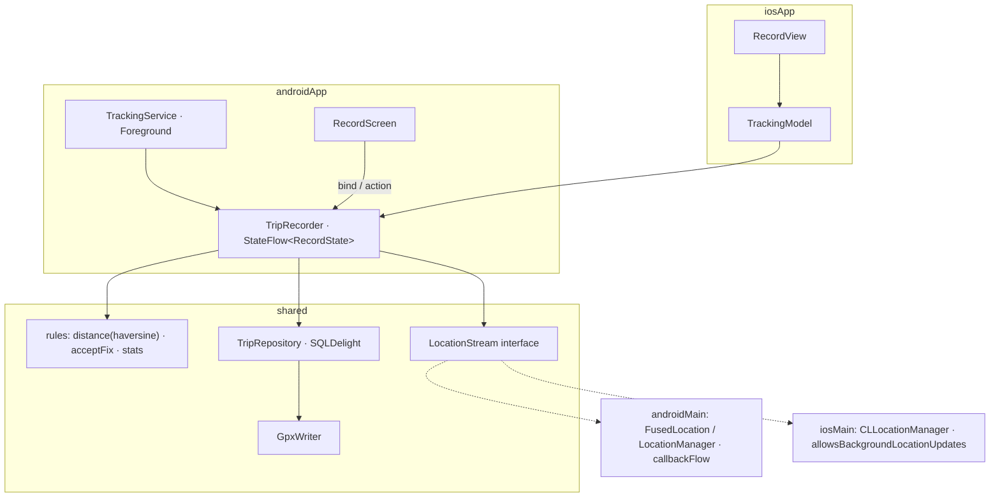

# App 4 · Trip Log 🗺️

> Bấm *Bắt đầu*, cất điện thoại vào túi, đi một vòng. App ghi lại đường đi, quãng đường, tốc độ, kể cả khi tắt màn hình.

## 1. Tóm tắt

| | |
|---|---|
| **Cấp độ** | ⭐⭐⭐⭐ |
| **Mới học** | **Chạy ngầm**: Android Foreground Service (`foregroundServiceType="location"`), iOS background location · `callbackFlow` · core sống ngoài màn hình · bản đồ native · xuất file GPX |
| **Cần trước** | App 3 · Device Pulse ([bài 10](../lessons/10-location.md) GPS + quyền) |
| **Thư mục code** | [`apps/TripLog/`](https://github.com/tucarmd/kotlin-multi-platform/tree/main/apps/TripLog) · package `dev.triplog` · ✅ đã có code |
| **Thời gian** | 7–10 buổi tối |

So với Device Pulse: GPS không chỉ đọc khi màn hình mở, mà phải **sống tiếp** khi app ra nền. Core không còn gắn với
`viewModelScope` nữa, mà gắn với Service (Android) hoặc vòng đời app (iOS).

## 2. Màn hình

| Màn | Hiện gì | Action |
|---|---|---|
| **Record** | Đồng hồ thời gian, quãng đường, tốc độ hiện tại / trung bình, bản đồ vẽ đường đi trực tiếp, độ chính xác GPS | *Bắt đầu* · *Tạm dừng* · *Kết thúc* |
| **Trips** | Danh sách chuyến: ngày, quãng đường, thời gian | Bấm → Detail · vuốt xoá |
| **Trip detail** | Bản đồ cả chuyến, thống kê, biểu đồ tốc độ đơn giản | *Xuất GPX* (share sheet) |

Android còn có **notification** cố định khi đang ghi (bắt buộc với Foreground Service), có nút *Dừng*.

## 3. Phạm vi

| Có | Làm sau |
|---|---|
| Ghi khi tắt màn hình / sang app khác | Tự phát hiện bắt đầu đi (activity recognition) |
| Lọc điểm GPS nhiễu | Đồng bộ cloud |
| Lưu chuyến (SQLDelight), xuất GPX | Nhập GPX |
| Xin quyền vị trí + thông báo (Android 13+) | Ghi khi app bị kill hẳn |

## 4. Kiến trúc



## 5. 7 bước làm

| Bước | Ở app này làm gì |
|:-:|---|
| **B1** | `model/`: `TrackPoint(lat, lon, accuracy, speed, time)`, `Trip`, `RecordState` (`Idle / Recording / Paused / Saving`). `rules/`: `distanceMeters(a, b)` (haversine), `acceptFix(prev, next)` (bỏ điểm sai số > 30 m hoặc nhảy > 50 m/s), `tripStats(points)`. |
| **B2** | `TripRecorder`: state machine `start / pause / resume / stop`. Thu `LocationStream.points()`, lọc qua `acceptFix`, cộng dồn quãng đường, ghi điểm theo lô (mỗi 10 điểm) xuống DB. Nhận `CoroutineScope` từ ngoài. |
| **B3** | `platform/LocationStream` (interface) + `AndroidLocationStream` (`callbackFlow` + `awaitClose { removeUpdates }`) + `IosLocationStream` (delegate Kotlin, `allowsBackgroundLocationUpdates = true`). `TripRepository` + `Trip.sq`, `Point.sq`. `GpxWriter` ở `commonMain` (chỉ ghép chuỗi XML). |
| **B4** | `TripRecorder` là `single` trong Koin (một bản cho cả app). Android: Service và màn Record dùng chung bản đó. `tripRecorder()` cho Swift. |
| **B5** | `TrackingService`: `startForeground(notification)` + chạy `TripRecorder` trong `lifecycleScope` của Service. Manifest: `FOREGROUND_SERVICE_LOCATION`, `POST_NOTIFICATIONS`. Bản đồ: `maps-compose` (hoặc vẽ `Canvas` nếu không muốn cần API key). |
| **B6** | Info.plist: `UIBackgroundModes = location`, `NSLocationWhenInUseUsageDescription`. SwiftUI `Map` + `MapPolyline`. Share GPX bằng `ShareLink`. |
| **B7** | `RulesTest` (haversine có đáp án chuẩn, lọc nhiễu) · `TripRecorderTest` với `FakeLocationStream` phát điểm giả · chạy thật: đi bộ 1 km tắt màn hình. |

## 6. Bản đồ function

Bảng đầy đủ (24 hàm, có link tới đúng dòng code) nằm trong
[`apps/TripLog/README.md`](https://github.com/tucarmd/kotlin-multi-platform/blob/main/apps/TripLog/README.md#ban-o-function). Các hàm chính:

| Hàm | File | Làm gì | Vì sao |
|---|---|---|---|
| `distanceMeters(a, b)` | `rules/Geo.kt` | Khoảng cách haversine | Test được, 2 máy ra cùng số |
| `judgeFix(prev, next)` / `acceptFix()` | `rules/Geo.kt` | `Accepted` / `TooInaccurate` (> 30 m) / `TooFast` (> 50 m/s) / `OutOfOrder` | GPS trong nhà nhảy vài trăm mét, cộng vào là sai quãng đường |
| `tripStats(points)` | `rules/Stats.kt` | Quãng đường, thời gian chạy, tốc độ TB / max | Cộng theo từng đoạn (segment), nên thời gian tạm dừng không bị tính |
| `formatFixed(value, decimals)` | `rules/Format.kt` | Số thập phân cố định, không bao giờ ra `1.0E-4` | Tọa độ GPX; `commonMain` không có `String.format` |
| `TripRecorder.start / pause / resume / finish` | `core/TripRecorder.kt` | State machine Idle → Recording ⇄ Paused → Saving | Một state machine cho cả 2 nền tảng; chuyến < 2 điểm bị bỏ |
| `TripRecorder.onFix()` | `core/TripRecorder.kt` | Lọc, cộng quãng đường, ghi DB mỗi 10 điểm | Ghi từng điểm là mỗi lần một lần sync đĩa |
| `TripLibrary.load(id)` | `core/TripLibrary.kt` | Chuyến + các điểm; lỗi → `null` | Exception Kotlin lọt sang Swift là crash |
| `GpxWriter.write(trip)` | `data/GpxWriter.kt` | GPX 1.1, mỗi đoạn một `<trkseg>` | Viết ở `commonMain`, 2 máy ra file giống hệt |
| `AndroidLocationStream.points()` | `androidMain/platform/` | `callbackFlow` + `awaitClose { removeUpdates }` | Quên gỡ listener = GPS chạy mãi |
| `IosLocationStream.points()` | `iosMain/platform/` | Delegate Kotlin, `flowOn(Dispatchers.Main)` | `CLLocationManager` tạo ngoài main thread không gọi delegate |
| `TrackingService.onStartCommand()` | `androidApp/.../service/TrackingService.kt` | `startForeground(type = LOCATION)` rồi `recorder.start()` | Quá 5 giây là Android 12+ crash |
| `RouteCanvas()` / `RouteMap` | `ui/Components.kt` / `Views/Components.swift` | Vẽ đường đi: Canvas (Android), `Map` + `MapPolyline` (iOS) | Android không cần API key Google Maps; đoạn tạm dừng hiện thành khoảng trống |

!!! note "Code khác plan ở đâu"
    - `TripRecorder` chạy trong một `CoroutineScope` cả app (Koin cấp), **không** trong `lifecycleScope` của Service. Service chỉ điều khiển recorder và cập nhật notification.
    - Thêm `TripLibrary` (danh sách, mở, xoá chuyến) bên cạnh `TripRecorder`.
    - `TrackPoint` có trường `segment`: mỗi lần tạm dừng mở đoạn mới, nên quãng đường, bản đồ và GPX đều tách đoạn.
    - Android chỉ dùng `GPS_PROVIDER` của `LocationManager`, không có Play Services. Service là `START_NOT_STICKY`: ghi tiếp khi app bị kill hẳn nằm ngoài phạm vi.
    - Test "GPX đọc lại được" dùng `javax.xml`, nên nằm ở `androidUnitTest` (chỉ chạy trên JVM).

Bẫy cần ghi `// TRAP:` / `// PLATFORM:` trong code:

- `PLATFORM:` Android 14+ bắt buộc khai `foregroundServiceType` trong manifest **và** khi gọi `startForeground`, thiếu là crash.
- `PLATFORM:` iOS: thiếu `UIBackgroundModes = location` mà bật `allowsBackgroundLocationUpdates` → crash ngay.
- `TRAP:` Ghi từng điểm xuống DB một → chậm và tốn pin. Ghi theo lô.
- `TRAP:` Xoay màn trên Android không được làm mất chuyến đang ghi: state ở `TripRecorder` (singleton), không ở ViewModel.
- `TRAP:` `LocationListener { }` viết dạng lambda crash `AbstractMethodError` trên Android < 11: viết hẳn `object`.
- `PLATFORM:` iOS `pausesLocationUpdatesAutomatically` mặc định là `true`: dừng đèn đỏ là iOS tắt GPS và không tự bật lại.
- `PLATFORM:` Người dùng chỉ cho vị trí "gần đúng" thì sai số ~2 km, bộ lọc bỏ hết điểm: app báo riêng trường hợp này.
- `TRAP:` `Double.toString()` có thể ra `1.0E-4`, không hợp lệ trong GPX.

## 7. Test

```bash
cd apps/TripLog
./gradlew :shared:testDebugUnitTest :shared:iosSimulatorArm64Test
# Giả lập đi đường, Android (bấm Bắt đầu trước): ~11 m mỗi giây, qua được bộ lọc nhiễu
for i in $(seq 0 60); do adb emu geo fix $(echo "106.7009 + $i*0.0001" | bc) 10.7769; sleep 1; done
# iOS Simulator
xcrun simctl location booted start --speed=8 21.0285,105.8542 21.0300,105.8560 21.0320,105.8570
```

Trên emulator, `geo fix` báo tốc độ = 0 nên tốc độ hiện tại / tối đa hiện 0 km/h; quãng đường và tốc độ trung bình vẫn đúng. Thử tốc độ trên máy thật.

Case tối thiểu: haversine Hà Nội (21.0285, 105.8542) → TP.HCM (10.7769, 106.7009) = 1.143,5 km · điểm nhảy 500 m trong 1 s bị bỏ · pause không cộng thời gian · GPX parse lại được.

## 8. Xong khi

- [ ] Android: ghi 10 phút **tắt màn hình**, notification hiện suốt, chuyến đủ điểm
- [ ] iOS máy thật: ghi 10 phút khi khóa máy, chuyến đủ điểm
- [ ] Từ chối quyền vị trí / thông báo → app báo rõ, không crash
- [ ] Xuất GPX mở được trên [gpx.studio](https://gpx.studio)
- [ ] Quãng đường 2 máy cùng đi chênh < 5 %
- [ ] KDoc `[App 4 · Bx]` mọi file · README đủ 7 mục

## 9. Tham khảo

- [Android: Foreground service types](https://developer.android.com/develop/background-work/services/fgs/service-types)
- [Apple: Handling location updates in the background](https://developer.apple.com/documentation/corelocation/handling-location-updates-in-the-background)
- [jordond/compass](https://github.com/jordond/compass): thư viện vị trí KMP, so với code tự viết
- native-mobile-learning: `BackgroundMonitor` (Foreground Service / BGAppRefresh) ở task 005
- Device Pulse: `AndroidLocationSensor.kt`, `IosLocationSensor.kt`

**Trước:** [App 3 · Rate Watch](03-rate-watch.md) · **Tiếp:** [App 5 · OBD Link](05-obd-link.md)
