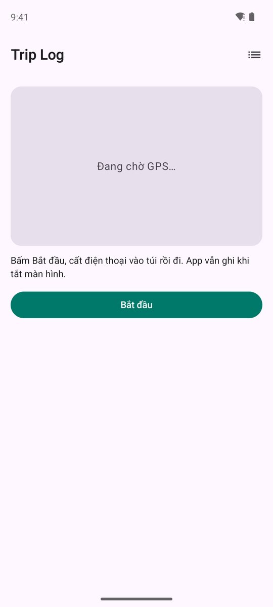
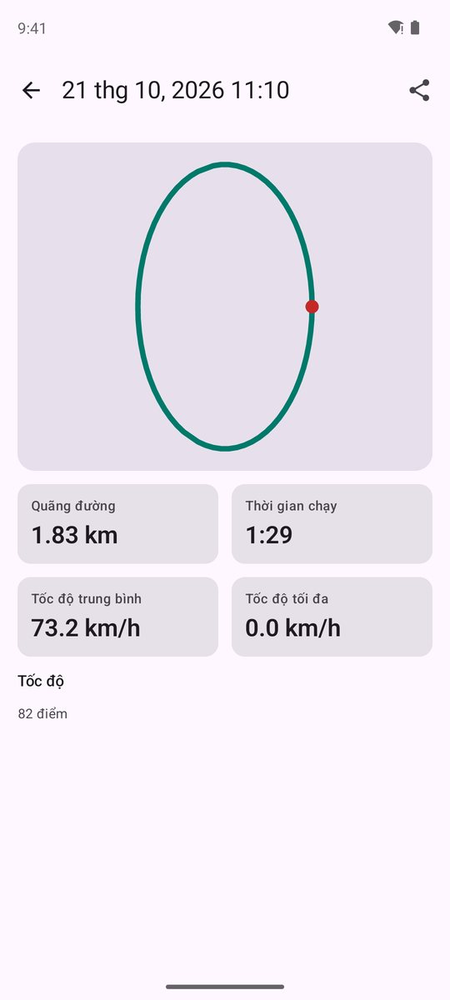
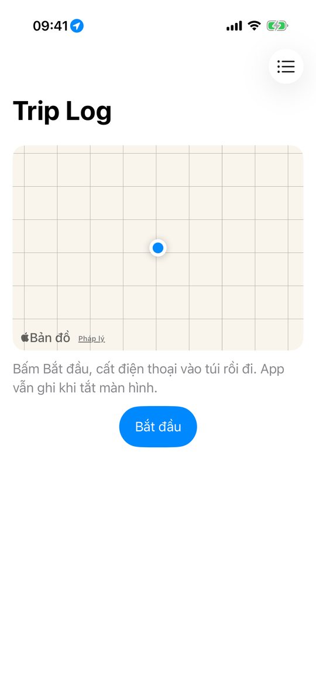
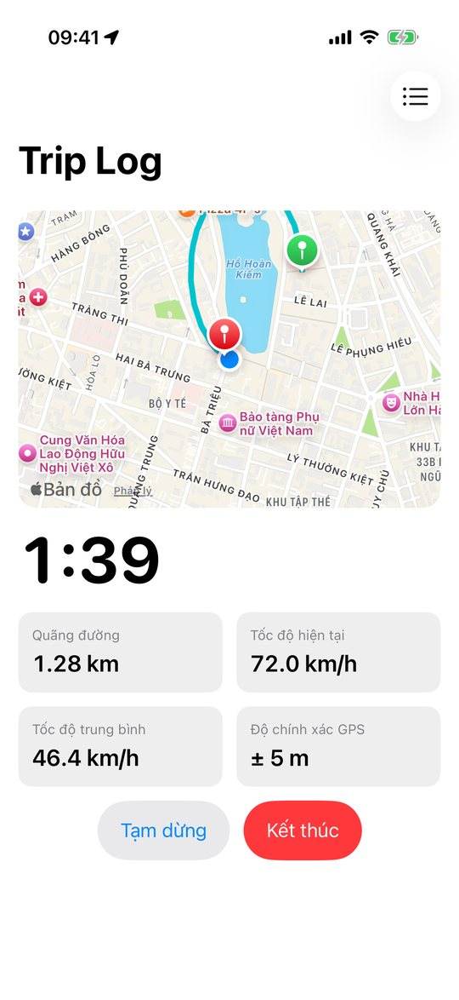
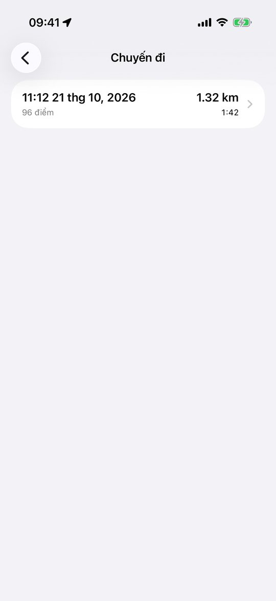
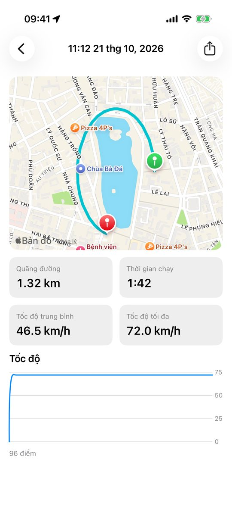
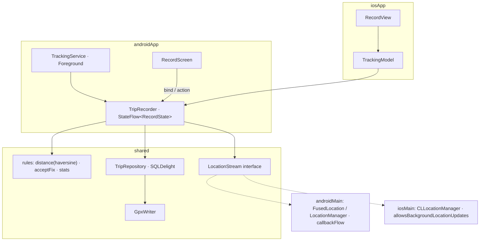

# App 4 · Trip Log 🗺️

> Bấm *Bắt đầu*, cất điện thoại vào túi, đi một vòng. App ghi lại đường đi, quãng đường, tốc độ, kể cả khi tắt màn hình.

## Demo: làm xong trông thế nào

Ảnh chụp **app thật trong repo** (không phải mockup), chạy bằng Maestro trên emulator Pixel 8 (Android 14) và Simulator iPhone 17 (iOS 26.5), ngày 2026-10-21.
Cùng một core KMP, mỗi bên một UI native: so hai tab là thấy **logic giống hệt, giao diện theo chuẩn từng nền tảng**.

=== "🤖 Android · Jetpack Compose"

    <div class="phones phones--demo" markdown>
    <figure markdown>
    
    <figcaption>1. Chờ bấm Bắt đầu</figcaption>
    </figure>
    <figure markdown>
    
    <figcaption>2. Đang ghi: vòng quanh Hồ Gươm</figcaption>
    </figure>
    <figure markdown>
    
    <figcaption>3. Danh sách chuyến</figcaption>
    </figure>
    <figure markdown>
    
    <figcaption>4. Chi tiết + biểu đồ tốc độ, nút chia sẻ GPX</figcaption>
    </figure>
    </div>

=== "🍎 iOS · SwiftUI"

    <div class="phones phones--demo" markdown>
    <figure markdown>
    
    <figcaption>1. Chờ bấm Bắt đầu</figcaption>
    </figure>
    <figure markdown>
    
    <figcaption>2. Đang ghi: vòng quanh Hồ Gươm</figcaption>
    </figure>
    <figure markdown>
    
    <figcaption>3. Danh sách chuyến</figcaption>
    </figure>
    <figure markdown>
    
    <figcaption>4. Chi tiết + biểu đồ tốc độ, nút chia sẻ GPX</figcaption>
    </figure>
    </div>

Đường đi là **GPS giả** (71 điểm vòng quanh Hồ Hoàn Kiếm, 1 điểm / giây), xem cách bơm ở mục 10.4. iOS vẽ trên Apple Maps (MapKit); Android vẽ đường bằng Canvas, không cần API key bản đồ. Tốc độ hiện tại trên Android là 0 km/h vì `adb emu geo fix` không gửi tốc độ (đã ghi ở mục 7); `simctl location` của iOS thì có.

## Ước lượng thời gian

Cho người **đã học xong 14 bài** (hoặc app trước), gõ lại từ đầu theo 7 bước, mỗi buổi tối khoảng 2–3 giờ.
Lần đầu làm KMP thì nhân 1,5.

| Việc | Thời gian người làm |
|---|---|
| Đọc trang + docs Foreground Service / background location | 1,5 giờ |
| B1 model + luật (haversine, lọc điểm nhiễu, pause) + test | 2,5 giờ |
| B2 `TripRecorder` sống ngoài màn hình, `TripLibrary` | 3 giờ |
| B3 vị trí bằng `callbackFlow` (Android + iOS), SQLDelight, `GpxWriter` | 4 giờ |
| B4 Koin, scope cấp app | 30 phút |
| B5 UI Android + `TrackingService` + notification | 4 giờ |
| B6 UI iOS + MapKit + background location | 4 giờ |
| B7 test, README | 2 giờ |
| **Chạy + test trên 2 máy** (mục [10](#10-how-to-test)) | 2–3 giờ (có 2 lần đi bộ thật 10 phút) |
| **Tổng** | **≈ 23 giờ · 8–10 buổi tối** |

Thời gian **máy chạy**, đo trên MacBook Pro M1 Pro 16 GB, Xcode 26.5, JDK 17:

| Việc | Đo được |
|---|---|
| Build app iOS cho Simulator (`xcodebuild`, Gradle đã có cache) | 1 phút 35 giây |
| Máy chạy toàn bộ unit test (JVM + iOS Simulator, build lại từ đầu bằng `--rerun-tasks`) | **1 phút 22 giây** · 63 test (JVM + iOS cộng lại), 0 lỗi |
| Build + cài Android khi đã build 1 lần (`installDebug`) | dưới 30 giây |

## 1. Tóm tắt

| | |
|---|---|
| **Cấp độ** | ⭐⭐⭐⭐ |
| **Mới học** | **Chạy ngầm**: Android Foreground Service (`foregroundServiceType="location"`), iOS background location · `callbackFlow` · core sống ngoài màn hình · bản đồ native · xuất file GPX |
| **Cần trước** | App 3 · Device Pulse ([bài 10](../lessons/10-location.md) GPS + quyền) |
| **Thư mục code** | [`apps/TripLog/`](https://github.com/tucarmd/kotlin-multi-platform/tree/main/apps/TripLog) · package `dev.triplog` · ✅ đã có code |
| **Thời gian** | 7–10 buổi tối · [chi tiết](#uoc-luong-thoi-gian) |

So với Device Pulse: GPS không chỉ đọc khi màn hình mở, mà phải **sống tiếp** khi app ra nền. Core không còn gắn với
`viewModelScope` nữa, mà gắn với Service (Android) hoặc vòng đời app (iOS).

## 2. Màn hình

| Màn | Hiện gì | Action |
|---|---|---|
| **Record** | Đồng hồ thời gian, quãng đường, tốc độ hiện tại / trung bình, bản đồ vẽ đường đi trực tiếp, độ chính xác GPS | *Bắt đầu* · *Tạm dừng* · *Kết thúc* |
| **Trips** | Danh sách chuyến: ngày, quãng đường, thời gian | Bấm → Detail · vuốt xoá |
| **Trip detail** | Bản đồ cả chuyến, thống kê, biểu đồ tốc độ đơn giản | *Xuất GPX* (share sheet) |

Android còn có **notification** cố định khi đang ghi (bắt buộc với Foreground Service), có nút *Dừng*.

## 3. Phạm vi

| Có | Làm sau |
|---|---|
| Ghi khi tắt màn hình / sang app khác | Tự phát hiện bắt đầu đi (activity recognition) |
| Lọc điểm GPS nhiễu | Đồng bộ cloud |
| Lưu chuyến (SQLDelight), xuất GPX | Nhập GPX |
| Xin quyền vị trí + thông báo (Android 13+) | Ghi khi app bị kill hẳn |

## 4. Kiến trúc



## 5. 7 bước làm

| Bước | Ở app này làm gì |
|:-:|---|
| **B1** | `model/`: `TrackPoint(lat, lon, accuracy, speed, time)`, `Trip`, `RecordState` (`Idle / Recording / Paused / Saving`). `rules/`: `distanceMeters(a, b)` (haversine), `acceptFix(prev, next)` (bỏ điểm sai số > 30 m hoặc nhảy > 50 m/s), `tripStats(points)`. |
| **B2** | `TripRecorder`: state machine `start / pause / resume / stop`. Thu `LocationStream.points()`, lọc qua `acceptFix`, cộng dồn quãng đường, ghi điểm theo lô (mỗi 10 điểm) xuống DB. Nhận `CoroutineScope` từ ngoài. |
| **B3** | `platform/LocationStream` (interface) + `AndroidLocationStream` (`callbackFlow` + `awaitClose { removeUpdates }`) + `IosLocationStream` (delegate Kotlin, `allowsBackgroundLocationUpdates = true`). `TripRepository` + `Trip.sq`, `Point.sq`. `GpxWriter` ở `commonMain` (chỉ ghép chuỗi XML). |
| **B4** | `TripRecorder` là `single` trong Koin (một bản cho cả app). Android: Service và màn Record dùng chung bản đó. `tripRecorder()` cho Swift. |
| **B5** | `TrackingService`: `startForeground(notification)` + chạy `TripRecorder` trong `lifecycleScope` của Service. Manifest: `FOREGROUND_SERVICE_LOCATION`, `POST_NOTIFICATIONS`. Bản đồ: `maps-compose` (hoặc vẽ `Canvas` nếu không muốn cần API key). |
| **B6** | Info.plist: `UIBackgroundModes = location`, `NSLocationWhenInUseUsageDescription`. SwiftUI `Map` + `MapPolyline`. Share GPX bằng `ShareLink`. |
| **B7** | `RulesTest` (haversine có đáp án chuẩn, lọc nhiễu) · `TripRecorderTest` với `FakeLocationStream` phát điểm giả · chạy thật: đi bộ 1 km tắt màn hình. |

## 6. Bản đồ function

Bảng đầy đủ (24 hàm, có link tới đúng dòng code) nằm trong
[`apps/TripLog/README.md`](https://github.com/tucarmd/kotlin-multi-platform/blob/main/apps/TripLog/README.md#ban-o-function). Các hàm chính:

| Hàm | File | Làm gì | Vì sao |
|---|---|---|---|
| `distanceMeters(a, b)` | `rules/Geo.kt` | Khoảng cách haversine | Test được, 2 máy ra cùng số |
| `judgeFix(prev, next)` / `acceptFix()` | `rules/Geo.kt` | `Accepted` / `TooInaccurate` (> 30 m) / `TooFast` (> 50 m/s) / `OutOfOrder` | GPS trong nhà nhảy vài trăm mét, cộng vào là sai quãng đường |
| `tripStats(points)` | `rules/Stats.kt` | Quãng đường, thời gian chạy, tốc độ TB / max | Cộng theo từng đoạn (segment), nên thời gian tạm dừng không bị tính |
| `formatFixed(value, decimals)` | `rules/Format.kt` | Số thập phân cố định, không bao giờ ra `1.0E-4` | Tọa độ GPX; `commonMain` không có `String.format` |
| `TripRecorder.start / pause / resume / finish` | `core/TripRecorder.kt` | State machine Idle → Recording ⇄ Paused → Saving | Một state machine cho cả 2 nền tảng; chuyến < 2 điểm bị bỏ |
| `TripRecorder.onFix()` | `core/TripRecorder.kt` | Lọc, cộng quãng đường, ghi DB mỗi 10 điểm | Ghi từng điểm là mỗi lần một lần sync đĩa |
| `TripLibrary.load(id)` | `core/TripLibrary.kt` | Chuyến + các điểm; lỗi → `null` | Exception Kotlin lọt sang Swift là crash |
| `GpxWriter.write(trip)` | `data/GpxWriter.kt` | GPX 1.1, mỗi đoạn một `<trkseg>` | Viết ở `commonMain`, 2 máy ra file giống hệt |
| `AndroidLocationStream.points()` | `androidMain/platform/` | `callbackFlow` + `awaitClose { removeUpdates }` | Quên gỡ listener = GPS chạy mãi |
| `IosLocationStream.points()` | `iosMain/platform/` | Delegate Kotlin, `flowOn(Dispatchers.Main)` | `CLLocationManager` tạo ngoài main thread không gọi delegate |
| `TrackingService.onStartCommand()` | `androidApp/.../service/TrackingService.kt` | `startForeground(type = LOCATION)` rồi `recorder.start()` | Quá 5 giây là Android 12+ crash |
| `RouteCanvas()` / `RouteMap` | `ui/Components.kt` / `Views/Components.swift` | Vẽ đường đi: Canvas (Android), `Map` + `MapPolyline` (iOS) | Android không cần API key Google Maps; đoạn tạm dừng hiện thành khoảng trống |

!!! note "Code khác plan ở đâu"
    - `TripRecorder` chạy trong một `CoroutineScope` cả app (Koin cấp), **không** trong `lifecycleScope` của Service. Service chỉ điều khiển recorder và cập nhật notification.
    - Thêm `TripLibrary` (danh sách, mở, xoá chuyến) bên cạnh `TripRecorder`.
    - `TrackPoint` có trường `segment`: mỗi lần tạm dừng mở đoạn mới, nên quãng đường, bản đồ và GPX đều tách đoạn.
    - Android chỉ dùng `GPS_PROVIDER` của `LocationManager`, không có Play Services. Service là `START_NOT_STICKY`: ghi tiếp khi app bị kill hẳn nằm ngoài phạm vi.
    - Test "GPX đọc lại được" dùng `javax.xml`, nên nằm ở `androidUnitTest` (chỉ chạy trên JVM).

Bẫy cần ghi `// TRAP:` / `// PLATFORM:` trong code:

- `PLATFORM:` Android 14+ bắt buộc khai `foregroundServiceType` trong manifest **và** khi gọi `startForeground`, thiếu là crash.
- `PLATFORM:` iOS: thiếu `UIBackgroundModes = location` mà bật `allowsBackgroundLocationUpdates` → crash ngay.
- `TRAP:` Ghi từng điểm xuống DB một → chậm và tốn pin. Ghi theo lô.
- `TRAP:` Xoay màn trên Android không được làm mất chuyến đang ghi: state ở `TripRecorder` (singleton), không ở ViewModel.
- `TRAP:` `LocationListener { }` viết dạng lambda crash `AbstractMethodError` trên Android < 11: viết hẳn `object`.
- `PLATFORM:` iOS `pausesLocationUpdatesAutomatically` mặc định là `true`: dừng đèn đỏ là iOS tắt GPS và không tự bật lại.
- `PLATFORM:` Người dùng chỉ cho vị trí "gần đúng" thì sai số ~2 km, bộ lọc bỏ hết điểm: app báo riêng trường hợp này.
- `TRAP:` `Double.toString()` có thể ra `1.0E-4`, không hợp lệ trong GPX.

## 7. Test

```bash
cd apps/TripLog
./gradlew :shared:testDebugUnitTest :shared:iosSimulatorArm64Test
# Giả lập đi đường, Android (bấm Bắt đầu trước): ~11 m mỗi giây, qua được bộ lọc nhiễu
for i in $(seq 0 60); do adb emu geo fix $(echo "106.7009 + $i*0.0001" | bc) 10.7769; sleep 1; done
# iOS Simulator
xcrun simctl location booted start --speed=8 21.0285,105.8542 21.0300,105.8560 21.0320,105.8570
```

Trên emulator, `geo fix` báo tốc độ = 0 nên tốc độ hiện tại / tối đa hiện 0 km/h; quãng đường và tốc độ trung bình vẫn đúng. Thử tốc độ trên máy thật.

Case tối thiểu: haversine Hà Nội (21.0285, 105.8542) → TP.HCM (10.7769, 106.7009) = 1.143,5 km · điểm nhảy 500 m trong 1 s bị bỏ · pause không cộng thời gian · GPX parse lại được.

## 8. Xong khi

- [ ] Android: ghi 10 phút **tắt màn hình**, notification hiện suốt, chuyến đủ điểm
- [ ] iOS máy thật: ghi 10 phút khi khóa máy, chuyến đủ điểm
- [ ] Từ chối quyền vị trí / thông báo → app báo rõ, không crash
- [ ] Xuất GPX mở được trên [gpx.studio](https://gpx.studio)
- [ ] Quãng đường 2 máy cùng đi chênh < 5 %
- [ ] KDoc `[App 4 · Bx]` mọi file · README đủ 7 mục

## 9. Tham khảo

- [Android: Foreground service types](https://developer.android.com/develop/background-work/services/fgs/service-types)
- [Apple: Handling location updates in the background](https://developer.apple.com/documentation/corelocation/handling-location-updates-in-the-background)
- [jordond/compass](https://github.com/jordond/compass): thư viện vị trí KMP, so với code tự viết
- native-mobile-learning: `BackgroundMonitor` (Foreground Service / BGAppRefresh) ở task 005
- Device Pulse: `AndroidLocationSensor.kt`, `IosLocationSensor.kt`


## 10. How to test

### 10.1 Unit test (tự động)

```bash
cd apps/TripLog
./gradlew :shared:testDebugUnitTest :shared:iosSimulatorArm64Test
```

### 10.2 Chạy trên 2 máy (cấp quyền sẵn để khỏi bấm dialog)

```bash
./gradlew :androidApp:installDebug
for p in ACCESS_FINE_LOCATION ACCESS_COARSE_LOCATION POST_NOTIFICATIONS; do adb shell pm grant dev.triplog android.permission.$p; done
adb shell monkey -p dev.triplog 1

xcrun simctl install booted iosApp/build/dd/Build/Products/Debug-iphonesimulator/TripLog.app
xcrun simctl privacy booted grant location-always dev.triplog.ios
xcrun simctl launch booted dev.triplog.ios
```

### 10.3 Kịch bản test tay

| # | Làm gì | Kết quả đúng |
|:-:|---|---|
| 1 | Mở app lần đầu, bấm **Bắt đầu** | Hỏi quyền vị trí (Android 13+ hỏi thêm thông báo) |
| 2 | Cho phép, bơm GPS (10.4) | Đồng hồ chạy, quãng đường tăng, đường vẽ dần trên bản đồ |
| 3 | Bấm **Tạm dừng** 30 giây rồi **Tiếp tục** | Thời gian chạy **không** cộng 30 giây đó |
| 4 | Bấm **Kết thúc** | "Đang lưu chuyến…", rồi chuyến có trong danh sách |
| 5 | Mở chuyến | Bản đồ cả chuyến, quãng đường, thời gian, tốc độ TB / tối đa |
| 6 | Bấm chia sẻ GPX, lưu file, mở trên [gpx.studio](https://gpx.studio) | Đường giống trên app |
| 7 | Android: đang ghi thì tắt màn hình 5 phút | Notification "Đang ghi chuyến đi" còn suốt, chuyến đủ điểm |
| 8 | iOS máy thật: đang ghi thì khoá máy 5 phút | Mũi tên vị trí trên status bar, chuyến đủ điểm |

### 10.4 Bơm GPS giả và cố làm hư

```bash
# Android: 71 điểm vòng quanh Hồ Gươm, 1 điểm/giây (~50 km/h)
python3 -c "import math;[print(f'{105.8524+0.0021*math.cos(2*math.pi*i/70):.6f} {21.0288+0.0032*math.sin(2*math.pi*i/70):.6f}') for i in range(71)]" > route.txt
while read lon lat; do adb emu geo fix $lon $lat; sleep 1; done < route.txt

# iOS Simulator: cùng tuyến, có tốc độ thật (m/s)
xcrun simctl location booted start --speed=20 $(awk '{printf "%s,%s ", $2, $1}' route.txt)
xcrun simctl location booted clear
```

| Thử | Cách giả lập | Mong đợi |
|---|---|---|
| Điểm nhảy xa (GPS nhiễu) | Bước 0,01° thay vì 0,0001° | "Đã bỏ N điểm nhiễu", quãng đường không vọt |
| Từ chối quyền vị trí | `adb shell pm revoke dev.triplog android.permission.ACCESS_FINE_LOCATION` · iOS `xcrun simctl privacy booted revoke location dev.triplog.ios` | Thông báo rõ + nút **Mở Cài đặt**, không crash. Android: thu hồi khi đang chạy = process bị kill ([Platform API › Location](native-device-monitor/platform-api/01-location.md)) |
| Chỉ cho vị trí gần đúng | Chọn "Approximate" / tắt "Precise" | "Vị trí chính xác đang tắt…" |
| Từ chối thông báo (Android 13+) | `pm revoke … POST_NOTIFICATIONS` | Vẫn ghi, chỉ không thấy notification |
| Tắt định vị cả máy | Android `adb shell cmd location set-location-enabled false` | "Định vị đang tắt…" |
| Hệ thống kill khi đang ghi | Bấm Home rồi `adb shell am kill dev.triplog` | Foreground Service giữ process, **không** chết. Force stop thì dừng (đúng thiết kế) |

## 11. Achievement: xong app này bạn có gì

| 🏅 | Đạt được | Bằng chứng |
|:-:|---|---|
| 🛰️ | Đổi callback GPS của 2 nền tảng thành `Flow` bằng `callbackFlow` | `AndroidLocationStream`, `IosLocationStream` |
| 🌙 | App **chạy khi tắt màn hình**: Foreground Service type `location` (Android), background location (iOS) | Chuyến 10 phút tắt màn hình đủ điểm |
| 🧠 | Core sống **ngoài** màn hình (scope cấp app), service và UI chỉ điều khiển nó | `TripRecorder` là `single` trong Koin |
| 📐 | Toán vị trí: haversine, lọc nhiễu, tốc độ TB / tối đa, test bằng số thật Hà Nội → TP.HCM | `RulesTest` 1.143,5 km |
| 🗺️ | Vẽ đường trên bản đồ native (MapKit) và Canvas | Ảnh demo |
| 📤 | Xuất file chuẩn (GPX 1.1) và chia sẻ qua share sheet | File mở được trên gpx.studio |
| 🔐 | Xử lý đủ nhánh quyền: từ chối, gần đúng, thông báo, định vị tắt | Mục 10.4 |

**Mở khoá:** [App 5 · OBD Link](05-obd-link.md): BLE + nhiều module.

**Trước:** [App 3 · Rate Watch](03-rate-watch.md) · **Tiếp:** [App 5 · OBD Link](05-obd-link.md)
