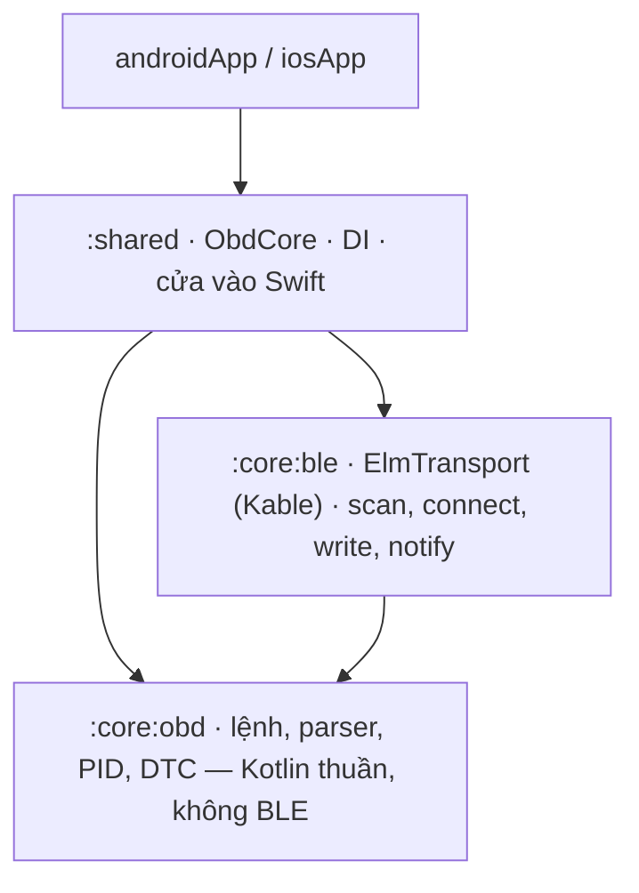
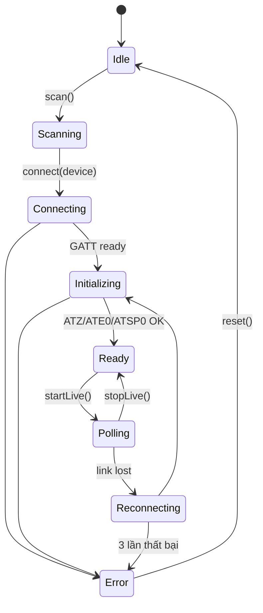

# App 5 · OBD Link 🚗

> Cắm dongle ELM327 Bluetooth LE vào cổng OBD-II của xe → app kết nối, hiện vòng tua, tốc độ, nhiệt độ nước làm mát theo
> thời gian thực, đọc và xoá mã lỗi (DTC).

## 1. Tóm tắt

| | |
|---|---|
| **Cấp độ** | ⭐⭐⭐⭐⭐ Khó nhất |
| **Mới học** | BLE trong KMP bằng [Kable](https://github.com/JuulLabs/kable) · state machine kết nối · **hàng đợi lệnh** (một lệnh một lúc) với `Mutex` + timeout + retry · parse byte / chuỗi hex · tách **nhiều module** Gradle · thiết bị giả để test |
| **Cần trước** | App 4 · native-mobile-learning phần BLE (scan → GATT → notify → write) |
| **Thư mục code** | `ObdLink/` · package `dev.obdlink` |
| **Phần cứng** | Dongle ELM327 **BLE** (không phải Bluetooth Classic, iOS không dùng được Classic) · hoặc ESP32 / nRF Connect giả lập |
| **Thời gian** | 10–14 buổi tối |

So với app 4: không chỉ *đọc* luồng dữ liệu, mà phải **hỏi – chờ – trả lời** qua một kênh chậm, hay rớt, và chỉ xử lý được một lệnh mỗi lần.

## 2. Màn hình

| Màn | Hiện gì | Action |
|---|---|---|
| **Connect** | Trạng thái quyền + Bluetooth, danh sách dongle tìm được, tín hiệu | Quét · chọn · kết nối · thử lại |
| **Live** | 3 đồng hồ: RPM, km/h, °C · tần số cập nhật · trạng thái kết nối | Tạm dừng / tiếp tục đọc |
| **Codes** | Danh sách mã lỗi (`P0301`…) + mô tả ngắn | *Đọc mã* · *Xoá mã* (hỏi xác nhận) |
| **Console** | Log lệnh gửi / nhận thô (`010C` → `41 0C 1A F8`) | Gõ lệnh AT / PID tay |

## 3. Phạm vi

| Có | Làm sau |
|---|---|
| Scan, connect, reconnect khi rớt | Bluetooth Classic (chỉ Android) |
| Khởi tạo ELM327 (`ATZ`, `ATE0`, `ATL0`, `ATSP0`) | Ghi log chuyến đi + biểu đồ |
| PID `010C` RPM · `010D` tốc độ · `0105` nhiệt độ | PID riêng hãng xe |
| Mode `03` đọc DTC · `04` xoá DTC | Freeze frame, readiness monitor |
| Console thô cho người học | |

## 4. Kiến trúc

Lần đầu tách `shared/` thành nhiều module, mỗi module một việc, phụ thuộc một chiều:





## 5. 7 bước làm

| Bước | Ở app này làm gì |
|:-:|---|
| **B1** | `:core:obd`: `ObdCommand` (sealed: `At`, `Pid`, `ReadDtc`, `ClearDtc`), `parseResponse(raw)` (bỏ `SEARCHING...`, `>`, khoảng trắng, phát hiện `NO DATA` / `?`), `decodePid(pid, bytes)` (RPM = `(256A + B) / 4`), `decodeDtc(bytes)` → `P0301`. Toàn hàm thuần, test kỹ nhất app. |
| **B2** | `ObdCore`: state machine trong sơ đồ trên; `CommandQueue` dùng `Mutex` để gửi **một lệnh một lúc**, `withTimeout(2.s)`, retry 1 lần; vòng `startLive()` hỏi 3 PID luân phiên. Test với `FakeElmTransport` (trả lời giả theo bảng). |
| **B3** | `:core:ble`: interface `ElmTransport { send(text): String }` + cài đặt bằng Kable: scan theo service UUID (`FFF0` / `FFE0` tùy dongle), ghi characteristic write, gom notify cho tới dấu `>` thì trả về. |
| **B4** | Koin: `obdModule`, `bleModule`, `platformModule` (quyền BLE). `obdCore()` cho Swift. `settings.gradle.kts` thêm `:core:obd`, `:core:ble`. |
| **B5** | Màn Connect dùng lại logic quyền BLE của native-mobile-learning (API 31+ `BLUETOOTH_SCAN/CONNECT`). 3 đồng hồ vẽ bằng `Canvas`. |
| **B6** | Info.plist `NSBluetoothAlwaysUsageDescription`. Đồng hồ bằng `Gauge`. `TabView` 4 tab. |
| **B7** | `ObdParserTest` (bảng response thật thu từ dongle) · `CommandQueueTest` (timeout, retry, không chen lệnh) · `ObdCoreTest` (rớt kết nối → reconnect → error sau 3 lần) · chạy thật trên xe. |

## 6. Bản đồ function (dự kiến)

| Hàm | File | Làm gì | Vì sao |
|---|---|---|---|
| `parseResponse(raw)` | `:core:obd/Parser.kt` | Làm sạch chuỗi ELM327, trả `ObdResult.Data / NoData / Error` | Dongle rẻ trả đủ kiểu rác: echo, `SEARCHING...`, xuống dòng `\r` |
| `decodePid(pid, bytes)` | `:core:obd/Pid.kt` | Byte → giá trị có đơn vị theo công thức SAE J1979 | Công thức nằm một chỗ, có test với số đã biết |
| `decodeDtc(bytes)` | `:core:obd/Dtc.kt` | 2 byte → `P0301`, `C0035`… | 2 bit đầu chọn chữ cái P/C/B/U, dễ sai nhất app |
| `CommandQueue.send(cmd)` | `core/CommandQueue.kt` | Khoá `Mutex`, gửi, chờ tới `>`, timeout, retry | ELM327 chỉ xử lý **một** lệnh; gửi chồng là nhận câu trả lời của lệnh khác |
| `ObdCore.connect(device)` | `core/ObdCore.kt` | Chạy state machine Connecting → Initializing → Ready | Mọi trạng thái là sealed class, UI chỉ vẽ |
| `ObdCore.startLive()` | `core/ObdCore.kt` | Vòng hỏi RPM / tốc độ / nhiệt độ, phát `StateFlow<LiveData>` | Hủy được bằng `stopLive()` hoặc khi rớt kết nối |
| `KableElmTransport.send(text)` | `:core:ble/KableElmTransport.kt` | Write `text + "\r"`, gom notify tới `>` | BLE chia gói 20 byte, một câu trả lời có thể tới thành nhiều notify |

Bẫy cần ghi `// TRAP:` / `// PLATFORM:` trong code:

- `TRAP:` Câu trả lời tới nhiều mảnh qua notify; chỉ coi là xong khi gặp `>`.
- `TRAP:` Lệnh đầu sau `ATSP0` mất vài giây (`SEARCHING...`); timeout lệnh đầu phải dài hơn.
- `PLATFORM:` iOS không cho thấy địa chỉ MAC, chỉ có UUID riêng của máy: không lưu "dongle quen" bằng MAC.
- `PLATFORM:` Android ≤ 30 quét BLE cần quyền **vị trí**, API 31+ cần `BLUETOOTH_SCAN`.
- `TRAP:` *Xoá mã* (mode `04`) tắt đèn check-engine và reset readiness: luôn hỏi xác nhận.

## 7. Test

```bash
cd ObdLink
./gradlew :core:obd:allTests :shared:testDebugUnitTest :shared:iosSimulatorArm64Test
```

Không có xe: dựng thiết bị giả bằng nRF Connect (tạo service `FFF0`, trả lời cố định) hoặc ESP32 như
`peripheral-setup.md` của native-mobile-learning. Case tối thiểu: `41 0C 1A F8` → 1726 rpm · `NO DATA` · response cắt làm 3
notify · hai lệnh gửi cùng lúc vẫn ra đúng thứ tự · timeout → retry → error · rớt kết nối giữa lúc poll.

## 8. Xong khi

- [ ] Kết nối được dongle thật (hoặc thiết bị giả) trên **cả 2 máy**
- [ ] Live hiện RPM / tốc độ / nhiệt độ, cập nhật ≥ 2 lần / giây
- [ ] Tắt dongle khi đang đọc → app hiện *Reconnecting*, cắm lại tự nối tiếp
- [ ] Đọc được mã lỗi (trên xe có lỗi hoặc thiết bị giả trả `43 01 03 01`)
- [ ] `:core:obd` không import gì của BLE hay Android / iOS
- [ ] KDoc `[App 5 · Bx]` mọi file · README đủ 7 mục + sơ đồ state machine

## 9. Tham khảo

- [JuulLabs/kable](https://github.com/JuulLabs/kable): BLE cho Kotlin Multiplatform
- [OBD-II PIDs (Wikipedia)](https://en.wikipedia.org/wiki/OBD-II_PIDs): công thức từng PID, cách mã hoá DTC
- [ELM327 datasheet](https://www.elmelectronics.com/wp-content/uploads/2016/07/ELM327DS.pdf): lệnh AT
- native-mobile-learning: `BluetoothClientService`, task 003 (GATT read / notify), task 004 (write + MTU), `peripheral-setup.md`

**Trước:** [App 4 · Trip Log](04-trip-log.md) · **Về:** [Danh sách 5 app](index.md)
