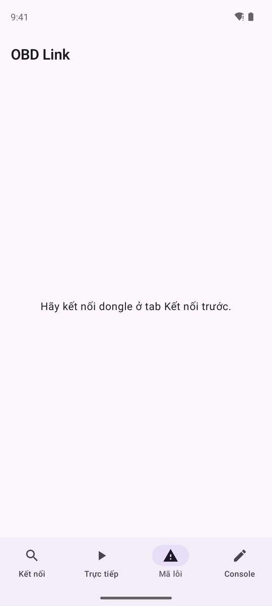
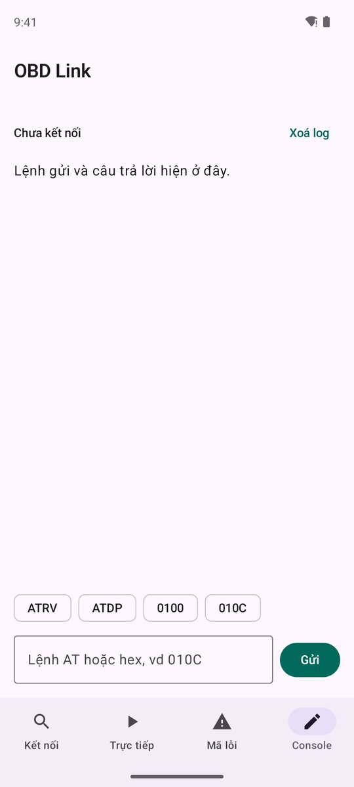
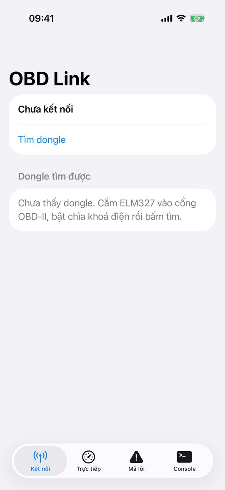
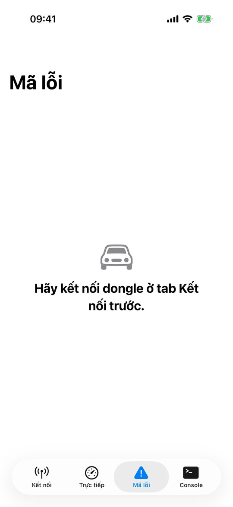
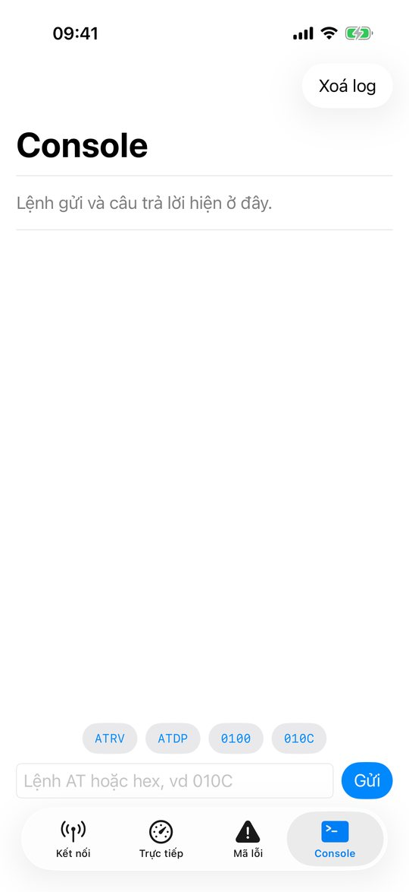
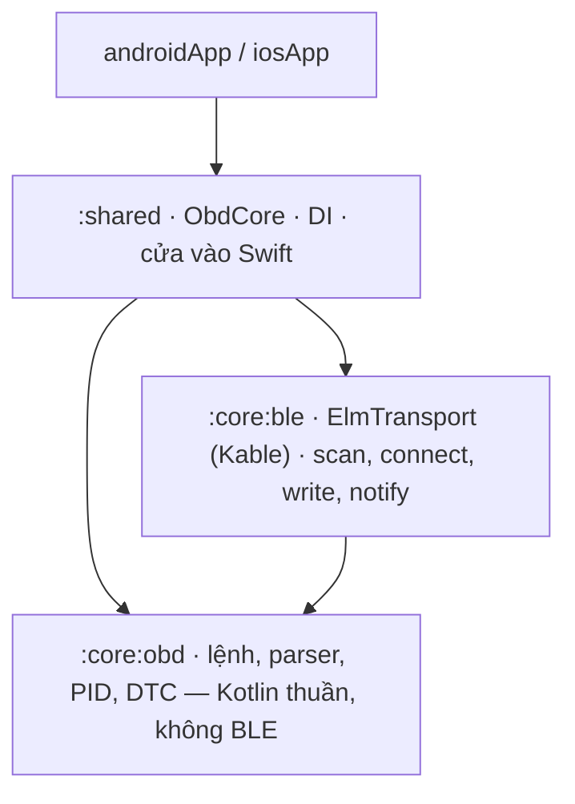
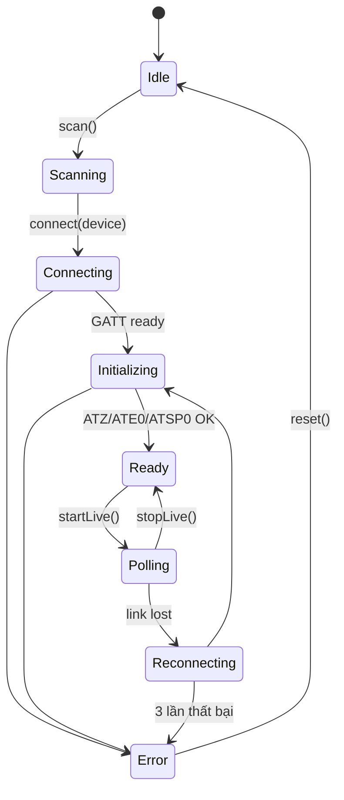

# App 5 · OBD Link 🚗

> Cắm dongle ELM327 Bluetooth LE vào cổng OBD-II của xe → app kết nối, hiện vòng tua, tốc độ, nhiệt độ nước làm mát theo
> thời gian thực, đọc và xoá mã lỗi (DTC).

## Demo: làm xong trông thế nào

Ảnh chụp **app thật trong repo** (không phải mockup), chạy bằng Maestro trên emulator Pixel 8 (Android 14) và Simulator iPhone 17 (iOS 26.5), ngày 2026-10-21.
Cùng một core KMP, mỗi bên một UI native: so hai tab là thấy **logic giống hệt, giao diện theo chuẩn từng nền tảng**.

=== "🤖 Android · Jetpack Compose"

    <div class="phones phones--demo" markdown>
    <figure markdown>
    
    <figcaption>1. Kết nối: quyền + Bluetooth + tìm dongle</figcaption>
    </figure>
    <figure markdown>
    
    <figcaption>2. Mã lỗi: chờ kết nối</figcaption>
    </figure>
    <figure markdown>
    
    <figcaption>3. Console: gõ lệnh AT / PID tay</figcaption>
    </figure>
    </div>

=== "🍎 iOS · SwiftUI"

    <div class="phones phones--demo" markdown>
    <figure markdown>
    
    <figcaption>1. Kết nối: quyền + Bluetooth + tìm dongle</figcaption>
    </figure>
    <figure markdown>
    
    <figcaption>2. Mã lỗi: chờ kết nối</figcaption>
    </figure>
    <figure markdown>
    
    <figcaption>3. Console: gõ lệnh AT / PID tay</figcaption>
    </figure>
    </div>

!!! note "Ảnh chụp không có xe"
    Emulator và Simulator **không có Bluetooth LE**, nên ảnh dừng ở trạng thái "Chưa kết nối". Tab Trực tiếp
    (3 đồng hồ vòng tua · tốc độ · nhiệt độ) và danh sách mã lỗi chỉ có số khi nối dongle ELM327 thật hoặc thiết bị giả
    (mục 10.4). Có dongle rồi thì chụp thêm 2 màn đó vào `docs/apps/assets/obdlink/`.

## Ước lượng thời gian

Cho người **đã học xong 14 bài** (hoặc app trước), gõ lại từ đầu theo 7 bước, mỗi buổi tối khoảng 2–3 giờ.
Lần đầu làm KMP thì nhân 1,5.

| Việc | Thời gian người làm |
|---|---|
| Đọc trang + OBD-II PIDs + datasheet ELM327, mua / dựng dongle giả | 2 giờ |
| B1 parse PID, DTC, chuỗi hex + test (module `:core:obd` thuần Kotlin) | 4 giờ |
| B2 hàng đợi lệnh (`Mutex` + timeout + retry), state machine kết nối | 5 giờ |
| B3 BLE bằng Kable (`:core:ble`), quyền Bluetooth 2 nền tảng | 6 giờ |
| B4 tách module Gradle, Koin | 1 giờ |
| B5 UI Android (4 tab) | 4 giờ |
| B6 UI iOS (4 tab) | 4 giờ |
| B7 test, README + sơ đồ state machine | 3 giờ |
| **Chạy + test trên 2 máy** (mục [10](#10-how-to-test)) | 3–4 giờ (dựng thiết bị giả ~1 giờ, test trên xe) |
| **Tổng** | **≈ 32 giờ · 11–14 buổi tối** |

Thời gian **máy chạy**, đo trên MacBook Pro M1 Pro 16 GB, Xcode 26.5, JDK 17:

| Việc | Đo được |
|---|---|
| Build app iOS cho Simulator (`xcodebuild`, Gradle đã có cache) | 2 phút 46 giây |
| Máy chạy toàn bộ unit test (JVM + iOS Simulator, build lại từ đầu bằng `--rerun-tasks`) | **33 giây** · 132 test (JVM + iOS cộng lại), 0 lỗi |
| Build + cài Android khi đã build 1 lần (`installDebug`) | dưới 30 giây |

## 1. Tóm tắt

| | |
|---|---|
| **Cấp độ** | ⭐⭐⭐⭐⭐ Khó nhất |
| **Mới học** | BLE trong KMP bằng [Kable](https://github.com/JuulLabs/kable) · state machine kết nối · **hàng đợi lệnh** (một lệnh một lúc) với `Mutex` + timeout + retry · parse byte / chuỗi hex · tách **nhiều module** Gradle · thiết bị giả để test |
| **Cần trước** | App 4 · native-mobile-learning phần BLE (scan → GATT → notify → write) |
| **Thư mục code** | [`apps/ObdLink/`](https://github.com/tucarmd/kotlin-multi-platform/tree/main/apps/ObdLink) · package `dev.obdlink` · ✅ đã có code |
| **Phần cứng** | Dongle ELM327 **BLE** (không phải Bluetooth Classic, iOS không dùng được Classic) · hoặc ESP32 / nRF Connect giả lập |
| **Thời gian** | 10–14 buổi tối · [chi tiết](#uoc-luong-thoi-gian) |

So với app 4: không chỉ *đọc* luồng dữ liệu, mà phải **hỏi – chờ – trả lời** qua một kênh chậm, hay rớt, và chỉ xử lý được một lệnh mỗi lần.

## 2. Màn hình

| Màn | Hiện gì | Action |
|---|---|---|
| **Connect** | Trạng thái quyền + Bluetooth, danh sách dongle tìm được, tín hiệu | Quét · chọn · kết nối · thử lại |
| **Live** | 3 đồng hồ: RPM, km/h, °C · tần số cập nhật · trạng thái kết nối | Tạm dừng / tiếp tục đọc |
| **Codes** | Danh sách mã lỗi (`P0301`…) + mô tả ngắn | *Đọc mã* · *Xoá mã* (hỏi xác nhận) |
| **Console** | Log lệnh gửi / nhận thô (`010C` → `41 0C 1A F8`) | Gõ lệnh AT / PID tay |

## 3. Phạm vi

| Có | Làm sau |
|---|---|
| Scan, connect, reconnect khi rớt | Bluetooth Classic (chỉ Android) |
| Khởi tạo ELM327 (`ATZ`, `ATE0`, `ATL0`, `ATSP0`) | Ghi log chuyến đi + biểu đồ |
| PID `010C` RPM · `010D` tốc độ · `0105` nhiệt độ | PID riêng hãng xe |
| Mode `03` đọc DTC · `04` xoá DTC | Freeze frame, readiness monitor |
| Console thô cho người học | |

## 4. Kiến trúc

Lần đầu tách `shared/` thành nhiều module, mỗi module một việc, phụ thuộc một chiều:





## 5. 7 bước làm

| Bước | Ở app này làm gì |
|:-:|---|
| **B1** | `:core:obd`: `ObdCommand` (sealed: `At`, `Pid`, `ReadDtc`, `ClearDtc`), `parseResponse(raw)` (bỏ `SEARCHING...`, `>`, khoảng trắng, phát hiện `NO DATA` / `?`), `decodePid(pid, bytes)` (RPM = `(256A + B) / 4`), `decodeDtc(bytes)` → `P0301`. Toàn hàm thuần, test kỹ nhất app. |
| **B2** | `ObdCore`: state machine trong sơ đồ trên; `CommandQueue` dùng `Mutex` để gửi **một lệnh một lúc**, `withTimeout(2.s)`, retry 1 lần; vòng `startLive()` hỏi 3 PID luân phiên. Test với `FakeElmTransport` (trả lời giả theo bảng). |
| **B3** | `:core:ble`: interface `ElmTransport { send(text): String }` + cài đặt bằng Kable: scan theo service UUID (`FFF0` / `FFE0` tùy dongle), ghi characteristic write, gom notify cho tới dấu `>` thì trả về. |
| **B4** | Koin: `obdModule`, `bleModule`, `platformModule` (quyền BLE). `obdCore()` cho Swift. `settings.gradle.kts` thêm `:core:obd`, `:core:ble`. |
| **B5** | Màn Connect dùng lại logic quyền BLE của native-mobile-learning (API 31+ `BLUETOOTH_SCAN/CONNECT`). 3 đồng hồ vẽ bằng `Canvas`. |
| **B6** | Info.plist `NSBluetoothAlwaysUsageDescription`. Đồng hồ bằng `Gauge`. `TabView` 4 tab. |
| **B7** | `ObdParserTest` (bảng response thật thu từ dongle) · `CommandQueueTest` (timeout, retry, không chen lệnh) · `ObdCoreTest` (rớt kết nối → reconnect → error sau 3 lần) · chạy thật trên xe. |

## 6. Bản đồ function

Bảng đầy đủ (25 hàm, có link tới đúng dòng code) nằm trong
[`apps/ObdLink/README.md`](https://github.com/tucarmd/kotlin-multi-platform/blob/main/apps/ObdLink/README.md#ban-o-function). Các hàm chính:

| Hàm | File | Làm gì | Vì sao |
|---|---|---|---|
| `parseResponse(raw, sent)` | `:core:obd/rules/Parser.kt` | Chuỗi thô → `ObdResult.Data / Ok / Text / NoData / Error` | Dongle trả đủ kiểu rác: echo, `SEARCHING...`, `\r`, nhiều frame CAN |
| `decodePid(pid, bytes)` | `:core:obd/rules/Pid.kt` | `(256A + B) / 4`, `A`, `A − 40` | Mỗi công thức một chỗ, có test |
| `decodeDtc(first, second)` / `decodeDtcResponse()` | `:core:obd/rules/Dtc.kt` | 2 byte → `P0301`; cả câu trả lời mode 03 → danh sách mã | 2 bit đầu chọn P/C/B/U; CAN có byte đếm, giao thức cũ thì không |
| `PromptCollector.feed(chunk)` | `:core:obd/transport/PromptCollector.kt` | Ghép các mảnh notify tới khi gặp `>` | Gói BLE chỉ ~20 byte |
| `ElmTransport` | `:core:obd/transport/ElmTransport.kt` | Interface: `scan` / `connect` / `disconnect` / `send` + `link` | Test dùng `FakeElmTransport`, không cần thư viện BLE |
| `CommandQueue.sendText()` | `shared/core/CommandQueue.kt` | `Mutex`, timeout 2 s (10 s cho lệnh đầu sau ATZ/ATSP), thử lại 1 lần | ELM327 chỉ xử lý một lệnh mỗi lần |
| `ObdCore.connect()` / `initialize()` | `shared/core/ObdCore.kt` | Connecting → Initializing (ATZ/ATE0/ATL0/ATSP0) → Ready, hoặc Error | UI chỉ vẽ state |
| `ObdCore.startLive()` / `pollLoop()` | `shared/core/ObdCore.kt` | Hỏi RPM → tốc độ → nhiệt độ lần lượt | Huỷ được bằng `stopLive()` hoặc khi rớt kết nối |
| `ObdCore.linkLost()` / `reconnect()` | `shared/core/ObdCore.kt` | → Reconnecting, tối đa 3 lần rồi Error | Đặt state ngay lập tức để chỉ một vòng reconnect chạy |
| `requestClearCodes()` / `confirmClearCodes()` | `shared/core/ObdCore.kt` | Mode 04 qua 2 bước, xong đọc lại mã | Xoá mã còn reset readiness monitor |
| `KableElmTransport.send()` | `:core:ble/KableElmTransport.kt` | Bỏ mảnh cũ, ghi `text + "\r"`, gom tới `>` | Mọi chi tiết BLE nằm trong một module |
| `ElmProfiles.pick()` | `:core:ble/ElmProfiles.kt` | Chọn characteristic ghi / notify cho họ FFF0, FFE0, 18F0 | Hàm thuần, test không cần điện thoại |

!!! note "Code khác plan ở đâu"
    - `ElmTransport` nằm ở `:core:obd/transport`, không ở `:core:ble`. Nhờ vậy bản giả không cần thư viện BLE, và `:core:ble` phụ thuộc `:core:obd` đúng chiều mũi tên.
    - `:core:obd` dùng target `jvm()` (không có plugin Android); module Android nhận bản JVM của nó. Muốn Swift thấy kiểu của `:core:obd` thì framework phải `export(project(":core:obd"))`.
    - Đổi tên để Swift không đụng tên có sẵn: `Dtc.summary` (không phải `description`), `ObdError.SetupFailed` (không phải `InitFailed`, vì tiền tố `init` của Objective-C), `decodePidAnswer` (tránh trùng chữ ký JVM).
    - Bước xác nhận xoá mã nằm trong core (`CodesState.ConfirmClear`), và Console từ chối lệnh `04`.
    - `platformModule` rỗng ở cả 2 bên: Kable che khác biệt BLE; quyền Android xin ở UI (`BlePermission.kt`).
    - Lệnh poll live không ghi vào Console (sẽ ngập log), chỉ ghi lệnh khởi tạo, đọc mã và lệnh gõ tay.

Bẫy cần ghi `// TRAP:` / `// PLATFORM:` trong code:

- `TRAP:` Câu trả lời tới nhiều mảnh qua notify; chỉ coi là xong khi gặp `>`.
- `TRAP:` Lệnh đầu sau `ATSP0` mất vài giây (`SEARCHING...`); timeout lệnh đầu phải dài hơn.
- `PLATFORM:` iOS không cho thấy địa chỉ MAC, chỉ có UUID riêng của máy: không lưu "dongle quen" bằng MAC.
- `PLATFORM:` Android ≤ 30 quét BLE cần quyền **vị trí**, API 31+ cần `BLUETOOTH_SCAN`.
- `TRAP:` *Xoá mã* (mode `04`) tắt đèn check-engine và reset readiness: luôn hỏi xác nhận.
- `TRAP:` Chờ `onSubscription` của `observe` trong Kable rồi mới ghi lệnh đầu tiên, không thì mất câu trả lời của `ATZ`.
- `TRAP:` Bắt đúng `TimeoutCancellationException`; bắt `CancellationException` là nuốt luôn lệnh huỷ thật. `Mutex` phải bao cả lần thử lại.
- `TRAP:` Nhiều dongle không quảng bá service UUID: quét lọc thêm theo tiền tố tên.

## 7. Test

```bash
cd apps/ObdLink
./gradlew :core:obd:allTests :core:ble:testDebugUnitTest :core:ble:iosSimulatorArm64Test \
          :shared:testDebugUnitTest :shared:iosSimulatorArm64Test
```

Không có xe: dựng thiết bị giả bằng nRF Connect (tạo service `FFF0`, trả lời cố định) hoặc ESP32 như
`peripheral-setup.md` của native-mobile-learning. Case tối thiểu: `41 0C 1A F8` → 1726 rpm · `NO DATA` · response cắt làm 3
notify · hai lệnh gửi cùng lúc vẫn ra đúng thứ tự · timeout → retry → error · rớt kết nối giữa lúc poll.

## 8. Xong khi

- [ ] Kết nối được dongle thật (hoặc thiết bị giả) trên **cả 2 máy**
- [ ] Live hiện RPM / tốc độ / nhiệt độ, cập nhật ≥ 2 lần / giây
- [ ] Tắt dongle khi đang đọc → app hiện *Reconnecting*, cắm lại tự nối tiếp
- [ ] Đọc được mã lỗi (trên xe có lỗi hoặc thiết bị giả trả `43 01 03 01`)
- [ ] `:core:obd` không import gì của BLE hay Android / iOS
- [ ] KDoc `[App 5 · Bx]` mọi file · README đủ 7 mục + sơ đồ state machine

## 9. Tham khảo

- [JuulLabs/kable](https://github.com/JuulLabs/kable): BLE cho Kotlin Multiplatform
- [OBD-II PIDs (Wikipedia)](https://en.wikipedia.org/wiki/OBD-II_PIDs): công thức từng PID, cách mã hoá DTC
- [ELM327 datasheet](https://www.elmelectronics.com/wp-content/uploads/2016/07/ELM327DS.pdf): lệnh AT
- native-mobile-learning: `BluetoothClientService`, task 003 (GATT read / notify), task 004 (write + MTU), `peripheral-setup.md`


## 10. How to test

### 10.1 Unit test (tự động, không cần Bluetooth)

```bash
cd apps/ObdLink
./gradlew :core:obd:allTests :core:ble:testDebugUnitTest :core:ble:iosSimulatorArm64Test \
          :shared:testDebugUnitTest :shared:iosSimulatorArm64Test
```

Toàn bộ logic OBD test bằng `FakeElmTransport` (trả lời cố định như một ELM327), nên phần khó nhất test được mà không cần xe.

### 10.2 Chạy trên máy (cần máy THẬT để kết nối)

```bash
./gradlew :androidApp:installDebug                 # cắm điện thoại Android thật
open iosApp/iosApp.xcodeproj                       # chọn iPhone thật, bấm Run
```

Trên emulator / Simulator vẫn mở được app, xem được màn Kết nối, Console (như ảnh demo), nhưng không quét thấy gì.

### 10.3 Kịch bản test tay (máy thật + dongle hoặc thiết bị giả)

| # | Làm gì | Kết quả đúng |
|:-:|---|---|
| 1 | Mở app lần đầu | Thẻ quyền Bluetooth "Chưa cho phép" + nút **Cho phép** |
| 2 | Cho phép, bấm **Tìm dongle** | "Đang tìm…", dongle hiện trong danh sách kèm dBm |
| 3 | Chọn dongle | "Đang kết nối…" → "Đang khởi tạo… (ATZ, ATE0, ATL0, ATSP0)" → "Đã kết nối" |
| 4 | Tab **Trực tiếp**, **Bắt đầu đọc** | RPM / km/h / °C đổi, "≥ 2 lần cập nhật mỗi giây" |
| 5 | Tab **Mã lỗi**, **Đọc mã** | Thiết bị giả trả `43 01 03 01` → hiện `P0301` + mô tả |
| 6 | **Xoá mã** | Hỏi xác nhận, xoá xong đọc lại ra rỗng |
| 7 | Tab **Console**: gửi `ATRV`, `010C` | Log hiện lệnh gửi và câu trả lời thô |

### 10.4 Thiết bị giả và cố làm hư

**Không có xe:** app **nRF Connect** trên một điện thoại khác → *Advertiser* tên `OBDII` + *GATT Server* service `FFF0`,
characteristic `FFF1` (notify) và `FFF2` (write). Trả lời tay theo `FakeElmTransport.defaultAnswers()`, nhớ kết thúc bằng `>`.
Hoặc ESP32 theo [Test peripheral setup](native-device-monitor/legacy/peripheral-setup.md).

| Thử | Cách giả lập | Mong đợi |
|---|---|---|
| Tắt Bluetooth giữa lúc đọc | Settings › Bluetooth (iOS: không dùng Control Center) | "Bluetooth đang tắt…", không treo ở "Đang đọc" |
| Rút dongle / tắt thiết bị giả | Tắt Advertiser trong nRF Connect | "Mất kết nối. Đang nối lại 1/3…", cắm lại tự nối |
| Dongle không phải ELM327 | Trả lời `ATZ` bằng chuỗi lạ | "Dongle không trả lời như một ELM327." |
| Trả lời cắt nhiều mảnh | Gửi `41 0C` rồi `1A F8>` ở 2 notify | Vẫn ra 1726 rpm (có test trong `PromptCollectorTest`) |
| Từ chối quyền | Android `adb shell pm revoke dev.obdlink android.permission.BLUETOOTH_SCAN` | Thẻ quyền đỏ, nút Cho phép / Cài đặt ([Platform API › Bluetooth](native-device-monitor/platform-api/02-bluetooth.md)) |
| Bấm Tìm liên tục (Android 7+) | Bấm 6 lần trong 30 giây | Hệ thống chặn scan im lặng: app không được báo "không có dongle" sai |

## 11. Achievement: xong app này bạn có gì

| 🏅 | Đạt được | Bằng chứng |
|:-:|---|---|
| 📡 | BLE trong KMP bằng Kable: scan, connect, notify, write trên cả 2 nền tảng | Kết nối dongle thật trên 2 máy |
| 🚦 | **State machine** kết nối có reconnect, vẽ được sơ đồ | README, test rớt kết nối |
| 📬 | Hàng đợi lệnh một-lệnh-một-lúc với `Mutex`, timeout, retry | `CommandQueueTest` |
| 🔢 | Parse byte / hex theo chuẩn OBD-II (PID, DTC) | `41 0C 1A F8` → 1726 rpm |
| 🧱 | Tách **nhiều module Gradle** phụ thuộc một chiều; `:core:obd` không biết gì về BLE | `settings.gradle.kts`, không import chéo |
| 🧪 | Test phần cứng **không cần phần cứng** bằng transport giả | `FakeElmTransport` |
| 🎓 | Đủ nền để đọc / sửa app BLE thật (như [Native Device Monitor](native-device-monitor/index.md)) | Hoàn thành cả 5 app |

**Về:** [Danh sách 5 app](index.md) · Đọc tiếp app demo lớn: [Native Device Monitor](native-device-monitor/index.md)

**Trước:** [App 4 · Trip Log](04-trip-log.md) · **Về:** [Danh sách 5 app](index.md)
