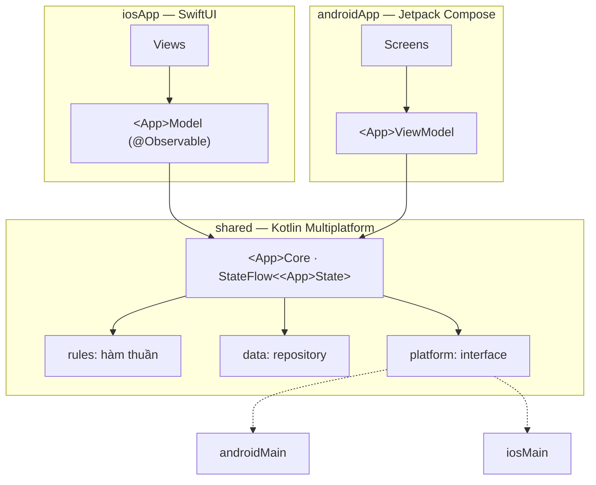

# Khung chung & quy ước comment

Trang này là **luật chung** cho cả 5 app luyện tập. Cái gì ghi ở đây thì app nào cũng làm y như vậy, trang của từng app
không nhắc lại.

Khuôn lấy từ hai nguồn đã chạy được:

- **Device Pulse** (repo này): kiến trúc KMP core + UI native, cây thư mục, Koin, SKIE.
- **[native-mobile-learning](https://github.com/tucarmd/native-mobile-learning)**: cách viết comment giải thích *vì sao*,
  bảng "hàm → file → làm gì → vì sao", và mỗi app đi kèm trang "how it's built / tasks / test".

## 1. Kiến trúc: luôn là KMP core + UI native



Ba luật không đổi:

1. **Phụ thuộc một chiều**: `androidApp` / `iosApp` → `shared`. Code trong `shared/` không biết UI nào đang dùng nó và không chứa chuỗi hiển thị.
2. **UI chỉ vẽ state và bắn action**. Mọi tính toán, gộp dữ liệu, gọi mạng, đọc database nằm ở `shared/`.
3. **Không exception nào đi qua ranh giới core → UI.** Lỗi luôn thành một nhánh của sealed class state (`Loading` / `Ready` / `Error`…).

## 2. Cây thư mục giống nhau

Thay `<App>` bằng tên app (`TipSplit`, `PocketNotes`…) và `<app>` bằng tên package (`tipsplit`, `pocketnotes`…).

```text
<App>/
├── shared/src/
│   ├── commonMain/kotlin/dev/<app>/
│   │   ├── model/      data class, enum, sealed class state. Không logic
│   │   ├── rules/      hàm thuần: vào → ra, không I/O. Có test 100%
│   │   ├── platform/   interface cho thứ cần API riêng của máy (app 1 để trống)
│   │   ├── data/       repository: database, mạng, cache
│   │   ├── core/       <App>Core: giữ StateFlow<<App>State>, nhận action
│   │   └── di/         Koin: commonModule + expect platformModule + initKoin()
│   ├── commonMain/sqldelight/   file .sq (từ app 2)
│   ├── androidMain/    cài đặt platform/ cho Android + platformModule
│   ├── iosMain/        cài đặt platform/ cho iOS + platformModule + hàm cửa vào cho Swift
│   └── commonTest/     RulesTest, <App>CoreTest (fake repository)
├── androidApp/src/main/kotlin/dev/<app>/android/
│   ├── <App>Application.kt     initKoin
│   └── ui/  App.kt (NavHost) · <App>ViewModel.kt · <Tên>Screen.kt · Components.kt
├── iosApp/
│   ├── iosApp/  iOSApp.swift · <App>Model.swift · Views/<Tên>View.swift
│   └── project.yml             XcodeGen
├── design/mockups/             mockup android/ + ios/
├── gradle/libs.versions.toml   copy từ DevicePulse rồi bỏ thư viện không dùng
├── gradle/gradle-daemon-jvm.properties
└── README.md                   cách chạy · cấu trúc · version · bẫy đã gặp
```

!!! tip "Tạo project mới nhanh"
    Copy `DevicePulse/` sang tên mới, đổi `rootProject.name`, package `dev.devicepulse` → `dev.<app>`,
    `bundleId` trong `iosApp/project.yml`, rồi xoá phần code cũ. Giữ nguyên Gradle, Koin, SKIE đã cấu hình chạy được.

## 3. Cùng 7 bước làm

Mọi app đi qua đúng 7 bước. Trang của từng app chỉ ghi *bước này ở app này làm gì*.

| Bước | Làm gì | Ở đâu | Xong khi |
|:-:|---|---|---|
| **B1** | Model + luật | `shared/commonMain/model`, `rules` | Test luật xanh trên JVM |
| **B2** | Core giữ state | `shared/commonMain/core` | Test core với fake repository xanh |
| **B3** | Data / nền tảng | `data/`, `platform/`, `androidMain`, `iosMain` | Chạy được qua test hoặc log |
| **B4** | Nối Koin + cửa vào Swift | `di/`, `iosMain/di` | Android `koinViewModel()` và Swift `doInitKoin()` lấy được core |
| **B5** | UI Android | `androidApp/ui` | Chạy trên emulator, đủ mọi trạng thái |
| **B6** | UI iOS | `iosApp/Views` | Chạy trên Simulator, giống Android |
| **B7** | Test + README + chạy máy thật | `commonTest`, `README.md` | Checklist *Xong khi* của app tick hết |

Mỗi bước là **một commit**: `feat(<app>): B3 add NoteRepository on SQLDelight`.

## 4. Quy ước comment

Mục tiêu: mở bất kỳ file nào cũng biết ngay **file này làm gì, thuộc bước nào, vì sao viết thế**, không cần đọc doc khác.
Comment viết **tiếng Anh**, giống code Device Pulse và native-mobile-learning; doc trên site viết tiếng Việt.

### 4.1. Đầu mỗi file: một khối KDoc

Trả lời 3 câu: *làm gì · vì sao viết thế này · ai gọi nó / nó gọi ai*. Dòng đầu luôn có nhãn `[App N · Bx]`.

```kotlin
/**
 * [App 2 · B3] NoteRepository — the only class that touches the notes table.
 *
 * Why a repository instead of calling SQLDelight queries from the core:
 * the core is tested with a FakeNoteRepository (no database, runs in milliseconds),
 * and swapping SQLDelight for Room later only changes this file.
 *
 * Called by: NotesCore. Calls: NoteQueries (generated from Note.sq).
 */
class NoteRepository(private val queries: NoteQueries) { … }
```

```swift
/// [App 2 · B6] NotesModel — bridges the Kotlin NotesCore to SwiftUI.
///
/// Why @Observable: SwiftUI redraws only views that read a changed property.
/// The Kotlin StateFlow is consumed with `for await` (SKIE turns it into an AsyncSequence).
///
/// Used by: NoteListView, NoteEditView. Uses: NotesCore from `Shared`.
@Observable final class NotesModel { … }
```

### 4.2. Mỗi hàm public: KDoc ngắn

1–3 dòng: **làm gì** + **vì sao** (nếu không hiển nhiên). Hàm luật thêm **ví dụ vào → ra**, vì đó là thứ người đọc cần nhất.

```kotlin
/**
 * Splits [bill] among [people], rounding each share UP to [roundTo] so the group never pays less than the bill.
 *
 * Example: bill = 100_000, tip = 10 %, people = 3, roundTo = 1_000 → 37_000 each (total 111_000).
 */
fun splitBill(bill: Money, tipPercent: Int, people: Int, roundTo: Long = 1): Split
```

### 4.3. Trong thân hàm: chỉ comment chỗ có bẫy, dùng 3 nhãn cố định

| Nhãn | Khi nào dùng | Ví dụ |
|---|---|---|
| `// TRAP:` | Chỗ viết khác đi là sai mà không báo lỗi | `// TRAP: money is Long (cents), never Double — 0.1 + 0.2 != 0.3` |
| `// PLATFORM:` | Android và iOS làm khác nhau ở đây | `// PLATFORM: iOS asks location permission only once; after "Don't Allow" only Settings can change it` |
| `// TEST:` | Trỏ tới test đang giữ hành vi này | `// TEST: RulesTest.roundsUpNotDown` |

Không comment lại điều code đã nói (`// increment i`). Tìm nhanh mọi bẫy của một app: `grep -rn "TRAP:" <App>/`.

### 4.4. Test cũng có comment

Tên test là câu tiếng Anh mô tả hành vi, theo mẫu `given_when_then` hoặc câu thường trong backtick:

```kotlin
@Test
fun `share is rounded up so the total never falls below the bill`() { … }
```

!!! warning "Không dùng dấu phẩy, chấm, hai chấm trong tên test"
    JVM chấp nhận, nhưng Kotlin/Native báo `Name contains illegal characters` khi chạy `iosSimulatorArm64Test`.
    Viết `rounded half up instead of truncated`, không viết `rounded half up, not truncated`.

## 5. Bản đồ function (trang app + README)

Mỗi app có một bảng giống [HOW-TO của native-mobile-learning](https://github.com/tucarmd/native-mobile-learning).
Trên trang plan bảng ghi **dự kiến**; khi code xong thì sửa cột *File* thành link có số dòng (`NoteRepository.kt#L42`).

| Hàm | File | Làm gì | Vì sao |
|---|---|---|---|
| `splitBill()` | `rules/Rules.kt` | Chia tiền, làm tròn lên | Làm tròn xuống thì cả nhóm trả thiếu |

## 6. README của mỗi app

Cùng các mục như `DevicePulse/README.md`, đúng thứ tự:

1. Một câu app làm gì + sơ đồ mermaid
2. Bảng Android vs iOS (UI, đọc state, API nền tảng)
3. **Chạy**: lệnh Gradle, `xcodebuild`, lệnh giả lập (nếu có)
4. **Cấu trúc**: cây thư mục `[git]` / `[máy]`
5. **Bản đồ function**
6. **Version và vì sao**
7. **Mấy cái bẫy đã gặp khi làm**: copy từ các comment `TRAP:` quan trọng nhất

## Tiếp theo?

- Bắt đầu [app 1: Tip Split](01-tip-split.md).
- Quên cách Swift gọi Kotlin: mục *Swift gọi Kotlin thế nào* trong
  [`DevicePulse/README.md`](https://github.com/tucarmd/kotlin-multi-platform/blob/main/DevicePulse/README.md).
