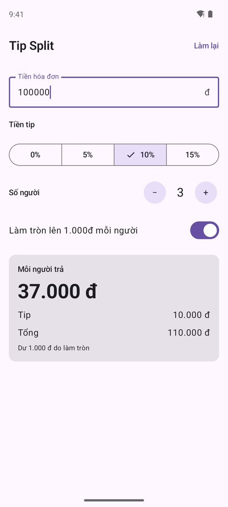
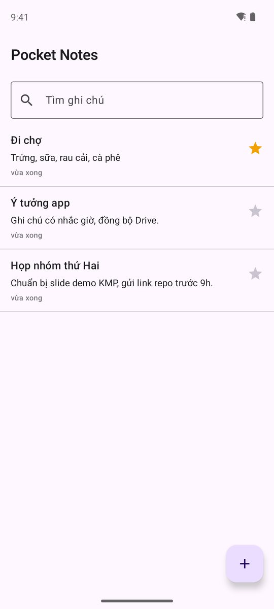
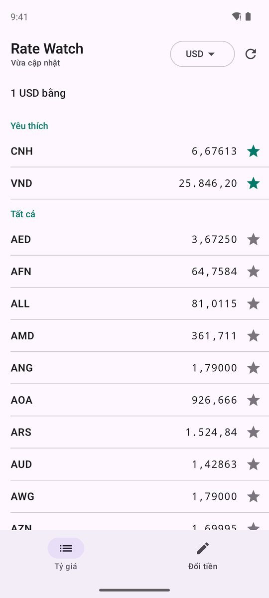
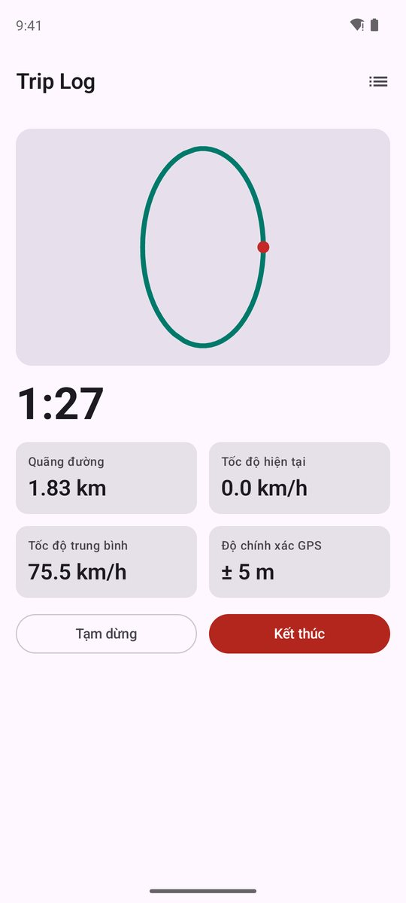
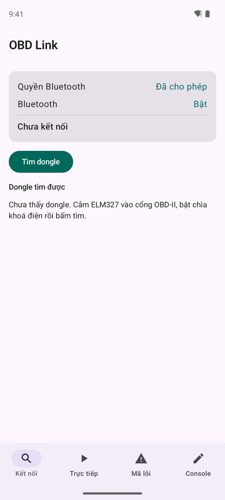

# 5 app luyện tập

Học xong 14 bài với Device Pulse, cách nhanh nhất để nhớ là **làm lại từ đầu** vài app khác. Danh sách dưới đây đi từ dễ
đến khó: mỗi app chỉ thêm **một hoặc hai thứ mới**, còn lại lặp lại đúng cách làm của app trước.

!!! info "Cùng một khuôn cho cả 5 app"
    Cùng kiến trúc **KMP core + UI native** như Device Pulse, cùng cây thư mục, cùng 7 bước làm, cùng quy ước comment.
    Học xong app 1 thì mở app 5 vẫn biết file nào nằm đâu. Khuôn chung ở trang [Khung chung & quy ước comment](conventions.md).

## Thang độ khó

| # | App | Làm gì | Mới học thêm | Thời gian |
|:-:|---|---|---|---|
| 1 | [🧾 Tip Split](01-tip-split.md) | Chia tiền hóa đơn, tính tiền tip | Hàm thuần ở `commonMain`, `StateFlow`, Koin tối giản, `commonTest`. **Không** gọi API nền tảng | 2–3 buổi · [≈ 9 giờ](01-tip-split.md#uoc-luong-thoi-gian) |
| 2 | [📝 Pocket Notes](02-pocket-notes.md) | Ghi chú offline, tìm kiếm, ghim | SQLDelight CRUD, `Flow` từ database, điều hướng list → edit, `kotlinx-datetime` | 4–5 buổi · [≈ 14 giờ](02-pocket-notes.md#uoc-luong-thoi-gian) |
| 3 | [💱 Rate Watch](03-rate-watch.md) | Tỷ giá ngoại tệ, đổi tiền, xem offline | Ktor + `kotlinx.serialization`, offline-first (mạng + cache), `MockEngine` | 5–6 buổi · [≈ 17 giờ](03-rate-watch.md#uoc-luong-thoi-gian) |
| — | [📟 Device Pulse](../project/index.md) | *(đã có)* pin, GPS, mạng | `expect/actual` qua interface, xin quyền, cảm biến thật | 14 bài |
| 4 | [🗺️ Trip Log](04-trip-log.md) | Ghi hành trình GPS khi tắt màn hình | Chạy ngầm (Foreground Service / iOS background location), `callbackFlow`, bản đồ, xuất file | 7–10 buổi · [≈ 23 giờ](04-trip-log.md#uoc-luong-thoi-gian) |
| 5 | [🚗 OBD Link](05-obd-link.md) | Đọc RPM, tốc độ, mã lỗi qua dongle OBD-II Bluetooth | BLE bằng Kable, state machine kết nối, hàng đợi lệnh, parse byte, tách nhiều module | 10–14 buổi · [≈ 32 giờ](05-obd-link.md#uoc-luong-thoi-gian) |

## Nhìn trước 5 app

Ảnh chụp app thật trong repo (Android, Jetpack Compose). Mỗi trang app có đủ ảnh **Android + iOS** theo từng bước dùng.

<div class="phones phones--demo phones--index" markdown>
<figure markdown>
[](01-tip-split.md#demo-lam-xong-trong-the-nao)
<figcaption>1 · Tip Split</figcaption>
</figure>
<figure markdown>
[](02-pocket-notes.md#demo-lam-xong-trong-the-nao)
<figcaption>2 · Pocket Notes</figcaption>
</figure>
<figure markdown>
[](03-rate-watch.md#demo-lam-xong-trong-the-nao)
<figcaption>3 · Rate Watch</figcaption>
</figure>
<figure markdown>
[](04-trip-log.md#demo-lam-xong-trong-the-nao)
<figcaption>4 · Trip Log</figcaption>
</figure>
<figure markdown>
[](05-obd-link.md#demo-lam-xong-trong-the-nao)
<figcaption>5 · OBD Link</figcaption>
</figure>
</div>

!!! example "App demo: Native Device Monitor"
    Ngoài 5 app luyện tập còn một **app demo** làm xong theo từng phase: [📡 Native Device Monitor](native-device-monitor/index.md).
    Xin quyền, BLE scan + GATT, camera, Ktor, chạy nền, UI native riêng (Jetpack Compose · SwiftUI) trên ViewModel chung.
    Code ở `apps/NativeDeviceMonitor/`. Đọc khi muốn xem một app KMP thật lớn cỡ nào và được chia phase ra sao.
    Bản gốc trước KMP (viết 2 lần, Kotlin + Swift) để so sánh: [App gốc](native-device-monitor/legacy/index.md), code `apps/NativeDeviceMonitorLegacy/`.

```
 1 Tip Split ──► 2 Pocket Notes ──► 3 Rate Watch ──► Device Pulse ──► 4 Trip Log ──► 5 OBD Link
 logic thuần      + database         + mạng/cache      + cảm biến       + chạy ngầm     + BLE + nhiều module
```

## Mỗi app có gì

Mỗi trang app viết theo cùng mục lục, đọc app nào cũng thấy đúng thứ tự:

- **Demo**: ảnh app thật Android + iOS theo từng bước dùng, để biết sẽ làm ra cái gì
- **Ước lượng thời gian**: giờ người làm cho từng bước B1–B7 + thời gian máy build / chạy test (đo thật)

1. **Tóm tắt**: cấp độ, mới học gì, cần biết gì trước
2. **Màn hình**: các màn và việc mỗi màn làm
3. **Phạm vi**: làm gì / để sau
4. **Kiến trúc**: sơ đồ core ↔ UI native
5. **7 bước làm**: cùng 7 bước cho mọi app, chỉ đổi nội dung
6. **Bản đồ function**: hàm nào, file nào, làm gì, *vì sao*. Đây là chỗ đọc trước khi mở code
7. **Test**: test gì, chạy thế nào
8. **Xong khi**: checklist chạy thật trên 2 máy
9. **Tham khảo**: repo, docs nên mở khi kẹt
10. **How to test**: unit test, lệnh chạy 2 máy, kịch bản test tay (bước → kết quả đúng), cách cố làm app hư, flow Maestro
11. **Achievement**: làm xong có kỹ năng gì, bằng chứng nằm ở file / test / ảnh nào

Code của mỗi app nằm ở thư mục gốc repo, cạnh `apps/DevicePulse/`: `apps/TipSplit/`, `apps/PocketNotes/`, `apps/RateWatch/`, `apps/TripLog/`, `apps/ObdLink/`.

## Tiến độ

| App | Trang plan | 🤖 Android | 🍎 iOS | Test |
|---|:-:|:-:|:-:|:-:|
| Tip Split | ✅ | ✅ | ✅ | ✅ 21 test JVM · 21 iOS · Kover |
| Pocket Notes | ✅ | ✅ | ✅ | ✅ 29 test JVM · 25 iOS |
| Rate Watch | ✅ | ✅ | ✅ | ✅ 44 test JVM · 44 iOS |
| Trip Log | ✅ | ✅ | ✅ | ✅ 32 test JVM · 31 iOS |
| OBD Link | ✅ | ✅ | ✅ | ✅ 66 test JVM · 66 iOS |

## Học theo thứ tự nào

- **Đi đúng thứ tự 1 → 5.** App sau giả định bạn đã làm xong app trước, nên trang của nó chỉ giải thích phần mới.
- Chưa học 14 bài? Làm app 1 và 2 song song với bài 1–8 được. App 3 cần bài 11, app 4 cần bài 10, app 5 cần cả lộ trình.
- Mỗi app xong thì tick bảng *Tiến độ* ở trên và chụp màn hình 2 nền tảng, giống [checklist Device Pulse](../project/checklist.md).

## Tiếp theo?

- Đọc [Khung chung & quy ước comment](conventions.md) trước khi gõ dòng code đầu tiên.
- Bắt đầu với [app 1: Tip Split](01-tip-split.md).
