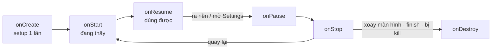
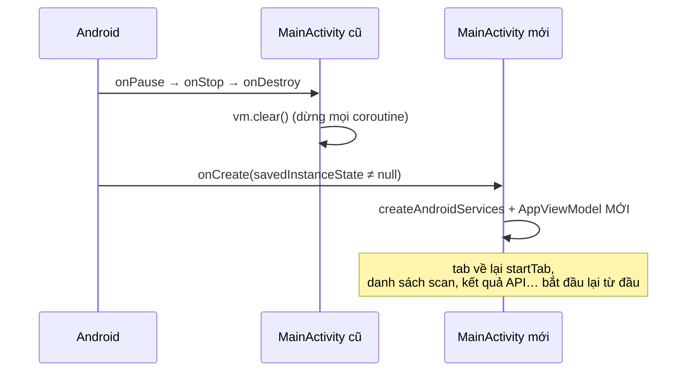

[🏠 README](index.md) · App chạy thế nào: [README-KMP-HOW-IT-WORKS.md](README-KMP-HOW-IT-WORKS.md) · Bản đồ thư mục: [README-KMP-FOLDER-MAP.md](README-KMP-FOLDER-MAP.md)

# Android cơ bản qua code của app

Trang này giải thích các khái niệm Android / Kotlin hay gặp, **lấy đúng code trong repo làm ví dụ**. Mỗi mục bắt đầu từ một câu hỏi thật khi đọc code.

## Mục lục

1. [`onCreate` chạy khi nào](#1-oncreate-chay-khi-nao)
2. [App này có bao nhiêu Activity](#2-app-nay-co-bao-nhieu-activity)
3. [`Bundle` là gì](#3-bundle-la-gi)
4. [`savedInstanceState: Bundle?` có phải để mặc định không](#4-savedinstancestate-bundle-co-phai-e-mac-inh-khong)
5. [Dấu `?` sau `Bundle` là gì](#5-dau-sau-bundle-la-gi)
6. [Xoay màn hình thì app này mất gì](#6-xoay-man-hinh-thi-app-nay-mat-gi)
7. [`enum class AppTab` và `AppTab.icon`](#7-enum-class-apptab-va-apptabicon)
8. [Tự kiểm tra](#8-tu-kiem-tra)

Code đang nói tới: [MainActivity.kt](https://github.com/tucarmd/kotlin-multi-platform/blob/main/apps/NativeDeviceMonitor/androidApp/src/main/kotlin/com/learn/ndmkmp/MainActivity.kt)

```kotlin
class MainActivity : ComponentActivity() {
    private lateinit var vm: AppViewModel

    override fun onCreate(savedInstanceState: Bundle?) {
        super.onCreate(savedInstanceState)
        enableEdgeToEdge()
        val services = createAndroidServices(this)
        vm = AppViewModel(services, startTab = intent.getStringExtra("tab"))
        setContent { App(vm) }
    }

    override fun onDestroy() {
        vm.clear()
        super.onDestroy()
    }
}
```

## 1. `onCreate` chạy khi nào

`onCreate` là hàm **Android tự gọi**, mình không tự gọi. Nó chạy **một lần cho mỗi đối tượng Activity mà hệ thống tạo ra**:

| Lúc nào | Vì sao `onCreate` chạy |
|---|---|
| Bấm icon mở app | Android tạo process, tạo `MainActivity`, gọi `onCreate` |
| Xoay màn hình, đổi ngôn ngữ, đổi dark mode | Android **huỷ** Activity cũ rồi **tạo đối tượng mới**, nên `onCreate` chạy lại |
| App ở nền bị hệ thống kill (thiếu RAM), người dùng quay lại | Android dựng lại Activity, gọi `onCreate` lần nữa |

Vòng đời của một Activity:



Vì vậy trong `onCreate` chỉ làm **việc setup một lần**: gọi `super.onCreate(...)` (bắt buộc), gắn UI (`setContent { ... }` với Compose), tạo ViewModel. Đó đúng là 4 dòng trong `MainActivity` ở trên.

Những việc phải làm **mỗi lần màn hình hiện lại** (đọc lại quyền, bắt đầu quét BLE, mở camera) thì đặt ở `onStart` / `onResume`. App này làm việc đó **trong Compose** chứ không override `onResume` của Activity, xem [App.kt](https://github.com/tucarmd/kotlin-multi-platform/blob/main/apps/NativeDeviceMonitor/androidApp/src/main/kotlin/com/learn/ndmkmp/App.kt):

```kotlin
// Quay lại từ Settings: đổi quyền không bắn event nào → đọc lại mỗi lần resume.
LifecycleResumeEffect(vm) {
    vm.onResume()
    onPauseOrDispose { }
}
```

`LifecycleResumeEffect` chạy khối bên trong mỗi khi Activity tới `onResume`, và chạy `onPauseOrDispose` khi tới `onPause`. Ví dụ: người dùng mở Settings bật quyền Bluetooth rồi quay lại app, `onCreate` **không** chạy lại nhưng `onResume` thì có, nên tab Permissions đọc lại được quyền mới.

## 2. App này có bao nhiêu Activity

**Một Activity duy nhất: `MainActivity`.** Mỗi Activity phải khai báo trong [AndroidManifest.xml](https://github.com/tucarmd/kotlin-multi-platform/blob/main/apps/NativeDeviceMonitor/androidApp/src/main/AndroidManifest.xml):

```xml
<activity android:name=".MainActivity" android:exported="true" ...>
    <intent-filter>
        <action android:name="android.intent.action.MAIN" />
        <category android:name="android.intent.category.LAUNCHER" />
    </intent-filter>
</activity>
```

`MAIN` + `LAUNCHER` nghĩa là: đây là màn hình mở ra khi bấm icon app.

5 tab (Permissions, Scanner, Media, API, Monitor) **không phải 5 Activity**. Chúng là 5 hàm `@Composable` (`ui/*Screen.kt`), cùng vẽ trong một Activity. `App.kt` dùng `when (tab)` để chọn vẽ màn nào. Đây là kiểu **single-activity** mà app Jetpack Compose thường dùng.

| | Nhiều Activity (kiểu cũ, XML View) | Một Activity + Compose (app này) |
|---|---|---|
| Đổi màn | `startActivity(Intent(...))`, mỗi màn một `onCreate` | đổi state (`vm.tab`), Compose vẽ lại |
| Khai báo | mỗi Activity một thẻ `<activity>` trong manifest | chỉ 1 thẻ |
| Truyền dữ liệu giữa màn | `Intent.putExtra(...)` | dùng chung ViewModel |

App lớn vẫn có thể có vài Activity (ví dụ màn đăng nhập riêng, màn mở từ notification). Activity nào cũng có vòng đời và `onCreate` riêng của nó.

## 3. `Bundle` là gì

`Bundle` là một **túi key–value** (giống `Map<String, Any>`), nhưng chỉ chứa được kiểu **ghi xuống bộ nhớ được**: `Int`, `String`, `Boolean`, mảng, `Parcelable`… Android dùng nó để **cất trạng thái nhỏ trước khi Activity bị huỷ, rồi trả lại khi tạo lại**.

```kotlin
override fun onSaveInstanceState(outState: Bundle) {
    super.onSaveInstanceState(outState)
    outState.putInt("counter", counter)                      // cất trước khi bị huỷ
}

override fun onCreate(savedInstanceState: Bundle?) {
    super.onCreate(savedInstanceState)
    counter = savedInstanceState?.getInt("counter") ?: 0     // lấy lại, lần đầu thì 0
}
```

| `savedInstanceState` | Nghĩa là |
|---|---|
| `null` | mở mới hoàn toàn, không có gì để khôi phục |
| khác `null` | Activity đang được **tạo lại** (xoay màn hình / sau khi bị kill), đây là dữ liệu đã cất lần trước |

Với Compose thường không cần viết `onSaveInstanceState` bằng tay: `rememberSaveable { ... }` (trong Composable) và `SavedStateHandle` (trong `androidx.lifecycle.ViewModel`) dùng chính cơ chế `Bundle` này ở bên dưới.

> ⚠️ `Bundle` chỉ hợp với dữ liệu **nhỏ** (cỡ dưới vài trăm KB). Cất danh sách lớn hay ảnh vào đó có thể làm app crash với lỗi `TransactionTooLargeException`.

## 4. `savedInstanceState: Bundle?` có phải để mặc định không

Đúng là **hầu như lúc nào cũng để y nguyên**, chỉ chuyền nó cho `super.onCreate(savedInstanceState)`. Nhưng đó **không phải giá trị mặc định** theo nghĩa Kotlin (`= null`), mà là **chữ ký bắt buộc của hàm cha**:

- `onCreate(savedInstanceState: Bundle?)` được khai báo sẵn trong class cha (`Activity` → `ComponentActivity`). Từ khoá `override` nghĩa là "viết lại hàm của cha", nên **kiểu tham số phải khớp đúng** `Bundle?`. Đổi thành `Bundle`, `String` hay bỏ đi là báo lỗi ngay.
- Hàm `override` **không được** ghi giá trị mặc định (`savedInstanceState: Bundle? = null` là lỗi biên dịch). Giá trị do Android truyền vào lúc gọi.
- **Tên** tham số thì đổi được (`state: Bundle?` vẫn chạy), nhưng cả cộng đồng đều viết `savedInstanceState`, nên giữ nguyên cho dễ đọc. Android Studio tự sinh dòng này khi tạo Activity hoặc khi gõ `override fun onCreate`.
- **Không được bỏ** `super.onCreate(savedInstanceState)`. Hàm cha dùng `Bundle` này để khôi phục state của chính nó (Compose `rememberSaveable`, Fragment…). Bỏ đi thì app crash với `SuperNotCalledException`.

Tóm lại: trong app này, như phần lớn app Compose, `savedInstanceState` chỉ được nhận rồi chuyền cho `super`, không đọc gì thêm.

## 5. Dấu `?` sau `Bundle` là gì

`?` nghĩa là **kiểu nullable**: biến có thể là `null`. Đây là **null safety** của Kotlin.

| Kiểu | Được là `null` không |
|---|---|
| `Bundle` | **không**. Gán `null` là lỗi biên dịch |
| `Bundle?` | **có** |

`savedInstanceState` phải là `Bundle?` vì lần đầu mở app **chưa có gì để khôi phục**, nên Android truyền `null`.

Với kiểu `?`, Kotlin **bắt** mình xử lý trường hợp `null` trước khi dùng:

```kotlin
savedInstanceState.getInt("counter")          // ❌ lỗi biên dịch: có thể null
savedInstanceState?.getInt("counter")         // ✅ ?.  null thì cả biểu thức ra null, không crash
savedInstanceState?.getInt("counter") ?: 0    // ✅ ?:  "Elvis": null thì lấy 0
if (savedInstanceState != null) {
    savedInstanceState.getInt("counter")      // ✅ đã kiểm tra → Kotlin tự hiểu là Bundle (smart cast)
}
savedInstanceState!!.getInt("counter")        // ⚠️ !!  "chắc chắn không null", sai thì crash NullPointerException
```

Trong repo có ví dụ ngay cạnh: `intent.getStringExtra("tab")` trả về `String?` (không truyền `--es tab` thì `null`). `AppTab.fromName(name: String?)` nhận `null` và chọn tab Permissions:

```kotlin
fun fromName(name: String?): AppTab =
    entries.firstOrNull { it.name.equals(name, ignoreCase = true) } ?: PERMISSIONS
```

So với Swift: `Bundle?` giống `Bundle?` (Optional), `?.` giống optional chaining, `?:` giống `??`, `!!` giống `!`.

## 6. Xoay màn hình thì app này mất gì

Sách và bài viết hay nói "ViewModel sống qua xoay màn hình". Điều đó **chỉ đúng với `androidx.lifecycle.ViewModel`** lấy bằng `by viewModels()`. App này **không** dùng loại đó.

`AppViewModel` kế thừa [SharedViewModel](https://github.com/tucarmd/kotlin-multi-platform/blob/main/apps/NativeDeviceMonitor/shared/src/commonMain/kotlin/com/learn/ndmkmp/presentation/SharedViewModel.kt), một class Kotlin thường trong `commonMain` (để iOS dùng chung được). Nó được tạo trong `onCreate` và dọn trong `onDestroy`. Lý do (ghi trong file): services bên dưới (launcher xin quyền, BLE client) gắn với Activity và chết theo Activity, nên ViewModel sống lâu hơn Activity sẽ giữ services đã chết.

Hệ quả, khi xoay màn hình (manifest không khai báo `android:configChanges`):



Đây là đánh đổi có chủ ý của thiết kế hiện tại. Nếu sau này muốn giữ state qua lúc xoay, các hướng hay gặp là: tách services khỏi Activity rồi dùng `androidx.lifecycle.ViewModel` (KMP có bản multiplatform), hoặc cất phần state nhỏ (tab đang chọn) bằng `Bundle` / `rememberSaveable`.

Tự thấy bằng mắt: thêm `Log.d("MainActivity", "onCreate saved=$savedInstanceState")` vào `onCreate`, chạy app, xoay emulator, xem Logcat. Lần đầu in `null`, sau khi xoay in ra một `Bundle`.

## 7. `enum class AppTab` và `AppTab.icon`

### 7.1 `enum class` là gì

`enum class` là một kiểu có **danh sách giá trị cố định, biết trước**. App có đúng 5 tab, không hơn không kém, nên dùng enum. Code ở [AppViewModel.kt](https://github.com/tucarmd/kotlin-multi-platform/blob/main/apps/NativeDeviceMonitor/shared/src/commonMain/kotlin/com/learn/ndmkmp/presentation/AppViewModel.kt) (nằm trong `commonMain`, Android và iOS dùng chung):

```kotlin
enum class AppTab(val label: String) {          // mỗi giá trị mang theo 1 thuộc tính: label
    PERMISSIONS(AppStrings.TAB_PERMISSIONS),    // = "Permissions"
    SCANNER(AppStrings.TAB_SCANNER),
    MEDIA(AppStrings.TAB_MEDIA),
    API(AppStrings.TAB_API),
    MONITOR(AppStrings.TAB_MONITOR);            // dấu ; trước khi viết thêm hàm

    companion object {
        fun fromName(name: String?): AppTab =
            entries.firstOrNull { it.name.equals(name, ignoreCase = true) } ?: PERMISSIONS
    }
}
```

Đọc từng phần:

| Phần | Nghĩa |
|---|---|
| `PERMISSIONS`, `SCANNER`… | 5 giá trị duy nhất có thể có. Mỗi giá trị là **một object có sẵn**, không `new` thêm được |
| `(val label: String)` | constructor: mỗi giá trị mang một `label`. `AppTab.API.label` là `"API"` |
| `.name` | tên hằng do Kotlin tự sinh: `AppTab.API.name` là `"API"` (khác `label`, `label` là chữ hiện lên UI) |
| `entries` | danh sách cả 5 giá trị **theo đúng thứ tự khai báo**. ViewModel dùng `val tabs = AppTab.entries` để vẽ thanh tab dưới đáy |
| `companion object { fun fromName… }` | giống hàm `static`: gọi `AppTab.fromName("monitor")` mà không cần có sẵn tab nào |
| `fromName` | tìm tab có `name` trùng chuỗi (không phân biệt hoa thường), không thấy hoặc `null` thì `?:` trả về `PERMISSIONS` |

Vì sao dùng enum thay cho `String` hay `Int`:

- **Không gõ sai được**: `vm.selectTab(AppTab.SCANER)` báo lỗi ngay lúc biên dịch, còn `selectTab("scaner")` thì chạy rồi mới sai.
- **`when` bắt đủ trường hợp**: trong `App.kt`, `when (tab) { AppTab.PERMISSIONS -> … }` phải liệt kê đủ 5 nhánh. Mai thêm tab thứ 6 mà quên vẽ màn hình, Kotlin báo lỗi ngay ở mọi `when` thiếu nhánh.
- **Dùng chung 2 nền tảng**: SKIE biến `AppTab` thành `enum` thật bên Swift, nên [RootView.swift](https://github.com/tucarmd/kotlin-multi-platform/blob/main/apps/NativeDeviceMonitor/iosApp/iosApp/UI/RootView.swift) viết `switch tab { case .permissions: … }` giống hệt bên Kotlin.

### 7.2 `private val AppTab.icon` (dòng 38 trong `App.kt`)

```kotlin
private val AppTab.icon: ImageVector
    get() = when (this) {
        AppTab.PERMISSIONS -> Icons.Filled.Lock
        AppTab.SCANNER -> Icons.Filled.Search
        AppTab.MEDIA -> Icons.Filled.Face
        AppTab.API -> Icons.AutoMirrored.Filled.Send
        AppTab.MONITOR -> Icons.Filled.DateRange
    }
```

Đây là **extension property**: gắn thêm thuộc tính `icon` vào `AppTab` **từ bên ngoài**, không sửa file `AppViewModel.kt`. Đọc là: "mọi `AppTab` có thêm thuộc tính `icon`, kiểu `ImageVector`, giá trị tính bằng `get()`".

| Phần | Nghĩa |
|---|---|
| `AppTab.icon` | `AppTab.` đứng trước tên nghĩa là "gắn vào kiểu `AppTab`" (gọi là **receiver**) |
| `get() = …` | không lưu giá trị, mỗi lần đọc `t.icon` thì chạy `when` để tính |
| `this` | chính cái tab đang được hỏi. `AppTab.API.icon` thì `this` là `AppTab.API` |
| `private` | chỉ dùng được trong file `App.kt` |

Sau đó dùng như thuộc tính thật: `Icon(t.icon, …)` trong `NavigationBarItem`.

Vì sao không ghi `icon` thẳng vào `enum class AppTab` như `label`? Vì `AppTab` nằm ở `commonMain` (code chung), còn `ImageVector` / `Icons.Filled.Lock` là thư viện **chỉ có trên Android**. iOS thì dùng SF Symbols (`"lock.shield"`), viết trong hàm `icon(for:)` bên Swift. Chọn icon là việc của View, nên mỗi nền tảng tự gắn icon của mình: Kotlin dùng extension property, Swift dùng hàm riêng.

> So với Swift: extension property của Kotlin giống `extension AppTab { var icon: String { switch self { … } } }`.

## 8. Tự kiểm tra

- [ ] Kể được 3 trường hợp làm `onCreate` chạy, và vì sao mở Settings rồi quay lại thì **không** chạy `onCreate`.
- [ ] Chỉ ra được việc "làm mỗi lần quay lại màn hình" của app này nằm ở đâu (`LifecycleResumeEffect` trong `App.kt`).
- [ ] Giải thích vì sao 5 tab không phải 5 Activity, và Activity được khai báo ở đâu.
- [ ] Nói được khi nào `savedInstanceState` là `null`, khi nào không.
- [ ] Giải thích vì sao không ghi được `savedInstanceState: Bundle? = null` trong hàm `override`.
- [ ] Đọc được `a?.b ?: c` và nói khi nào dùng `!!` là nguy hiểm.
- [ ] Nói được xoay màn hình thì app này mất state gì, và vì sao `AppViewModel` không tự sống sót như `androidx.lifecycle.ViewModel`.
- [ ] Giải thích được `label`, `name`, `entries` của `AppTab` khác nhau thế nào, và `fromName("abc")` trả về gì.
- [ ] Nói được vì sao `icon` không nằm trong `enum class AppTab` mà là extension property trong `App.kt`.
