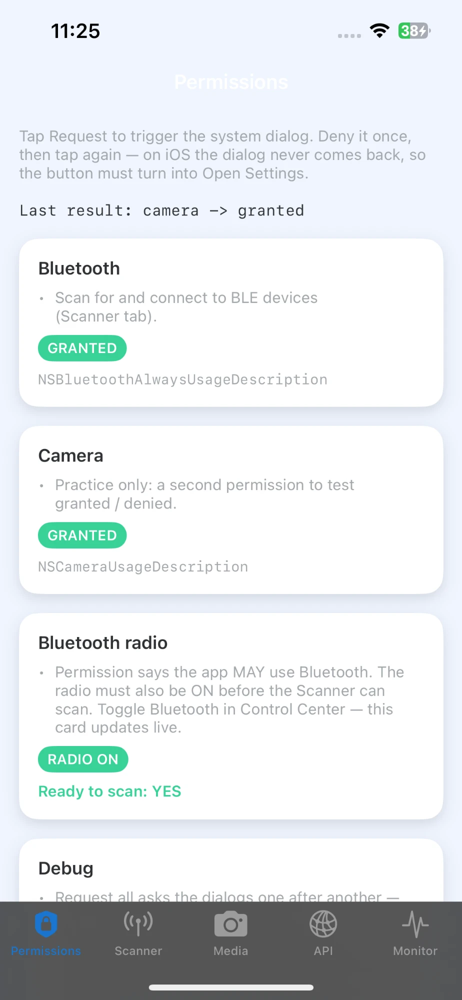
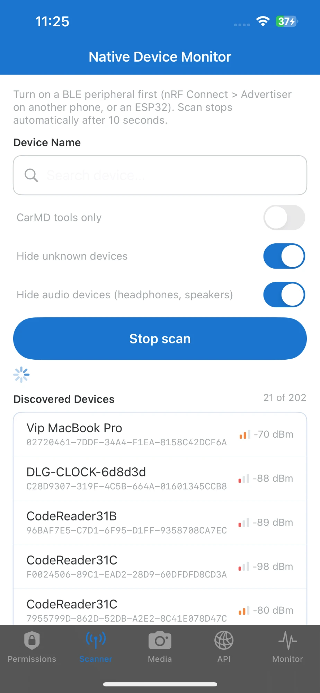
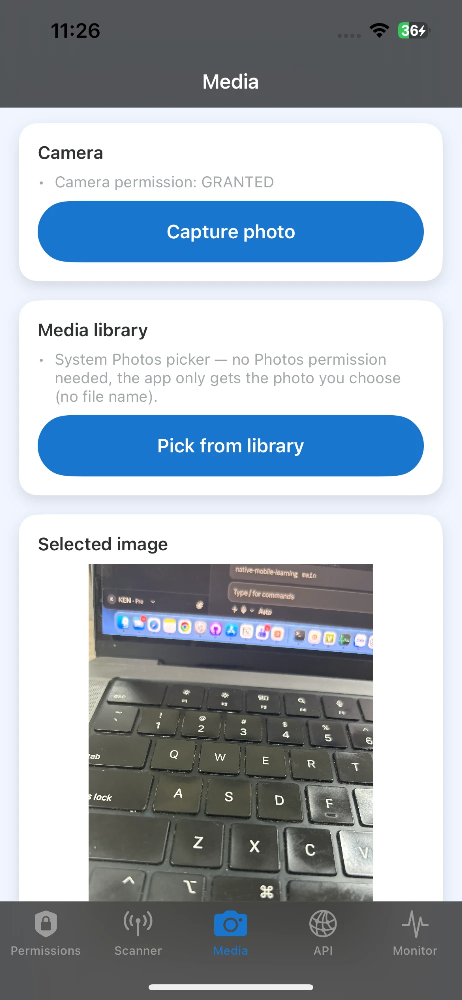
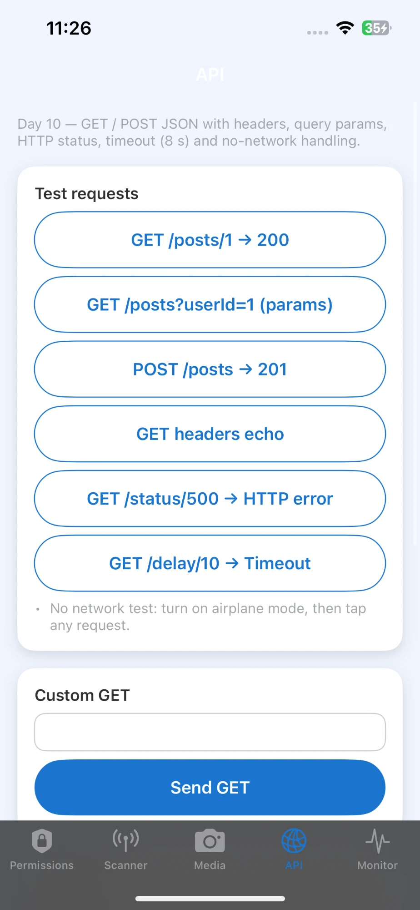
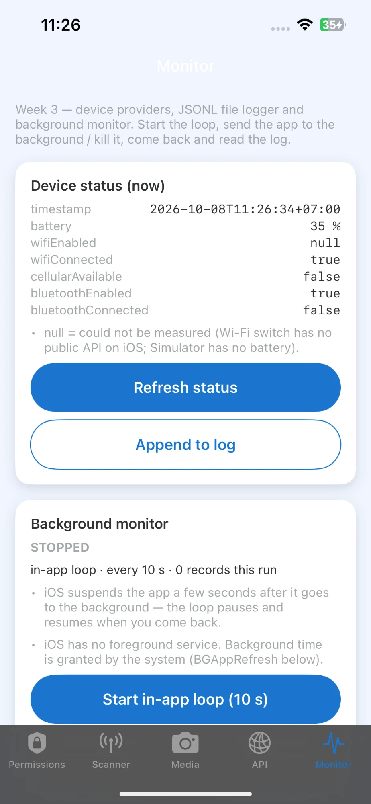
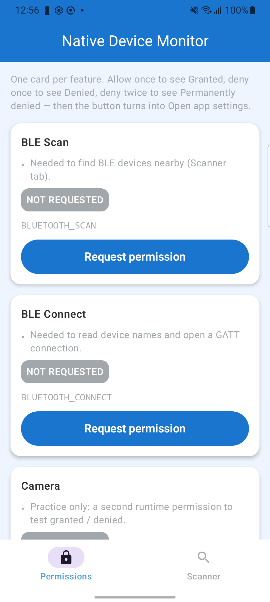
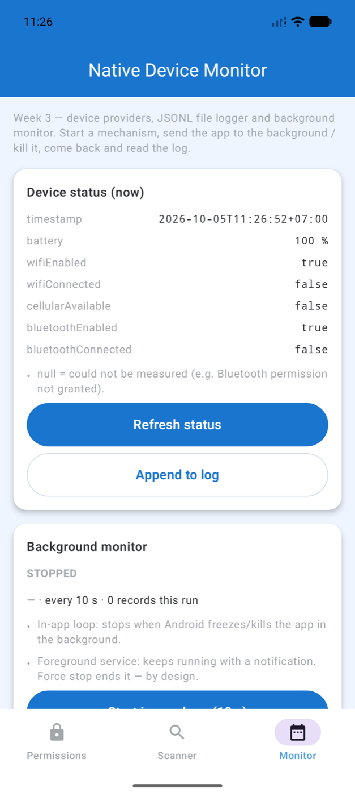
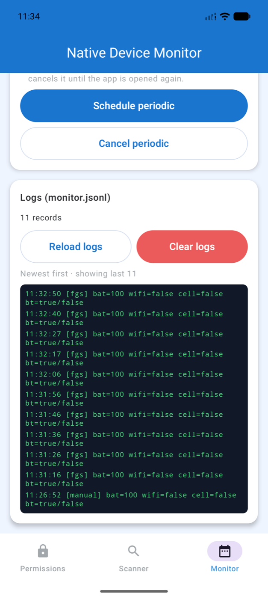

# App gốc: Native Device Monitor (trước KMP)

!!! note "Bản gốc, viết 2 lần"
    Đây là app **trước khi có KMP**: cùng 5 tab viết hai lần, Kotlin + Jetpack Compose và Swift + SwiftUI. Code ở
    [`apps/NativeDeviceMonitorLegacy/`](https://github.com/tucarmd/kotlin-multi-platform/tree/main/apps/NativeDeviceMonitorLegacy)
    (chuyển từ repo private `native-mobile-learning` ngày 2026-10-21, giữ lịch sử). Bản KMP làm lại: [Native Device Monitor (app demo)](../index.md).
    Các trang bên dưới giữ nguyên tiếng Anh như lúc viết; task 001–007 là "đề bài" mà bản KMP port theo.

> The learning app: the same 5-tab app written in **Swift + SwiftUI** and **Kotlin + Jetpack Compose**, with the same layers and file names on both platforms.

iOS 17+
Android API 26+
BLE · GATT · notify · write
Camera · Photo picker
HTTP
Background

<figure markdown>

<figcaption>Permissions</figcaption>
</figure>
<figure markdown>

<figcaption>Scanner · real BLE scan</figcaption>
</figure>
<figure markdown>

<figcaption>Media · capture</figcaption>
</figure>
<figure markdown>

<figcaption>API</figcaption>
</figure>
<figure markdown>

<figcaption>Monitor</figcaption>
</figure>

## The 5 tabs

- **Permissions**: check, request and handle the result for BLE + Camera, including *denied* and *permanently denied*; live Bluetooth radio ON/OFF and one *Ready to scan* answer.
- **Scanner**: scan (10 s timeout, no duplicates), *Device Name* filter, *Hide unknown* / *Hide audio* toggles, Connect / Disconnect, live status. After connecting: GATT discover, **Read** + decode, **Notify** stream, **Write** (Text / Hex + ELM327 presets), MTU.
- **Media**: camera capture and photo picker; shows source · name · size · MIME · dimensions.
- **API**: GET / POST / HTTP 500 / timeout; on iOS, switch between own `URLSession` code and Alamofire.
- **Monitor**: battery / network / Bluetooth providers, a JSONL `FileLogger`, and a `BackgroundMonitor` that runs as an in-app loop, an Android Foreground Service / WorkManager job, or an iOS BGAppRefresh task.

## Progress

| Feature | 🤖 | 🍎 | Notes |
|---|:-:|:-:|---|
| Permissions (BLE + Camera) + Bluetooth radio | ✅ | ✅ | [HOW-TO §3](README-HOW-TO-IMPLEMENT.md) |
| Scan + connect / disconnect + live state | ✅ | ✅ | [task 001](tasks/001-scanner-row-connect.md) |
| Scanner filters: hide unknown + hide audio | ✅ | ✅ | [task 002](tasks/002-scanner-hide-filters.md) |
| GATT discover · read · decode · notify · errors | ✅ | ✅ | [task 003](tasks/003-gatt-read-notify.md) |
| Write characteristic · MTU | ✅ | ✅ | [task 004](tasks/004-write-mtu.md) |
| Media + API client | ✅ | ✅ | Day 10 |
| API with two backends (URLSession / Alamofire) | — | ✅ | [task 007](tasks/007-api-two-backends.md) |
| Device providers · FileLogger · BackgroundMonitor · Monitor tab | ✅ | ✅ | [task 005](tasks/005-week3-nativecore-background.md) |
| End-to-end + refactor checklist + clean build | ✅ | ✅ | [task 006](tasks/006-final-e2e-cleanup.md) |

## Android screenshots

<figure markdown>

<figcaption>Permissions · Samsung A32</figcaption>
</figure>
<figure markdown>

<figcaption>Scanner · Samsung A32</figcaption>
</figure>
<figure markdown>

<figcaption>Monitor · emulator</figcaption>
</figure>
<figure markdown>

<figcaption>Monitor logs · FGS</figcaption>
</figure>

## Go deeper

- [How it is implemented](README-HOW-TO-IMPLEMENT.md): code walkthrough, diagrams and test cases
- [BLE flow, file by file](README-BLE-FLOW.md): every step of scan → connect → GATT with `file:line`
- [Test peripheral setup](peripheral-setup.md): nRF Connect or an ESP32 as the device under test
- [How audio devices are detected](bluetooth-audio-devices.md)
- [Next phases](plan/README-NEXT-PHASES.md): what is still open
