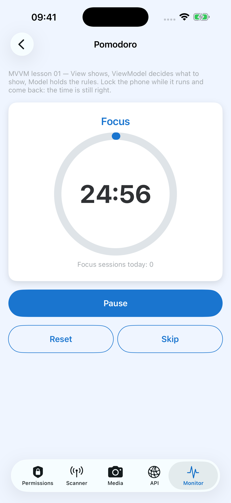

# TASK 007 — MVVM lesson 01: mini Pomodoro timer

> Platform: 🍎 iOS only (no Android twin yet) · Created: 2026-10-13 · Branch: `feat/mini-pomodoro-timer`
> Entry: **Monitor** tab → ⏱ button (top right). Launch straight into it: `xcrun simctl launch booted com.learn.NativeDeviceMonitor -openPomodoro`



## 1. Goal · scope · out of scope

**Goal:** learn MVVM the way Swift developers write it today — one small screen where:

1. the View holds no logic (draws + forwards taps),
2. the ViewModel is unit-tested **without a screen and without waiting real time**,
3. the storage can change (UserDefaults → file → SwiftData) without touching View / ViewModel.

**In scope:** 25:00 focus → 05:00 break → focus…; Start / Pause / Resume, Reset, Skip; progress ring; "focus sessions today"
kept in UserDefaults; time stays right after lock / background.

**Out of scope (backlog §6):** notifications, Live Activity, sound, custom durations, long break, history, Android.

## 2. Layers

```
PomodoroView (SwiftUI)            reads timeText · progress · phaseTitle · primaryTitle · todayText
   │ calls primaryTapped · reset · skip · tick · appBecameActive
   ▼
PomodoroViewModel                 @MainActor @Observable — import Observation, NOT SwiftUI
   │ init(store:, now:, calendar:)   ← dependencies come in from outside
   ▼
PomodoroEngine (NativeCore)       pure functions: (state, now) → new state
PomodoroSessionStore (protocol)   UserDefaultsPomodoroSessionStore · InMemoryPomodoroSessionStore (tests, #Preview)
```

| File | Layer |
|---|---|
| `NativeCore/Pomodoro/PomodoroEngine.swift` | Model: `PomodoroPhase`, `PomodoroStatus`, `PomodoroState`, `PomodoroEngine` |
| `NativeCore/Pomodoro/PomodoroSessionStore.swift` | Data: protocol + real + in-memory |
| `UI/Pomodoro/PomodoroViewModel.swift` | ViewModel |
| `UI/Pomodoro/PomodoroView.swift` · `ProgressRing.swift` · `PomodoroStrings.swift` | View |
| `UI/Monitor/MonitorView.swift` | owns the VM (`@State`) + pushes the screen — the timer survives going back |
| `NativeDeviceMonitorTests/PomodoroEngineTests.swift` · `PomodoroViewModelTests.swift` | 11 + 8 tests |

## 3. The key idea — time

Wrong: `Timer` every second doing `remaining -= 1` → iOS suspends the app in the background, the counter freezes.
Right: on Start store `endDate = now + remaining`; every tick `remaining = endDate - now`. `now` is **passed in**, so a test
moves a fake clock by 25 minutes in one line. `endDate` lives inside `.running(endDate:)` — an idle/paused timer can't
hold a stale one.

## 4. Steps (read the code in this order)

| # | Read | Ask yourself |
|---|---|---|
| 1 | `PomodoroEngine.swift` + `PomodoroEngineTests` | Why is `start` a pure function and not a method that mutates? Which test fails if `tick` stamped `now` instead of `endDate`? |
| 2 | `PomodoroSessionStore.swift` | What changes if we move to SwiftData? (answer: one new type + one line in `MonitorView`) |
| 3 | `PomodoroViewModel.swift` + `PomodoroViewModelTests` | Why `private(set)`? Why is `timeText` in the VM and not in the View? |
| 4 | `PomodoroView.swift` | Why `.task(id: isRunning)` and not `Timer.publish`? What cancels the loop? |
| 5 | `MonitorView.swift` (`pomodoro`, `showPomodoro`) | Who creates the VM, and why not `PomodoroView` itself? |
| 6 | Exercise (yourself): copy the VM to an `ObservableObject` + `@Published` + `@StateObject` version, list the differences, delete it | |

## 5. Results — 2026-10-13 · iPhone 17 Pro Max Simulator (iOS 26.5)

| Check | Result |
|---|---|
| `xcodebuild test` | ✅ 80 tests in 8 suites passed in 0.25 s (19 new, no real waiting) |
| Idle: 25:00 · Start · Reset disabled | ✅ |
| Start → counts down | ✅ 24:56 after ~4 s, Reset enabled |
| Home button 15 s → reopen | ✅ 24:56 → 24:32, the time kept going while suspended |
| Pause → frozen 3 s | ✅ 24:26, button "Resume" |
| Back to Monitor → ⏱ again | ✅ still 24:26 paused (VM owned by `MonitorView`) |
| Focus finishes → Break + counter +1 | ✅ unit test only (`finishingFocusSavesAndCountsAndSwitchesToBreak`) — not waited 25 min on device |

Project note: `DEVELOPMENT_TEAM` moved into `project.yml` so `xcodegen generate` no longer drops it.

## 6. Backlog (not in this lesson)

Local notification when a phase ends · settings screen for durations (lesson 02: navigation + child VM) · long break after 4 ·
keep a running timer across app kill · Live Activity · 7-day chart (Swift Charts) · Android twin (Compose + `ViewModel` + `StateFlow`).
