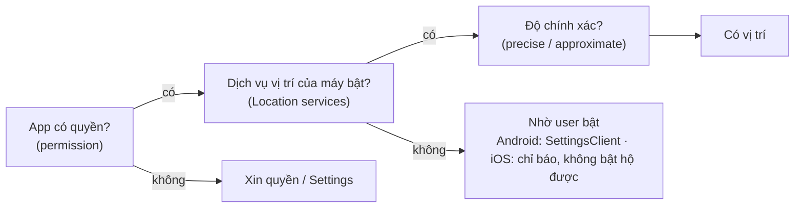

[↑ Platform API](index.md) · [02 Bluetooth →](02-bluetooth.md)

# 01 · Location Permission

!!! info "App này dùng Location ở đâu"
    Không có tính năng GPS. Location chỉ xuất hiện **gián tiếp**: trên **Android 8–11 (API 26–30)** muốn scan BLE phải có `ACCESS_FINE_LOCATION` **và** bật dịch vụ vị trí. Xem [`AndroidPermissions.kt` › `permissionGroups`](https://github.com/tucarmd/kotlin-multi-platform/blob/main/apps/NativeDeviceMonitor/shared/src/androidMain/kotlin/com/learn/ndmkmp/core/permission/AndroidPermissions.kt) và [manifest của `shared`](https://github.com/tucarmd/kotlin-multi-platform/blob/main/apps/NativeDeviceMonitor/shared/src/androidMain/AndroidManifest.xml). Bài học GPS đầy đủ: [Bài 10 · GPS và xin quyền](../../../lessons/10-location.md).

## 1. Hai lớp: quyền và công tắc vị trí

Location là quyền **hai lớp**, hay bị quên lớp thứ hai:



## 2. API

=== "Android"

    **Khai báo** (`AndroidManifest.xml`):

    ```xml
    <uses-permission android:name="android.permission.ACCESS_COARSE_LOCATION" />  <!-- ~3 km -->
    <uses-permission android:name="android.permission.ACCESS_FINE_LOCATION" />    <!-- GPS chính xác -->
    <!-- Chỉ khi thật sự cần vị trí lúc app ở nền (Android 10+). Google Play bắt khai báo lý do. -->
    <uses-permission android:name="android.permission.ACCESS_BACKGROUND_LOCATION" />
    <!-- Foreground Service lấy vị trí (Android 14+) -->
    <uses-permission android:name="android.permission.FOREGROUND_SERVICE_LOCATION" />
    ```

    **Xin quyền**: luôn xin **cả FINE + COARSE cùng lúc** (Android 12+ cho user chọn "Approximate").

    ```kotlin
    private val requestLocation = registerForActivityResult(          // đăng ký trong onCreate, trước STARTED
        ActivityResultContracts.RequestMultiplePermissions()
    ) { result ->
        val fine = result[Manifest.permission.ACCESS_FINE_LOCATION] == true
        val coarse = result[Manifest.permission.ACCESS_COARSE_LOCATION] == true
        // fine=false, coarse=true  → user chọn "Approximate"
    }

    requestLocation.launch(arrayOf(
        Manifest.permission.ACCESS_FINE_LOCATION,
        Manifest.permission.ACCESS_COARSE_LOCATION,
    ))
    ```

    **Vị trí nền** (Android 11+): phải xin **riêng, sau khi** đã có quyền foreground. Hệ thống không hiện dialog, mà đưa user tới trang Settings với lựa chọn "Allow all the time".

    **Công tắc vị trí**: `LocationManagerCompat.isLocationEnabled(locationManager)`; nhờ user bật bằng `SettingsClient.checkLocationSettings()` → `ResolvableApiException` → `startResolutionForResult` (Google Play services).

=== "iOS"

    **Khai báo** (`Info.plist`):

    | Key | Khi nào cần |
    |---|---|
    | `NSLocationWhenInUseUsageDescription` | Luôn cần (kể cả khi xin Always) |
    | `NSLocationAlwaysAndWhenInUseUsageDescription` | Xin vị trí nền |
    | `NSLocationTemporaryUsageDescriptionDictionary` | Xin "Precise" tạm thời khi user chọn Approximate |
    | `UIBackgroundModes` → `location` | Nhận vị trí liên tục khi app ở nền |

    **Xin quyền**:

    ```swift
    let manager = CLLocationManager()       // giữ strong reference, manager bị giải phóng = không còn callback
    manager.delegate = self
    manager.requestWhenInUseAuthorization() // dialog: Allow Once / Allow While Using / Don't Allow

    func locationManagerDidChangeAuthorization(_ m: CLLocationManager) {   // iOS 14+, gọi cả lúc tạo manager
        switch m.authorizationStatus {
        case .notDetermined: break
        case .authorizedWhenInUse, .authorizedAlways: m.startUpdatingLocation()
        case .denied, .restricted: showOpenSettings()
        @unknown default: showOpenSettings()
        }
        if m.accuracyAuthorization == .reducedAccuracy { /* user tắt "Precise Location" */ }
    }
    ```

    **Vị trí nền**: gọi `requestAlwaysAuthorization()` **sau** khi đã có When In Use. iOS cho "Always tạm thời" (provisional), rồi vài ngày sau tự hỏi lại user có giữ Always không.

    **Công tắc vị trí**: `CLLocationManager.locationServicesEnabled()` (đừng gọi trên main thread, iOS 16+ cảnh báo UI hang). App **không bật hộ được**, chỉ hiện hướng dẫn.

## 3. Trạng thái: Android ↔ iOS

| Ý nghĩa | Android | iOS |
|---|---|---|
| Chưa hỏi | DENIED + app chưa lưu cờ "đã hỏi" | `.notDetermined` |
| Cho khi đang dùng | FINE/COARSE GRANTED | `.authorizedWhenInUse` |
| Cho luôn cả nền | + `ACCESS_BACKGROUND_LOCATION` GRANTED | `.authorizedAlways` |
| Chỉ lần này | GRANTED nhưng hết hạn sau khi app rời foreground một lúc | "Allow Once": `.authorizedWhenInUse` tới khi app không dùng nữa, rồi về `.notDetermined` |
| Vị trí xấp xỉ | chỉ COARSE GRANTED | `accuracyAuthorization == .reducedAccuracy` |
| Từ chối, còn hỏi được | `shouldShowRequestPermissionRationale = true` | Không có |
| Từ chối hẳn | đã hỏi + rationale `false` | `.denied` |
| Bị chặn bởi quản lý | (MDM: policy) | `.restricted` (Screen Time / MDM) |

## 4. Vòng đời: khởi động lại, kill, crash

| Chuyện xảy ra | Android | iOS |
|---|---|---|
| Khởi động lại app (cold start) | Quyền giữ nguyên. "Chỉ lần này" có thể đã hết → về chưa cấp | Quyền giữ nguyên. "Allow Once" đã hết → `.notDetermined`, hỏi lại được |
| Hệ thống kill khi ở nền | Quyền giữ nguyên; luồng vị trí dừng (trừ Foreground Service type `location`) | Quyền giữ nguyên; luồng vị trí dừng. **Region monitoring / significant-change** có thể đánh thức lại app ở nền |
| User vuốt tắt / Force stop | Swipe: process thường chết, FGS có thể vẫn chạy. Force stop: dừng hết, geofence bị xoá, không tự sống lại | Swipe: dừng cập nhật thường. Theo Apple, region monitoring / significant-change vẫn có thể relaunch app, **phải test trên máy thật** |
| Crash khi dialog đang mở | Hệ thống đã tính lần hỏi đó (đếm vào "từ chối 2 lần") dù callback không về | Câu trả lời của user vẫn được lưu, mở lại app đọc `authorizationStatus` là thấy |
| Đổi quyền trong Settings | Thu hồi → **process bị kill**. Lần mở sau là cold start | App **bị kill**, mở lại là cold start |
| Xoá app cài lại | Quyền mất. Nếu Auto Backup khôi phục SharedPreferences → xem `L10` | Quyền mất, hỏi lại từ đầu |

## 5. Use case & error case

| Mã | Tình huống | Triệu chứng | Xử lý | Cách giả lập |
|---|---|---|---|---|
| `L01` | Xin FINE một mình trên Android 12+ | Không dialog, logcat ghi request bị bỏ qua | Luôn xin FINE + COARSE cùng lúc | Sửa code chỉ `launch(arrayOf(FINE))`, chạy trên API 31+ |
| `L02` | User chọn Approximate | `fine=false, coarse=true`; vị trí lệch vài km | Chấp nhận nếu đủ; cần chính xác thì giải thích rồi xin lại FINE | Android: chọn "Approximate" trong dialog. iOS: tắt "Precise" trong dialog |
| `L03` | Quyền có, công tắc vị trí tắt | Không bao giờ có vị trí, **không có lỗi**; scan BLE (API ≤ 30) trả 0 thiết bị | Kiểm tra `isLocationEnabled` trước, hiện nút bật | Android: `adb shell cmd location set-location-enabled false`. iOS: Settings › Privacy › Location Services tắt |
| `L04` | "Chỉ lần này" hết hạn | Lần mở sau app tưởng còn quyền, lấy vị trí bị `SecurityException` | Không cache quyền; đọc lại mỗi `onResume` / `.active` | Chọn "Only this time", Home, đợi ~1 phút, mở lại |
| `L05` | Xin background location chung với foreground (Android 11+) | Cả request bị bỏ qua | Xin foreground trước, background sau, có màn giải thích | Thêm BACKGROUND vào cùng mảng `launch` |
| `L06` | Thiếu key `Info.plist` (iOS) | Gọi `request…Authorization()` không có gì xảy ra, console báo thiếu key | Thêm `NSLocationWhenInUseUsageDescription` | Xoá key khỏi `Info.plist` rồi chạy |
| `L07` | `CLLocationManager` là biến local | Dialog hiện rồi tắt / delegate không bao giờ được gọi | Giữ manager trong property của object sống lâu | Tạo manager trong hàm, không lưu |
| `L08` | User thu hồi quyền trong Settings khi app đang chạy nền | Quay lại thấy app mở lại từ đầu (mất state chưa lưu) | Lưu state quan trọng (`SavedStateHandle`, `@SceneStorage`) | Android: `adb shell pm revoke com.learn.ndmkmp android.permission.ACCESS_FINE_LOCATION`. iOS: `xcrun simctl privacy booted revoke location com.learn.ndmkmp` |
| `L09` | Auto-reset quyền app lâu không mở (Android 11+) | User mở lại sau vài tháng, mất hết quyền | Xử lý như cài mới; có thể xin user tắt "Remove permissions if app isn't used" | Không có lệnh adb chính thức để kích hoạt. Kết quả giống hệt `adb shell pm revoke` từng quyền (cờ "đã hỏi" của app vẫn còn → kiểm tra luôn `L10`). Công tắc nằm ở App info › "Pause app activity if unused" |
| `L10` | Cài lại + Auto Backup khôi phục cờ "đã hỏi" (Android) | Cài mới mà app hiện ngay "Mở Settings" thay vì dialog | Loại file prefs `permission_asked` khỏi backup (`dataExtractionRules`), hoặc thử `launch` luôn rồi mới kết luận | `adb shell bmgr backupnow com.learn.ndmkmp` → `adb uninstall` → cài lại (local transport tự restore) |
| `L11` | Bấm ra ngoài dialog lần đầu (Android 11+) | Callback `false`, rationale `false` → app tưởng "từ chối hẳn" | Không kết luận PERMANENTLY_DENIED chỉ từ 1 lần; lần sau vẫn thử `launch` | Mở dialog, chạm vùng tối bên ngoài |
| `L12` | Gọi `locationServicesEnabled()` trên main thread (iOS 16+) | Cảnh báo "UI unresponsiveness" trong Xcode | Gọi ở background queue hoặc dựa vào `authorizationStatus` + lỗi `kCLErrorLocationUnknown` | Gọi trong `onAppear` |
| `L13` | Emulator / Simulator không có vị trí | Không nhận callback nào | Set vị trí giả | Android: Extended controls › Location, hoặc `adb emu geo fix 106.70 10.77`. iOS: `xcrun simctl location booted set 10.77,106.70` |
| `L14` | FGS lấy vị trí bị chặn (Android 14+) | `SecurityException` / `ForegroundServiceStartNotAllowedException` | Khai `foregroundServiceType="location"` + `FOREGROUND_SERVICE_LOCATION`, start khi app đang foreground | Start service từ `WorkManager` lúc app ở nền |

## 6. Issue hay gặp & khác biệt cần nhớ

- **Android không có "đã hỏi chưa"**: app này lưu cờ trong SharedPreferences (`markAsked` gọi **trước** `launch`, ghi bằng `commit()`), xem doc trong [`AndroidPermissions.kt`](https://github.com/tucarmd/kotlin-multi-platform/blob/main/apps/NativeDeviceMonitor/shared/src/androidMain/kotlin/com/learn/ndmkmp/core/permission/AndroidPermissions.kt). iOS có sẵn `.notDetermined`.
- **iOS chỉ hỏi 1 lần**, nên phải có màn "vì sao cần" **trước** khi gọi `request…`. Android cho hỏi lại 1 lần, dùng `shouldShowRequestPermissionRationale` để hiện lý do.
- **Vị trí nền là con đường khó nhất** cả hai bên: Google Play và App Review đều soi lý do. App này không cần nên không xin.
- **Scan BLE trên Android ≤ 11 cần Location** (danh sách beacon xung quanh lộ vị trí). Android 12+ khai `neverForLocation` thì khỏi, xem [02 Bluetooth](02-bluetooth.md).
