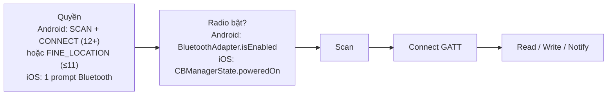

[← 01 Location](01-location.md) · [↑ Platform API](index.md) · [03 Notification →](03-notification.md)

# 02 · Bluetooth Permission

!!! info "App này dùng ở đâu"
    Tab **Permissions** (2 thẻ BLE Scan + BLE Connect, nút bật Bluetooth) và tab **Scanner** (scan, connect GATT).

    - Android: [`AndroidPermissions.kt`](https://github.com/tucarmd/kotlin-multi-platform/blob/main/apps/NativeDeviceMonitor/shared/src/androidMain/kotlin/com/learn/ndmkmp/core/permission/AndroidPermissions.kt) (ma trận quyền theo API level) · [`AndroidPermissionController.kt`](https://github.com/tucarmd/kotlin-multi-platform/blob/main/apps/NativeDeviceMonitor/shared/src/androidMain/kotlin/com/learn/ndmkmp/core/permission/AndroidPermissionController.kt) (launcher, theo dõi radio) · [manifest](https://github.com/tucarmd/kotlin-multi-platform/blob/main/apps/NativeDeviceMonitor/shared/src/androidMain/AndroidManifest.xml)
    - iOS: [`PermissionNative.swift`](https://github.com/tucarmd/kotlin-multi-platform/blob/main/apps/NativeDeviceMonitor/iosApp/iosApp/Platform/PermissionNative.swift) (CBManager) · [`IosPermissionController.kt`](https://github.com/tucarmd/kotlin-multi-platform/blob/main/apps/NativeDeviceMonitor/shared/src/iosMain/kotlin/com/learn/ndmkmp/platform/IosPermissionController.kt) (map sang 4 trạng thái) · [`Info.plist`](https://github.com/tucarmd/kotlin-multi-platform/blob/main/apps/NativeDeviceMonitor/iosApp/iosApp/Info.plist)
    - Luồng BLE từng file: [BLE flow (app gốc)](../legacy/README-BLE-FLOW.md)

## 1. Ba lớp: quyền, radio, kết nối



Mỗi lớp hỏng một kiểu khác nhau, và **nhiều chỗ hỏng không báo lỗi** (scan trả 0 thiết bị, kết nối im lặng). Vì vậy trang này dài nhất.

## 2. API

=== "Android"

    Bluetooth bị **tách đôi ở Android 12 (API 31)**. App có `minSdk = 26` nên phải khai cả hai nhánh:

    ```xml
    <!-- Nhánh CŨ, API 26–30: install-time + Location runtime -->
    <uses-permission android:name="android.permission.BLUETOOTH" android:maxSdkVersion="30" />
    <uses-permission android:name="android.permission.BLUETOOTH_ADMIN" android:maxSdkVersion="30" />
    <uses-permission android:name="android.permission.ACCESS_FINE_LOCATION" android:maxSdkVersion="30" />

    <!-- Nhánh MỚI, API 31+: 2 quyền runtime, hứa không dùng BLE để suy ra vị trí -->
    <uses-permission android:name="android.permission.BLUETOOTH_SCAN"
        android:usesPermissionFlags="neverForLocation" />
    <uses-permission android:name="android.permission.BLUETOOTH_CONNECT" />
    <!-- BLUETOOTH_ADVERTISE: chỉ khi app phát quảng bá (làm peripheral) -->

    <uses-feature android:name="android.hardware.bluetooth_le" android:required="false" />
    ```

    | Việc | API 26–30 cần | API 31+ cần |
    |---|---|---|
    | Scan | `ACCESS_FINE_LOCATION` (runtime) + **bật Location** | `BLUETOOTH_SCAN` |
    | Connect, đọc tên, bonding | không cần hỏi (install-time) | `BLUETOOTH_CONNECT` |
    | Bật radio (`ACTION_REQUEST_ENABLE`) | không cần hỏi | `BLUETOOTH_CONNECT`, thiếu là **crash** |

    Xin **SCAN + CONNECT trong một lần** `RequestMultiplePermissions` (app này làm thế), gọi 2 lần liên tiếp thì hệ thống có thể nuốt lần thứ hai.

    Theo dõi radio: `BroadcastReceiver` với `BluetoothAdapter.ACTION_STATE_CHANGED`, đăng ký ở `onStart`, huỷ ở `onStop`. Bật radio: `ActivityResultContracts.StartActivityForResult()` với `Intent(BluetoothAdapter.ACTION_REQUEST_ENABLE)` (`BluetoothAdapter.enable()` không còn tác dụng từ target 33).

=== "iOS"

    **Một key, một prompt** cho mọi thứ Bluetooth:

    ```xml
    <key>NSBluetoothAlwaysUsageDescription</key>
    <string>Scan for and connect to BLE devices…</string>
    <!-- Nền: UIBackgroundModes → bluetooth-central -->
    ```

    iOS **không có `requestAccess` cho Bluetooth**. Prompt hiện khi app **tạo `CBCentralManager` lần đầu**:

    ```swift
    // Đọc trạng thái KHÔNG gây prompt (static, iOS 13.1+)
    switch CBManager.authorization {
    case .notDetermined:  /* chưa hỏi */
    case .allowedAlways:  /* đã cho */
    case .denied, .restricted: /* chỉ còn Settings */
    @unknown default: break
    }

    // Gây prompt: tạo manager, chờ delegate
    let central = CBCentralManager(delegate: self, queue: nil,
                                   options: [CBCentralManagerOptionShowPowerAlertKey: false])
    func centralManagerDidUpdateState(_ c: CBCentralManager) {
        switch c.state {
        case .poweredOn: /* scan được */
        case .poweredOff: /* radio tắt */
        case .unauthorized: /* bị từ chối */
        case .unsupported: /* Simulator, máy không có BLE */
        case .unknown, .resetting: /* chờ thêm */
        @unknown default: break
        }
    }
    ```

    iOS **không cho app bật Bluetooth**. Cách duy nhất: tạo manager với `ShowPowerAlertKey: true` khi radio đang tắt, hệ thống hiện alert "Turn On Bluetooth" (app này làm thế trong `showPowerAlert()`).

## 3. Trạng thái: Android ↔ iOS

| Ý nghĩa | Android 12+ | Android ≤ 11 | iOS |
|---|---|---|---|
| Chưa hỏi | SCAN/CONNECT DENIED + chưa lưu cờ | FINE_LOCATION DENIED + chưa lưu cờ | `CBManager.authorization == .notDetermined` |
| Đã cho | SCAN **và** CONNECT GRANTED | FINE_LOCATION GRANTED (+ Location bật) | `.allowedAlways` |
| Cho 1 nửa | SCAN có, CONNECT không (hoặc ngược lại) → coi như **chưa cho** | không có | không có (1 prompt) |
| Từ chối hẳn | rationale `false` sau khi đã hỏi | như trên | `.denied` → state `.unauthorized` |
| Radio tắt | `isEnabled == false` | như trên | `.poweredOff` |
| Không có phần cứng | `FEATURE_BLUETOOTH_LE` không có | như trên | `.unsupported` (**Simulator luôn thế**) |

## 4. Vòng đời: khởi động lại, kill, crash

| Chuyện xảy ra | Android | iOS |
|---|---|---|
| Khởi động lại app | Quyền giữ nguyên. Kết nối GATT cũ **đã mất**, phải connect lại | Quyền giữ nguyên. Kết nối cũ mất (trừ khi dùng state restoration) |
| Hệ thống kill khi ở nền | Process chết → GATT ngắt (thiết bị thấy disconnect). FGS `connectedDevice` giữ được process | App bị suspend → scan dừng. Có `bluetooth-central` + `RestoreIdentifierKey`: iOS **đánh thức lại app** khi có sự kiện BLE (`willRestoreState`) |
| User vuốt tắt / Force stop | Force stop: mọi thứ dừng, `autoConnect` không còn tác dụng | **Vuốt tắt = state restoration KHÔNG chạy**. Phải chờ user mở lại |
| Crash | GATT có thể "treo" ở stack Bluetooth: lần connect sau lỗi `133` | Kết nối bị huỷ, mở lại app scan lại |
| Đổi quyền trong Settings | Thu hồi → process bị kill | App bị kill |
| Radio tắt khi đang scan / connect | **Scan và GATT không báo lỗi gì**, phải nghe `ACTION_STATE_CHANGED` rồi tự dừng (app này: `ble.onRadioOff()`) | Delegate `centralManagerDidUpdateState(.poweredOff)`, các peripheral bị disconnect |
| Máy khởi động lại | Phải mở app mới chạy lại (hoặc `BOOT_COMPLETED`) | Phải mở app (state restoration không áp dụng sau reboot) |

## 5. Use case & error case

| Mã | Tình huống | Triệu chứng | Xử lý | Cách giả lập |
|---|---|---|---|---|
| `B01` | Thiếu `NSBluetoothAlwaysUsageDescription` (iOS) | **Crash** lúc tạo `CBCentralManager` (`__CRASHING_DUE_TO_PRIVACY_VIOLATION__`) | Thêm key | Xoá key khỏi `Info.plist`, mở tab Permissions |
| `B02` | Đọc trạng thái bằng cách tạo `CBCentralManager` | Prompt hiện ngay lúc mở app, user chưa hiểu gì đã bị hỏi | Đọc `CBManager.authorization` (static), chỉ tạo manager khi user bấm | Tạo manager trong `init` của màn hình |
| `B03` | Android 12+ chỉ cho SCAN, không cho CONNECT | Scan thấy thiết bị nhưng tên `null` / connect `SecurityException` | Gộp 2 quyền thành 1 nhóm, trạng thái nhóm = trạng thái **xấu nhất** (app này làm) | Cho SCAN, từ chối CONNECT trong chuỗi dialog; hoặc `adb shell pm revoke com.learn.ndmkmp android.permission.BLUETOOTH_CONNECT` |
| `B04` | Android ≤ 11 thiếu FINE_LOCATION hoặc Location tắt | Scan chạy, **0 thiết bị, không lỗi** | Kiểm tra cả quyền lẫn `isLocationEnabled` trước khi scan | Emulator/máy API 30: tắt Location (`adb shell cmd location set-location-enabled false`) |
| `B05` | Bật radio khi chưa có CONNECT (API 31+) | **Crash** `SecurityException` khi launch `ACTION_REQUEST_ENABLE` | Kiểm tra quyền trước (app này: `turnOnBluetooth()` có guard) | Bỏ guard, thu hồi CONNECT, bấm "Bật Bluetooth" |
| `B06` | Radio tắt giữa chừng | UI vẫn hiện "đang scan" / "connected" mãi | Nghe `ACTION_STATE_CHANGED` / `.poweredOff`, reset state | Android: `adb shell cmd bluetooth_manager disable` (API 33+) hoặc kéo Quick Settings. iOS máy thật: **Settings › Bluetooth** (Control Center chỉ ngắt thiết bị, không tắt radio) |
| `B07` | Scan quá nhiều lần (Android 7+) | Sau 5 lần `startScan` trong 30 s, scan **im lặng không trả kết quả** | Không start/stop liên tục; debounce nút Scan | Bấm Scan / Stop 6 lần thật nhanh, xem logcat `App 'xxx' is scanning too frequently` |
| `B08` | Lỗi GATT `133` (Android) | `onConnectionStateChange(status=133)` | `close()` gatt cũ trước khi connect lại, chờ 1–2 s, thử lại có giới hạn; `TRANSPORT_LE` | Connect liên tục vào thiết bị ở xa / vừa tắt; kill app khi đang connected rồi connect lại |
| `B09` | Quên `gatt.close()` | Sau ~7 lần connect, không connect được nữa tới khi bật/tắt Bluetooth | Luôn `close()` khi disconnect / thoát màn | Connect → back → lặp lại nhiều lần |
| `B10` | iOS Simulator | State `.unsupported`, không scan được | Test trên iPhone thật; app này có `FakeBleClient` cho Simulator | Chạy trên Simulator |
| `B11` | Scan nền trên iOS không có service UUID | Không thấy thiết bị khi app ở nền | Nền phải scan theo `withServices: [UUID]` + `bluetooth-central` | Scan `withServices: nil`, bấm Home |
| `B12` | Màn hình tắt (Android 8.1+) | Scan **không lọc** bị dừng khi tắt màn | Dùng `ScanFilter` khi cần scan lâu | Scan không filter, tắt màn 1 phút, xem log |
| `B13` | Callback BLE chạy trên Binder thread (Android) | Sửa state UI từ callback → crash / race | Đẩy về main (StateFlow + `Dispatchers.Main`) | Gán thẳng `mutableStateOf` trong `onScanResult` |
| `B14` | Giải phóng `CBCentralManager` trong chính delegate của nó (iOS) | Crash hiếm / delegate gọi vào object đã chết | Giải phóng ở vòng main-loop sau (`DispatchQueue.main.async`), app này làm trong `requestBluetooth` | Gán `probe = nil` ngay trong callback |

## 6. Khác biệt cần nhớ

| | Android | iOS |
|---|---|---|
| Số quyền | 2 (12+) hoặc Location (≤ 11) | 1 |
| Địa chỉ thiết bị | MAC thật (`AA:BB:…`), ổn định | `UUID` do iOS sinh, **khác nhau giữa các máy**, đổi khi reset |
| Bật radio hộ user | Có dialog hệ thống | Không, chỉ alert nhắc |
| Kill khi ở nền | FGS giữ được | State restoration đánh thức lại (trừ khi user vuốt tắt) |
| Test trên máy ảo | Emulator API 33+ có BLE ảo (hạn chế) | Không được |

Thiết bị test: [Test peripheral setup](../legacy/peripheral-setup.md) (dùng điện thoại thứ hai làm peripheral).
