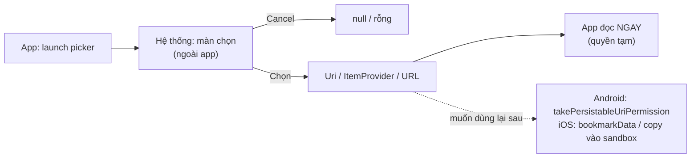

[← 04 Thư viện ảnh](04-library.md) · [↑ Platform API](index.md) · [06 Camera →](06-camera.md)

# 05 · Picker Permission (chọn ảnh / file không cần quyền)

!!! info "App này dùng ở đâu"
    Tab **Media**, nút "Chọn ảnh":

    - Android: `PickVisualMedia(ImageOnly)` trong [`AndroidMediaPicker.kt`](https://github.com/tucarmd/kotlin-multi-platform/blob/main/apps/NativeDeviceMonitor/shared/src/androidMain/kotlin/com/learn/ndmkmp/core/media/AndroidMediaPicker.kt) (launcher → `suspend` qua `CompletableDeferred`).
    - iOS: `PHPickerViewController` trong [`MediaNative.swift`](https://github.com/tucarmd/kotlin-multi-platform/blob/main/apps/NativeDeviceMonitor/iosApp/iosApp/Platform/MediaNative.swift), Kotlin [`IosMediaPicker.kt`](https://github.com/tucarmd/kotlin-multi-platform/blob/main/apps/NativeDeviceMonitor/shared/src/iosMain/kotlin/com/learn/ndmkmp/platform/IosMediaPicker.kt) đổi callback thành `suspend`.

## 1. "Picker permission" là gì

Picker **không cần xin quyền**: màn chọn chạy **ngoài app** (process của hệ thống), app chỉ nhận lại đúng thứ user chọn. Quyền ở đây là **quyền tạm thời trên 1 item**:

| | Android | iOS |
|---|---|---|
| Ảnh / video | **Photo Picker** `PickVisualMedia` / `PickMultipleVisualMedia` | **`PHPickerViewController`** (iOS 14+), SwiftUI `PhotosPicker` |
| File bất kỳ | **SAF** `OpenDocument` / `CreateDocument` / `OpenDocumentTree` | **`UIDocumentPickerViewController`**, SwiftUI `.fileImporter` |
| App nhận về | `content://` `Uri` + quyền đọc **tạm thời** | `NSItemProvider` (ảnh) / URL **security-scoped** (file) |
| Quyền sống bao lâu | Tới khi **process chết** (trừ khi `takePersistableUriPermission`) | Ảnh: copy dữ liệu ra là xong. File: chỉ trong `start…/stopAccessingSecurityScopedResource`, muốn giữ lâu → **bookmark** |



## 2. API

=== "Android"

    ```kotlin
    // Đăng ký trong onCreate (trước STARTED), giống mọi launcher
    val pick = registerForActivityResult(ActivityResultContracts.PickVisualMedia()) { uri: Uri? ->
        if (uri == null) return@registerForActivityResult      // user Cancel
        // Đọc NGAY trên Dispatchers.IO: contentResolver.openInputStream(uri)
        // Muốn giữ để mở lại sau khi app khởi động lại:
        contentResolver.takePersistableUriPermission(uri, Intent.FLAG_GRANT_READ_URI_PERMISSION)
    }
    pick.launch(PickVisualMediaRequest(ActivityResultContracts.PickVisualMedia.ImageOnly))

    // File bất kỳ (PDF, JSON…): Storage Access Framework
    val open = registerForActivityResult(ActivityResultContracts.OpenDocument()) { uri -> … }
    open.launch(arrayOf("application/pdf"))
    ```

    Photo Picker có sẵn trên Android 13+; máy cũ hơn được Google Play cập nhật module, nếu không có thì `PickVisualMedia` tự rơi về `ACTION_OPEN_DOCUMENT`. Kiểm tra: `ActivityResultContracts.PickVisualMedia.isPhotoPickerAvailable(context)`.

=== "iOS"

    ```swift
    var config = PHPickerConfiguration()          // không truyền PHPhotoLibrary → không cần quyền
    config.filter = .images
    config.selectionLimit = 1                       // 0 = không giới hạn
    let picker = PHPickerViewController(configuration: config)
    picker.delegate = delegate                      // UIKit giữ delegate WEAK → app phải giữ strong ref
    present(picker, animated: true)

    func picker(_ p: PHPickerViewController, didFinishPicking results: [PHPickerResult]) {
        p.dismiss(animated: true)                   // picker KHÔNG tự đóng
        guard let provider = results.first?.itemProvider else { return }   // rỗng = Cancel
        provider.loadDataRepresentation(forTypeIdentifier: UTType.image.identifier) { data, error in
            // chạy trên queue bất kỳ, có thể đang tải từ iCloud → về main mới đụng UI
        }
    }

    // File: URL security-scoped
    let ok = url.startAccessingSecurityScopedResource()
    defer { if ok { url.stopAccessingSecurityScopedResource() } }
    let data = try Data(contentsOf: url)
    ```

## 3. Vòng đời: khởi động lại, kill, crash

Đây là chỗ Picker hay hỏng nhất, vì **app đang ở nền trong lúc user chọn**.

| Chuyện xảy ra | Android | iOS |
|---|---|---|
| Hệ thống kill app **trong lúc** picker đang mở | Activity được tạo lại, kết quả **vẫn được giao** cho launcher đăng ký lại trong `onCreate`. Nhưng coroutine đang `await()` đã chết → **ảnh bị mất** nếu code giữ kết quả trong coroutine (giới hạn đã biết của app này) | Picker chạy trong process của app (view controller remote), app bị kill thì picker đóng theo, user chọn lại |
| Khởi động lại app, mở lại `Uri` cũ | **`SecurityException`** (quyền tạm đã hết), trừ khi đã `takePersistableUriPermission` | `NSItemProvider` không dùng lại được; URL file cũ: phải resolve từ bookmark |
| Crash sau khi chọn | Mất kết quả, chọn lại | Mất kết quả, chọn lại |
| Xoay màn hình khi picker đang mở | Kết quả vẫn về (launcher đăng ký lại cùng key) | Không tạo lại màn, không sao |
| User xoá file gốc | `FileNotFoundException` khi mở `Uri` | Bookmark `isStale` / đọc lỗi |

## 4. Use case & error case

| Mã | Tình huống | Triệu chứng | Xử lý | Cách giả lập |
|---|---|---|---|---|
| `P01` | `registerForActivityResult` gọi sau STARTED (Android) | **Crash** `IllegalStateException: … is attempting to register while current state is RESUMED` | Đăng ký trong `onCreate` (app này: `createAndroidServices(this)` trước `setContent`) | Gọi `registerForActivityResult` trong `onClick` |
| `P02` | Kill app trong lúc user chọn ảnh (Android) | Quay lại app, không có ảnh | Lưu `Uri` vào `SavedStateHandle` / `rememberSaveable` ngay trong callback launcher, không dựa vào coroutine | Chắc ăn nhất: Developer options › **"Don't keep activities"** (`adb shell settings put global always_finish_activities 1`), mở picker, chọn ảnh. Kill cả process: mở picker rồi `adb shell am kill com.learn.ndmkmp` (chỉ ăn khi hệ thống coi app đang ở nền) |
| `P03` | Dùng lại `Uri` sau khi khởi động lại (Android) | `SecurityException: Permission Denial` | `takePersistableUriPermission` hoặc copy file vào `filesDir` | Lưu `Uri` vào prefs, `am force-stop`, mở lại |
| `P04` | Đọc `Uri` trên main thread | Giật, ANR với ảnh lớn / ảnh cloud | `withContext(Dispatchers.IO)` (app này: `load()`) | Đọc + decode ảnh 50 MP trên main |
| `P05` | Lấy "đường dẫn file" từ `Uri` | `null` / crash trên Android 10+ | Không có đường dẫn: đọc qua `ContentResolver`, tên/size qua `OpenableColumns` | — |
| `P06` | Delegate PHPicker bị giải phóng (iOS) | Chọn xong không có gì xảy ra | Giữ delegate strong (app này: `pending`) | Tạo delegate là biến local |
| `P07` | Quên `dismiss` picker (iOS) | Picker đứng yên sau khi chọn | Gọi `picker.dismiss` trong `didFinishPicking` | Bỏ dòng `dismiss` |
| `P08` | Cập nhật UI từ callback `loadDataRepresentation` (iOS) | Cảnh báo Main Thread Checker / UI không cập nhật | `DispatchQueue.main.async` / `@MainActor` | Gán `@Published` thẳng trong callback |
| `P09` | Ảnh HEIC / Live Photo / ảnh iCloud | Không decode được / chờ lâu | Lấy `UTType.image` chung, cho iOS chuyển đổi; hiện loading | Chọn ảnh HEIC trên máy thật |
| `P10` | File picker iOS không `startAccessingSecurityScopedResource` | `Data(contentsOf:)` lỗi "permission denied" | Bọc trong start/stop | Bỏ dòng start |
| `P11` | Picker không có trên máy cũ (Android) | Hiện trình chọn file kiểu cũ | Bình thường, `PickVisualMedia` tự fallback | Emulator API 26 không có Google Play |
| `P12` | Bấm nút chọn 2 lần nhanh | Mở 2 picker / `CompletableDeferred` cũ bị đè | Disable nút khi đang chọn (app này: ViewModel có `isLoading`) | Double-tap nút "Chọn ảnh" |

## 5. Khác biệt cần nhớ

- Cả hai đều **không cần quyền**, không có dialog, không cần key `Info.plist` / manifest.
- Android: kết quả là `Uri` có hạn dùng (theo process). iOS: kết quả là dữ liệu tải về một lần.
- Android phải lo **process death** trong lúc chọn; iOS thì gần như không.
- Picker = lựa chọn mặc định. Chỉ chuyển sang [quyền Library](04-library.md) khi app phải tự duyệt cả thư viện.
