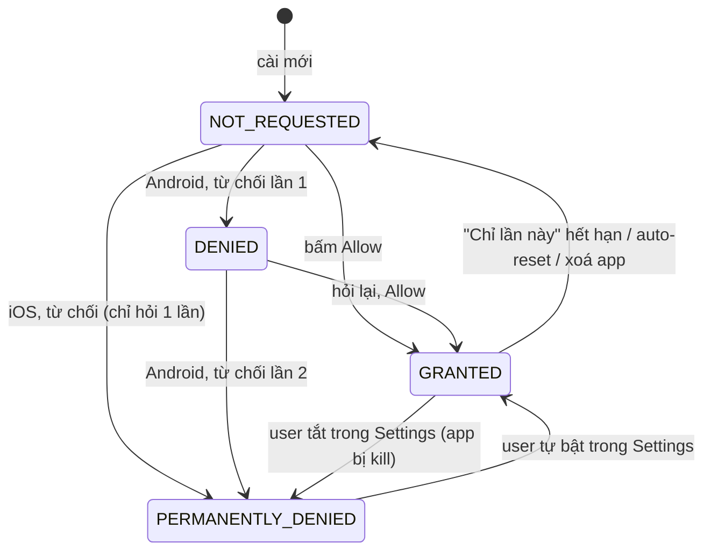

[🏠 Native Device Monitor](../index.md) · [Android cơ bản qua code](../README-KMP-ANDROID-BASICS.md) · [App chạy thế nào](../README-KMP-HOW-IT-WORKS.md)

# Platform API: quyền & vòng đời

Phần này gom **API hệ điều hành** mà app native nào cũng đụng: xin quyền (Location, Bluetooth, Notification, Thư viện ảnh, Picker, Camera) và **vòng đời app**. Mỗi trang trả lời cùng một bộ câu hỏi, cho **cả Android lẫn iOS**:

1. API nào, khai báo ở đâu, gọi thế nào.
2. Quyền có mấy trạng thái, đi từ trạng thái này sang trạng thái khác ra sao.
3. **Khi app khởi động lại, bị kill, bị crash, bị đổi quyền trong Settings, bị xoá cài lại** thì chuyện gì xảy ra.
4. Danh sách **use case + error case**, mỗi case có **mã** (vd `L07`, `B03`) và **cách giả lập** để cố tình làm app hư.
5. Android khác iOS chỗ nào, xử lý sao, issue hay gặp.

!!! tip "Dùng mã lỗi để tra nhanh"
    Gặp bug thật, tìm triệu chứng trong bảng của trang tương ứng, ghi mã vào ticket / commit (`fix: B04 scan trả 0 thiết bị trên API 30`). Lần sau gặp lại chỉ cần tìm mã.

## Các trang

| # | Trang | Mã | App này dùng chưa |
|---|---|---|---|
| 01 | [Location](01-location.md) | `L01`… | Chỉ gián tiếp: Android ≤ 11 cần `ACCESS_FINE_LOCATION` để scan BLE |
| 02 | [Bluetooth](02-bluetooth.md) | `B01`… | Có: tab Permissions + Scanner |
| 03 | [Notification](03-notification.md) | `N01`… | Android có (`POST_NOTIFICATIONS` trước Foreground Service), iOS chưa |
| 04 | [Thư viện ảnh (Library)](04-library.md) | `M01`… | Không: app cố ý **không** xin quyền thư viện, dùng Picker |
| 05 | [Picker (chọn ảnh / file không cần quyền)](05-picker.md) | `P01`… | Có: tab Media, nút "Chọn ảnh" |
| 06 | [Camera](06-camera.md) | `C01`… | Có: tab Permissions + Media, nút "Chụp" |
| 07 | [Vòng đời app (Lifecycle)](07-lifecycle.md) | `LC01`… | Có: `onResume` đọc lại quyền, Foreground Service, BGAppRefresh |

## Mô hình chung: 4 trạng thái của một quyền

App này gộp mọi quyền về **4 trạng thái** trong code chung ([`PermissionStatus.kt`](https://github.com/tucarmd/kotlin-multi-platform/blob/main/apps/NativeDeviceMonitor/shared/src/commonMain/kotlin/com/learn/ndmkmp/core/permission/PermissionStatus.kt)). UI chỉ cần biết 4 trạng thái này, không cần biết đang chạy Android hay iOS.



| Trạng thái | Nút trong UI | Android đọc từ | iOS đọc từ |
|---|---|---|---|
| `NOT_REQUESTED` | "Xin quyền" → hiện dialog hệ thống | `checkSelfPermission = DENIED` + app **chưa từng hỏi** (app tự lưu cờ) | `.notDetermined` |
| `GRANTED` | Dùng được tính năng | `checkSelfPermission = GRANTED` | `.authorized` / `.allowedAlways` / `.authorizedWhenInUse` |
| `DENIED` | "Xin lại" + giải thích lý do | `shouldShowRequestPermissionRationale = true` | Không có: iOS chỉ hỏi **1 lần** |
| `PERMANENTLY_DENIED` | "Mở Settings" | đã hỏi + `rationale = false` | `.denied` / `.restricted` |

## Android khác iOS: bảng tổng

| Chủ đề | Android | iOS |
|---|---|---|
| Khai báo | `<uses-permission>` trong `AndroidManifest.xml` | Key `NS…UsageDescription` trong `Info.plist` (câu giải thích hiện trong dialog) |
| Thiếu khai báo | Xin quyền trả về denied ngay, không dialog; một số API ném `SecurityException` | **Crash ngay** khi chạm API (Camera, Photos, Bluetooth, Mic…). Riêng Location: không crash, chỉ không hiện dialog |
| Số lần hỏi | Hỏi được tới khi bị từ chối **2 lần** (Android 11+) | Hỏi **đúng 1 lần**; sau đó chỉ còn Settings |
| Biết "đã hỏi chưa" | **Không có API**, app phải tự lưu cờ | Có: `.notDetermined` |
| Đổi quyền trong Settings khi app đang chạy | **Thu hồi → process bị kill.** Cấp thêm → không kill | Thường **bị kill** (SIGKILL), chắc chắn khi thu hồi |
| Quay lại app sau Settings | Không có event, phải đọc lại ở `onResume` | Không có event, đọc lại khi `scenePhase == .active` (nếu không bị kill) |
| Mở Settings | `ACTION_APPLICATION_DETAILS_SETTINGS` (trang App Info) | `UIApplication.openSettingsURLString` (trang của app, không trỏ được tới 1 công tắc) |
| Quyền tạm thời | "Chỉ lần này" (Location, Camera, Mic; Android 11+) | "Allow Once" (Location), "Limited" (Photos) |
| Tự thu hồi | Auto-reset quyền của app lâu không mở (Android 11+) | Không |
| Reset để test lại | `adb shell pm revoke …` / `pm clear` / gỡ app | Gỡ app, hoặc `xcrun simctl privacy … reset` (Simulator), hoặc Settings › General › Transfer or Reset › Reset Location & Privacy |

## 8 tình huống phải thử với MỌI quyền

Đây là khung test chung. Mỗi trang con ghi kết quả cụ thể cho quyền đó.

| # | Tình huống | Giả lập Android | Giả lập iOS |
|---|---|---|---|
| T1 | Cài mới, mở lần đầu | `adb uninstall com.learn.ndmkmp` rồi cài lại | Xoá app trên Simulator / máy, cài lại |
| T2 | Từ chối 1 lần, từ chối 2 lần | Bấm "Don't allow" | Bấm "Don't Allow" (chỉ có 1 lần) |
| T3 | Đổi quyền trong Settings khi app đang chạy nền | Settings › Apps › app › Permissions, hoặc `adb shell pm revoke com.learn.ndmkmp <perm>` | Settings › app, hoặc `xcrun simctl privacy booted revoke <service> com.learn.ndmkmp` |
| T4 | App bị hệ thống kill khi ở nền (thiếu RAM) | Bấm Home rồi `adb shell am kill com.learn.ndmkmp` | Không có lệnh "kill như thiếu RAM"; dùng `xcrun simctl terminate booted com.learn.ndmkmp` (giống bị kill) |
| T5 | User vuốt tắt app / Force stop | Vuốt khỏi Recents · `adb shell am force-stop com.learn.ndmkmp` | Vuốt lên trong App Switcher |
| T6 | App crash giữa chừng (vd đang mở dialog quyền) | `adb shell am crash com.learn.ndmkmp` hoặc nút crash debug | `fatalError()` trong nút debug, hoặc Xcode › Debug › Detach rồi kill |
| T7 | Xoay màn hình / đổi dark mode khi dialog đang mở | Xoay emulator (Ctrl+←/→) | Xoay Simulator (Cmd+←/→), iOS không tạo lại màn hình |
| T8 | Xoá app, cài lại (có/không backup) | `adb uninstall` + cài lại; test backup xem [`L10`](01-location.md) | Xoá + cài lại; cài đè từ Xcode **giữ** quyền |

!!! warning "Test kill / nền thì tách debugger ra"
    Khi chạy dưới debugger (Android Studio, Xcode), hệ thống **không suspend / kill app như thật**: iOS tắt watchdog, Android giữ process để debug. Muốn thấy hành vi thật: chạy app từ icon (không Run từ IDE), xem log bằng `adb logcat` / `Console.app`.

## Lệnh hay dùng (giữ trang này mở khi test)

```bash
# ===== Android =====
PKG=com.learn.ndmkmp
adb shell pm grant  $PKG android.permission.CAMERA        # cấp quyền runtime, không cần bấm
adb shell pm revoke $PKG android.permission.CAMERA        # thu hồi (process bị kill nếu đang chạy)
adb shell pm clear $PKG                                   # xoá data + reset quyền runtime (giống cài mới, không cần cài lại)
adb shell dumpsys package $PKG | grep -A30 "runtime permissions"   # xem quyền nào đang granted + flags USER_SET/USER_FIXED
adb shell am kill $PKG                                    # kill như thiếu RAM (chỉ khi app đang ở nền)
adb shell am force-stop $PKG                              # Force stop: dừng hết, không nhận broadcast/alarm tới khi user mở lại
adb shell am crash $PKG                                   # ép crash (Android 11+)
adb logcat --pid=$(adb shell pidof $PKG)                  # log riêng của app

# ===== iOS Simulator =====
BID=com.learn.ndmkmp
xcrun simctl privacy booted grant  location  $BID         # service: all, location, location-always, photos, photos-add,
xcrun simctl privacy booted revoke photos    $BID         #          contacts, calendar, microphone, motion, reminders…
xcrun simctl privacy booted reset  all       $BID         # về .notDetermined, lần sau hỏi lại
xcrun simctl terminate booted $BID                        # kill app
xcrun simctl launch --console booted $BID                 # mở app + in log ra terminal
```

!!! note "Simulator không có Camera, không có Bluetooth"
    Camera và Bluetooth phải test trên **iPhone thật** (`simctl privacy` cũng không có service `camera`/`bluetooth`). Android emulator có camera ảo, Bluetooth thì emulator mới (API 33+) có BLE ảo nhưng rất hạn chế, nên dùng máy thật.

## Đọc thêm

- [Android cơ bản qua code](../README-KMP-ANDROID-BASICS.md): `onCreate`, `Bundle`, xoay màn hình.
- [900 lỗi Kotlin › 11. Android: lifecycle, quyền, Manifest](../../../issues/11-android.md)
- Docs chính chủ: [Android permissions](https://developer.android.com/guide/topics/permissions/overview) · [Apple: Requesting access to protected resources](https://developer.apple.com/documentation/uikit/requesting-access-to-protected-resources)
