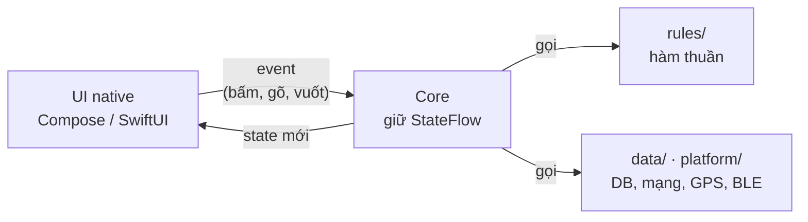

# Bức tranh lớn: 1 khung, 6 app, lúc nào bung sức

Trang này dành cho người **chưa biết Kotlin** mà vẫn muốn làm như dev pro. Dev pro không gõ hết từng file.
Họ nhìn ra **cái khung lặp lại**, giao phần lặp cho template và AI, rồi dồn sức vào vài chỗ quyết định.

Giống pivot trong futsal: phần lớn trận đứng quay lưng về khung thành, che bóng, nhả bóng cho đồng đội, **không chạy
lung tung**. Chỉ vài khoảnh khắc mới xoay người, lao vào cột hai, dứt điểm. Pivot giỏi không phải người chạy nhiều
nhất, mà là người **biết khoảnh khắc nào đáng chạy**.

## 1. Cả 6 app là cùng một vòng



Đọc bằng lời: **UI bắn event → Core đổi input → rules tính lại → Core phát state mới → UI vẽ lại.**
UI không tính gì, Core không vẽ gì. Thuộc câu này là đọc được mọi app trong repo.

Luật chi tiết (cây thư mục, 7 bước B1–B7, comment) nằm ở [Khung chung](apps/conventions.md).
Trang này chỉ trả lời: **app nào khác app nào đúng ở chỗ nào.**

## 2. Bản đồ: mỗi app chỉ thay một mảnh

| App | Core | Mảnh mới duy nhất | Kotlin mới phải hiểu | Cú dứt điểm |
|---|---|---|---|---|
| Device Pulse | `PulseCore` | `sensor/`: pin, GPS, mạng | `expect`/`actual`, [Flow](concepts/flow.md) | Cảm biến thật ra số đúng trên máy thật |
| 1. Tip Split | `TipCore` | Không có `data/`, chỉ `rules/` | [data class](concepts/sealed-when.md), [lambda](concepts/lambda.md), StateFlow | `rules/Money.kt`: "120.000" và "120,000" ra cùng một số |
| 2. Pocket Notes | `NotesCore` | `data/NoteRepository` trên SQLDelight | `suspend`, Flow từ database | Undo không xoá note lần hai (bug nằm ở UI, test core không bắt được) |
| 3. Rate Watch | `RatesCore` | `data/` Ktor + cache | [Coroutine](concepts/coroutines.md), xử lý lỗi mạng | `rules/Freshness.kt`: `now` truyền vào, không tự đọc đồng hồ |
| 4. Trip Log | `TripRecorder` | `platform/LocationStream` (GPS) | `callbackFlow`, `Channel` | Biến callback GPS thành Flow, một coroutine giữ trạng thái chuyến đi |
| 5. OBD Link | `ObdCore` | BLE (Kable) + module `core/` | `Mutex`, timeout | `CommandQueue`: mỗi lần chỉ một lệnh, kể cả lúc retry |

Đọc theo cột: cột **"Mảnh mới"** là thứ duy nhất phải học thêm ở mỗi app. Gradle, Koin, cách UI đọc state, cách viết
test **giống hệt app trước**, đọc lướt là đủ.

## 3. Kotlin tối thiểu: đọc hiểu `TipCore` là đủ 70 %

Toàn bộ `TipCore.kt` chỉ dùng 6 khái niệm. Xuất hiện ở đâu thì ghi ngay bên cạnh:

```kotlin
class TipCore {                                              // (1) class
    private val _state = MutableStateFlow(SplitState())      // (2) StateFlow: hộp giữ state, ai cũng nghe được
    val state: StateFlow<SplitState> = _state.asStateFlow()  //     bản chỉ-đọc cho UI

    fun addPerson() = update {                               // (3) lambda: khối { } truyền vào hàm như một giá trị
        it.copy(people = (it.people + 1)                     // (4) data class .copy(): tạo bản mới, không sửa bản cũ
            .coerceAtMost(SplitState.MAX_PEOPLE))
    }

    private fun update(change: (SplitInput) -> SplitInput) { // (5) kiểu hàm: "nhận SplitInput, trả SplitInput"
        _state.update { old ->
            val input = change(old.input)
            SplitState(input = input, result = calculate(input))  // gọi rules: tính lại TOÀN BỘ từ input
        }
    }
}

sealed class SplitResult {                                   // (6) sealed: kết quả chỉ có thể là một trong vài nhánh
    data class Invalid(val error: InputError) : SplitResult()
    data class Ready(val split: Split) : SplitResult()
}
```

Thêm `null` (`Long?`, xem [Null safety](concepts/null-safety.md)) và `suspend` (từ app 2) là đủ đọc cả 6 app.
[900 lỗi Kotlin](issues/index.md) là từ điển, **gặp lỗi mới tra**, không đọc từ đầu.

## 4. Nhịp pivot: lúc nào giữ bóng, lúc nào bung sức

### Giữ bóng: đừng tốn sức ở đây

Giao cho template hoặc AI. Bạn chỉ cần **đọc lướt và chạy được**.

| Việc | Vì sao không bung sức |
|---|---|
| Gradle, `libs.versions.toml`, `gradle-daemon-jvm.properties` | Copy từ app trước, app nào cũng giống. Lỗi sync thì tra [Lỗi hay gặp](reference/troubleshooting.md) |
| Koin `di/`, `KoinIos.kt`, XcodeGen | Đúng một khuôn, đổi tên class là xong |
| Layout UI (padding, màu, icon) | Nhìn mockup, sửa tới khi giống. Không có gì để "hiểu" |
| Cú pháp lạ (`?.`, `?:`, `it`, `::`) | Gặp mới tra. Nhớ cú pháp là việc của IDE |
| Đọc hết tài liệu trước khi code | Đọc đúng phần app đang cần |

### Bung sức: 5 khoảnh khắc đáng chạy hết tốc lực

| # | Khoảnh khắc | Trong code là | Dấu hiệu đã tới lúc |
|:-:|---|---|---|
| 1 | **Chốt hợp đồng**: State có gì, Event nào | `model/`, đầu `core/` (bước B1–B2) | Trước khi viết dòng code đầu tiên. Sai ở đây thì mọi thứ phía sau sai theo |
| 2 | **Luật + test** | `rules/`, `RulesTest.kt` | Có tiền, thời gian, đơn vị, làm tròn. Bug ở đây âm thầm và đắt |
| 3 | **Mảnh mới của app** | cột "Mảnh mới" ở bảng trên | Thứ chưa từng xuất hiện ở app trước. Mỗi app chỉ có **một** cơ hội như vậy |
| 4 | **Bug không giải thích được** | bất kỳ đâu | Sửa thử 2 lần không ăn. Dừng đoán, lần tới gốc rồi phân loại bằng [8 loại lỗi](reference/kotlin-issue-types.md) |
| 5 | **Chạy thật đầu cuối** | máy thật, B7 | Test xanh hết. Bug Undo của Pocket Notes chỉ lộ ra ở bước này |

Mẹo nhận ra khoảnh khắc: **nếu không giải thích được bằng một câu thì đó là chỗ phải bung sức.** Giải thích được rồi
thì quay về giữ bóng.

## 5. Tự kiểm tra: không mở code

Làm được 3 câu dưới đây là đã nắm khung, dù chưa thuộc cú pháp Kotlin nào:

1. Kể lại bằng 5 câu: bấm nút "+1 người" trong Tip Split thì cái gì chạy, theo thứ tự nào.
2. Vẽ vòng ở mục 1 cho Pocket Notes, ghi đúng tên class ở mỗi ô.
3. Với app tiếp theo bạn muốn làm (ví dụ app đọc lỗi xe): mảnh mới là gì, và State có những trường gì?

Kẹt câu nào thì đó là khoảnh khắc bung sức số 1.
