# Coroutine & suspend

!!! tip "Hiểu trong 1 câu"
    **Coroutine** là một việc nhỏ chạy được song song mà không cần thread riêng. **`suspend`** đánh dấu hàm có thể **tạm dừng** giữa chừng (chờ mạng, chờ `delay`) để nhường thread cho việc khác, rồi chạy tiếp đúng chỗ cũ khi chờ xong.

## Hình dung

Một đầu bếp (= **1 thread**) nấu 3 món: cơm 300 ms, canh 200 ms, trứng 100 ms.

- **`delay` (tạm dừng):** bắc nồi cơm lên, **đi làm** món canh, rồi bắc nồi trứng. Ba nồi sôi cùng lúc. Xong hết sau **300 ms**.
- **`Thread.sleep` (chặn):** bắc nồi cơm lên rồi **đứng nhìn** tới khi chín, sau đó mới tới canh, rồi tới trứng. Xong sau **600 ms**.

```mermaid
---
config:
  gantt:
    fontSize: 15
    sectionFontSize: 15
    barHeight: 28
    barGap: 8
    leftPadding: 90
---
gantt
  title delay — 1 đầu bếp, 3 nồi cùng sôi (xong sau 300 ms)
  dateFormat x
  axisFormat %L ms
  tickInterval 100millisecond
  section cơm
  nấu 300 ms   :0, 300ms
  section canh
  nấu 200 ms   :0, 200ms
  section trứng
  luộc 100 ms  :0, 100ms
```

```mermaid
---
config:
  gantt:
    fontSize: 15
    sectionFontSize: 15
    barHeight: 28
    barGap: 8
    leftPadding: 90
---
gantt
  title Thread.sleep — đứng nhìn từng nồi (xong sau 600 ms)
  dateFormat x
  axisFormat %L ms
  tickInterval 100millisecond
  section cơm
  nấu 300 ms   :crit, 0, 300ms
  section canh
  nấu 200 ms   :crit, 300, 200ms
  section trứng
  luộc 100 ms  :crit, 500, 100ms
```





Chỗ khác nhau nằm ở **lúc chờ**. Coroutine không làm máy chạy nhanh hơn. Nó chỉ giúp thread không ngồi không trong lúc chờ.

## Mini demo 1: `delay` cho 3 món cùng chạy

```kotlin
// 1 đầu bếp (1 thread) nấu 3 món.
// Thread.sleep = đứng nhìn nồi. delay = đặt nồi rồi đi làm món khác.
import kotlinx.coroutines.*

var start = 0L
fun log(msg: String) =
    println("[${(System.currentTimeMillis() - start) / 100 * 100} ms] $msg  (thread ${Thread.currentThread().name})")

suspend fun cook(dish: String, ms: Long) {
    log("bắt đầu $dish")
    delay(ms)                   // TẠM DỪNG coroutine này, thread rảnh để làm việc khác
    log("xong $dish")
}

fun main() = runBlocking<Unit> {   // runBlocking chạy trên đúng 1 thread: main
    delay(1); start = System.currentTimeMillis()   // làm nóng máy ảo cho đồng hồ đo chuẩn
    launch { cook("cơm", 300) }
    launch { cook("canh", 200) }
    launch { cook("trứng", 100) }
}
```

[▶ Chạy thử][d-suspend]

Output: ba món **bắt đầu cùng lúc ở 0 ms**, và tất cả đều chạy trên **cùng thread `main`**.

```text
[0 ms] bắt đầu cơm  (thread main @coroutine#2)
[0 ms] bắt đầu canh  (thread main @coroutine#3)
[0 ms] bắt đầu trứng  (thread main @coroutine#4)
[100 ms] xong trứng  (thread main @coroutine#4)
[200 ms] xong canh  (thread main @coroutine#3)
[300 ms] xong cơm  (thread main @coroutine#2)
```

## Mini demo 2: đổi sang `Thread.sleep`

```kotlin
// Cùng 3 món, nhưng dùng Thread.sleep (chặn thread) thay cho delay (tạm dừng)
import kotlinx.coroutines.*

var start = 0L
fun log(msg: String) =
    println("[${(System.currentTimeMillis() - start) / 100 * 100} ms] $msg")

fun cookBlocking(dish: String, ms: Long) {
    log("bắt đầu $dish")
    Thread.sleep(ms)            // CHẶN thread: đầu bếp đứng nhìn nồi, không làm gì khác
    log("xong $dish")
}

fun main() = runBlocking<Unit> {
    delay(1); start = System.currentTimeMillis()   // làm nóng máy ảo cho đồng hồ đo chuẩn
    launch { cookBlocking("cơm", 300) }
    launch { cookBlocking("canh", 200) }
    launch { cookBlocking("trứng", 100) }
}
```

[▶ Chạy thử][d-blocking]

Output: món sau phải chờ món trước xong, tổng cộng 600 ms.

```text
[0 ms] bắt đầu cơm
[300 ms] xong cơm
[300 ms] bắt đầu canh
[500 ms] xong canh
[500 ms] bắt đầu trứng
[600 ms] xong trứng
```

## Mini demo 3: `launch` và `async`

| | `launch` | `async` |
|---|---|---|
| Ví von | "Làm đi, khỏi báo lại" | "Làm đi, xong đưa tôi kết quả" |
| Trả về | `Job` (để chờ hoặc huỷ) | `Deferred<T>` (gọi `await()` để lấy kết quả) |
| Dùng khi | Lưu lịch sử, gửi log | Gọi 2 API cùng lúc rồi gộp kết quả |

```mermaid
---
config:
  gantt:
    fontSize: 15
    sectionFontSize: 15
    barHeight: 28
    barGap: 8
    leftPadding: 90
---
gantt
  title Tuần tự 500 ms, song song bằng async 300 ms
  dateFormat x
  axisFormat %L ms
  tickInterval 100millisecond
  section Tuần tự
  fetchBattery 300 ms  :crit, 0, 300ms
  fetchLatency 200 ms  :crit, 300, 200ms
  section async
  fetchBattery 300 ms  :0, 300ms
  fetchLatency 200 ms  :0, 200ms
```



```kotlin
// launch = "làm đi, không cần báo kết quả"   async = "làm đi, xong đưa tôi kết quả"
import kotlinx.coroutines.*

var start = 0L
fun t() = (System.currentTimeMillis() - start) / 100 * 100

suspend fun fetchBattery(): Int { delay(300); return 82 }
suspend fun fetchLatency(): Long { delay(200); return 45 }

fun main() = runBlocking<Unit> {
    delay(1); start = System.currentTimeMillis()   // làm nóng máy ảo cho đồng hồ đo chuẩn

    // Tuần tự: gọi xong cái này mới gọi cái kia
    val b1 = fetchBattery()
    val l1 = fetchLatency()
    println("[${t()} ms] tuần tự: pin=$b1% ping=${l1}ms")       // ~500 ms

    // Song song bằng async: cả 2 chạy cùng lúc, await để lấy kết quả
    val mark = t()
    val b2 = async { fetchBattery() }      // bắt đầu ngay, chưa chờ
    val l2 = async { fetchLatency() }      // bắt đầu ngay, chưa chờ
    val pin = b2.await()                   // giờ mới chờ kết quả
    val ping = l2.await()
    println("[${t()} ms] song song: pin=$pin% ping=${ping}ms  (mất ${t() - mark} ms)")

    // launch: không có kết quả, chỉ có Job để chờ hoặc huỷ
    val job = launch { delay(100); println("[${t()} ms] launch: đã lưu lịch sử") }
    job.join()
}
```

[▶ Chạy thử][d-async]

Output:

```text
[500 ms] tuần tự: pin=82% ping=45ms
[800 ms] song song: pin=82% ping=45ms  (mất 300 ms)
[900 ms] launch: đã lưu lịch sử
```

## Đọc từng dòng

| Code | Nghĩa |
|---|---|
| `suspend fun cook(…)` | Hàm này **có thể tạm dừng**. Chỉ gọi được từ trong coroutine hoặc từ một hàm `suspend` khác |
| `delay(ms)` | Tạm dừng coroutine này trong `ms` mili giây, **thread vẫn rảnh** để làm việc khác |
| `runBlocking { … }` | Cầu nối từ code thường sang thế giới coroutine. Chỉ dùng ở `main` và trong test, **không** dùng trong app |
| `launch { … }` | Bắt đầu một coroutine mới rồi đi tiếp ngay, không chờ nó xong |
| `async { … }` + `await()` | Bắt đầu ngay; `await()` mới là lúc chờ lấy kết quả |
| `thread main @coroutine#2` | Cùng một thread `main`, nhưng là các coroutine khác nhau (#2, #3, #4) |

## Hay nhầm

- **"suspend nghĩa là chạy ở thread khác."** Sai. `suspend` chỉ có nghĩa là *có thể tạm dừng*. Demo 1 chạy hết trên thread `main`. Muốn đổi thread thì dùng [Dispatcher](dispatchers.md).
- **Gọi `Thread.sleep` hoặc code chặn bên trong coroutine.** Làm vậy chặn luôn cả các coroutine khác đang dùng chung thread (demo 2). Trên Android, chặn thread UI quá 5 giây là bị ANR.
- **`async` rồi `await()` ngay.** `async { a() }.await()` không khác gì gọi `a()` trực tiếp. Phải khởi động **hết** các `async` trước, rồi mới `await`.
- **`fun main() = runBlocking { launch { … } }`** trả về `Job` chứ không phải `Unit`, nên JVM không nhận ra hàm `main` ("No main method found"). Sửa bằng `runBlocking<Unit> { … }`. [▶ Xem lỗi này][d-mainjob]

## Tự kiểm tra

??? question "Đổi `cook("cơm", 300)` thành `cook("cơm", 1000)` trong demo 1. Bao lâu thì xong hết?"
    Khoảng 1000 ms, bằng món lâu nhất, vì các món chạy chồng lên nhau.

??? question "Gọi `delay(100)` từ một hàm thường (không có `suspend`) được không?"
    Không, lỗi compile: *Suspend function 'delay' should be called only from a coroutine or another suspend function*.

??? question "Với 3 món trong demo 2, đổi `launch` thành `async` có nhanh hơn không?"
    Không. Vẫn mất 600 ms, vì `Thread.sleep` chặn thread, `launch` hay `async` đều phải chờ.

## Gặp ở đâu trong repo

- [`LatencyProbe.kt`](https://github.com/tucarmd/kotlin-multi-platform/blob/main/apps/DevicePulse/shared/src/commonMain/kotlin/dev/devicepulse/sensor/LatencyProbe.kt): `suspend fun measure()` gọi mạng để đo độ trễ.
- [`PulseMonitor.kt`](https://github.com/tucarmd/kotlin-multi-platform/blob/main/apps/DevicePulse/shared/src/commonMain/kotlin/dev/devicepulse/core/PulseMonitor.kt): `scope.launch { latency.value = probe.measure() }`. Bấm nút thì bắt đầu đo, UI không bị đứng.
- [`CommandQueueTest.kt`](https://github.com/tucarmd/kotlin-multi-platform/blob/main/apps/ObdLink/shared/src/commonTest/kotlin/dev/obdlink/CommandQueueTest.kt): hai `async` gửi lệnh OBD cùng lúc để kiểm tra hàng đợi.

## Nguồn

- [Coroutines basics](https://kotlinlang.org/docs/coroutines-basics.html)
- [Composing suspending functions](https://kotlinlang.org/docs/composing-suspending-functions.html)

[d-async]: ../playground/index.html#code=Ly8gbGF1bmNoID0gImzDoG0gxJFpLCBraMO0bmcgY-G6p24gYsOhbyBr4bq_dCBxdeG6oyIgICBhc3luYyA9ICJsw6BtIMSRaSwgeG9uZyDEkcawYSB0w7RpIGvhur90IHF14bqjIgppbXBvcnQga290bGlueC5jb3JvdXRpbmVzLioKCnZhciBzdGFydCA9IDBMCmZ1biB0KCkgPSAoU3lzdGVtLmN1cnJlbnRUaW1lTWlsbGlzKCkgLSBzdGFydCkgLyAxMDAgKiAxMDAKCnN1c3BlbmQgZnVuIGZldGNoQmF0dGVyeSgpOiBJbnQgeyBkZWxheSgzMDApOyByZXR1cm4gODIgfQpzdXNwZW5kIGZ1biBmZXRjaExhdGVuY3koKTogTG9uZyB7IGRlbGF5KDIwMCk7IHJldHVybiA0NSB9CgpmdW4gbWFpbigpID0gcnVuQmxvY2tpbmc8VW5pdD4gewogICAgZGVsYXkoMSk7IHN0YXJ0ID0gU3lzdGVtLmN1cnJlbnRUaW1lTWlsbGlzKCkgICAvLyBsw6BtIG7Ds25nIG3DoXkg4bqjbyBjaG8gxJHhu5NuZyBo4buTIMSRbyBjaHXhuqluCgogICAgLy8gVHXhuqduIHThu7E6IGfhu41pIHhvbmcgY8OhaSBuw6B5IG3hu5tpIGfhu41pIGPDoWkga2lhCiAgICB2YWwgYjEgPSBmZXRjaEJhdHRlcnkoKQogICAgdmFsIGwxID0gZmV0Y2hMYXRlbmN5KCkKICAgIHByaW50bG4oIlske3QoKX0gbXNdIHR14bqnbiB04buxOiBwaW49JGIxJSBwaW5nPSR7bDF9bXMiKSAgICAgICAvLyB-NTAwIG1zCgogICAgLy8gU29uZyBzb25nIGLhurFuZyBhc3luYzogY-G6oyAyIGNo4bqheSBjw7luZyBsw7pjLCBhd2FpdCDEkeG7gyBs4bqleSBr4bq_dCBxdeG6owogICAgdmFsIG1hcmsgPSB0KCkKICAgIHZhbCBiMiA9IGFzeW5jIHsgZmV0Y2hCYXR0ZXJ5KCkgfSAgICAgIC8vIGLhuq90IMSR4bqndSBuZ2F5LCBjaMawYSBjaOG7nQogICAgdmFsIGwyID0gYXN5bmMgeyBmZXRjaExhdGVuY3koKSB9ICAgICAgLy8gYuG6r3QgxJHhuqd1IG5nYXksIGNoxrBhIGNo4budCiAgICB2YWwgcGluID0gYjIuYXdhaXQoKSAgICAgICAgICAgICAgICAgICAvLyBnaeG7nSBt4bubaSBjaOG7nSBr4bq_dCBxdeG6owogICAgdmFsIHBpbmcgPSBsMi5hd2FpdCgpCiAgICBwcmludGxuKCJbJHt0KCl9IG1zXSBzb25nIHNvbmc6IHBpbj0kcGluJSBwaW5nPSR7cGluZ31tcyAgKG3huqV0ICR7dCgpIC0gbWFya30gbXMpIikKCiAgICAvLyBsYXVuY2g6IGtow7RuZyBjw7Mga-G6v3QgcXXhuqMsIGNo4buJIGPDsyBKb2IgxJHhu4MgY2jhu50gaG_hurdjIGh14bu3CiAgICB2YWwgam9iID0gbGF1bmNoIHsgZGVsYXkoMTAwKTsgcHJpbnRsbigiWyR7dCgpfSBtc10gbGF1bmNoOiDEkcOjIGzGsHUgbOG7i2NoIHPhu60iKSB9CiAgICBqb2Iuam9pbigpCn0K
[d-blocking]: ../playground/index.html#code=Ly8gQ8O5bmcgMyBtw7NuLCBuaMawbmcgZMO5bmcgVGhyZWFkLnNsZWVwIChjaOG6t24gdGhyZWFkKSB0aGF5IGNobyBkZWxheSAodOG6oW0gZOG7q25nKQppbXBvcnQga290bGlueC5jb3JvdXRpbmVzLioKCnZhciBzdGFydCA9IDBMCmZ1biBsb2cobXNnOiBTdHJpbmcpID0KICAgIHByaW50bG4oIlskeyhTeXN0ZW0uY3VycmVudFRpbWVNaWxsaXMoKSAtIHN0YXJ0KSAvIDEwMCAqIDEwMH0gbXNdICRtc2ciKQoKZnVuIGNvb2tCbG9ja2luZyhkaXNoOiBTdHJpbmcsIG1zOiBMb25nKSB7CiAgICBsb2coImLhuq90IMSR4bqndSAkZGlzaCIpCiAgICBUaHJlYWQuc2xlZXAobXMpICAgICAgICAgICAgLy8gQ0jhurZOIHRocmVhZDogxJHhuqd1IGLhur9wIMSR4bupbmcgbmjDrG4gbuG7k2ksIGtow7RuZyBsw6BtIGfDrCBraMOhYwogICAgbG9nKCJ4b25nICRkaXNoIikKfQoKZnVuIG1haW4oKSA9IHJ1bkJsb2NraW5nPFVuaXQ-IHsKICAgIGRlbGF5KDEpOyBzdGFydCA9IFN5c3RlbS5jdXJyZW50VGltZU1pbGxpcygpICAgLy8gbMOgbSBuw7NuZyBtw6F5IOG6o28gY2hvIMSR4buTbmcgaOG7kyDEkW8gY2h14bqpbgogICAgbGF1bmNoIHsgY29va0Jsb2NraW5nKCJjxqFtIiwgMzAwKSB9CiAgICBsYXVuY2ggeyBjb29rQmxvY2tpbmcoImNhbmgiLCAyMDApIH0KICAgIGxhdW5jaCB7IGNvb2tCbG9ja2luZygidHLhu6luZyIsIDEwMCkgfQp9Cg
[d-mainjob]: ../playground/index.html#code=Ly8gQuG6q3k6IG1haW4gPSBydW5CbG9ja2luZyB7IGxhdW5jaCB7Li4ufSB9IOKGkiBtYWluIHRy4bqjIHbhu4EgSm9iLCBKVk0ga2jDtG5nIGNvaSBsw6AgaMOgbSBtYWluCmltcG9ydCBrb3RsaW54LmNvcm91dGluZXMuKgoKZnVuIG1haW4oKSA9IHJ1bkJsb2NraW5nIHsgICAgICAgICAgLy8gZMOybmcgY3Xhu5FpIGzDoCBsYXVuY2gg4oaSIGPhuqMga2jhu5FpIHRy4bqjIHbhu4EgSm9iCiAgICBsYXVuY2ggeyBwcmludGxuKCJraMO0bmcgYmFvIGdp4budIGNo4bqheSIpIH0KfQovLyBT4butYTogZnVuIG1haW4oKSA9IHJ1bkJsb2NraW5nPFVuaXQ-IHsgLi4uIH0gICBob-G6t2MgICBmdW4gbWFpbigpOiBVbml0ID0gcnVuQmxvY2tpbmcgeyAuLi4gfQo
[d-suspend]: ../playground/index.html#code=Ly8gMSDEkeG6p3UgYuG6v3AgKDEgdGhyZWFkKSBu4bqldSAzIG3Ds24uCi8vIFRocmVhZC5zbGVlcCA9IMSR4bupbmcgbmjDrG4gbuG7k2kuIGRlbGF5ID0gxJHhurd0IG7hu5NpIHLhu5NpIMSRaSBsw6BtIG3Ds24ga2jDoWMuCmltcG9ydCBrb3RsaW54LmNvcm91dGluZXMuKgoKdmFyIHN0YXJ0ID0gMEwKZnVuIGxvZyhtc2c6IFN0cmluZykgPQogICAgcHJpbnRsbigiWyR7KFN5c3RlbS5jdXJyZW50VGltZU1pbGxpcygpIC0gc3RhcnQpIC8gMTAwICogMTAwfSBtc10gJG1zZyAgKHRocmVhZCAke1RocmVhZC5jdXJyZW50VGhyZWFkKCkubmFtZX0pIikKCnN1c3BlbmQgZnVuIGNvb2soZGlzaDogU3RyaW5nLCBtczogTG9uZykgewogICAgbG9nKCJi4bqvdCDEkeG6p3UgJGRpc2giKQogICAgZGVsYXkobXMpICAgICAgICAgICAgICAgICAgIC8vIFThuqBNIEThu6pORyBjb3JvdXRpbmUgbsOgeSwgdGhyZWFkIHLhuqNuaCDEkeG7gyBsw6BtIHZp4buHYyBraMOhYwogICAgbG9nKCJ4b25nICRkaXNoIikKfQoKZnVuIG1haW4oKSA9IHJ1bkJsb2NraW5nPFVuaXQ-IHsgICAvLyBydW5CbG9ja2luZyBjaOG6oXkgdHLDqm4gxJHDum5nIDEgdGhyZWFkOiBtYWluCiAgICBkZWxheSgxKTsgc3RhcnQgPSBTeXN0ZW0uY3VycmVudFRpbWVNaWxsaXMoKSAgIC8vIGzDoG0gbsOzbmcgbcOheSDhuqNvIGNobyDEkeG7k25nIGjhu5MgxJFvIGNodeG6qW4KICAgIGxhdW5jaCB7IGNvb2soImPGoW0iLCAzMDApIH0KICAgIGxhdW5jaCB7IGNvb2soImNhbmgiLCAyMDApIH0KICAgIGxhdW5jaCB7IGNvb2soInRy4bupbmciLCAxMDApIH0KfQo
