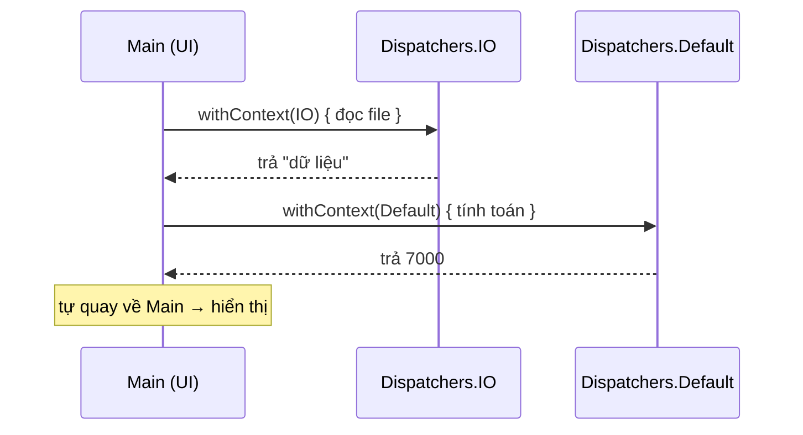

# Dispatcher

!!! tip "Hiểu trong 1 câu"
    **Dispatcher** chọn **nhóm thread** sẽ chạy coroutine: `Main` cho giao diện, `IO` cho việc chờ (mạng, file, database), `Default` cho việc tính toán nặng. **`withContext(…)`** nhảy sang nhóm khác để làm một việc, xong thì tự quay về chỗ cũ.

## Hình dung

Một ngân hàng có 3 loại quầy:

| Quầy | Dispatcher | Số nhân viên | Việc |
|---|---|---|---|
| Quầy tiếp khách | `Main` | **1** người | Vẽ UI, nhận cú bấm. Bận lâu là khách xếp hàng, app bị đứng |
| Quầy chờ giấy tờ | `IO` | rất nhiều (mặc định tới 64) | Gọi mạng, đọc file, database: phần lớn thời gian là ngồi chờ |
| Quầy kế toán | `Default` | bằng số nhân CPU | Sort, parse JSON lớn, xử lý ảnh |



Người gọi chỉ viết `val data = loadFromDisk()` như một hàm bình thường. Việc nhảy qua quầy khác rồi quay về được giấu bên trong hàm.

## Mini demo

```kotlin
// Dispatcher = chọn "quầy" (nhóm thread) để chạy code
//   Main    → quầy giao diện (Android/iOS), chỉ 1 thread, không được làm việc nặng
//   IO      → quầy chờ: mạng, file, database
//   Default → quầy tính toán nặng: sort, parse JSON lớn
import kotlinx.coroutines.*

// In ra coroutine đang ở dispatcher nào
suspend fun where(): String {
    val d = currentCoroutineContext()[CoroutineDispatcher].toString()
    return if ("BlockingEventLoop" in d) "runBlocking" else d
}

suspend fun loadFromDisk(): String = withContext(Dispatchers.IO) {
    println("  đọc file ở: ${where()}")
    delay(100)
    "dữ liệu"
}

suspend fun crunch(data: String): Int = withContext(Dispatchers.Default) {
    println("  tính toán ở: ${where()}")
    data.length * 1_000
}

fun main() = runBlocking<Unit> {       // Playground không có Main thật → runBlocking đóng vai "thread UI"
    println("bắt đầu ở: ${where()} (thread ${Thread.currentThread().name})")
    val data = loadFromDisk()          // nhảy sang IO…
    val score = crunch(data)           // …sang Default…
    println("quay về: ${where()} (thread ${Thread.currentThread().name}) → hiển thị $score")   // …rồi tự quay về chỗ cũ
}
```

[▶ Chạy thử][d-dispatcher]

Output:

```text
bắt đầu ở: runBlocking (thread main @coroutine#1)
  đọc file ở: Dispatchers.IO
  tính toán ở: Dispatchers.Default
quay về: runBlocking (thread main @coroutine#1) → hiển thị 7000
```

## Đọc từng dòng

| Code | Nghĩa |
|---|---|
| `withContext(Dispatchers.IO) { … }` | Chạy khối này ở quầy IO, chờ xong, trả kết quả của dòng cuối |
| `currentCoroutineContext()[CoroutineDispatcher]` | Hỏi "coroutine này đang chạy ở quầy nào" |
| `runBlocking` | Ở Playground không có thread UI thật, nên `runBlocking` (thread `main`) đóng vai thread UI |
| Dòng "quay về: runBlocking" | Sau `withContext`, code tự trở về đúng dispatcher ban đầu, không cần gọi lại gì |

## Hay nhầm

- **Gọi mạng trên Main.** Android ném `NetworkOnMainThreadException`. Thư viện tốt (Ktor, Room, SQLDelight với coroutines) đã tự chuyển sang thread khác bên trong, nên bạn chỉ cần tự `withContext` khi gọi code chặn (blocking).
- **Cập nhật UI từ IO.** Trên iOS, thay đổi UI ngoài main thread có thể crash. Hãy để `withContext` tự quay về, đừng sửa state UI bên trong khối `withContext(IO)`.
- **IO và Default dùng chung thread.** Nếu in tên thread, cả hai đều ra `DefaultDispatcher-worker-N`. Chúng dùng chung một nhóm thread, chỉ khác nhau ở **giới hạn** số việc chạy cùng lúc. Vì vậy demo in tên dispatcher, không in tên thread.
- **`Dispatchers.IO` không có ở mọi target.** Android và iOS có, nhưng Kotlin/JS thì không. DevicePulse dùng `Dispatchers.Default` trong code chung nên không phải bận tâm chuyện này.

## Tự kiểm tra

??? question "Hàm sort 1 triệu phần tử nên chạy ở dispatcher nào?"
    `Dispatchers.Default`, vì đây là việc tốn CPU, không phải việc chờ.

??? question "Sau `withContext(IO) { … }`, dòng code tiếp theo chạy ở đâu?"
    Ở dispatcher **trước** khi gọi `withContext`, thường là Main.

## Gặp ở đâu trong repo

- [`HistoryRepository.kt`](https://github.com/tucarmd/kotlin-multi-platform/blob/main/DevicePulse/shared/src/commonMain/kotlin/dev/devicepulse/data/HistoryRepository.kt): `withContext(Dispatchers.Default) { insert(state) }`. Ghi SQLite là việc chặn, nên đẩy khỏi thread UI.

## Nguồn

- [Coroutine context and dispatchers](https://kotlinlang.org/docs/coroutine-context-and-dispatchers.html)
- [Dispatchers.IO (API)](https://kotlinlang.org/api/kotlinx.coroutines/kotlinx-coroutines-core/kotlinx.coroutines/-dispatchers/-i-o.html)

[d-dispatcher]: ../playground/index.html#code=Ly8gRGlzcGF0Y2hlciA9IGNo4buNbiAicXXhuqd5IiAobmjDs20gdGhyZWFkKSDEkeG7gyBjaOG6oXkgY29kZQovLyAgIE1haW4gICAg4oaSIHF14bqneSBnaWFvIGRp4buHbiAoQW5kcm9pZC9pT1MpLCBjaOG7iSAxIHRocmVhZCwga2jDtG5nIMSRxrDhu6NjIGzDoG0gdmnhu4djIG7hurduZwovLyAgIElPICAgICAg4oaSIHF14bqneSBjaOG7nTogbeG6oW5nLCBmaWxlLCBkYXRhYmFzZQovLyAgIERlZmF1bHQg4oaSIHF14bqneSB0w61uaCB0b8OhbiBu4bq3bmc6IHNvcnQsIHBhcnNlIEpTT04gbOG7m24KaW1wb3J0IGtvdGxpbnguY29yb3V0aW5lcy4qCgovLyBJbiByYSBjb3JvdXRpbmUgxJFhbmcg4bufIGRpc3BhdGNoZXIgbsOgbwpzdXNwZW5kIGZ1biB3aGVyZSgpOiBTdHJpbmcgewogICAgdmFsIGQgPSBjdXJyZW50Q29yb3V0aW5lQ29udGV4dCgpW0Nvcm91dGluZURpc3BhdGNoZXJdLnRvU3RyaW5nKCkKICAgIHJldHVybiBpZiAoIkJsb2NraW5nRXZlbnRMb29wIiBpbiBkKSAicnVuQmxvY2tpbmciIGVsc2UgZAp9CgpzdXNwZW5kIGZ1biBsb2FkRnJvbURpc2soKTogU3RyaW5nID0gd2l0aENvbnRleHQoRGlzcGF0Y2hlcnMuSU8pIHsKICAgIHByaW50bG4oIiAgxJHhu41jIGZpbGUg4bufOiAke3doZXJlKCl9IikKICAgIGRlbGF5KDEwMCkKICAgICJk4buvIGxp4buHdSIKfQoKc3VzcGVuZCBmdW4gY3J1bmNoKGRhdGE6IFN0cmluZyk6IEludCA9IHdpdGhDb250ZXh0KERpc3BhdGNoZXJzLkRlZmF1bHQpIHsKICAgIHByaW50bG4oIiAgdMOtbmggdG_DoW4g4bufOiAke3doZXJlKCl9IikKICAgIGRhdGEubGVuZ3RoICogMV8wMDAKfQoKZnVuIG1haW4oKSA9IHJ1bkJsb2NraW5nPFVuaXQ-IHsgICAgICAgLy8gUGxheWdyb3VuZCBraMO0bmcgY8OzIE1haW4gdGjhuq10IOKGkiBydW5CbG9ja2luZyDEkcOzbmcgdmFpICJ0aHJlYWQgVUkiCiAgICBwcmludGxuKCJi4bqvdCDEkeG6p3Ug4bufOiAke3doZXJlKCl9ICh0aHJlYWQgJHtUaHJlYWQuY3VycmVudFRocmVhZCgpLm5hbWV9KSIpCiAgICB2YWwgZGF0YSA9IGxvYWRGcm9tRGlzaygpICAgICAgICAgIC8vIG5o4bqjeSBzYW5nIElP4oCmCiAgICB2YWwgc2NvcmUgPSBjcnVuY2goZGF0YSkgICAgICAgICAgIC8vIOKApnNhbmcgRGVmYXVsdOKApgogICAgcHJpbnRsbigicXVheSB24buBOiAke3doZXJlKCl9ICh0aHJlYWQgJHtUaHJlYWQuY3VycmVudFRocmVhZCgpLm5hbWV9KSDihpIgaGnhu4NuIHRo4buLICRzY29yZSIpICAgLy8g4oCmcuG7k2kgdOG7sSBxdWF5IHbhu4EgY2jhu5cgY8WpCn0K
