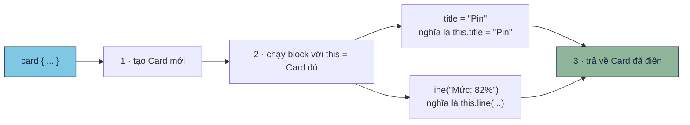

# Extension & lambda có receiver

!!! tip "Hiểu trong 1 câu"
    **Extension** gắn thêm hàm cho một class có sẵn mà không cần sửa class đó. **Lambda có receiver** là lambda chạy "bên trong" một object: trong lambda, `this` chính là object đó. Compose, Gradle `build.gradle.kts` và Ktor đều được xây trên kiểu lambda này.

## Hình dung

- **Extension** giống như dán thêm một nút lên cái máy có sẵn. Máy vẫn vậy, nhưng giờ bấm được thêm `"xin chào".shout()`.
- **Lambda có receiver** giống như đưa cho thợ một tờ việc rồi đẩy thợ **vào trong phòng**. Ở trong phòng, thợ cứ nói "sơn tường", "treo tranh" mà không cần nói "sơn tường *của phòng này*".



## Mini demo

```kotlin
// Extension = gắn thêm hàm cho class có sẵn
// Lambda có receiver = lambda mà bên trong "this" là một object → nền của DSL (Compose, Gradle)

fun String.shout(): String = uppercase() + "!"          // this = chuỗi đang gọi

class Card {
    var title = ""
    val lines = mutableListOf<String>()
    fun line(text: String) { lines += text }
}

// block: Card.() -> Unit  =  "đoạn code chạy BÊN TRONG một Card"
fun card(block: Card.() -> Unit): Card {
    val c = Card()
    c.block()                                           // chạy block với this = c
    return c
}

fun main() {
    println("xin chào".shout())

    val battery = card {
        title = "Pin"                                    // = this.title
        line("Mức: 82%")                                 // = this.line(...)
        line("Đang sạc")
    }
    println("${battery.title} → ${battery.lines}")

    // Cùng một việc, viết kiểu "bình thường" (không DSL):
    val same = Card()
    same.title = "Pin"; same.line("Mức: 82%"); same.line("Đang sạc")
    println("${same.title} → ${same.lines}")
}
```

[▶ Chạy thử][d-receiver]

Output (hai cách viết cho cùng kết quả):

```text
XIN CHÀO!
Pin → [Mức: 82%, Đang sạc]
Pin → [Mức: 82%, Đang sạc]
```

## Đọc từng dòng

| Code | Nghĩa |
|---|---|
| `fun String.shout()` | Extension cho `String`. Trong thân hàm, `this` là chuỗi đang gọi, nên `uppercase()` nghĩa là `this.uppercase()` |
| `block: Card.() -> Unit` | Kiểu "lambda có receiver": một hàm chạy **trên** một `Card`, không có tham số, không trả về gì |
| `c.block()` | Chạy `block` với `this = c` |
| `card { title = "Pin" }` | Trailing lambda (xem [Lambda](lambda.md)). Bên trong, `title` chính là `this.title` của Card vừa tạo |

So sánh hai kiểu lambda:

| Kiểu | Trong lambda gọi object là | Ví dụ |
|---|---|---|
| `(Card) -> Unit` | `it` | `list.forEach { println(it.title) }` |
| `Card.() -> Unit` | `this` (có thể bỏ, không cần viết) | `card { title = "Pin" }`, `Column { Text("A") }` |

## Hay nhầm

- **Extension không sửa class và không override được.** Nó chỉ là hàm bình thường được viết cho dễ gọi. Hàm nào được gọi là do **kiểu khai báo** của biến quyết định. Xem [bẫy 2.10](../reference/kotlin-pitfalls.md#210-extension-function-khong-override-duoc).
- **`this` trong lambda lồng nhau.** Trong `card { … }` nằm bên trong một class khác, `this` là Card. Muốn chỉ object bên ngoài thì viết `this@TênClass`.
- **Gradle không có gì bí ẩn.** `android { defaultConfig { minSdk = 24 } }` là các hàm nhận lambda có receiver lồng vào nhau. `minSdk = 24` chính là `this.minSdk = 24` trên object cấu hình.

## Tự kiểm tra

??? question "Viết extension `Int.isEven()` trả về `true` nếu là số chẵn."
    `fun Int.isEven() = this % 2 == 0`. Gọi: `4.isEven()`.

??? question "Trong `Column { Text("A") }`, lambda thuộc kiểu nào?"
    Lambda có receiver: `ColumnScope.() -> Unit`. Nhờ vậy bên trong gọi được những hàm chỉ có trong `ColumnScope`, như `Modifier.weight(...)`.

## Gặp ở đâu trong repo

- Mọi file `build.gradle.kts` (`kotlin { sourceSets { … } }`).
- [`Models.kt`](https://github.com/tucarmd/kotlin-multi-platform/blob/main/DevicePulse/shared/src/commonMain/kotlin/dev/devicepulse/model/Models.kt): `fun <T : Any> Reading<T>.valueOrNull()` là extension lấy giá trị khi đã có kết quả.
- Mọi màn Compose: `Column { … }`, `Row { … }`, `LazyColumn { … }`.

## Nguồn

- [Extensions](https://kotlinlang.org/docs/extensions.html)
- [Function literals with receiver](https://kotlinlang.org/docs/lambdas.html#function-literals-with-receiver)
- [Type-safe builders](https://kotlinlang.org/docs/type-safe-builders.html)

[d-receiver]: ../playground/index.html#code=Ly8gRXh0ZW5zaW9uID0gZ-G6r24gdGjDqm0gaMOgbSBjaG8gY2xhc3MgY8OzIHPhurVuCi8vIExhbWJkYSBjw7MgcmVjZWl2ZXIgPSBsYW1iZGEgbcOgIGLDqm4gdHJvbmcgInRoaXMiIGzDoCBt4buZdCBvYmplY3Qg4oaSIG7hu4FuIGPhu6dhIERTTCAoQ29tcG9zZSwgR3JhZGxlKQoKZnVuIFN0cmluZy5zaG91dCgpOiBTdHJpbmcgPSB1cHBlcmNhc2UoKSArICIhIiAgICAgICAgICAvLyB0aGlzID0gY2h14buXaSDEkWFuZyBn4buNaQoKY2xhc3MgQ2FyZCB7CiAgICB2YXIgdGl0bGUgPSAiIgogICAgdmFsIGxpbmVzID0gbXV0YWJsZUxpc3RPZjxTdHJpbmc-KCkKICAgIGZ1biBsaW5lKHRleHQ6IFN0cmluZykgeyBsaW5lcyArPSB0ZXh0IH0KfQoKLy8gYmxvY2s6IENhcmQuKCkgLT4gVW5pdCAgPSAgIsSRb-G6oW4gY29kZSBjaOG6oXkgQsOKTiBUUk9ORyBt4buZdCBDYXJkIgpmdW4gY2FyZChibG9jazogQ2FyZC4oKSAtPiBVbml0KTogQ2FyZCB7CiAgICB2YWwgYyA9IENhcmQoKQogICAgYy5ibG9jaygpICAgICAgICAgICAgICAgICAgICAgICAgICAgICAgICAgICAgICAgICAgIC8vIGNo4bqheSBibG9jayB24bubaSB0aGlzID0gYwogICAgcmV0dXJuIGMKfQoKZnVuIG1haW4oKSB7CiAgICBwcmludGxuKCJ4aW4gY2jDoG8iLnNob3V0KCkpCgogICAgdmFsIGJhdHRlcnkgPSBjYXJkIHsKICAgICAgICB0aXRsZSA9ICJQaW4iICAgICAgICAgICAgICAgICAgICAgICAgICAgICAgICAgICAgLy8gPSB0aGlzLnRpdGxlCiAgICAgICAgbGluZSgiTeG7qWM6IDgyJSIpICAgICAgICAgICAgICAgICAgICAgICAgICAgICAgICAgLy8gPSB0aGlzLmxpbmUoLi4uKQogICAgICAgIGxpbmUoIsSQYW5nIHPhuqFjIikKICAgIH0KICAgIHByaW50bG4oIiR7YmF0dGVyeS50aXRsZX0g4oaSICR7YmF0dGVyeS5saW5lc30iKQoKICAgIC8vIEPDuW5nIG3hu5l0IHZp4buHYywgdmnhur90IGtp4buDdSAiYsOsbmggdGjGsOG7nW5nIiAoa2jDtG5nIERTTCk6CiAgICB2YWwgc2FtZSA9IENhcmQoKQogICAgc2FtZS50aXRsZSA9ICJQaW4iOyBzYW1lLmxpbmUoIk3hu6ljOiA4MiUiKTsgc2FtZS5saW5lKCLEkGFuZyBz4bqhYyIpCiAgICBwcmludGxuKCIke3NhbWUudGl0bGV9IOKGkiAke3NhbWUubGluZXN9IikKfQo
