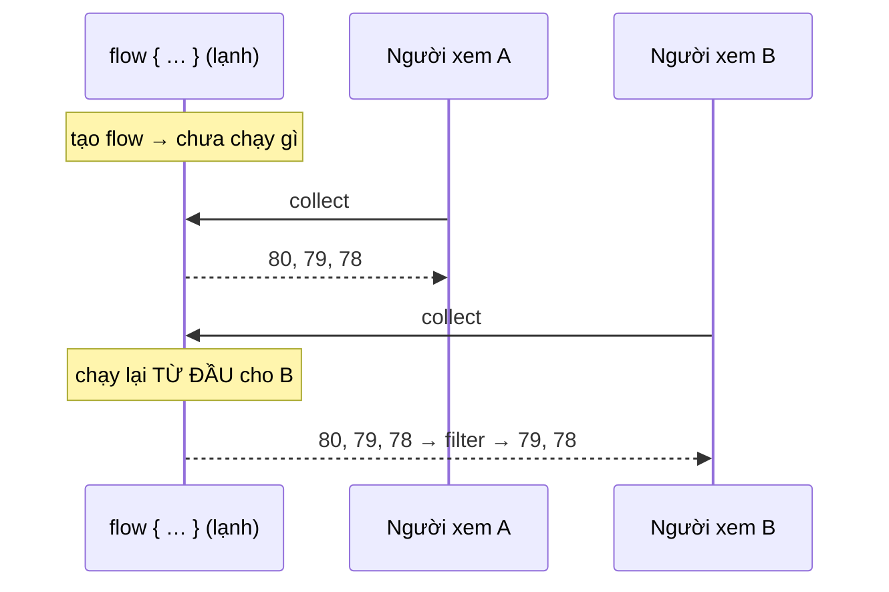
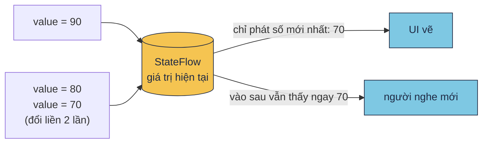
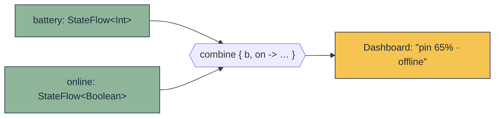

# Flow & StateFlow

!!! tip "Hiểu trong 1 câu"
    **Flow** là một dòng giá trị đến **theo thời gian** (pin 80, 79, 78…), khác với `List` là có sẵn tất cả cùng lúc. **Flow lạnh** chỉ chạy khi có người nghe, và mỗi người nghe lại từ đầu. **StateFlow** là Flow nóng, luôn giữ **một giá trị hiện tại**, ai nhìn vào cũng thấy số mới nhất.

## Hình dung

| | Ví von | Có giá trị khi chưa ai nghe? | Người nghe mới thấy gì? |
|---|---|---|---|
| `List` | Album ảnh: có sẵn hết | Có, tất cả | Tất cả |
| `Flow` (lạnh) | **Video theo yêu cầu**: ai bấm xem thì video mới phát, mỗi người xem từ đầu | Không, chưa chạy gì | Phát lại **từ đầu** |
| `StateFlow` (nóng) | **Bảng tỉ số trên sân**: lúc nào cũng hiện một con số | Có, luôn có một giá trị | **Giá trị mới nhất**, ngay lập tức |





## Mini demo 1: Flow lạnh

```kotlin
// Flow lạnh = video theo yêu cầu: ai bấm xem mới bắt đầu phát, mỗi người xem từ đầu
import kotlinx.coroutines.*
import kotlinx.coroutines.flow.*

fun batteryLevels(): Flow<Int> = flow {
    println("  (bắt đầu đọc cảm biến)")
    for (level in listOf(80, 79, 78)) {
        delay(100)
        emit(level)                      // phát 1 giá trị cho người đang xem
    }
}

fun main() = runBlocking<Unit> {
    val levels = batteryLevels()         // chưa chạy gì cả — mới chỉ là "công thức"
    println("đã tạo flow, chưa có gì chạy")

    println("người xem A:")
    levels.collect { println("  A thấy $it%") }

    println("người xem B (dùng toán tử):")
    levels
        .filter { it < 80 }
        .map { "$it% ${if (it < 79) "🔴" else "🟢"}" }
        .collect { println("  B thấy $it") }
}
```

[▶ Chạy thử][d-flow]

Output: dòng `(bắt đầu đọc cảm biến)` in **2 lần**, mỗi người xem một lần. Còn lúc mới tạo flow thì chưa có gì chạy.

```text
đã tạo flow, chưa có gì chạy
người xem A:
  (bắt đầu đọc cảm biến)
  A thấy 80%
  A thấy 79%
  A thấy 78%
người xem B (dùng toán tử):
  (bắt đầu đọc cảm biến)
  B thấy 79% 🟢
  B thấy 78% 🔴
```

## Mini demo 2: StateFlow và `combine`

```kotlin
// StateFlow = bảng tỉ số trên sân: luôn có 1 giá trị, ai nhìn cũng thấy số MỚI NHẤT
import kotlinx.coroutines.*
import kotlinx.coroutines.flow.*

fun main() = runBlocking<Unit> {
    val battery = MutableStateFlow(100)            // bắt buộc có giá trị ban đầu

    val ui = launch {
        battery.collect { println("  UI vẽ: $it%") }
    }
    delay(10)

    battery.value = 90; delay(10)                  // UI kịp thấy 90
    battery.value = 80
    battery.value = 70; delay(10)                  // đổi liền 2 lần → UI chỉ thấy 70 (mới nhất)
    battery.value = 70; delay(10)                  // giá trị không đổi → UI không vẽ lại

    println("người mới nhìn vào thấy ngay: ${battery.value}%")

    // combine: ghép nhiều nguồn thành 1 trạng thái màn hình (giống PulseMonitor của DevicePulse)
    val online = MutableStateFlow(true)
    val dashboard = combine(battery, online) { b, on -> "pin $b% · ${if (on) "online" else "offline"}" }
    val screen = launch { dashboard.collect { println("  Dashboard: $it") } }
    delay(10)
    online.value = false; delay(10)
    battery.value = 65; delay(10)

    ui.cancel(); screen.cancel()
}
```

[▶ Chạy thử][d-stateflow]

Output: UI **không** vẽ số 80 (bị số 70 đè lên trước khi kịp vẽ), và gán lại 70 lần nữa thì cũng không vẽ lại.

```text
  UI vẽ: 100%
  UI vẽ: 90%
  UI vẽ: 70%
người mới nhìn vào thấy ngay: 70%
  Dashboard: pin 70% · online
  Dashboard: pin 70% · offline
  UI vẽ: 65%
  Dashboard: pin 65% · offline
```

`combine` ghép nhiều nguồn thành **một** trạng thái màn hình. Bất kỳ nguồn nào đổi thì màn hình được tính lại:



## Đọc từng dòng

| Code | Nghĩa |
|---|---|
| `flow { emit(x) }` | Công thức tạo dòng giá trị. `emit` là phát một giá trị cho người đang nghe |
| `.filter { }`, `.map { }` | Toán tử giống của `List`, nhưng chạy trên từng giá trị khi nó tới |
| `.collect { }` | "Bấm xem": bắt đầu chạy flow và nhận từng giá trị. Đây là hàm `suspend` |
| `MutableStateFlow(100)` | StateFlow sửa được, bắt buộc có giá trị ban đầu |
| `battery.value = 90` | Đặt giá trị mới; mọi người đang nghe sẽ nhận được |
| `combine(a, b) { … }` | Ghép nhiều flow; chạy lại lambda mỗi khi một nguồn đổi |

## Hay nhầm

- **Tạo `flow { … }` xong tưởng nó đã chạy.** Chưa, phải `collect` thì mới chạy. Ngược lại, mỗi lần `collect` là chạy lại từ đầu, nên một flow gọi mạng sẽ gọi mạng **nhiều lần** nếu có nhiều người nghe. Dùng `stateIn` để biến nó thành StateFlow dùng chung.
- **Dùng StateFlow làm hàng đợi sự kiện.** StateFlow bỏ qua giá trị trung gian và giá trị trùng (demo 2). Sự kiện xảy ra một lần (hiện toast, điều hướng) không hợp với StateFlow.
- **Để lộ `MutableStateFlow` ra ngoài.** Giữ `private val _state = MutableStateFlow(…)` và chỉ đưa ra `val state: StateFlow<…>`, để UI chỉ đọc được, không sửa được.
- **`collect` không bao giờ kết thúc với StateFlow.** Code nằm sau `stateFlow.collect { }` sẽ không chạy. Vì vậy demo 2 phải `launch` riêng rồi `cancel()`.

## Tự kiểm tra

??? question "Trong demo 1, thêm người xem C. Dòng `(bắt đầu đọc cảm biến)` in ra mấy lần?"
    3 lần. Flow lạnh chạy lại cho mỗi người nghe.

??? question "Gán `battery.value = 70` khi giá trị đang là 70. UI có vẽ lại không?"
    Không. StateFlow chỉ phát khi giá trị **khác** giá trị cũ (so bằng `==`).

??? question "ViewModel nên đưa trạng thái màn hình lên UI bằng Flow hay StateFlow?"
    StateFlow. UI luôn cần một giá trị để vẽ ngay, kể cả khi vừa xoay màn hình xong.

## Gặp ở đâu trong repo

- [`PulseMonitor.kt`](https://github.com/tucarmd/kotlin-multi-platform/blob/main/apps/DevicePulse/shared/src/commonMain/kotlin/dev/devicepulse/core/PulseMonitor.kt): `combine(battery.observe(), location…, network.observe(), latency) { … }.stateIn(scope, SharingStarted.WhileSubscribed(5_000), DashboardState())`. Đây đúng là demo 2 nhưng với 4 nguồn; `WhileSubscribed(5_000)` tắt cảm biến 5 giây sau khi không còn ai nhìn màn hình.
- [`IosBatterySensor.kt`](https://github.com/tucarmd/kotlin-multi-platform/blob/main/apps/DevicePulse/shared/src/iosMain/kotlin/dev/devicepulse/sensor/IosBatterySensor.kt): `callbackFlow` biến thông báo pin của iOS thành Flow.
- `NotesCore.kt` (Pocket Notes), `RatesCore.kt` (Rate Watch), `TipCore.kt` (Tip Split): core nào cũng đưa ra một `StateFlow` duy nhất cho màn hình.

## Nguồn

- [Asynchronous Flow](https://kotlinlang.org/docs/flow.html)
- [StateFlow and SharedFlow (Android)](https://developer.android.com/kotlin/flow/stateflow-and-sharedflow)

[d-flow]: ../playground/index.html#code=Ly8gRmxvdyBs4bqhbmggPSB2aWRlbyB0aGVvIHnDqnUgY-G6p3U6IGFpIGLhuqVtIHhlbSBt4bubaSBi4bqvdCDEkeG6p3UgcGjDoXQsIG3hu5dpIG5nxrDhu51pIHhlbSB04burIMSR4bqndQppbXBvcnQga290bGlueC5jb3JvdXRpbmVzLioKaW1wb3J0IGtvdGxpbnguY29yb3V0aW5lcy5mbG93LioKCmZ1biBiYXR0ZXJ5TGV2ZWxzKCk6IEZsb3c8SW50PiA9IGZsb3cgewogICAgcHJpbnRsbigiICAoYuG6r3QgxJHhuqd1IMSR4buNYyBj4bqjbSBiaeG6v24pIikKICAgIGZvciAobGV2ZWwgaW4gbGlzdE9mKDgwLCA3OSwgNzgpKSB7CiAgICAgICAgZGVsYXkoMTAwKQogICAgICAgIGVtaXQobGV2ZWwpICAgICAgICAgICAgICAgICAgICAgIC8vIHBow6F0IDEgZ2nDoSB0cuG7iyBjaG8gbmfGsOG7nWkgxJFhbmcgeGVtCiAgICB9Cn0KCmZ1biBtYWluKCkgPSBydW5CbG9ja2luZzxVbml0PiB7CiAgICB2YWwgbGV2ZWxzID0gYmF0dGVyeUxldmVscygpICAgICAgICAgLy8gY2jGsGEgY2jhuqF5IGfDrCBj4bqjIOKAlCBt4bubaSBjaOG7iSBsw6AgImPDtG5nIHRo4bupYyIKICAgIHByaW50bG4oIsSRw6MgdOG6oW8gZmxvdywgY2jGsGEgY8OzIGfDrCBjaOG6oXkiKQoKICAgIHByaW50bG4oIm5nxrDhu51pIHhlbSBBOiIpCiAgICBsZXZlbHMuY29sbGVjdCB7IHByaW50bG4oIiAgQSB0aOG6pXkgJGl0JSIpIH0KCiAgICBwcmludGxuKCJuZ8aw4budaSB4ZW0gQiAoZMO5bmcgdG_DoW4gdOG7rSk6IikKICAgIGxldmVscwogICAgICAgIC5maWx0ZXIgeyBpdCA8IDgwIH0KICAgICAgICAubWFwIHsgIiRpdCUgJHtpZiAoaXQgPCA3OSkgIvCflLQiIGVsc2UgIvCfn6IifSIgfQogICAgICAgIC5jb2xsZWN0IHsgcHJpbnRsbigiICBCIHRo4bqleSAkaXQiKSB9Cn0K
[d-stateflow]: ../playground/index.html#code=Ly8gU3RhdGVGbG93ID0gYuG6o25nIHThu4kgc-G7kSB0csOqbiBzw6JuOiBsdcO0biBjw7MgMSBnacOhIHRy4buLLCBhaSBuaMOsbiBjxaluZyB0aOG6pXkgc-G7kSBN4buaSSBOSOG6pFQKaW1wb3J0IGtvdGxpbnguY29yb3V0aW5lcy4qCmltcG9ydCBrb3RsaW54LmNvcm91dGluZXMuZmxvdy4qCgpmdW4gbWFpbigpID0gcnVuQmxvY2tpbmc8VW5pdD4gewogICAgdmFsIGJhdHRlcnkgPSBNdXRhYmxlU3RhdGVGbG93KDEwMCkgICAgICAgICAgICAvLyBi4bqvdCBideG7mWMgY8OzIGdpw6EgdHLhu4sgYmFuIMSR4bqndQoKICAgIHZhbCB1aSA9IGxhdW5jaCB7CiAgICAgICAgYmF0dGVyeS5jb2xsZWN0IHsgcHJpbnRsbigiICBVSSB24bq9OiAkaXQlIikgfQogICAgfQogICAgZGVsYXkoMTApCgogICAgYmF0dGVyeS52YWx1ZSA9IDkwOyBkZWxheSgxMCkgICAgICAgICAgICAgICAgICAvLyBVSSBr4buLcCB0aOG6pXkgOTAKICAgIGJhdHRlcnkudmFsdWUgPSA4MAogICAgYmF0dGVyeS52YWx1ZSA9IDcwOyBkZWxheSgxMCkgICAgICAgICAgICAgICAgICAvLyDEkeG7lWkgbGnhu4FuIDIgbOG6p24g4oaSIFVJIGNo4buJIHRo4bqleSA3MCAobeG7m2kgbmjhuqV0KQogICAgYmF0dGVyeS52YWx1ZSA9IDcwOyBkZWxheSgxMCkgICAgICAgICAgICAgICAgICAvLyBnacOhIHRy4buLIGtow7RuZyDEkeG7lWkg4oaSIFVJIGtow7RuZyB24bq9IGzhuqFpCgogICAgcHJpbnRsbigibmfGsOG7nWkgbeG7m2kgbmjDrG4gdsOgbyB0aOG6pXkgbmdheTogJHtiYXR0ZXJ5LnZhbHVlfSUiKQoKICAgIC8vIGNvbWJpbmU6IGdow6lwIG5oaeG7gXUgbmd14buTbiB0aMOgbmggMSB0cuG6oW5nIHRow6FpIG3DoG4gaMOsbmggKGdp4buRbmcgUHVsc2VNb25pdG9yIGPhu6dhIERldmljZVB1bHNlKQogICAgdmFsIG9ubGluZSA9IE11dGFibGVTdGF0ZUZsb3codHJ1ZSkKICAgIHZhbCBkYXNoYm9hcmQgPSBjb21iaW5lKGJhdHRlcnksIG9ubGluZSkgeyBiLCBvbiAtPiAicGluICRiJSDCtyAke2lmIChvbikgIm9ubGluZSIgZWxzZSAib2ZmbGluZSJ9IiB9CiAgICB2YWwgc2NyZWVuID0gbGF1bmNoIHsgZGFzaGJvYXJkLmNvbGxlY3QgeyBwcmludGxuKCIgIERhc2hib2FyZDogJGl0IikgfSB9CiAgICBkZWxheSgxMCkKICAgIG9ubGluZS52YWx1ZSA9IGZhbHNlOyBkZWxheSgxMCkKICAgIGJhdHRlcnkudmFsdWUgPSA2NTsgZGVsYXkoMTApCgogICAgdWkuY2FuY2VsKCk7IHNjcmVlbi5jYW5jZWwoKQp9Cg
