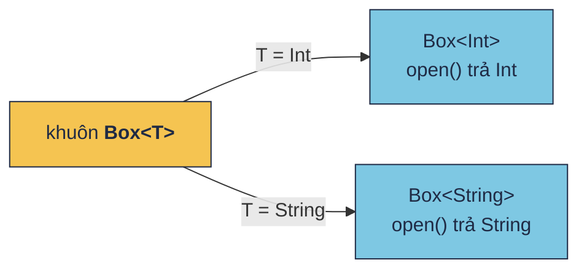
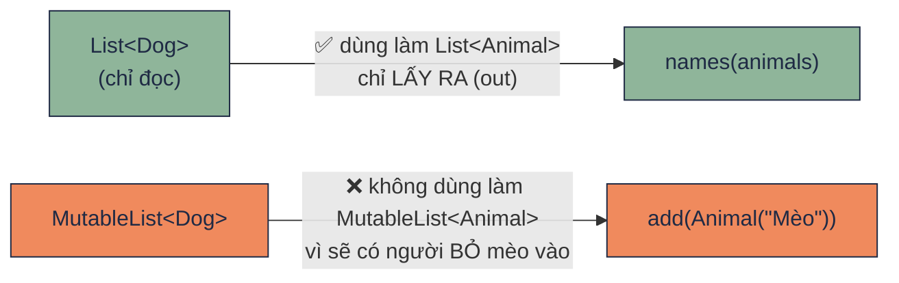

# Generics

!!! tip "Hiểu trong 1 câu"
    **Generic** là viết code một lần, dùng cho nhiều kiểu: `<T>` là một chỗ trống, người dùng điền kiểu vào. **`out T`** nghĩa là "chỉ lấy T ra", **`in T`** nghĩa là "chỉ bỏ T vào".

## Hình dung

`Box<T>` là cái khuôn hộp có chừa chỗ dán nhãn. Dán `Int` thì ra hộp số, dán `String` thì ra hộp chữ. Compiler đọc nhãn, nên biết chắc thứ lấy ra là gì, không cần ép kiểu.



**`out` và `in`.** Một rổ chó (`List<Dog>`) đưa cho người chỉ muốn *lấy* con vật ra thì không sao, vì lấy ra con nào cũng là `Animal`. Nhưng đưa cho người được *bỏ vào* (`MutableList<Animal>`) thì họ có thể bỏ một con mèo vào rổ chó.



| Viết | Đọc là | Ví dụ trong thư viện chuẩn |
|---|---|---|
| `<T>` | dùng được cả lấy ra lẫn bỏ vào | `MutableList<T>` |
| `<out T>` | chỉ **lấy ra** (producer) | `List<out E>`, `Flow<out T>` |
| `<in T>` | chỉ **bỏ vào** (consumer) | `Comparator<in T>` |
| `<*>` | "kiểu gì đó, không cần biết" | `List<*>` |

## Mini demo

```kotlin
// Generic = viết 1 lần, dùng cho nhiều kiểu. <T> là "chỗ trống cho kiểu"
class Box<T>(val item: T) {
    fun open(): T = item
}

fun <T> firstOr(list: List<T>, fallback: T): T = list.firstOrNull() ?: fallback

open class Animal(val name: String)
class Dog(name: String) : Animal(name)

// out = hộp chỉ để LẤY RA → List<Dog> dùng được ở chỗ cần List<Animal>
fun names(animals: List<Animal>) = animals.map { it.name }

fun main() {
    val a = Box(42)              // Box<Int>
    val b = Box("cà phê")        // Box<String>
    println(a.open() + 1)        // 43 — biết chắc là Int
    println(b.open().uppercase())

    println(firstOr(listOf<Int>(), -1))
    println(firstOr(listOf("a", "b"), "?"))

    val dogs: List<Dog> = listOf(Dog("Mực"), Dog("Vàng"))
    println(names(dogs))         // OK vì List là List<out E>

    val mutableDogs: MutableList<Dog> = mutableListOf(Dog("Mực"))
    // val animals: MutableList<Animal> = mutableDogs   ← lỗi compile:
    // nếu được thì ai đó có thể add(Animal("Mèo")) vào list chó
    println(mutableDogs.size)
}
```

[▶ Chạy thử][d-generics]

Output:

```text
43
CÀ PHÊ
-1
a
[Mực, Vàng]
1
```

## Đọc từng dòng

| Code | Nghĩa |
|---|---|
| `class Box<T>(val item: T)` | Class có một chỗ trống kiểu tên `T` |
| `Box(42)` | Kotlin tự suy ra `T = Int`, không cần viết `Box<Int>(42)` |
| `fun <T> firstOr(list: List<T>, fallback: T): T` | **Hàm** generic: `<T>` đứng trước tên hàm |
| `names(dogs)` | Được, vì `List` khai báo là `List<out E>` |
| `MutableList<Animal> = mutableDogs` | Lỗi compile, vì `MutableList<E>` vừa lấy ra vừa bỏ vào |

## Hay nhầm

- **Không cần tự viết `in`/`out` ngay từ đầu.** Người mới chỉ cần đọc hiểu. Gặp lỗi "type mismatch" khi truyền `List<Dog>` vào chỗ cần `MutableList<Animal>` thì nhớ lại sơ đồ rổ chó.
- **Khi chạy, kiểu generic bị xoá.** Trên JVM không viết được `if (x is List<String>)`. Phải dùng hàm `inline` với `reified T`. Xem [hạn chế ở phụ lục](../reference/kotlin-pitfalls.md#3-han-che-cua-kotlin).
- **`T : Any` nghĩa là T không được null.** `Reading<out T : Any>` trong DevicePulse cấm viết `Reading<String?>`.
- **`Nothing`** là kiểu "không bao giờ có giá trị". Vì `Reading` là `out T`, nên `Reading<Nothing>` dùng được ở mọi chỗ cần `Reading<BatteryInfo>`. Nhờ vậy `Loading` chỉ cần một object dùng chung cho mọi loại cảm biến.

## Tự kiểm tra

??? question "`Box("a").open().length` có compile không?"
    Có. `T = String` nên `open()` trả `String`, và `String` có `length`.

??? question "Vì sao `Flow<out T>` có `out`?"
    Vì Flow chỉ phát giá trị ra cho người nghe, không bao giờ nhận vào. Nhờ vậy `Flow<Dog>` dùng được ở chỗ cần `Flow<Animal>`.

## Gặp ở đâu trong repo

- [`Models.kt`](https://github.com/tucarmd/kotlin-multi-platform/blob/main/apps/DevicePulse/shared/src/commonMain/kotlin/dev/devicepulse/model/Models.kt): `sealed class Reading<out T : Any>`, với `Loading : Reading<Nothing>`. Dùng đủ `out`, `T : Any` và `Nothing` trong 5 dòng.
- `StateFlow<DashboardState>`, `List<Snapshot>`: mọi collection và Flow đều là generic.

## Nguồn

- [Generics: in, out, where](https://kotlinlang.org/docs/generics.html)

[d-generics]: ../playground/index.html#code=Ly8gR2VuZXJpYyA9IHZp4bq_dCAxIGzhuqduLCBkw7luZyBjaG8gbmhp4buBdSBraeG7g3UuIDxUPiBsw6AgImNo4buXIHRy4buRbmcgY2hvIGtp4buDdSIKY2xhc3MgQm94PFQ-KHZhbCBpdGVtOiBUKSB7CiAgICBmdW4gb3BlbigpOiBUID0gaXRlbQp9CgpmdW4gPFQ-IGZpcnN0T3IobGlzdDogTGlzdDxUPiwgZmFsbGJhY2s6IFQpOiBUID0gbGlzdC5maXJzdE9yTnVsbCgpID86IGZhbGxiYWNrCgpvcGVuIGNsYXNzIEFuaW1hbCh2YWwgbmFtZTogU3RyaW5nKQpjbGFzcyBEb2cobmFtZTogU3RyaW5nKSA6IEFuaW1hbChuYW1lKQoKLy8gb3V0ID0gaOG7mXAgY2jhu4kgxJHhu4MgTOG6pFkgUkEg4oaSIExpc3Q8RG9nPiBkw7luZyDEkcaw4bujYyDhu58gY2jhu5cgY-G6p24gTGlzdDxBbmltYWw-CmZ1biBuYW1lcyhhbmltYWxzOiBMaXN0PEFuaW1hbD4pID0gYW5pbWFscy5tYXAgeyBpdC5uYW1lIH0KCmZ1biBtYWluKCkgewogICAgdmFsIGEgPSBCb3goNDIpICAgICAgICAgICAgICAvLyBCb3g8SW50PgogICAgdmFsIGIgPSBCb3goImPDoCBwaMOqIikgICAgICAgIC8vIEJveDxTdHJpbmc-CiAgICBwcmludGxuKGEub3BlbigpICsgMSkgICAgICAgIC8vIDQzIOKAlCBiaeG6v3QgY2jhuq9jIGzDoCBJbnQKICAgIHByaW50bG4oYi5vcGVuKCkudXBwZXJjYXNlKCkpCgogICAgcHJpbnRsbihmaXJzdE9yKGxpc3RPZjxJbnQ-KCksIC0xKSkKICAgIHByaW50bG4oZmlyc3RPcihsaXN0T2YoImEiLCAiYiIpLCAiPyIpKQoKICAgIHZhbCBkb2dzOiBMaXN0PERvZz4gPSBsaXN0T2YoRG9nKCJN4buxYyIpLCBEb2coIlbDoG5nIikpCiAgICBwcmludGxuKG5hbWVzKGRvZ3MpKSAgICAgICAgIC8vIE9LIHbDrCBMaXN0IGzDoCBMaXN0PG91dCBFPgoKICAgIHZhbCBtdXRhYmxlRG9nczogTXV0YWJsZUxpc3Q8RG9nPiA9IG11dGFibGVMaXN0T2YoRG9nKCJN4buxYyIpKQogICAgLy8gdmFsIGFuaW1hbHM6IE11dGFibGVMaXN0PEFuaW1hbD4gPSBtdXRhYmxlRG9ncyAgIOKGkCBs4buXaSBjb21waWxlOgogICAgLy8gbuG6v3UgxJHGsOG7o2MgdGjDrCBhaSDEkcOzIGPDsyB0aOG7gyBhZGQoQW5pbWFsKCJNw6hvIikpIHbDoG8gbGlzdCBjaMOzCiAgICBwcmludGxuKG11dGFibGVEb2dzLnNpemUpCn0K
