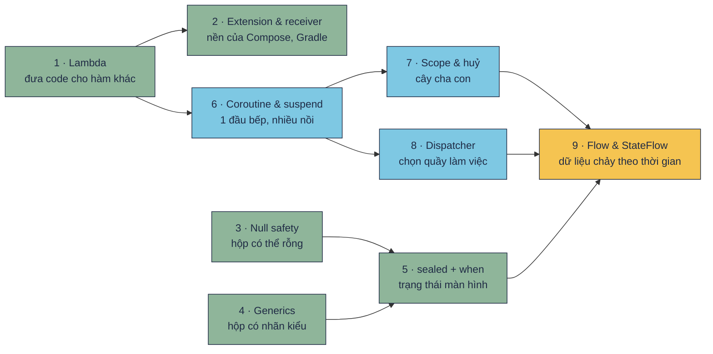

# Khái niệm khó, hiểu trong 5 phút

Mấy chữ nghe "hàn lâm" như *coroutine*, *lambda có receiver*, *generic `out`*, *Flow lạnh* thật ra đều mô tả những việc rất đời thường. Mỗi trang ở đây giải thích **một** khái niệm theo cùng một khung:

| Phần | Để làm gì |
|---|---|
| **Hiểu trong 1 câu** | Đọc xong câu này là nắm được ý chính |
| **Hình dung** | Một ví von đời thường kèm sơ đồ: nhìn là hiểu |
| **Mini demo** | Code ngắn, có link **▶ Chạy thử** mở thẳng trong [Playground](../playground/index.html), kèm output thật |
| **Đọc từng dòng** | Giải thích những dòng quan trọng |
| **Hay nhầm** | Những chỗ người mới hay hiểu sai |
| **Tự kiểm tra** | Vài câu hỏi, bấm để xem đáp án |
| **Gặp ở đâu trong repo** | Chỉ ra đúng file code thật đang dùng khái niệm đó |

Output in trong các trang là kết quả **chạy thật** trên Kotlin 2.4.21. Demo coroutine có in mốc thời gian (`[300 ms]`) để bạn nhìn thấy cái gì chạy cùng lúc, cái gì phải chờ.

## Học theo thứ tự nào

- **Màu xanh lá** là nền cú pháp. Nên đọc trước [bài 4](../lessons/04-share-code.md).
- **Màu xanh dương** là coroutine. Nên đọc trước [bài 8](../lessons/08-viewmodel-navigation.md) và [bài 11](../lessons/11-network.md).
- **Màu vàng** là Flow, chỗ mọi thứ gặp nhau. ViewModel của mọi app trong repo đều đưa trạng thái lên UI bằng `StateFlow`.

## 9 khái niệm

| # | Khái niệm | Hiểu trong 1 câu |
|---|---|---|
| 1 | [Lambda & hàm bậc cao](lambda.md) | Cất một đoạn code vào biến rồi đưa cho hàm khác chạy |
| 2 | [Extension & lambda có receiver](extension-receiver.md) | Gắn thêm hàm cho class có sẵn; chạy một đoạn code "bên trong" một object |
| 3 | [Null safety](null-safety.md) | Kiểu có `?` là hộp có thể rỗng, phải mở ra kiểm tra trước khi dùng |
| 4 | [Generics](generics.md) | Viết một lần, dùng cho nhiều kiểu; `out` là chỉ lấy ra, `in` là chỉ bỏ vào |
| 5 | [sealed + when](sealed-when.md) | Danh sách trạng thái đóng, compiler nhắc khi bạn quên xử lý một trường hợp |
| 6 | [Coroutine & suspend](coroutines.md) | Một thread làm nhiều việc bằng cách tạm dừng việc đang chờ để làm việc khác |
| 7 | [Scope, huỷ và lỗi](structured-concurrency.md) | Coroutine con sống trong cha: huỷ cha thì huỷ hết con |
| 8 | [Dispatcher](dispatchers.md) | Chọn nhóm thread để chạy: UI, chờ mạng/file, hay tính toán nặng |
| 9 | [Flow & StateFlow](flow.md) | Dòng giá trị theo thời gian; StateFlow là bảng tỉ số luôn hiện số mới nhất |

Bẫy đã gặp khi dùng các khái niệm này (tràn số, `!!`, nuốt lệnh huỷ…) nằm ở [Phụ lục: Kotlin khó gì, bẫy gì](../reference/kotlin-pitfalls.md).
