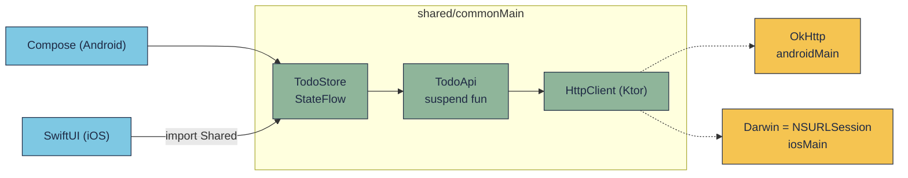

# Viết code shared: luật KMP + một Ktor service từ đầu

!!! tip "Hiểu trong 1 câu"
    Code trong `commonMain` được biên dịch ra **hai thứ khác nhau** (bytecode JVM cho Android, mã máy cho iOS), nên nó
    chỉ được dùng Kotlin thuần + thư viện multiplatform, phần riêng thì đẩy xuống `androidMain` / `iosMain`, và mọi
    hàm public phải "dễ gọi" từ **cả Kotlin lẫn Swift**.

## Hình dung

`shared/` giống một ổ cắm chuẩn: bên trong viết một lần, hai đầu cắm vào là app Android (Kotlin) và app iOS (Swift).
Mỗi đầu nhìn ổ cắm theo một kiểu khác nhau, nên thiết kế cái ổ phải nghĩ cho cả hai.



## Luật khi viết code `shared`

| Tính năng / luật | Ý nghĩa khi viết code |
|---|---|
| **Source set** `commonMain` · `androidMain` · `iosMain` | `commonMain` chỉ thấy Kotlin thuần + thư viện multiplatform. Gọi `Context` hay `UIDevice` thì xuống `androidMain` / `iosMain` ([bài 3](../lessons/03-project-structure.md)). |
| **Không có Java** trong `commonMain` | Không có `String.format`, `java.util.UUID`, `System.currentTimeMillis()`, `SimpleDateFormat`. Dùng `kotlin.time`, `kotlinx-datetime`, `padStart`… |
| **`expect` / `actual`** | Khai báo ở `commonMain`, mỗi nền tảng viết thân. Hợp với chỗ nhỏ (tên máy, phân loại lỗi mạng). Chỗ lớn dùng **interface + DI** cho dễ test ([bài 4](../lessons/04-share-code.md)). |
| **Thư viện multiplatform** | Ktor, kotlinx.serialization, coroutines / Flow, SQLDelight, Koin, kotlinx-io. **Engine** của Ktor khác mỗi bên: OkHttp (Android), Darwin = `NSURLSession` (iOS). |
| **Kotlin/Native gọi thẳng API Apple** | Trong `iosMain` viết `import platform.UIKit.UIDevice` được ngay, không cần Swift. |
| **Swift nhìn Kotlin qua Objective-C** | `suspend` → `async` (có SKIE) hoặc completion handler · `Flow` → `AsyncSequence` (SKIE) · `sealed class` → enum để `switch` (SKIE) · `Int` → `Int32`, `Long` → `Int64` · `List<T>` lồng trong generic → mảng mất kiểu · **không có tham số mặc định** · exception không khai `@Throws` → **app crash**. |
| **`commonTest`** | Test viết một lần, chạy trên JVM **và** iOS simulator. |

Hệ quả cho thiết kế: **service không ném exception ra ngoài**, mà trả về một `sealed class` kết quả; Kotlin `when`, Swift `switch`.

## Ví dụ từ đầu: `TodoApi` bằng Ktor

API thử: `jsonplaceholder.typicode.com/todos`. Toàn bộ code dưới đây đã được **biên dịch và chạy test** (5/5 xanh trên
JVM và iOS simulator, phần Swift build bằng Xcode với SKIE 0.10) trên bộ phiên bản của repo: Kotlin 2.4, Ktor 3.5.1,
kotlinx.serialization 1.11.

### 1. Gradle: thư viện đặt đúng source set

```kotlin
// shared/build.gradle.kts
plugins {
    alias(libs.plugins.kotlinMultiplatform)
    alias(libs.plugins.androidLibrary)
    alias(libs.plugins.kotlinSerialization)   // cần cho @Serializable
    alias(libs.plugins.skie)                  // Swift: async/await, switch enum, Flow
}

kotlin {
    sourceSets {
        commonMain.dependencies {
            implementation(libs.ktor.client.core)
            implementation(libs.ktor.client.content.negotiation)
            implementation(libs.ktor.serialization.kotlinx.json)
            implementation(libs.kotlinx.coroutines.core)
        }
        androidMain.dependencies { implementation(libs.ktor.client.okhttp) }   // engine Android
        iosMain.dependencies { implementation(libs.ktor.client.darwin) }       // engine iOS
        commonTest.dependencies {
            implementation(kotlin("test"))
            implementation(libs.ktor.client.mock)          // server giả, không cần mạng
            implementation(libs.kotlinx.coroutines.test)
        }
    }
}
```

`HttpClient { }` không truyền engine thì Ktor tự lấy engine có trên classpath của nền tảng đó: code chung không cần biết
mình đang chạy Android hay iOS.

### 2. Model, kết quả và một `expect` (`commonMain`)

```kotlin
// shared/src/commonMain/kotlin/dev/demo/todo/Todo.kt
@Serializable
data class Todo(
    val id: Int = 0,
    val userId: Int = 1,
    val title: String,
    val completed: Boolean = false,
)

/** Service không ném lỗi ra ngoài: mọi kết cục là một nhánh ở đây. */
sealed class ApiResult<out T : Any> {               // sealed CLASS để Swift giữ được kiểu T
    data class Ok<out T : Any>(val value: T) : ApiResult<T>()
    data class HttpError(val status: Int) : ApiResult<Nothing>()
    data class NetworkError(val message: String) : ApiResult<Nothing>()
}

expect fun platformName(): String
```

=== "androidMain"

    ```kotlin
    actual fun platformName(): String = "Android ${android.os.Build.VERSION.SDK_INT}"
    ```

=== "iosMain"

    ```kotlin
    import platform.UIKit.UIDevice                 // Kotlin gọi thẳng UIKit

    actual fun platformName(): String =
        UIDevice.currentDevice.systemName() + " " + UIDevice.currentDevice.systemVersion
    ```

Thiếu `actual` ở nền tảng nào thì build nền tảng đó đỏ ngay, không có chuyện quên một bên.

### 3. HttpClient + service (`commonMain`)

```kotlin
// shared/src/commonMain/kotlin/dev/demo/todo/TodoApi.kt
fun createHttpClient(engine: HttpClientEngine? = null): HttpClient {
    val config: HttpClientConfig<*>.() -> Unit = {
        expectSuccess = false                                    // 404 / 500 KHÔNG ném exception
        install(ContentNegotiation) { json(Json { ignoreUnknownKeys = true }) }
        install(HttpTimeout) { requestTimeoutMillis = 10_000 }
        defaultRequest {
            url("https://jsonplaceholder.typicode.com/")
            header("X-Platform", platformName())                 // expect / actual ở trên
        }
    }
    return if (engine == null) HttpClient(config) else HttpClient(engine, config)
}

interface TodoApi {
    suspend fun list(limit: Int): ApiResult<List<Todo>>
    suspend fun get(id: Int): ApiResult<Todo>
    suspend fun create(title: String): ApiResult<Todo>
}

class KtorTodoApi(private val client: HttpClient) : TodoApi {

    override suspend fun list(limit: Int) = call<List<Todo>> {
        client.get("todos") { parameter("_limit", limit) }
    }

    override suspend fun get(id: Int) = call<Todo> { client.get("todos/$id") }

    override suspend fun create(title: String) = call<Todo> {
        client.post("todos") {
            contentType(ContentType.Application.Json)
            setBody(Todo(title = title))                         // object → JSON tự động
        }
    }

    /** Một chỗ duy nhất đổi response / exception thành ApiResult. */
    private suspend inline fun <reified T : Any> call(request: () -> HttpResponse): ApiResult<T> =
        try {
            val res = request()
            if (res.status.isSuccess()) ApiResult.Ok(res.body<T>()) else ApiResult.HttpError(res.status.value)
        } catch (e: CancellationException) {
            throw e                                              // màn hình đóng → để coroutine dừng
        } catch (e: Exception) {
            ApiResult.NetworkError(e.message ?: e::class.simpleName.orEmpty())
        }
}

/** Cho Swift: Swift không có tham số mặc định, nên đưa sẵn một hàm tạo. */
fun todoApi(): TodoApi = KtorTodoApi(createHttpClient())
```

### 4. State dùng chung cho hai UI (`commonMain`)

```kotlin
// shared/src/commonMain/kotlin/dev/demo/todo/TodoStore.kt
data class TodoUiState(
    val loading: Boolean = false,
    val todos: List<Todo> = emptyList(),
    val error: String? = null,
)

class TodoStore(private val api: TodoApi, private val scope: CoroutineScope) {
    private val _state = MutableStateFlow(TodoUiState())
    val state: StateFlow<TodoUiState> = _state.asStateFlow()

    fun refresh() {
        if (_state.value.loading) return
        _state.update { it.copy(loading = true, error = null) }
        scope.launch {
            when (val r = api.list(limit = 10)) {
                is ApiResult.Ok -> _state.update { it.copy(loading = false, todos = r.value) }
                is ApiResult.HttpError -> _state.update { it.copy(loading = false, error = "HTTP ${r.status}") }
                is ApiResult.NetworkError -> _state.update { it.copy(loading = false, error = r.message) }
            }
        }
    }

    fun add(title: String) {
        scope.launch {
            val r = api.create(title)
            if (r is ApiResult.Ok) _state.update { it.copy(todos = listOf(r.value) + it.todos) }
        }
    }

    fun close() = scope.cancel()
}

/** Cho Swift: Swift không tự tạo CoroutineScope được. */
fun todoStore(): TodoStore = TodoStore(todoApi(), MainScope())
```

`TodoStore` nhận `scope` từ ngoài: Android đưa `viewModelScope`, iOS đưa `MainScope()` rồi tự `close()`, test đưa scope
của bộ lập lịch test. Lõi không phụ thuộc vòng đời của nền tảng nào (cùng ý với `PulseMonitor` ở [bài 8](../lessons/08-viewmodel-navigation.md)).

### 5. Gọi từ mỗi nền tảng

=== "Android · Kotlin"

    ```kotlin
    class TodoViewModel : ViewModel() {
        val store = TodoStore(KtorTodoApi(createHttpClient()), viewModelScope)
    }

    @Composable
    fun TodoScreen(vm: TodoViewModel = viewModel()) {
        val state by vm.store.state.collectAsStateWithLifecycle()
        LaunchedEffect(Unit) { vm.store.refresh() }
        LazyColumn { items(state.todos) { Text(it.title) } }
    }

    // Gọi thẳng một hàm suspend của service:
    lifecycleScope.launch {
        when (val r = api.get(1)) {
            is ApiResult.Ok -> println(r.value.title)
            else -> println("lỗi: $r")
        }
    }
    ```

=== "iOS · Swift (có SKIE)"

    ```swift
    import Shared

    // Gọi thẳng hàm suspend: SKIE biến nó thành async
    func todoDemo() async throws {
        let api = todoApi()
        let result = try await api.get(id: 1)           // Kotlin get(id: Int) → Swift get(id: Int32)
        switch onEnum(of: result) {                     // sealed class → enum, thiếu nhánh là lỗi build
        case .ok(let ok):           print(ok.value.title)
        case .httpError(let e):     print("HTTP \(e.status)")
        case .networkError(let e):  print(e.message)
        }
        // List<Todo> nằm trong generic → sang Swift chỉ còn NSArray, phải ép kiểu
        let all = try await api.list(limit: 10)
        if case .ok(let ok) = onEnum(of: all), let todos = ok.value as? [Todo] { print(todos.count) }
    }

    // Cho màn hình: đọc state chung qua StateFlow
    @MainActor @Observable
    final class TodoModel {
        private(set) var state = TodoUiState(loading: false, todos: [], error: nil)
        private let store = todoStore()

        init() {
            Task { [weak self, store] in
                for await s in store.state { self?.state = s }   // StateFlow → AsyncSequence
            }
        }
        func refresh() { store.refresh() }
        func add(_ title: String) { store.add(title: title) }
    }
    ```

Cùng một hàm, nhìn từ hai phía (kiểm theo header `Shared.h` thật):

| Kotlin khai báo | Android gọi | Swift có SKIE | Swift không SKIE |
|---|---|---|---|
| `suspend fun get(id: Int): ApiResult<Todo>` | `api.get(1)` trong coroutine | `try await api.get(id: 1)` | `api.get(id: 1) { result, error in … }` |
| `suspend fun list(limit: Int): ApiResult<List<Todo>>` | `api.list(10)` → `List<Todo>` | `try await api.list(limit: 10)` rồi `value as? [Todo]` | như trên, `value` là `NSArray` |
| `val state: StateFlow<TodoUiState>` | `collectAsStateWithLifecycle()` | `for await s in store.state` | tự viết collector + callback |
| `sealed class ApiResult` | `when (r)` | `switch onEnum(of: r)` | `if let ok = r as? ApiResultOk` |
| `fun todoApi()` (top-level) | `todoApi()` | `todoApi()` | `TodoApiKt.todoApi()` |
| tham số mặc định `= 10` | dùng được | **không có**, phải truyền đủ | không có |

Vì sao Swift phải `try` dù service không ném? Hàm `suspend` nào sang Swift cũng là `throws` (coroutine có thể bị huỷ).
Nhưng chỉ `CancellationException` được chuyển thành lỗi Swift; exception khác không khai `@Throws(Exception::class)`
thì **app crash**. Vì thế `call()` bắt hết và trả `ApiResult`.

### 6. Test một lần, chạy hai nền tảng (`commonTest`)

```kotlin
class KtorTodoApiTest {
    private val json = headersOf(HttpHeaders.ContentType, "application/json")

    private fun api(status: HttpStatusCode, body: String) = KtorTodoApi(
        createHttpClient(MockEngine { respond(body, status, json) })
    )

    @Test fun listParsesJson() = runTest {
        val r = api(HttpStatusCode.OK, """[{"id":1,"userId":1,"title":"Học KMP","completed":false}]""").list(10)
        assertEquals("Học KMP", (r as ApiResult.Ok).value.first().title)
    }

    @Test fun server500IsHttpError() = runTest {
        assertEquals(ApiResult.HttpError(500), api(HttpStatusCode.InternalServerError, "").get(1))
    }

    @Test fun brokenConnectionIsNetworkError() = runTest {
        val r = KtorTodoApi(createHttpClient(MockEngine { error("offline") })).get(1)
        assertIs<ApiResult.NetworkError>(r)
    }

    @Test fun createSendsJsonAndPlatformHeader() = runTest {
        var sent = ""
        var platform = ""
        val api = KtorTodoApi(createHttpClient(MockEngine { req ->
            sent = req.body.toByteArray().decodeToString()
            platform = req.headers["X-Platform"].orEmpty()
            respond("""{"id":201,"userId":1,"title":"Viết test","completed":false}""", HttpStatusCode.Created, json)
        }))
        val r = api.create("Viết test")
        assertEquals(201, (r as ApiResult.Ok).value.id)
        assertTrue("\"title\":\"Viết test\"" in sent, sent)
        assertTrue(platform.isNotBlank())
    }

    @Test fun storeLoadsList() = runTest {
        val scope = CoroutineScope(SupervisorJob() + StandardTestDispatcher(testScheduler))
        val store = TodoStore(api(HttpStatusCode.OK, """[{"id":1,"title":"A"},{"id":2,"title":"B"}]"""), scope)
        store.refresh()
        assertTrue(store.state.value.loading)
        val done = store.state.first { !it.loading }   // Ktor trả lời trên thread riêng → chờ state
        assertEquals(listOf("A", "B"), done.todos.map { it.title })
        store.close()
    }
}
```

```bash
./gradlew :shared:testDebugUnitTest :shared:iosSimulatorArm64Test   # cùng 5 test, chạy trên JVM rồi iOS
```

## Đọc từng dòng

- `expectSuccess = false`: Ktor 2+ mặc định đã là `false` (4xx/5xx không ném), ghi rõ ra để không ai bật `true` rồi 404 rơi nhầm vào nhánh `NetworkError`. `call()` tự đổi mã lỗi thành `HttpError`.
- `install(ContentNegotiation) { json(...) }` + `@Serializable`: `res.body<T>()` và `setBody(todo)` tự đổi JSON ↔ object,
  giống nhau trên cả hai engine. `ignoreUnknownKeys` để server thêm trường mới không làm app vỡ.
- `suspend inline fun <reified T>`: `reified` giữ được kiểu `T` lúc chạy, nên `body<List<Todo>>()` biết parse thành list.
- `catch (e: CancellationException) { throw e }` **trước** `catch (e: Exception)`: nếu nuốt nó, huỷ coroutine sẽ không dừng được.
- `fun todoApi()` / `fun todoStore()`: hàm tạo không tham số dành cho Swift (không có tham số mặc định, không tạo được `CoroutineScope`).

## Hay nhầm

- **Ném exception từ hàm public** → bên Swift crash, không phải lỗi bắt được. Trả `sealed class` thay vì ném.
- **`sealed interface` cho kết quả** → Swift mất kiểu generic (`any ApiResult`). Dùng `sealed class` khi có generic.
- **Mong `List<Todo>` sang Swift là `[Todo]`** → chỉ đúng khi nó đứng một mình; nằm trong generic (`ApiResult<List<Todo>>`) thì thành `NSArray`, phải `as? [Todo]`.
- **`advanceUntilIdle()` để đợi Ktor** → không đợi được: `MockEngine` / engine thật trả lời trên thread riêng, không theo thời gian ảo. Chờ state đổi (`state.first { … }`) như test cuối.
- **Đặt chữ hiển thị vào `shared/`** → mỗi UI có cơ chế đa ngôn ngữ riêng ([bài 7](../lessons/07-resources.md)); `shared/` chỉ trả giá trị.
- **Gọi `runBlocking` trên main thread iOS** để "chờ cho xong" → treo UI. Dùng `async` / `Task` bên Swift.

## Tự kiểm tra

??? question "Đổi thành `expectSuccess = true`, server trả 404. `get(1)` trả về gì?"
    `NetworkError`: Ktor ném `ClientRequestException`, rơi vào `catch (e: Exception)`. Để `false` thì mới ra `HttpError(404)` đúng nghĩa.

??? question "Bên Swift, `api.get(id: 1)` nhận `Int` hay `Int32`? Vì sao?"
    `Int32`. Kotlin `Int` luôn 32 bit; qua Objective-C thành `int32_t`. Swift `Int` là 64 bit nên không tự khớp.

??? question "Vì sao `TodoStore` nhận `scope` qua constructor thay vì tự kế thừa `ViewModel`?"
    Để lõi không phụ thuộc Android: Android đưa `viewModelScope`, iOS đưa `MainScope()`, test đưa scope của bộ lập lịch test. Cùng một class chạy được cả ba nơi.

??? question "Xoá `actual fun platformName()` trong `iosMain`. Chuyện gì xảy ra?"
    Build iOS báo lỗi thiếu `actual` ngay lúc biên dịch; build Android vẫn xanh. KMP không cho quên một nền tảng mà không biết.

## Gặp ở đâu trong repo

- [KtorApiService.kt](https://github.com/tucarmd/kotlin-multi-platform/blob/main/apps/NativeDeviceMonitor/shared/src/commonMain/kotlin/com/learn/ndmkmp/core/network/KtorApiService.kt) (Native Device Monitor): bản thật cùng ý, tách thêm `Timeout` / `NoNetwork`; phần "mất mạng" là `expect fun platformNetworkErrorKind()` vì Android báo `UnknownHostException`, iOS báo `NSError -1009`.
- [ApiService.kt](https://github.com/tucarmd/kotlin-multi-platform/blob/main/apps/NativeDeviceMonitor/shared/src/commonMain/kotlin/com/learn/ndmkmp/core/network/ApiService.kt): interface + `ApiResult` 5 nhánh, UI chỉ `when` / `switch`.
- [Bài 11: Mạng và đo độ trễ](../lessons/11-network.md) · [App 3: Rate Watch](../apps/03-rate-watch.md): Ktor + kotlinx.serialization + cache offline.

## Nguồn

[Ktor client: multiplatform](https://ktor.io/docs/client-create-multiplatform-application.html) · [Ktor engines](https://ktor.io/docs/client-engines.html) · [Content negotiation](https://ktor.io/docs/client-serialization.html) · [MockEngine](https://ktor.io/docs/client-testing.html) · [Interop với Swift/Objective-C](https://kotlinlang.org/docs/native-objc-interop.html) · [SKIE](https://skie.touchlab.co/) · [Expected and actual declarations](https://kotlinlang.org/docs/multiplatform/multiplatform-expect-actual.html)
