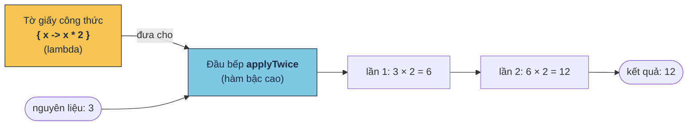

# Lambda & hàm bậc cao

!!! tip "Hiểu trong 1 câu"
    **Lambda** là một đoạn code được cất vào biến. **Hàm bậc cao** là hàm nhận đoạn code đó làm tham số và tự quyết định chạy nó lúc nào, chạy mấy lần.

## Hình dung

Bạn viết công thức "nhân đôi" lên một tờ giấy rồi đưa cho đầu bếp. Đầu bếp (`applyTwice`) không cần biết công thức là gì, chỉ cần làm theo tờ giấy **hai lần**.



Đổi tờ giấy thành `{ it * it }` thì cùng đầu bếp đó cho ra `81`. Phần **cách làm** tách khỏi phần **khi nào làm, làm mấy lần**.

## Mini demo

```kotlin
// Lambda = một đoạn code cất vào biến, đưa cho hàm khác chạy
fun main() {
    // 1. Cất "cách làm" vào biến
    val double: (Int) -> Int = { x -> x * 2 }
    println(double(5))                          // 10

    // 2. Đưa "cách làm" cho hàm khác → hàm bậc cao
    println(applyTwice(3, double))              // 12

    // 3. Lambda đứng cuối thì viết ra ngoài ngoặc (trailing lambda)
    println(applyTwice(3) { x -> x + 10 })      // 23

    // 4. Chỉ có 1 tham số thì gọi bằng it
    println(applyTwice(3) { it * it })          // 81

    // 5. Thư viện chuẩn toàn là hàm bậc cao
    val prices = listOf(45, 120, 30)
    println(prices.map { it * 1000 })           // [45000, 120000, 30000]
    println(prices.filter { it > 40 })          // [45, 120]
}

// Hàm nhận 1 hàm khác làm tham số
fun applyTwice(value: Int, action: (Int) -> Int): Int = action(action(value))
```

[▶ Chạy thử][d-lambda]

Output:

```text
10
12
23
81
[45000, 120000, 30000]
[45, 120]
```

## Đọc từng dòng

| Code | Nghĩa |
|---|---|
| `(Int) -> Int` | **Kiểu** của một hàm: nhận một `Int`, trả về một `Int` |
| `{ x -> x * 2 }` | Lambda: bên trái `->` là tham số, bên phải là thân. Dòng cuối của thân là giá trị trả về, không cần `return` |
| `action: (Int) -> Int` | Tham số `action` là một hàm, nên `applyTwice` là hàm bậc cao |
| `applyTwice(3) { x -> x + 10 }` | Lambda là tham số cuối thì được đưa ra ngoài ngoặc (trailing lambda) |
| `{ it * it }` | Lambda chỉ có một tham số thì không cần đặt tên, gọi bằng `it` |
| `prices.map { it * 1000 }` | `map`, `filter`, `forEach`… của thư viện chuẩn đều là hàm bậc cao |

## Hay nhầm

- **`{ }` của lambda không phải `{ }` của khối lệnh.** `if (ok) { … }` chạy ngay. `val f = { … }` thì chưa chạy, phải gọi `f()` mới chạy.
- **`return` trong lambda.** `return` trần trong lambda của `forEach` thoát luôn hàm bên ngoài. Muốn chỉ thoát lambda thì dùng `return@forEach`. Xem [bẫy 2.7](../reference/kotlin-pitfalls.md#27-return-trong-lambda-thoat-luon-ham-ben-ngoai).
- **`it` lồng nhau.** Hai lambda lồng nhau cùng dùng `it` thì rất khó đọc. Lambda bên ngoài nên đặt tên tham số.
- **Compose cũng là lambda.** `Button(onClick = { … }) { Text("OK") }` có hai lambda: `onClick` là việc cần làm khi bấm, lambda cuối là phần nội dung của nút.

## Tự kiểm tra

??? question "`val f = { println("hi") }` rồi không gọi gì thêm. Màn hình in ra gì?"
    Không in gì. Mới chỉ cất đoạn code vào `f`. Phải gọi `f()` thì mới in.

??? question "`applyTwice(2) { it + 1 }` ra bao nhiêu?"
    `4`. Lần 1: 2 + 1 = 3. Lần 2: 3 + 1 = 4.

??? question "Kiểu của `{ a: Int, b: Int -> a > b }` là gì?"
    `(Int, Int) -> Boolean`: nhận 2 `Int`, trả về `Boolean`.

## Gặp ở đâu trong repo

- Mọi màn Compose: `onClick = { … }`, `LazyColumn { items(list) { … } }`.
- [`PulseMonitor.kt`](https://github.com/tucarmd/kotlin-multi-platform/blob/main/apps/DevicePulse/shared/src/commonMain/kotlin/dev/devicepulse/core/PulseMonitor.kt): `combine(…) { b, l, n, ms -> DashboardState(b, l, n, ms) }`, một lambda nhận 4 tham số và ghép chúng thành trạng thái màn hình.

## Nguồn

- [Higher-order functions and lambdas](https://kotlinlang.org/docs/lambdas.html)

[d-lambda]: ../playground/index.html#code=Ly8gTGFtYmRhID0gbeG7mXQgxJFv4bqhbiBjb2RlIGPhuqV0IHbDoG8gYmnhur9uLCDEkcawYSBjaG8gaMOgbSBraMOhYyBjaOG6oXkKZnVuIG1haW4oKSB7CiAgICAvLyAxLiBD4bqldCAiY8OhY2ggbMOgbSIgdsOgbyBiaeG6v24KICAgIHZhbCBkb3VibGU6IChJbnQpIC0-IEludCA9IHsgeCAtPiB4ICogMiB9CiAgICBwcmludGxuKGRvdWJsZSg1KSkgICAgICAgICAgICAgICAgICAgICAgICAgIC8vIDEwCgogICAgLy8gMi4gxJDGsGEgImPDoWNoIGzDoG0iIGNobyBow6BtIGtow6FjIOKGkiBow6BtIGLhuq1jIGNhbwogICAgcHJpbnRsbihhcHBseVR3aWNlKDMsIGRvdWJsZSkpICAgICAgICAgICAgICAvLyAxMgoKICAgIC8vIDMuIExhbWJkYSDEkeG7qW5nIGN14buRaSB0aMOsIHZp4bq_dCByYSBuZ2_DoGkgbmdv4bq3YyAodHJhaWxpbmcgbGFtYmRhKQogICAgcHJpbnRsbihhcHBseVR3aWNlKDMpIHsgeCAtPiB4ICsgMTAgfSkgICAgICAvLyAyMwoKICAgIC8vIDQuIENo4buJIGPDsyAxIHRoYW0gc-G7kSB0aMOsIGfhu41pIGLhurFuZyBpdAogICAgcHJpbnRsbihhcHBseVR3aWNlKDMpIHsgaXQgKiBpdCB9KSAgICAgICAgICAvLyA4MQoKICAgIC8vIDUuIFRoxrAgdmnhu4duIGNodeG6qW4gdG_DoG4gbMOgIGjDoG0gYuG6rWMgY2FvCiAgICB2YWwgcHJpY2VzID0gbGlzdE9mKDQ1LCAxMjAsIDMwKQogICAgcHJpbnRsbihwcmljZXMubWFwIHsgaXQgKiAxMDAwIH0pICAgICAgICAgICAvLyBbNDUwMDAsIDEyMDAwMCwgMzAwMDBdCiAgICBwcmludGxuKHByaWNlcy5maWx0ZXIgeyBpdCA-IDQwIH0pICAgICAgICAgIC8vIFs0NSwgMTIwXQp9CgovLyBIw6BtIG5o4bqtbiAxIGjDoG0ga2jDoWMgbMOgbSB0aGFtIHPhu5EKZnVuIGFwcGx5VHdpY2UodmFsdWU6IEludCwgYWN0aW9uOiAoSW50KSAtPiBJbnQpOiBJbnQgPSBhY3Rpb24oYWN0aW9uKHZhbHVlKSkK
