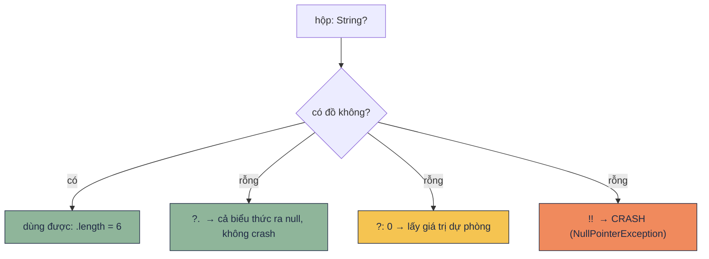

# Null safety

!!! tip "Hiểu trong 1 câu"
    Kiểu có dấu `?` (như `String?`) là **một cái hộp có thể rỗng**. Kotlin không cho dùng đồ bên trong khi chưa kiểm tra hộp, nên lỗi "null" bị bắt ngay lúc compile thay vì làm app crash lúc chạy.

## Hình dung

`String` là chai nước chắc chắn có nước. `String?` là hộp quà, có thể có đồ, có thể rỗng. Kotlin cho bạn 4 cách mở hộp:



| Cách | Viết | Hộp rỗng thì | Dùng khi |
|---|---|---|---|
| Gọi an toàn | `x?.length` | ra `null` | Giá trị null cũng chấp nhận được |
| Elvis | `x?.length ?: 0` | ra giá trị dự phòng | Cần một giá trị chắc chắn |
| Kiểm tra | `if (x != null) x.length` | không vào `if` | Cần làm nhiều việc với `x` |
| Ép | `x!!.length` | **crash** | Gần như không bao giờ |

## Mini demo

```kotlin
// Null safety: kiểu có ? là "hộp có thể rỗng", Kotlin bắt mở hộp trước khi dùng
fun main() {
    val full: String? = "Kotlin"
    val empty: String? = null

    // ?.  → hộp rỗng thì cả biểu thức ra null, không crash
    println(full?.length)            // 6
    println(empty?.length)           // null

    // ?:  → hộp rỗng thì lấy giá trị dự phòng
    println(empty?.length ?: 0)      // 0

    // if (x != null) → bên trong if, Kotlin biết chắc hộp có đồ (smart cast)
    if (full != null) println(full.uppercase())

    // let → chỉ chạy khi hộp có đồ
    empty?.let { println("không in") }
    full?.let { println("có: $it") }

    // Chuỗi người dùng gõ → số: dùng toIntOrNull thay cho toInt
    println("12a".toIntOrNull() ?: "không phải số")

    // !! = "tôi thề không null" → sai thì crash. Bỏ comment để thử:
    // println(empty!!.length)
}
```

[▶ Chạy thử][d-null]

Output:

```text
6
null
0
KOTLIN
có: Kotlin
không phải số
```

## Đọc từng dòng

| Code | Nghĩa |
|---|---|
| `val empty: String? = null` | Có `?` thì mới được gán `null`. `val s: String = null` là lỗi compile |
| `empty?.length` | Hộp rỗng thì dừng và trả `null`. Kiểu kết quả là `Int?` |
| `empty?.length ?: 0` | Bên trái ra `null` thì lấy bên phải. Kiểu kết quả là `Int`, chắc chắn có giá trị |
| `if (full != null) full.uppercase()` | **Smart cast**: bên trong `if`, Kotlin coi `full` là `String`, không còn là `String?` |
| `full?.let { … }` | Chỉ chạy lambda khi có đồ. Trong lambda, `it` là `String` |
| `"12a".toIntOrNull()` | Không đổi được sang số thì trả `null` thay vì ném lỗi như `toInt()` |

## Hay nhầm

- **Thấy lỗi compile liền thêm `!!` cho hết lỗi.** Làm vậy chỉ là dời lỗi từ lúc compile sang lúc chạy, khi app đã nằm trên máy người dùng. Thay bằng `?:` hoặc `if`.
- **Giá trị từ Java không được bảo vệ.** `System.getenv("X")` có kiểu `String!`, Kotlin không bắt kiểm tra. Xem [bẫy 2.4](../reference/kotlin-pitfalls.md#24-kieu-tu-java-lach-null-safety).
- **`var` thuộc tính không smart cast được.** `if (user.name != null) user.name.length` có thể bị báo lỗi, vì giữa hai lần đọc, `name` có thể đã bị đổi. Hãy gán vào một `val` trước: `val n = user.name`.
- **`lateinit` cũng là một kiểu `!!`.** Đọc trước khi gán là crash.

## Tự kiểm tra

??? question "`val n: Int = "abc".toIntOrNull() ?: -1`. `n` bằng bao nhiêu?"
    `-1`. `"abc"` không phải số nên ra `null`, và `?:` lấy `-1`.

??? question "Kiểu của `user?.address?.city` là gì nếu `city` có kiểu `String`?"
    `String?`. Chỉ cần một mắt xích trong chuỗi là `null` thì cả biểu thức ra `null`.

??? question "Vì sao Kotlin không cho `val s: String = null`?"
    Vì `String` (không có `?`) hứa là luôn có giá trị. Nhờ lời hứa đó, mọi chỗ dùng `s.length` đều không cần kiểm tra lại.

## Gặp ở đâu trong repo

- [`PulseMonitor.kt`](https://github.com/tucarmd/kotlin-multi-platform/blob/main/DevicePulse/shared/src/commonMain/kotlin/dev/devicepulse/core/PulseMonitor.kt): `MutableStateFlow<Reading<Long>?>(null)`. Chưa đo độ trễ lần nào thì giá trị là `null`.
- [`HistoryRepository.kt`](https://github.com/tucarmd/kotlin-multi-platform/blob/main/DevicePulse/shared/src/commonMain/kotlin/dev/devicepulse/data/HistoryRepository.kt): `row.connection?.let { … }` chuyển cột có thể null trong database thành enum.
- [Tip Split](../apps/01-tip-split.md): `parseMoney()` trả `Long?` khi người dùng gõ sai.

## Nguồn

- [Null safety](https://kotlinlang.org/docs/null-safety.html)

[d-null]: ../playground/index.html#code=Ly8gTnVsbCBzYWZldHk6IGtp4buDdSBjw7MgPyBsw6AgImjhu5lwIGPDsyB0aOG7gyBy4buXbmciLCBLb3RsaW4gYuG6r3QgbeG7nyBo4buZcCB0csaw4bubYyBraGkgZMO5bmcKZnVuIG1haW4oKSB7CiAgICB2YWwgZnVsbDogU3RyaW5nPyA9ICJLb3RsaW4iCiAgICB2YWwgZW1wdHk6IFN0cmluZz8gPSBudWxsCgogICAgLy8gPy4gIOKGkiBo4buZcCBy4buXbmcgdGjDrCBj4bqjIGJp4buDdSB0aOG7qWMgcmEgbnVsbCwga2jDtG5nIGNyYXNoCiAgICBwcmludGxuKGZ1bGw_Lmxlbmd0aCkgICAgICAgICAgICAvLyA2CiAgICBwcmludGxuKGVtcHR5Py5sZW5ndGgpICAgICAgICAgICAvLyBudWxsCgogICAgLy8gPzogIOKGkiBo4buZcCBy4buXbmcgdGjDrCBs4bqleSBnacOhIHRy4buLIGThu7EgcGjDsm5nCiAgICBwcmludGxuKGVtcHR5Py5sZW5ndGggPzogMCkgICAgICAvLyAwCgogICAgLy8gaWYgKHggIT0gbnVsbCkg4oaSIGLDqm4gdHJvbmcgaWYsIEtvdGxpbiBiaeG6v3QgY2jhuq9jIGjhu5lwIGPDsyDEkeG7kyAoc21hcnQgY2FzdCkKICAgIGlmIChmdWxsICE9IG51bGwpIHByaW50bG4oZnVsbC51cHBlcmNhc2UoKSkKCiAgICAvLyBsZXQg4oaSIGNo4buJIGNo4bqheSBraGkgaOG7mXAgY8OzIMSR4buTCiAgICBlbXB0eT8ubGV0IHsgcHJpbnRsbigia2jDtG5nIGluIikgfQogICAgZnVsbD8ubGV0IHsgcHJpbnRsbigiY8OzOiAkaXQiKSB9CgogICAgLy8gQ2h14buXaSBuZ8aw4budaSBkw7luZyBnw7Ug4oaSIHPhu5E6IGTDuW5nIHRvSW50T3JOdWxsIHRoYXkgY2hvIHRvSW50CiAgICBwcmludGxuKCIxMmEiLnRvSW50T3JOdWxsKCkgPzogImtow7RuZyBwaOG6o2kgc-G7kSIpCgogICAgLy8gISEgPSAidMO0aSB0aOG7gSBraMO0bmcgbnVsbCIg4oaSIHNhaSB0aMOsIGNyYXNoLiBC4buPIGNvbW1lbnQgxJHhu4MgdGjhu606CiAgICAvLyBwcmludGxuKGVtcHR5ISEubGVuZ3RoKQp9Cg
