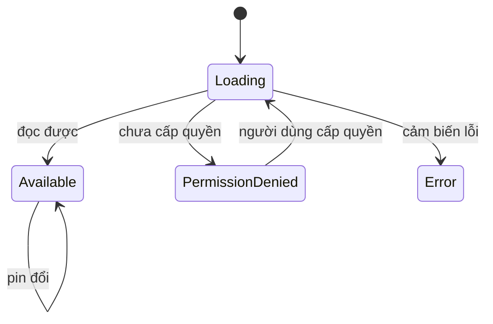

# sealed + when

!!! tip "Hiểu trong 1 câu"
    **`sealed`** khai báo một danh sách trạng thái **đóng**: compiler biết hết mọi trường hợp. **`when`** trên kiểu sealed vì vậy không cần `else`, và quên một trường hợp là lỗi compile chứ không phải bug lúc chạy.

## Hình dung

Đèn giao thông chỉ có đúng 3 màu. Ai làm luật đèn đỏ, đèn vàng, đèn xanh là đủ. Nếu mai có thêm màu tím, compiler sẽ chỉ ra **mọi** chỗ chưa có luật cho màu tím.

Trạng thái đọc pin trong demo:



| Khi đã khai báo | `when` không có `else` | Thêm trạng thái mới |
|---|---|---|
| `enum class` | ✅ | Compiler nhắc. Nhưng mọi trạng thái **không mang dữ liệu riêng** |
| `sealed` | ✅ | Compiler nhắc. Mỗi trạng thái **mang dữ liệu riêng** (`percent`, `message`) |
| `String`, `Int` | ❌ phải có `else` | Không ai nhắc, dễ quên |

## Mini demo

```kotlin
// sealed = danh sách trạng thái ĐÓNG: compiler biết hết mọi trường hợp
sealed interface Reading {
    data object Loading : Reading
    data class Available(val percent: Int) : Reading
    data object PermissionDenied : Reading
    data class Error(val message: String) : Reading
}

// when không cần else: thiếu nhánh nào là lỗi compile
fun render(r: Reading): String = when (r) {
    Reading.Loading -> "⏳ Đang đọc pin…"
    is Reading.Available -> "🔋 ${r.percent}%"        // smart cast → dùng được r.percent
    Reading.PermissionDenied -> "🚫 Chưa cấp quyền"
    is Reading.Error -> "❌ ${r.message}"
}

fun main() {
    val states = listOf(
        Reading.Loading,
        Reading.Available(82),
        Reading.PermissionDenied,
        Reading.Error("Cảm biến lỗi"),
    )
    states.forEach { println(render(it)) }

    // Thử: thêm  data object Unsupported : Reading  vào sealed ở trên rồi Run
    // → compiler chỉ ra đúng chỗ when còn thiếu nhánh.
}
```

[▶ Chạy thử][d-sealed]

Output:

```text
⏳ Đang đọc pin…
🔋 82%
🚫 Chưa cấp quyền
❌ Cảm biến lỗi
```

## Đọc từng dòng

| Code | Nghĩa |
|---|---|
| `sealed interface Reading` | Mọi loại `Reading` phải khai báo trong cùng module và cùng package, nên compiler biết đủ danh sách |
| `data object Loading` | Trạng thái không mang dữ liệu thì chỉ cần **một** object dùng chung |
| `data class Available(val percent: Int)` | Trạng thái mang dữ liệu riêng |
| `when (r) { … }` không có `else` | Thiếu nhánh nào là lỗi compile |
| `is Reading.Available -> r.percent` | Smart cast: trong nhánh này, `r` đã là `Available` nên đọc được `percent` |

## Hay nhầm

- **Thêm `else ->` "cho chắc".** Có `else` thì khi thêm trạng thái mới, compiler **không** nhắc nữa, vì trạng thái mới rơi vào `else` một cách im lặng. Với kiểu sealed, đừng viết `else`.
- **Dùng `Boolean` cho mọi thứ.** `isLoading`, `hasError`, `data` để riêng thì có thể sai cùng lúc (`isLoading = true` và `hasError = true`). Một sealed class bảo đảm mỗi lúc chỉ có **một** trạng thái.
- **`object` và `data object`.** Cả hai đều chỉ có một bản duy nhất. `data object` có thêm `toString()` dễ đọc (`Loading` thay vì `Reading$Loading@1a2b`).

## Tự kiểm tra

??? question "Thêm `data object Unsupported : Reading` thì chuyện gì xảy ra?"
    `render()` báo lỗi compile: `when` thiếu nhánh `Unsupported`. Bấm ▶ Chạy thử ở trên để xem.

??? question "Khi nào dùng `enum` thay cho `sealed`?"
    Khi mọi trường hợp đều không mang dữ liệu riêng và cần duyệt hết danh sách, ví dụ `SensorKind.entries`.

## Gặp ở đâu trong repo

- [`Models.kt`](https://github.com/tucarmd/kotlin-multi-platform/blob/main/apps/DevicePulse/shared/src/commonMain/kotlin/dev/devicepulse/model/Models.kt): `Reading` có 5 trạng thái, và mọi cảm biến đều trả về một trong 5 trạng thái đó.
- [Tip Split](../apps/01-tip-split.md): `SplitResult` có `Waiting`, `Invalid`, `Ready`.
- Phía iOS: nhờ SKIE, Swift `switch` qua `onEnum(of:)` cũng được kiểm tra đủ trường hợp (xem comment trong `Models.kt`).

## Nguồn

- [Sealed classes and interfaces](https://kotlinlang.org/docs/sealed-classes.html)
- [Conditions and loops: when](https://kotlinlang.org/docs/control-flow.html#when-expressions-and-statements)

[d-sealed]: ../playground/index.html#code=Ly8gc2VhbGVkID0gZGFuaCBzw6FjaCB0cuG6oW5nIHRow6FpIMSQw5NORzogY29tcGlsZXIgYmnhur90IGjhur90IG3hu41pIHRyxrDhu51uZyBo4bujcApzZWFsZWQgaW50ZXJmYWNlIFJlYWRpbmcgewogICAgZGF0YSBvYmplY3QgTG9hZGluZyA6IFJlYWRpbmcKICAgIGRhdGEgY2xhc3MgQXZhaWxhYmxlKHZhbCBwZXJjZW50OiBJbnQpIDogUmVhZGluZwogICAgZGF0YSBvYmplY3QgUGVybWlzc2lvbkRlbmllZCA6IFJlYWRpbmcKICAgIGRhdGEgY2xhc3MgRXJyb3IodmFsIG1lc3NhZ2U6IFN0cmluZykgOiBSZWFkaW5nCn0KCi8vIHdoZW4ga2jDtG5nIGPhuqduIGVsc2U6IHRoaeG6v3UgbmjDoW5oIG7DoG8gbMOgIGzhu5dpIGNvbXBpbGUKZnVuIHJlbmRlcihyOiBSZWFkaW5nKTogU3RyaW5nID0gd2hlbiAocikgewogICAgUmVhZGluZy5Mb2FkaW5nIC0-ICLij7MgxJBhbmcgxJHhu41jIHBpbuKApiIKICAgIGlzIFJlYWRpbmcuQXZhaWxhYmxlIC0-ICLwn5SLICR7ci5wZXJjZW50fSUiICAgICAgICAvLyBzbWFydCBjYXN0IOKGkiBkw7luZyDEkcaw4bujYyByLnBlcmNlbnQKICAgIFJlYWRpbmcuUGVybWlzc2lvbkRlbmllZCAtPiAi8J-aqyBDaMawYSBj4bqlcCBxdXnhu4FuIgogICAgaXMgUmVhZGluZy5FcnJvciAtPiAi4p2MICR7ci5tZXNzYWdlfSIKfQoKZnVuIG1haW4oKSB7CiAgICB2YWwgc3RhdGVzID0gbGlzdE9mKAogICAgICAgIFJlYWRpbmcuTG9hZGluZywKICAgICAgICBSZWFkaW5nLkF2YWlsYWJsZSg4MiksCiAgICAgICAgUmVhZGluZy5QZXJtaXNzaW9uRGVuaWVkLAogICAgICAgIFJlYWRpbmcuRXJyb3IoIkPhuqNtIGJp4bq_biBs4buXaSIpLAogICAgKQogICAgc3RhdGVzLmZvckVhY2ggeyBwcmludGxuKHJlbmRlcihpdCkpIH0KCiAgICAvLyBUaOG7rTogdGjDqm0gIGRhdGEgb2JqZWN0IFVuc3VwcG9ydGVkIDogUmVhZGluZyAgdsOgbyBzZWFsZWQg4bufIHRyw6puIHLhu5NpIFJ1bgogICAgLy8g4oaSIGNvbXBpbGVyIGNo4buJIHJhIMSRw7puZyBjaOG7lyB3aGVuIGPDsm4gdGhp4bq_dSBuaMOhbmguCn0K
