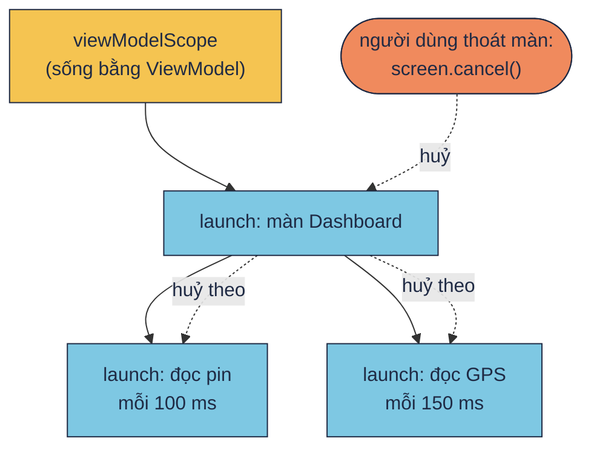
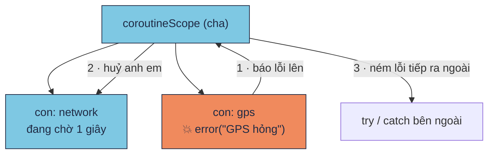

# Scope, huỷ và lỗi (structured concurrency)

!!! tip "Hiểu trong 1 câu"
    Mỗi coroutine sinh ra **bên trong** một scope cha, nên tất cả tạo thành một cây. **Huỷ cha thì huỷ hết con. Một con lỗi thì các anh em dừng theo và lỗi bay lên cha.** Nhờ vậy không có coroutine nào chạy "lạc" sau khi màn hình đã đóng.

## Hình dung

Một chuyến đi tham quan: cô giáo (scope cha) dẫn cả lớp (các coroutine con).

- Cô giáo nói "về thôi" (`cancel()`), thì **cả lớp** cùng về. Không ai bị bỏ lại ở bảo tàng.
- Một bạn bị thương (một coroutine con ném lỗi), thì **cả đoàn** dừng chuyến đi và báo về trường (lỗi bay lên cha).





## Mini demo

```kotlin
// Structured concurrency: coroutine con nằm trong cha, như cây.
// Huỷ cha → huỷ hết con. Một con lỗi → cha và các anh em cũng dừng.
import kotlinx.coroutines.*

fun main() = runBlocking<Unit> {
    // 1. Huỷ cha thì các con dừng theo
    val screen = launch {                         // cha = "màn hình Dashboard"
        launch { repeat(10) { delay(100); println("  pin: đọc lần ${it + 1}") } }
        launch { repeat(10) { delay(150); println("  gps: đọc lần ${it + 1}") } }
    }
    delay(350)
    println("→ người dùng thoát màn hình: screen.cancel()")
    screen.cancel()
    screen.join()
    println("→ không còn con nào chạy\n")

    // 2. Một con lỗi → anh em bị huỷ, lỗi bay lên cha
    try {
        coroutineScope {
            launch {
                try { delay(1_000); println("  không bao giờ in") }
                finally { println("  network: bị huỷ vì anh em lỗi") }
            }
            launch { delay(100); error("GPS hỏng") }
        }
    } catch (e: IllegalStateException) {
        println("→ cha nhận lỗi: ${e.message}")
    }
}
```

[▶ Chạy thử][d-structured]

Output:

```text
  pin: đọc lần 1
  gps: đọc lần 1
  pin: đọc lần 2
  gps: đọc lần 2
  pin: đọc lần 3
→ người dùng thoát màn hình: screen.cancel()
→ không còn con nào chạy

  network: bị huỷ vì anh em lỗi
→ cha nhận lỗi: GPS hỏng
```

- Phần 1: pin đọc được 3 lần, GPS được 2 lần trong 350 ms. Sau `cancel()` thì **không còn dòng nào** được in ra nữa, dù code định lặp 10 lần.
- Phần 2: GPS lỗi ở 100 ms. Coroutine network đang chờ 1 giây bị huỷ ngay, khối `finally` của nó vẫn chạy để dọn dẹp, và lỗi được bắt ở `catch` bên ngoài.

## Đọc từng dòng

| Code | Nghĩa |
|---|---|
| `val screen = launch { launch {…}; launch {…} }` | Hai `launch` bên trong là **con** của `screen` |
| `screen.cancel()` | Huỷ cha, nên mọi con bị huỷ ở lần `delay` tiếp theo |
| `screen.join()` | Chờ cả cây dừng hẳn |
| `coroutineScope { … }` | Mở một scope con, chờ **mọi** con trong đó xong mới đi tiếp. Con lỗi thì nó ném lỗi ra ngoài |
| `finally { … }` | Luôn chạy, kể cả khi bị huỷ. Dùng để đóng file, đóng kết nối |

**Huỷ là "hợp tác".** Coroutine chỉ dừng được ở **điểm tạm dừng** (`delay`, gọi mạng, `yield()`…). Một vòng lặp tính toán dài không có điểm tạm dừng nào thì sẽ không dừng. Trong vòng lặp đó, hãy kiểm tra `ensureActive()`.

## Hay nhầm

- **Dùng `GlobalScope.launch`.** Coroutine đó không có cha, không ai huỷ nó, nên nó chạy tiếp sau khi màn hình đã đóng (rò bộ nhớ, tốn pin). Trong app, dùng `viewModelScope` hoặc scope được truyền vào.
- **`catch (e: Exception)` quanh `delay`.** Làm vậy nuốt luôn lệnh huỷ, và coroutine không dừng được. Xem [bẫy 2.11](../reference/kotlin-pitfalls.md#211-coroutine-catch-e-exception-nuot-lenh-huy).
- **Muốn con lỗi mà anh em vẫn chạy tiếp** (ví dụ GPS hỏng nhưng pin vẫn đọc): dùng `supervisorScope { … }` thay cho `coroutineScope`.

## Tự kiểm tra

??? question "Trong phần 1, đổi `delay(350)` thành `delay(1_000)`. Pin đọc được mấy lần?"
    9 lần (100, 200, …, 900 ms). Lần thứ 10 rơi vào đúng 1000 ms, có thể kịp hoặc không, tuỳ thứ tự chạy.

??? question "Người dùng xoay màn hình trên Android. `viewModelScope` có bị huỷ không?"
    Không. ViewModel sống qua lần xoay màn hình. Scope chỉ bị huỷ khi màn hình bị đóng hẳn.

## Gặp ở đâu trong repo

- [`PulseMonitor.kt`](https://github.com/tucarmd/kotlin-multi-platform/blob/main/DevicePulse/shared/src/commonMain/kotlin/dev/devicepulse/core/PulseMonitor.kt): nhận `scope: CoroutineScope` từ bên ngoài. Android truyền `viewModelScope`. iOS nhận một scope mới và phải gọi `close()` khi xong, đúng như comment đầu class.

## Nguồn

- [Cancellation and timeouts](https://kotlinlang.org/docs/cancellation-and-timeouts.html)
- [Coroutine exceptions handling](https://kotlinlang.org/docs/exception-handling.html)
- [Coroutine context: children of a coroutine](https://kotlinlang.org/docs/coroutine-context-and-dispatchers.html#children-of-a-coroutine)

[d-structured]: ../playground/index.html#code=Ly8gU3RydWN0dXJlZCBjb25jdXJyZW5jeTogY29yb3V0aW5lIGNvbiBu4bqxbSB0cm9uZyBjaGEsIG5oxrAgY8OieS4KLy8gSHXhu7cgY2hhIOKGkiBodeG7tyBo4bq_dCBjb24uIE3hu5l0IGNvbiBs4buXaSDihpIgY2hhIHbDoCBjw6FjIGFuaCBlbSBjxaluZyBk4burbmcuCmltcG9ydCBrb3RsaW54LmNvcm91dGluZXMuKgoKZnVuIG1haW4oKSA9IHJ1bkJsb2NraW5nPFVuaXQ-IHsKICAgIC8vIDEuIEh14bu3IGNoYSB0aMOsIGPDoWMgY29uIGThu6tuZyB0aGVvCiAgICB2YWwgc2NyZWVuID0gbGF1bmNoIHsgICAgICAgICAgICAgICAgICAgICAgICAgLy8gY2hhID0gIm3DoG4gaMOsbmggRGFzaGJvYXJkIgogICAgICAgIGxhdW5jaCB7IHJlcGVhdCgxMCkgeyBkZWxheSgxMDApOyBwcmludGxuKCIgIHBpbjogxJHhu41jIGzhuqduICR7aXQgKyAxfSIpIH0gfQogICAgICAgIGxhdW5jaCB7IHJlcGVhdCgxMCkgeyBkZWxheSgxNTApOyBwcmludGxuKCIgIGdwczogxJHhu41jIGzhuqduICR7aXQgKyAxfSIpIH0gfQogICAgfQogICAgZGVsYXkoMzUwKQogICAgcHJpbnRsbigi4oaSIG5nxrDhu51pIGTDuW5nIHRob8OhdCBtw6BuIGjDrG5oOiBzY3JlZW4uY2FuY2VsKCkiKQogICAgc2NyZWVuLmNhbmNlbCgpCiAgICBzY3JlZW4uam9pbigpCiAgICBwcmludGxuKCLihpIga2jDtG5nIGPDsm4gY29uIG7DoG8gY2jhuqF5XG4iKQoKICAgIC8vIDIuIE3hu5l0IGNvbiBs4buXaSDihpIgYW5oIGVtIGLhu4sgaHXhu7csIGzhu5dpIGJheSBsw6puIGNoYQogICAgdHJ5IHsKICAgICAgICBjb3JvdXRpbmVTY29wZSB7CiAgICAgICAgICAgIGxhdW5jaCB7CiAgICAgICAgICAgICAgICB0cnkgeyBkZWxheSgxXzAwMCk7IHByaW50bG4oIiAga2jDtG5nIGJhbyBnaeG7nSBpbiIpIH0KICAgICAgICAgICAgICAgIGZpbmFsbHkgeyBwcmludGxuKCIgIG5ldHdvcms6IGLhu4sgaHXhu7cgdsOsIGFuaCBlbSBs4buXaSIpIH0KICAgICAgICAgICAgfQogICAgICAgICAgICBsYXVuY2ggeyBkZWxheSgxMDApOyBlcnJvcigiR1BTIGjhu49uZyIpIH0KICAgICAgICB9CiAgICB9IGNhdGNoIChlOiBJbGxlZ2FsU3RhdGVFeGNlcHRpb24pIHsKICAgICAgICBwcmludGxuKCLihpIgY2hhIG5o4bqtbiBs4buXaTogJHtlLm1lc3NhZ2V9IikKICAgIH0KfQo
