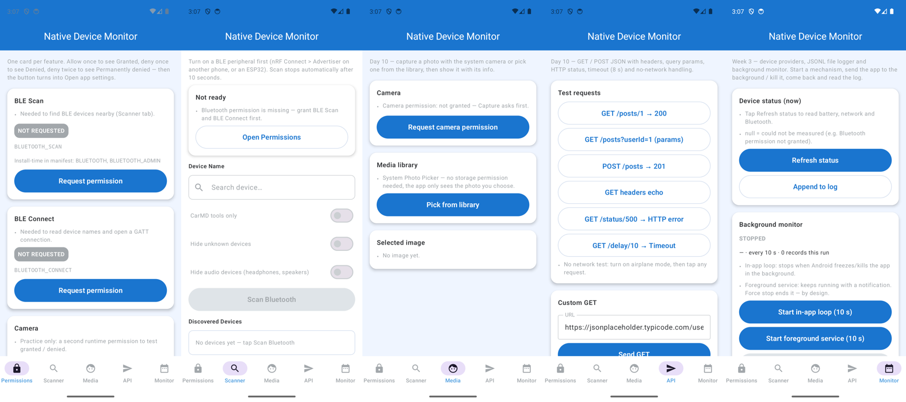
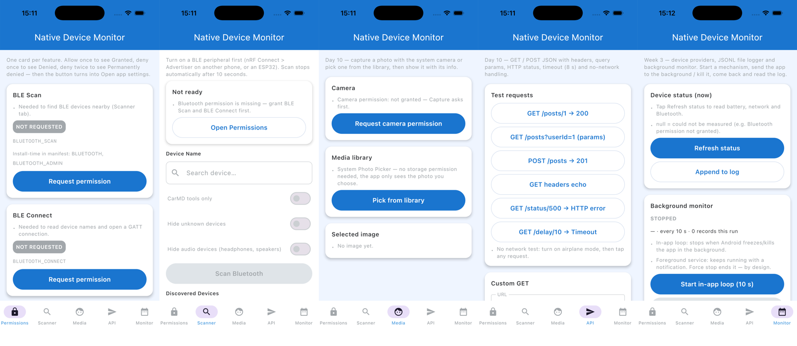

# Native Device Monitor KMP

App `native-device-monitor` cũ (repo private [tucarmd/native-mobile-learning](https://github.com/tucarmd/native-mobile-learning/tree/main/native-device-monitor)) viết **hai lần** (Kotlin + Swift), làm lại thành **một codebase Kotlin** bằng Kotlin Multiplatform + Compose Multiplatform cho Android và iOS. Swift chỉ còn là vỏ iOS (`iosApp/`).

## Đọc theo thứ tự

1. [Kế hoạch + tiến độ](plan/README-KMP-MIGRATION.md): mục tiêu, kiến trúc, phase P0–P7, cái gì đã chạy thật.
2. [App chạy thế nào](README-KMP-HOW-IT-WORKS.md): 6 tầng, app khởi động ai gọi ai, bấm "Scan" hàm nào chạy, KMP gọi SDK nào.
3. [Kế hoạch site này](plan/README-KMP-DOCS-SITE-PLAN.md): site tài liệu được dựng ra sao (S1–S5).

## Module

- `shared/`: thư viện KMP. `commonMain` (UI, model, luật), `androidMain`, `iosMain` (code riêng nền tảng).
- `androidApp/`: app Android, `MainActivity` gọi `App()`.
- `iosApp/`: project Xcode, nhúng framework `Shared`, `ContentView.swift` hiện `MainViewController()`.

## Chạy

```bash
# Android (JDK 17+), từ thư mục gốc repo
./gradlew :androidApp:assembleDebug
adb install -r androidApp/build/outputs/apk/debug/androidApp-debug.apk
adb shell am start -n com.learn.ndmkmp/.MainActivity
```

```bash
# iOS Simulator (hoặc mở iosApp/iosApp.xcodeproj trong Xcode rồi bấm Run)
xcodebuild -project iosApp/iosApp.xcodeproj -scheme iosApp -destination 'platform=iOS Simulator,name=iPhone 17' -derivedDataPath iosApp/build/dd build
xcrun simctl install "iPhone 17" "iosApp/build/dd/Build/Products/Debug-iphonesimulator/Device Monitor KMP.app"
xcrun simctl launch "iPhone 17" com.learn.ndmkmp
```

```bash
./gradlew :shared:allTests   # commonTest trên JVM của Android host + iOS simulator
```

## Ảnh chạy thật

| Android (Pixel 8 emulator, API 34) | iOS (iPhone 17 Simulator, iOS 26.5) |
|---|---|
| { width="200" } | { width="200" } |
