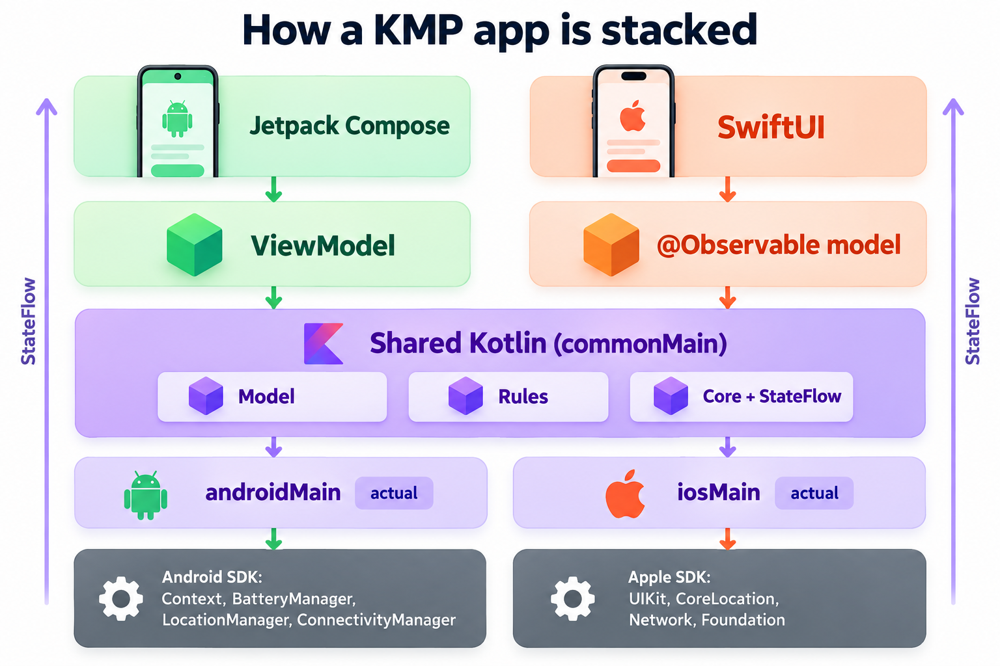
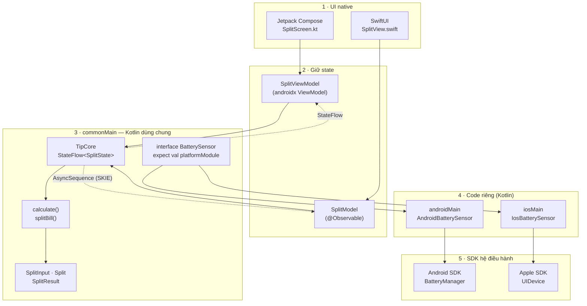
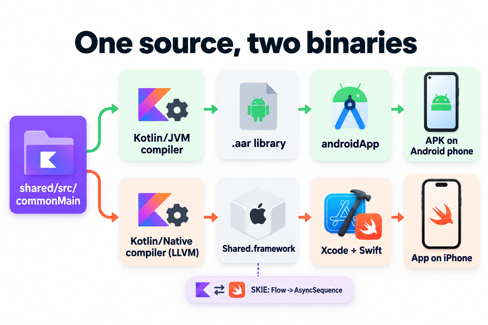
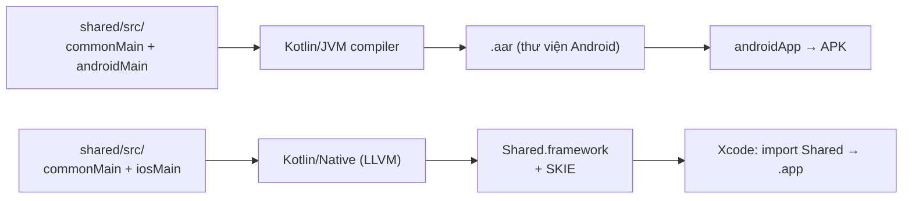
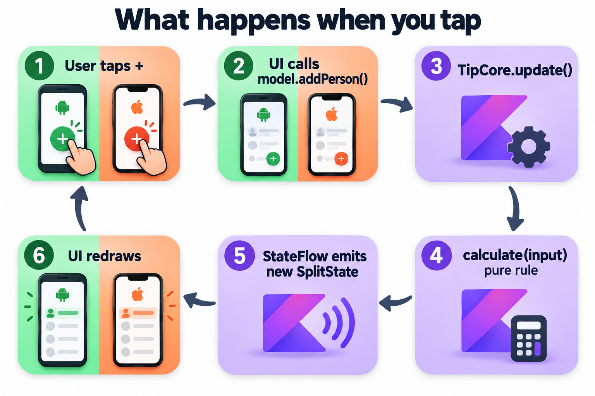
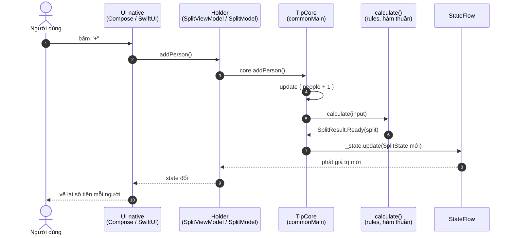
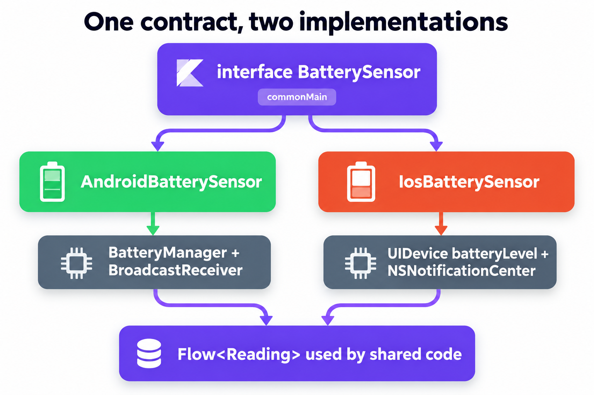
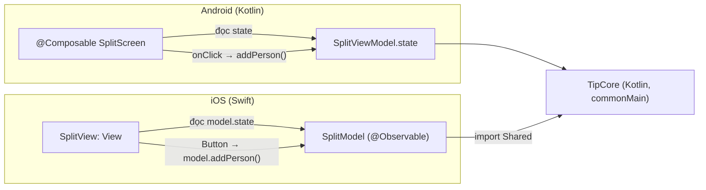

# KMP chạy thế nào: từ nút bấm tới SDK

Trang này vẽ lại một app KMP từ trên xuống dưới: giao diện native ở trên, code Kotlin dùng chung ở giữa, SDK của hệ điều hành ở dưới. Mọi ví dụ lấy từ code thật của [Tip Split](apps/01-tip-split.md) (chỉ có logic) và [Device Pulse](project/index.md) (có pin, GPS, mạng, database).

## Mục tiêu

- Nhìn một sơ đồ là biết code nào nằm tầng nào, tầng nào gọi tầng nào.
- Biết KMP **thật sự chia sẻ cái gì** và **không chia sẻ cái gì**.
- Biết mỗi việc bên dưới (pin, GPS, mạng, HTTP, database) KMP gọi SDK nào trên Android và trên iOS.
- Theo được một lần bấm nút: hàm nào chạy trước, hàm nào chạy sau, dữ liệu quay về UI bằng đường nào.

## 1. Bức tranh tổng: 5 tầng



Đọc từ trên xuống:

| Tầng | Android | iOS | Chung hay riêng? |
|---|---|---|---|
| **1. UI native** | Jetpack Compose (`@Composable`) | SwiftUI (`View`) | riêng, viết 2 lần |
| **2. Giữ state cho UI** | `ViewModel` (androidx) | class `@Observable` | riêng, nhưng chỉ vài dòng chuyển tiếp |
| **3. Code chung** (`commonMain`) | model, luật, core + `StateFlow` | ← cùng một file | **chung, viết 1 lần, test 1 lần** |
| **4. Code riêng nền tảng** (`androidMain` / `iosMain`) | `actual`, class implement interface | `actual`, class implement interface | riêng, viết bằng **Kotlin** |
| **5. SDK hệ điều hành** | Android SDK (Context, BatteryManager…) | Apple SDK (UIKit, CoreLocation…) | của Google / Apple |

!!! tip "Một câu để nhớ"
    UI vẽ bằng **ngôn ngữ của nền tảng** (Kotlin Compose / Swift). Logic viết bằng **Kotlin một lần**. Khi logic cần phần cứng, nó gọi xuống tầng 4, nơi **Kotlin gọi thẳng SDK của Android hoặc Apple**.

Cùng sơ đồ đó dạng mermaid (trỏ chuột vào được, copy được):



## 2. Một nguồn, hai file chạy



Cùng thư mục `shared/` nhưng compiler khác nhau cho mỗi nền tảng:



| | Android | iOS |
|---|---|---|
| Compiler | Kotlin/JVM → bytecode | Kotlin/Native → mã máy ARM64 qua LLVM |
| Thứ UI nhận được | module Gradle `:shared` (`implementation(project(":shared"))`) | `Shared.framework` (static) — Swift `import Shared` |
| Ai đóng gói | Gradle | Gradle build framework, Xcode link vào app |
| Cấu hình ở | [shared/build.gradle.kts:18](https://github.com/tucarmd/kotlin-multi-platform/blob/main/apps/TipSplit/shared/build.gradle.kts#L18) `androidTarget` | [shared/build.gradle.kts:25-34](https://github.com/tucarmd/kotlin-multi-platform/blob/main/apps/TipSplit/shared/build.gradle.kts#L25-L34) `iosArm64` + `iosSimulatorArm64`, `baseName = "Shared"` |

!!! note "Swift không gọi Kotlin trực tiếp"
    Swift chỉ thấy **header Objective-C** mà Kotlin/Native sinh ra trong framework. Vì thế có mấy điểm lệch:
    `Int` của Kotlin thành `Int32`, `List<Int>` thành `[KotlinInt]`, hàm `initKoin()` thành `doInitKoin()`.
    **SKIE** vá phần khó nhất: `StateFlow` thành `AsyncSequence` dùng được với `for await`, `sealed class` thành enum Swift qua `onEnum(of:)`.

## 3. Bấm một nút: hàm nào chạy, theo thứ tự nào



Ví dụ: người dùng bấm **+** (thêm 1 người) trong Tip Split.



Bản đồ từng hàm trong vòng đó:

| # | Hàm | File | Làm gì |
|---|---|---|---|
| 1 | `SplitRoute()` / `SplitView` | [SplitScreen.kt:59](https://github.com/tucarmd/kotlin-multi-platform/blob/main/apps/TipSplit/androidApp/src/main/kotlin/dev/tipsplit/android/ui/SplitScreen.kt#L59) · [SplitView.swift:10](https://github.com/tucarmd/kotlin-multi-platform/blob/main/apps/TipSplit/iosApp/iosApp/Views/SplitView.swift#L10) | vẽ màn hình, nút gọi `viewModel.addPerson()` / `model.addPerson()` |
| 2 | `SplitViewModel.addPerson()` | [SplitViewModel.kt:23](https://github.com/tucarmd/kotlin-multi-platform/blob/main/apps/TipSplit/androidApp/src/main/kotlin/dev/tipsplit/android/ui/SplitViewModel.kt#L23) | chuyển tiếp xuống core, không có logic |
| 2' | `SplitModel.addPerson()` | [SplitModel.swift:34](https://github.com/tucarmd/kotlin-multi-platform/blob/main/apps/TipSplit/iosApp/iosApp/SplitModel.swift#L34) | bản Swift của dòng trên |
| 3 | `TipCore.addPerson()` | [TipCore.kt:43](https://github.com/tucarmd/kotlin-multi-platform/blob/main/apps/TipSplit/shared/src/commonMain/kotlin/dev/tipsplit/core/TipCore.kt#L43) | đổi **input** (people + 1, tối đa 50) |
| 4 | `TipCore.update()` | [TipCore.kt:53](https://github.com/tucarmd/kotlin-multi-platform/blob/main/apps/TipSplit/shared/src/commonMain/kotlin/dev/tipsplit/core/TipCore.kt#L53) | chỗ **duy nhất** ghi state; tính lại toàn bộ kết quả từ input |
| 5 | `calculate()` | [Rules.kt:73](https://github.com/tucarmd/kotlin-multi-platform/blob/main/apps/TipSplit/shared/src/commonMain/kotlin/dev/tipsplit/rules/Rules.kt#L73) | input thô → `Waiting` / `Invalid` / `Ready` |
| 5a | `validate()` | [Rules.kt:36](https://github.com/tucarmd/kotlin-multi-platform/blob/main/apps/TipSplit/shared/src/commonMain/kotlin/dev/tipsplit/rules/Rules.kt#L36) | bắt lỗi nhập (không phải số, ≤ 0, quá lớn…) |
| 5b | `splitBill()` | [Rules.kt:54](https://github.com/tucarmd/kotlin-multi-platform/blob/main/apps/TipSplit/shared/src/commonMain/kotlin/dev/tipsplit/rules/Rules.kt#L54) | tính tip, tổng, làm tròn lên mỗi phần |
| 6 | `state` (StateFlow) | [TipCore.kt:33](https://github.com/tucarmd/kotlin-multi-platform/blob/main/apps/TipSplit/shared/src/commonMain/kotlin/dev/tipsplit/core/TipCore.kt#L33) | phát `SplitState` mới cho ai đang nghe |
| 7a | `collectAsStateWithLifecycle()` | [SplitScreen.kt:61](https://github.com/tucarmd/kotlin-multi-platform/blob/main/apps/TipSplit/androidApp/src/main/kotlin/dev/tipsplit/android/ui/SplitScreen.kt#L61) | Android: Flow → Compose `State` → recompose |
| 7b | `for await state in core.state` | [SplitModel.swift:27](https://github.com/tucarmd/kotlin-multi-platform/blob/main/apps/TipSplit/iosApp/iosApp/SplitModel.swift#L27) | iOS: gán vào property `@Observable` → SwiftUI vẽ lại |

Bước 3 → 6 là **cùng một đoạn bytecode/mã máy** trên cả hai máy. Chỉ bước 1, 2, 7 là viết hai lần.

### Lúc app khởi động: ai tạo ra TipCore?

```mermaid
sequenceDiagram
    participant A as TipSplitApp.onCreate()<br/>(Android)
    participant I as iOSApp.init()<br/>(Swift)
    participant K as initKoin()<br/>(commonMain)
    participant M as commonModule + platformModule
    A->>K: initKoin { androidContext(this); modules(appModule) }
    I->>K: doInitKoin()
    K->>M: startKoin { modules(commonModule, platformModule) }
    Note over M: singleOf(::TipCore) — một TipCore cho cả app
    A-->>A: koinViewModel() → SplitViewModel(core)
    I-->>I: tipCore() → SplitModel(core:)
```

| Hàm | File | Ghi chú |
|---|---|---|
| `TipSplitApp.onCreate()` | [TipSplitApp.kt:22](https://github.com/tucarmd/kotlin-multi-platform/blob/main/apps/TipSplit/androidApp/src/main/kotlin/dev/tipsplit/android/TipSplitApp.kt#L22) | Android khởi động Koin ở `Application`, không phải `Activity` (xoay màn hình là Activity bị tạo lại) |
| `iOSApp.init()` | [iOSApp.swift:14](https://github.com/tucarmd/kotlin-multi-platform/blob/main/apps/TipSplit/iosApp/iosApp/iOSApp.swift#L14) | gọi `doInitKoin()` rồi `tipCore()` |
| `initKoin()` | [Koin.kt:35](https://github.com/tucarmd/kotlin-multi-platform/blob/main/apps/TipSplit/shared/src/commonMain/kotlin/dev/tipsplit/di/Koin.kt#L35) | cùng một hàm cho cả hai bên |
| `expect val platformModule` | [Koin.kt:32](https://github.com/tucarmd/kotlin-multi-platform/blob/main/apps/TipSplit/shared/src/commonMain/kotlin/dev/tipsplit/di/Koin.kt#L32) | mỗi nền tảng phải có `actual` |
| `tipCore()` | [KoinIos.kt:15](https://github.com/tucarmd/kotlin-multi-platform/blob/main/apps/TipSplit/shared/src/iosMain/kotlin/dev/tipsplit/di/KoinIos.kt#L15) | cửa cho Swift, vì Swift không gọi được `get<T>()` (reified) |

## 4. KMP gọi SDK nào bên dưới



Code chung chỉ biết **interface** ([Sensors.kt:11-21](https://github.com/tucarmd/kotlin-multi-platform/blob/main/apps/DevicePulse/shared/src/commonMain/kotlin/dev/devicepulse/sensor/Sensors.kt#L11-L21)). Bên dưới, mỗi nền tảng có một class Kotlin gọi thẳng SDK của nó, rồi gói kết quả thành `Flow` bằng `callbackFlow { … awaitClose { … } }`.

### Bảng SDK — lấy từ code Device Pulse

| Việc | Code chung thấy | Android: class → SDK | iOS: class → SDK |
|---|---|---|---|
| **Pin** | `BatterySensor.observe()` | [AndroidBatterySensor](https://github.com/tucarmd/kotlin-multi-platform/blob/main/apps/DevicePulse/shared/src/androidMain/kotlin/dev/devicepulse/sensor/AndroidBatterySensor.kt#L25) → `BroadcastReceiver` + `Intent.ACTION_BATTERY_CHANGED`, `BatteryManager` | [IosBatterySensor](https://github.com/tucarmd/kotlin-multi-platform/blob/main/apps/DevicePulse/shared/src/iosMain/kotlin/dev/devicepulse/sensor/IosBatterySensor.kt#L22) → `platform.UIKit.UIDevice.batteryLevel`, `NSNotificationCenter` |
| **GPS** | `LocationSensor.observe()` | [AndroidLocationSensor](https://github.com/tucarmd/kotlin-multi-platform/blob/main/apps/DevicePulse/shared/src/androidMain/kotlin/dev/devicepulse/sensor/AndroidLocationSensor.kt#L46) → `LocationManager.requestLocationUpdates`, `LocationListener` | [IosLocationSensor](https://github.com/tucarmd/kotlin-multi-platform/blob/main/apps/DevicePulse/shared/src/iosMain/kotlin/dev/devicepulse/sensor/IosLocationSensor.kt#L35) → `platform.CoreLocation.CLLocationManager`, delegate `CLLocationManagerDelegateProtocol` |
| **Mạng có/không** | `NetworkSensor.observe()` | [AndroidNetworkSensor](https://github.com/tucarmd/kotlin-multi-platform/blob/main/apps/DevicePulse/shared/src/androidMain/kotlin/dev/devicepulse/sensor/AndroidNetworkSensor.kt#L33) → `ConnectivityManager.registerDefaultNetworkCallback`, `NetworkCapabilities` | [IosNetworkSensor](https://github.com/tucarmd/kotlin-multi-platform/blob/main/apps/DevicePulse/shared/src/iosMain/kotlin/dev/devicepulse/sensor/IosNetworkSensor.kt#L30) → `platform.Network.nw_path_monitor_*` (Network.framework) |
| **Gọi HTTP** | `HttpClient` của Ktor (API giống nhau) | [engine `OkHttp`](https://github.com/tucarmd/kotlin-multi-platform/blob/main/apps/DevicePulse/shared/src/androidMain/kotlin/dev/devicepulse/di/PlatformModule.android.kt#L24) → OkHttp trên Android | [engine `Darwin`](https://github.com/tucarmd/kotlin-multi-platform/blob/main/apps/DevicePulse/shared/src/iosMain/kotlin/dev/devicepulse/di/PlatformModule.ios.kt#L23) → `NSURLSession` của Apple |
| **Database** | SQLDelight: query sinh từ file `.sq` | [`AndroidSqliteDriver`](https://github.com/tucarmd/kotlin-multi-platform/blob/main/apps/DevicePulse/shared/src/androidMain/kotlin/dev/devicepulse/di/PlatformModule.android.kt#L26) → SQLite của Android (cần `Context`) | [`NativeSqliteDriver`](https://github.com/tucarmd/kotlin-multi-platform/blob/main/apps/DevicePulse/shared/src/iosMain/kotlin/dev/devicepulse/di/PlatformModule.ios.kt#L24) → `libsqlite3` có sẵn trong iOS |
| **Coroutine / thread** | `kotlinx.coroutines`, `Dispatchers.Main` | Main = `Looper` chính của Android | Main = main queue (GCD) của iOS |
| **DI** | Koin `commonModule` | + `koin-android` (`androidContext`) | không cần thêm gì |

Ghi nhớ:

- Thư viện **multiplatform** (coroutines, Koin core, Ktor core, SQLDelight runtime) → đặt ở `commonMain`.
- Thứ **đụng tới SDK** (driver SQLite, engine HTTP, sensor) → đặt ở `androidMain` / `iosMain`, rồi bind vào `platformModule` ([Android](https://github.com/tucarmd/kotlin-multi-platform/blob/main/apps/DevicePulse/shared/src/androidMain/kotlin/dev/devicepulse/di/PlatformModule.android.kt#L20) · [iOS](https://github.com/tucarmd/kotlin-multi-platform/blob/main/apps/DevicePulse/shared/src/iosMain/kotlin/dev/devicepulse/di/PlatformModule.ios.kt#L19)).
- Trong `iosMain`, Kotlin import Apple API bằng tiền tố `platform.` (`platform.UIKit`, `platform.CoreLocation`, `platform.Foundation`, `platform.Network`). Không cần Swift.

### Hai cách nói "mỗi nền tảng làm một kiểu"

| Cách | Dùng khi | Ví dụ trong repo |
|---|---|---|
| `expect` / `actual` | một khai báo nhỏ, compiler phải bắt mỗi nền tảng có đủ | `expect val platformModule` |
| `interface` + class riêng + Koin | việc có trạng thái, cần thay bằng bản giả khi test | `BatterySensor` ← `AndroidBatterySensor` / `IosBatterySensor` |

## 5. Tầng trên: KMP nối với UI ra sao

Phần này trả lời: **UI native liên hệ gì với code bên dưới?** Ngắn gọn: UI **không bao giờ** gọi SDK hay luật trực tiếp. Nó chỉ làm 2 việc: **đọc state** và **gửi hành động**.



### So sánh hai UI native với code bên dưới

| Câu hỏi | Android: Jetpack Compose (Kotlin) | iOS: SwiftUI (Swift) |
|---|---|---|
| Ngôn ngữ UI | Kotlin — **cùng ngôn ngữ** với shared | Swift — **khác ngôn ngữ**, gọi qua framework |
| Dùng code shared bằng | phụ thuộc Gradle `project(":shared")`, gọi như class Kotlin thường | `import Shared` (framework do Kotlin/Native sinh) |
| Lấy TipCore ở đâu | `koinViewModel()` → Koin tạo `SplitViewModel(core)` | `tipCore()` trong `iosMain` (Swift không gọi được `get<T>()`) |
| Holder giữ state | `androidx.lifecycle.ViewModel` (sống qua xoay màn hình) | `@Observable final class` (iOS không có ViewModel) |
| Đọc `StateFlow` | `collectAsStateWithLifecycle()` | `for await` nhờ SKIE biến Flow thành `AsyncSequence` |
| Rẽ nhánh `sealed class SplitResult` | `when (result) { is Ready -> … }` | `switch onEnum(of: result) { case .ready(let r): … }` |
| Kiểu số | `Int`, `Long` như cũ | `Int32`, `Int64`; `List<Int>` thành `[KotlinInt]` → đổi một lần trong holder |
| Xin quyền (GPS…) | ở UI Android (`LocationPermission.kt`) | ở UI iOS / `Info.plist` |
| Chuỗi hiển thị | `Labels.kt` (Android) | `Labels.swift` (iOS) — core chỉ trả `InputError`, **không giữ chữ** |

!!! warning "Vì sao UI không được tính gì?"
    Nếu Compose tự tính tiền tip còn SwiftUI cũng tự tính, hai app sẽ có lúc ra **hai con số khác nhau**. Luật nằm ở `commonMain`, được test một lần ở `commonTest` (chạy cả JVM lẫn iOS Simulator). UI chỉ hiện kết quả.

### Còn cách thứ hai: Compose Multiplatform

Tip Split chọn **UI native hai bên** (Compose + SwiftUI). Lộ trình chính (Device Pulse ở các bài 6–8) có nói tới **Compose Multiplatform**: viết UI Compose một lần trong `composeApp/commonMain`, iOS hiển thị qua `MainViewController()`.

| | UI native hai bên (Tip Split) | Compose Multiplatform |
|---|---|---|
| Chia sẻ | logic | logic **và** UI |
| iOS trông | đúng chất iOS (SwiftUI) | Compose vẽ trên iOS (Skia) |
| Code Swift | màn hình + holder | gần như chỉ có `ContentView` bọc `MainViewController()` |
| Hợp khi | team có dev iOS, cần UI thuần Apple | team nhỏ, muốn ra cả hai nhanh |

## Kiểm tra

- [ ] Chỉ vào sơ đồ 5 tầng, nói được `TipCore`, `SplitViewModel`, `AndroidBatterySensor`, `UIDevice` thuộc tầng nào.
- [ ] Kể được thứ tự hàm chạy khi bấm "+" (ít nhất 5 bước).
- [ ] Nói được trên iOS, Ktor gọi HTTP bằng gì và SQLDelight dùng SQLite của ai.
- [ ] Giải thích được vì sao Swift gọi `doInitKoin()` chứ không phải `initKoin()`, và vì sao cần `tipCore()`.
- [ ] Nói được 3 chỗ khác nhau giữa cách Compose và SwiftUI đọc state từ shared.

## Tiếp theo?

- [Bài 3: cấu trúc project](lessons/03-project-structure.md) — source set, target, hierarchy.
- [Bài 4: chia sẻ code](lessons/04-share-code.md) — `expect` / `actual`, model và luật.
- [Bài 8: ViewModel và điều hướng](lessons/08-viewmodel-navigation.md) — chỗ giữ state.
- [Bài 9: đọc pin](lessons/09-battery.md) — lần đầu xuống tới SDK.

## Docs gốc

[Project structure](https://kotlinlang.org/docs/multiplatform/multiplatform-discover-project.html) · [Expected and actual declarations](https://kotlinlang.org/docs/multiplatform/multiplatform-expect-actual.html) · [Interoperability with Swift/Objective-C](https://kotlinlang.org/docs/native-objc-interop.html) · [SKIE](https://skie.touchlab.co/)
