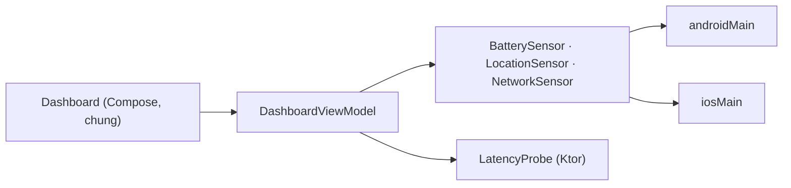

# KMP là gì, khi nào dùng

Kotlin Multiplatform (KMP) cho bạn viết **một lần** phần logic bằng Kotlin, rồi dùng lại trên Android, iOS và các nền tảng khác.
Phần giao diện thì tuỳ bạn: dùng chung luôn bằng Compose Multiplatform, hoặc giữ UI native riêng từng nền tảng.
Suốt lộ trình, bạn dựng **Device Pulse** — app đọc pin, vị trí GPS và mạng trên Android lẫn iOS.

## Mục tiêu

- Hiểu KMP chia sẻ **cái gì** và **không** chia sẻ cái gì.
- Biết khi nào nên chọn KMP thay vì Flutter, React Native hay viết native hai lần.
- Hiểu Device Pulse làm gì và vì sao nó là bài tập KMP tốt.

## KMP chia sẻ những gì

Một app thường có ba lớp:

| Lớp | Ví dụ | Chia sẻ bằng KMP? |
|---|---|---|
| Logic nghiệp vụ | phân loại mức pin, chấm điểm độ trễ, gọi API, lưu DB | **Có** — đây là lý do chính để dùng KMP |
| Giao diện | màn hình, nút, điều hướng | **Tuỳ chọn** — Compose Multiplatform, hoặc SwiftUI/Jetpack Compose riêng |
| API riêng của máy | pin, GPS, mạng, Bluetooth, camera | **Không trực tiếp** — viết phần riêng rồi nối bằng interface hoặc `expect`/`actual` |

Code Kotlin được biên dịch ra đúng thứ mỗi nền tảng hiểu: bytecode JVM cho Android, mã máy native (framework) cho iOS.
Không có máy ảo hay lớp runtime chen vào giữa trên iOS.

## Hai kiểu app

=== "Chia sẻ cả UI (Compose Multiplatform)"

    Logic **và** giao diện viết một lần. Ít code nhất, giao diện giống nhau trên mọi máy.
    Compose Multiplatform đã stable trên iOS. **Device Pulse chọn kiểu này.**

=== "Chỉ chia sẻ logic, UI native"

    Logic chung trong module `shared`; Android dùng Jetpack Compose, iOS dùng SwiftUI.
    Hợp khi đã có đội iOS/Android riêng, hoặc cần cảm giác native tuyệt đối.

## So nhanh với các lựa chọn khác

| Lựa chọn | Ngôn ngữ | Gọi API của máy | Ghi chú |
|---|---|---|---|
| Native hai lần | Kotlin + Swift | trực tiếp | viết mọi thứ 2 lần |
| Flutter | Dart | qua plugin / platform channel | UI tự vẽ, có runtime riêng |
| React Native | JavaScript/TS | qua native module | có lớp runtime JS |
| **KMP** | Kotlin | **gọi thẳng** Android SDK và API Apple từ Kotlin | chia sẻ ít hay nhiều đều được, chuyển dần từ app Android có sẵn |

Chọn KMP khi: đội đã quen Kotlin, cần logic giống hệt nhau trên hai nền tảng, và vẫn muốn chạm sâu vào API native.

## Device Pulse là gì

Một màn Dashboard với ba thẻ, cập nhật trực tiếp:

- **Pin** — phần trăm và trạng thái sạc; cảnh báo khi thấp.
- **Vị trí** — vĩ độ, kinh độ, độ chính xác, tốc độ; chấm chất lượng tín hiệu GPS.
- **Mạng** — Wi-Fi / di động / không có mạng, kèm **độ trễ HTTP** đo bằng Ktor.

Thêm màn Detail cho từng cảm biến và màn History lưu các lần chụp (snapshot) bằng SQLDelight.
Chi tiết phạm vi xem ở [trang dự án](../project/index.md).

## Vì sao là bài tập KMP tốt

- **Logic chung thật sự:** model (`BatteryInfo`, `LocationFix`, `NetworkStatus`), trạng thái `Reading` và các hàm chấm điểm
  (`batteryLevel`, `fixQuality`, `latencyGrade`) viết một lần trong `commonMain`, test một lần.
- **UI chung:** một Dashboard Compose chạy trên cả hai máy.
- **Phải chạm API riêng:** pin, GPS, mạng mỗi nền tảng một kiểu. Bạn khai báo interface (`BatterySensor`,
  `LocationSensor`, `NetworkSensor`) ở `commonMain` và cài đặt riêng ở `androidMain` / `iosMain` — đúng chỗ KMP mạnh nhất.
- **Gặp lỗi thật:** quyền vị trí bị từ chối, simulator không có pin, mất mạng. App phải xử lý tử tế thay vì crash.

## Làm trên Device Pulse

Chưa code. Viết ra ghi chú ba câu trả lời:

1. Phần nào của Device Pulse nằm trong `commonMain`?
2. Phần nào bắt buộc viết riêng cho Android và iOS?
3. Trên iOS Simulator, đọc pin sẽ ra gì? (Gợi ý: simulator không có pin thật — app hiện "Không hỗ trợ".)

## Kiểm tra

- [ ] Nói được 3 lớp của app và lớp nào nên chia sẻ.
- [ ] Giải thích vì sao Device Pulse chọn Compose Multiplatform.
- [ ] Kể được 3 cảm biến Device Pulse đọc, và biết mỗi cái cần code riêng trên **Android** và **iOS**.
- [ ] Nêu một khác biệt giữa KMP và Flutter / React Native.

## Tiếp theo?

- [Bài 2: cài máy, tạo project đầu tiên](02-setup.md).
- Đọc thêm: [Supported platforms](https://kotlinlang.org/docs/multiplatform/supported-platforms.html) · [FAQ](https://kotlinlang.org/docs/multiplatform/faq.html).

## Docs gốc

[Kotlin Multiplatform overview](https://kotlinlang.org/docs/multiplatform/kmp-overview.html) · [Native and cross-platform](https://kotlinlang.org/docs/multiplatform/native-and-cross-platform.html)
