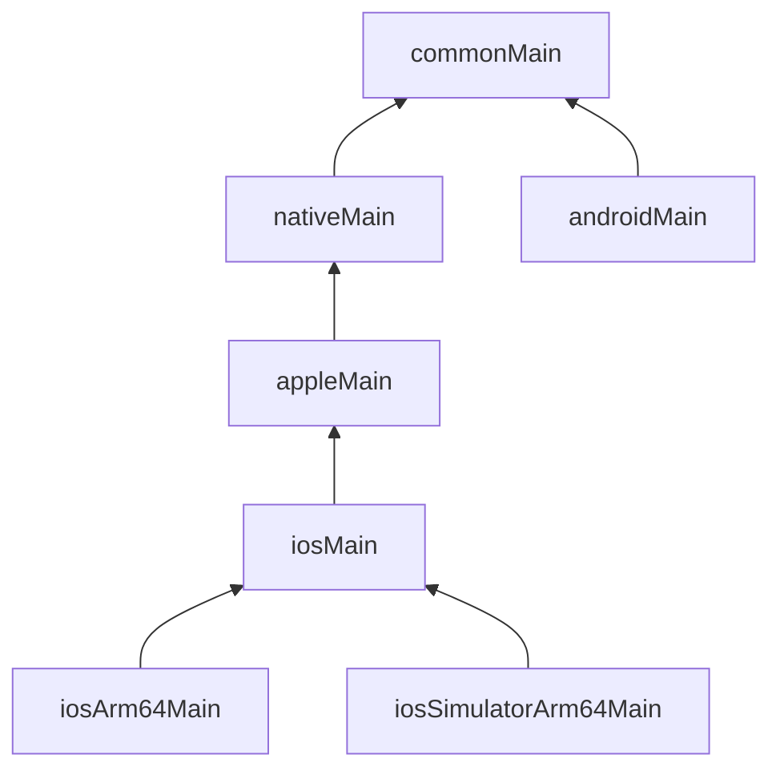

# Cấu trúc project

Trước khi viết tính năng, đọc hiểu project wizard vừa sinh. KMP chỉ có hai khái niệm cần nắm chắc: **target** và **source set**.

## Mục tiêu

- Phân biệt target và source set.
- Đọc được `build.gradle.kts` và `gradle/libs.versions.toml`.
- Biết đặt từng file của Device Pulse vào thư mục nào.

## Cây thư mục

```text
DevicePulse/
├── composeApp/
│   ├── build.gradle.kts        # target + thư viện của module
│   └── src/
│       ├── commonMain/          # code chung: model, rules, UI, ViewModel
│       ├── androidMain/         # MainActivity + code gọi Android SDK
│       ├── iosMain/             # MainViewController + code gọi API Apple
│       └── commonTest/          # test chạy trên mọi target
├── iosApp/                      # project Xcode, chỉ là vỏ gọi framework ComposeApp
├── gradle/libs.versions.toml    # version catalog: phiên bản thư viện, plugin
├── build.gradle.kts             # cấu hình gốc (khai báo plugin)
└── settings.gradle.kts          # danh sách module
```

## Target — "build ra cho máy nào"

Target là một nền tảng đích. Device Pulse có ba:

- `androidTarget()` — Android.
- `iosArm64()` — iPhone thật.
- `iosSimulatorArm64()` — simulator trên Mac chip Apple.

Khai báo trong khối `kotlin { }` của `composeApp/build.gradle.kts`.

## Source set — "code này dùng cho máy nào"

| Source set | Biên dịch cho | Được dùng gì |
|---|---|---|
| `commonMain` | mọi target | chỉ Kotlin chung + thư viện multiplatform |
| `androidMain` | Android | thêm Android SDK (`Context`, `BatteryManager`, `LocationManager`…) |
| `iosMain` | mọi target iOS | thêm API Apple (`platform.UIKit`, `platform.CoreLocation`, `platform.Network`) |
| `commonTest` | test chạy trên mọi target | `kotlin.test` |

## Hierarchy — source set lồng nhau

KMP tự dựng cây source set theo **default hierarchy template**: `iosArm64Main` và `iosSimulatorArm64Main` cùng nằm dưới `iosMain`,
`iosMain` nằm dưới `appleMain` → `nativeMain` → `commonMain`. Nhờ vậy bạn viết code iOS **một lần** trong `iosMain`,
không phải chép cho từng kiến trúc chip.



## Đọc `build.gradle.kts`

Khung thường thấy (rút gọn — file thật của bạn có thể khác tên alias):

```kotlin
kotlin {
    androidTarget()

    listOf(iosArm64(), iosSimulatorArm64()).forEach { target ->
        target.binaries.framework {
            baseName = "ComposeApp"   // tên framework Xcode import
            isStatic = true
        }
    }

    sourceSets {
        commonMain.dependencies { /* thư viện dùng chung */ }
        androidMain.dependencies { /* chỉ Android */ }
        iosMain.dependencies { /* chỉ iOS */ }
        commonTest.dependencies { implementation(libs.kotlin.test) }
    }
}
```

`gradle/libs.versions.toml` giữ phiên bản; Gradle sinh ra accessor `libs.…` để dùng ở trên. Bài 5 thêm thư viện qua file này.

## Làm trên Device Pulse

Tạo sẵn các package trong `composeApp/src/commonMain/kotlin/dev/devicepulse/`:

| Package | Chứa gì | Bài |
|---|---|---|
| `model/` | `BatteryInfo`, `LocationFix`, `NetworkStatus`, `Reading`, `SensorKind` | 4 |
| `rules/` | hàm thuần `batteryLevel`, `fixQuality`, `latencyGrade` | 4 |
| `sensor/` | interface `BatterySensor`, `LocationSensor`, `NetworkSensor` | 4 |
| `ui/` | Dashboard, Detail, `DashboardViewModel` | 6–8 |
| `data/` | `LatencyProbe`, `HistoryRepository` | 11–12 |

Code cài đặt cảm biến thật sẽ nằm trong `androidMain/kotlin/dev/devicepulse/sensor/` và `iosMain/kotlin/dev/devicepulse/sensor/`.

Thử nhanh: tạo file tạm trong `commonMain/.../model/`, gõ `import android.content.Context` — IDE báo đỏ.
Đó là `commonMain` đang bảo vệ bạn. Xoá file tạm đi.

## Kiểm tra

- [ ] Chỉ ra được dòng khai báo `androidTarget()` và hai target iOS trong Gradle.
- [ ] Giải thích được vì sao `LocationFix` nằm ở `commonMain`, còn code gọi `CLLocationManager` nằm ở `iosMain`.
- [ ] Sau khi tạo package, app vẫn build và chạy trên **Android** và **iOS**.

## Tiếp theo?

- [Bài 4: chia sẻ code giữa các nền tảng](04-share-code.md).
- Đọc thêm: [Module structure recommendations](https://kotlinlang.org/docs/multiplatform/multiplatform-project-recommended-structure.html) · [Project organization options](https://kotlinlang.org/docs/multiplatform/multiplatform-project-configuration.html).

## Docs gốc

[Targets and source sets](https://kotlinlang.org/docs/multiplatform/multiplatform-discover-project.html) · [Source set hierarchy](https://kotlinlang.org/docs/multiplatform/multiplatform-hierarchy.html) · [Dependencies between source sets](https://kotlinlang.org/docs/multiplatform/multiplatform-advanced-project-structure.html)
