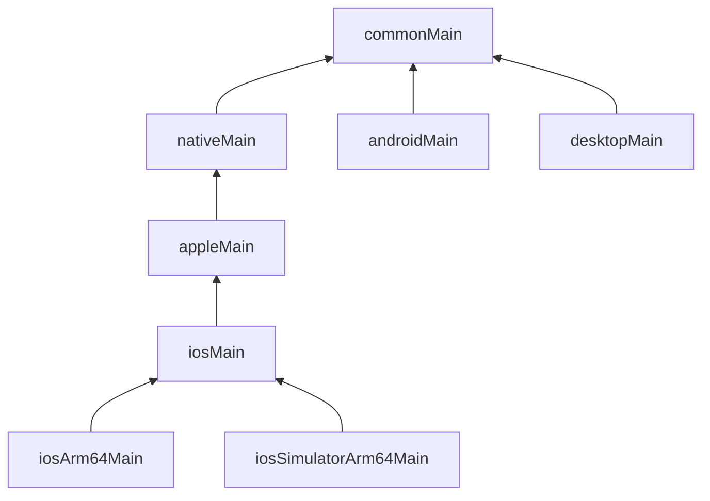

# Cấu trúc project

Trước khi viết tính năng, đọc hiểu project wizard vừa sinh. KMP chỉ có hai khái niệm cần nắm chắc: **target** và **source set**.

## Mục tiêu

- Phân biệt target và source set.
- Biết đặt code mới vào thư mục nào.

## Target — "build ra cho máy nào"

Target là một nền tảng đích: `android`, `iosArm64` (iPhone thật), `iosSimulatorArm64` (simulator trên Mac chip M), `jvm("desktop")`…
Khai báo trong khối `kotlin { }` của `composeApp/build.gradle.kts`.

## Source set — "code này dùng cho máy nào"

Mỗi thư mục trong `src/` là một source set:

| Source set | Biên dịch cho | Được dùng gì |
|---|---|---|
| `commonMain` | mọi target | chỉ Kotlin chung + thư viện multiplatform |
| `androidMain` | Android | thêm Android SDK (`Context`, `Activity`…) |
| `iosMain` | mọi target iOS | thêm API Apple (`platform.UIKit`, `platform.Foundation`) |
| `desktopMain` | JVM desktop | thêm thư viện Java |
| `commonTest` | test chạy trên mọi target | `kotlin.test` |

## Hierarchy — source set lồng nhau

KMP tự dựng cây source set theo **default hierarchy template**: `iosArm64Main` và `iosSimulatorArm64Main` cùng nằm dưới `iosMain`,
`iosMain` nằm dưới `appleMain` → `nativeMain` → `commonMain`. Nhờ vậy bạn viết code iOS **một lần** trong `iosMain`,
không phải chép cho từng kiến trúc chip.



## Đọc `build.gradle.kts`

Khung thường thấy (rút gọn — file thật của bạn có thể khác tên alias):

```kotlin
kotlin {
    // các target: android, iOS (framework cho Xcode), desktop
    listOf(iosArm64(), iosSimulatorArm64()).forEach { target ->
        target.binaries.framework {
            baseName = "ComposeApp"   // tên framework Xcode import
            isStatic = true
        }
    }
    jvm("desktop")

    sourceSets {
        commonMain.dependencies { /* thư viện dùng chung */ }
        androidMain.dependencies { /* chỉ Android */ }
    }
}
```

## Làm trên app MVP

Tạo package `dev.habittick.model` trong `commonMain`, thêm:

```kotlin
data class Habit(
    val id: Long,
    val title: String,
    val doneDates: Set<String> = emptySet(), // "2026-10-14"
)
```

Thử import `android.content.Context` trong file này — IDE báo đỏ. Đó là `commonMain` đang bảo vệ bạn.

## Kiểm tra

- [ ] Giải thích được vì sao `Habit` nằm ở `commonMain`.
- [ ] Chỉ ra được dòng khai báo target iOS trong Gradle.

## Tiếp theo?

- [Bài 4: chia sẻ code giữa các nền tảng](04-share-code.md).
- Đọc thêm: [Module structure recommendations](https://kotlinlang.org/docs/multiplatform/multiplatform-project-recommended-structure.html) · [Project organization options](https://kotlinlang.org/docs/multiplatform/multiplatform-project-configuration.html).

## Docs gốc

[Targets and source sets](https://kotlinlang.org/docs/multiplatform/multiplatform-discover-project.html) · [Source set hierarchy](https://kotlinlang.org/docs/multiplatform/multiplatform-hierarchy.html) · [Dependencies between source sets](https://kotlinlang.org/docs/multiplatform/multiplatform-advanced-project-structure.html)
